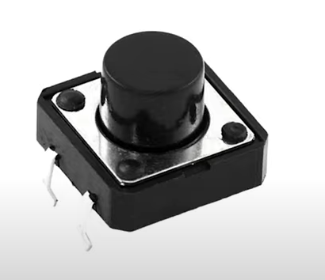
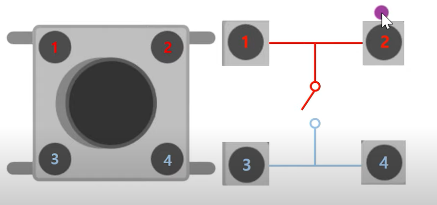
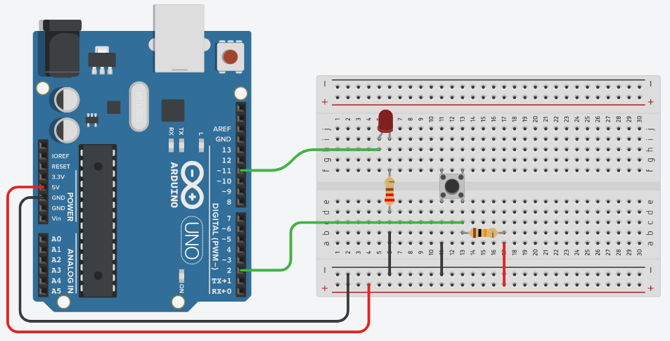
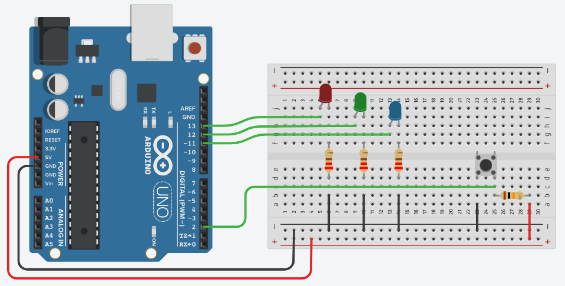

# 046_딸깍스위치_택트버튼다루기 🎹🎶


**도로시와 지니가 함께하는 손가락으로 누르는 순간 아두이노가 반응하는 디지털 입력 기초와 택트 스위치 완벽 정복**

* 👧 **도로시**: "교수님! 지니야! 전등 스위치나 게임기 조종기처럼, 내가 손가락으로 꾹 눌렀을 때만 LED 불이 켜지게 만들고 싶어!"
* **👨‍🏫 이호진 교수님**: "그게 바로 메이커들이 가장 사랑하는 **택트 스위치(Tactile Push Button)** 란다! 손가락으로 누르면 접점이 닫혀 전기가 통하고, 손을 떼면 스프링 힘으로 전기가 끊어지는 가장 친근한 디지털 입력 부품이지!"
* 🐶 **토토**: "바우! 나도 앞발로 꾹꾹 눌러서 전등을 켜보고 싶다 멍!"

* 🖥️ **강의 슬라이드**: [slides.md](./slides.md)

---

## 1. 도로시의 궁금증: 누를 때만 켜지게 할 수 없을까?


### 🔘 인터랙티브(Interactive) 시스템의 시작: 사용자 입력

아두이노가 혼자서 깜빡거리는 것을 넘어, 사람이 누르는 물리적 버튼에 반응하기 시작하면 비로소 진정한 상호작용 기기(게임기 패드, 키보드, 리모컨)가 됩니다.

* **푸시 버튼의 특성**:
  * 누르는 순간에만 연결되는 **모멘터리(Momentary)** 방식입니다.
  * 손을 떼면 내부 판스프링에 의해 원래의 열린(Open) 상태로 자동 복귀합니다.

---

## 2. 스위치(Switch)의 전자기적 기본 원리



### 🌉 회로 중간에 다리를 놓았다가 끊었다가 하는 물리적 개폐기

스위치는 전선 한가운데에 놓인 도개교(Drawbridge)와 같습니다.

```mermaid
graph LR
    subgraph 열린 상태 (Open Circuit - OFF)
        Power1["전원 (+5V)"] --- Break["끊어진 접점 ❌"]
        Break -.-> Ground1["접지 (GND)"]
    end
    subgraph 닫힌 상태 (Closed Circuit - ON)
        Power2["전원 (+5V)"] === Closed["연결된 접점 ✔️"]
        Closed === Ground2["접지 (GND) - 전류 통전!"]
    end
```

* **열린 상태 (Open)**: 회로가 끊어져 전류가 0이 됩니다 (OFF).
* **닫힌 상태 (Closed)**: 회로가 연결되어 전류가 도선을 타고 흐릅니다 (ON).

---

## 3. 게딱지처럼 생긴 택트 스위치는 왜 다리가 4개일까?



### 🦀 마주 보는 다리가 한 쌍! 브레드보드 전용 고정 설계

네모난 꼬마 택트 스위치에는 4개의 은색 다리가 뻗어 있습니다.

* **내부 연결 구조**:
  * 마주 보고 있는 두 다리끼리는 내부에서 **구리 판으로 이미 연결**되어 있습니다 (상단 2개 다리 한 묶음, 하단 2개 다리 한 묶음).
  * 버튼을 누르는 순간 위쪽 묶음과 아래쪽 묶음 사이의 접점이 맞닿으며 4개 다리가 모두 통전됩니다!
* **브레드보드 장착 꿀팁**:
  * 브레드보드 정중앙의 홈(계곡)을 가로지르도록 꽂아야 양쪽 다리가 서로 단락(쇼트)되지 않고 정상 동작합니다.

---

## 4. 스위치와 저항의 필수 앙상블: 전원 쇼트(Short) 방지


### ⚡ 저항 없이 스위치를 5V와 GND에 직결하면 생기는 참사

만약 스위치의 한쪽 다리를 5V에 꽂고 반대쪽 다리를 GND에 꽂은 채 버튼을 꾹 누르면:

* 저항이 0인 상태에서 5V와 GND가 직접 맞닿아 **폭발적인 과전류 합선(Short Circuit)** 이 일어납니다!
* 아두이노 보드의 USB 전원이 순간 차단되어 컴퓨터가 꺼지거나 아두이노가 타버릴 수 있습니다.
* 따라서 스위치 회로에는 전류를 적절히 제한하고 기준 전압을 잡아주는 **풀업 또는 풀다운 저항(10k$\Omega$)** 이 반드시 함께 연결되어야 합니다.

---

## 5. 실습 1: 누르면 켜지고 떼면 꺼지는 기본 스위치 스케치


### 💻 `digitalRead()`로 2번 핀의 상태를 읽어 13번 LED를 제어

```cpp
const int buttonPin = 2; // 스위치 입력 핀
const int ledPin = 13;    // 내장 LED 핀

void setup() {
  pinMode(buttonPin, INPUT); // 2번 핀을 입력으로 설정
  pinMode(ledPin, OUTPUT);   // 13번 핀을 출력으로 설정
  
  Serial.begin(9600);
  Serial.println("택트 스위치 디지털 입력 실습 시작!");
}

void loop() {
  int buttonState = digitalRead(buttonPin); // 2번 핀 전압 읽기 (HIGH 또는 LOW)
  
  if (buttonState == HIGH) {
    digitalWrite(ledPin, HIGH); // 버튼이 눌렸을 때 LED 켜기!
    Serial.println("버튼 눌림: LED ON");
  } else {
    digitalWrite(ledPin, LOW);  // 손을 뗐을 때 LED 끄기!
  }
  
  delay(10); // 바운싱 방지를 위한 짧은 안정화 지연
}
```

---

## 6. 실습 2: 버튼을 누르는 동안 서서히 밝아지는 감성 램프



### 💡 `analogWrite()` PWM과 결합한 점진적 디밍 제어

버튼을 누르고 있는 동안 `for` 반복문으로 PWM 값을 0에서 255까지 증가시켜 부드럽게 밝아지는 램프를 만듭니다.

```cpp
const int buttonPin = 2;
const int ledPin = 11; // PWM 지원 디지털 11번 핀 (~11)

void setup() {
  pinMode(buttonPin, INPUT_PULLUP); // 내부 풀업 사용 (누르면 LOW)
  pinMode(ledPin, OUTPUT);
}

void loop() {
  int buttonState = digitalRead(buttonPin);
  
  if (buttonState == LOW) { // 버튼을 누르고 있는 동안
    for (int brightness = 0; brightness <= 255; brightness += 5) {
      analogWrite(ledPin, brightness); // 점점 밝아짐
      delay(20);
      if (digitalRead(buttonPin) == HIGH) break; // 중간에 손을 떼면 탈출
    }
  } else {
    analogWrite(ledPin, 0); // 버튼에서 손을 떼면 소등
  }
}
```

---

## 7. 실습 3: 배열(Array)을 활용한 다중 LED 동시 제어



### 🚥 버튼 하나로 3색 신호등을 일제히 점등하기

```cpp
const int buttonPin = 2;
const int ledPins[3] = {11, 12, 13}; // 3개 LED 핀 배열

void setup() {
  pinMode(buttonPin, INPUT_PULLUP);
  for (int i = 0; i < 3; i++) {
    pinMode(ledPins[i], OUTPUT);
  }
}

void loop() {
  int buttonState = digitalRead(buttonPin);
  
  if (buttonState == LOW) { // 버튼 눌림
    for (int i = 0; i < 3; i++) digitalWrite(ledPins[i], HIGH); // 전체 켜기
  } else {
    for (int i = 0; i < 3; i++) digitalWrite(ledPins[i], LOW);  // 전체 끄기
  }
}
```

---

## 🌟 도로시와 지니의 핵심 요약 노트!

```cpp
// 택트 스위치 핀의 디지털 전압 상태(HIGH / LOW) 읽기
int buttonState = digitalRead(buttonPin);
```

* 👧 **도로시**: "스위치는 마주 보는 다리가 한 쌍이고, 누르면 회로가 연결되어 `digitalRead()`로 HIGH/LOW를 읽을 수 있구나!"
* **👨‍🏫 이호진 교수님**: "맞아! 그런데 버튼을 누르지 않았을 때 전압이 공중에 붕 뜨는 플로팅(Floating) 현상을 막으려면 **풀업 저항**이 꼭 필요하단다."
* 🐶 **토토**: "바우! 다음 시간에 아두이노 칩 속에 내장된 마법의 **풀업 저항(INPUT_PULLUP)** 을 완벽하게 정복해보자 멍!"
