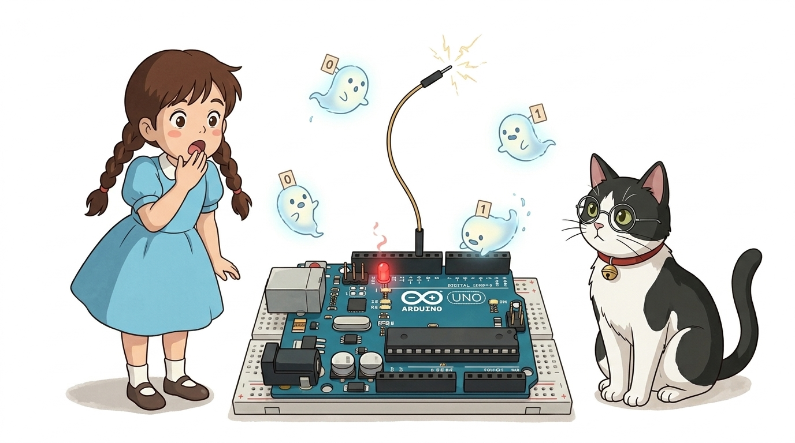
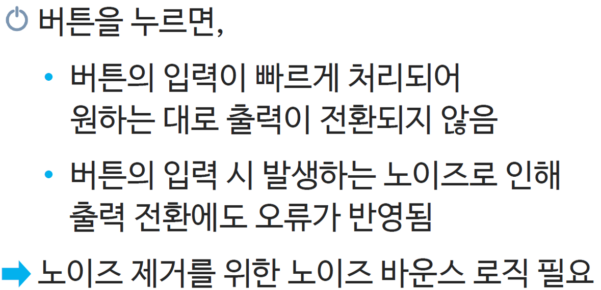
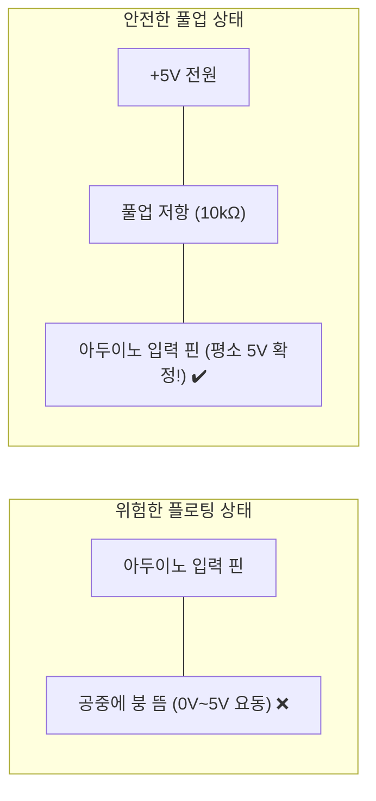
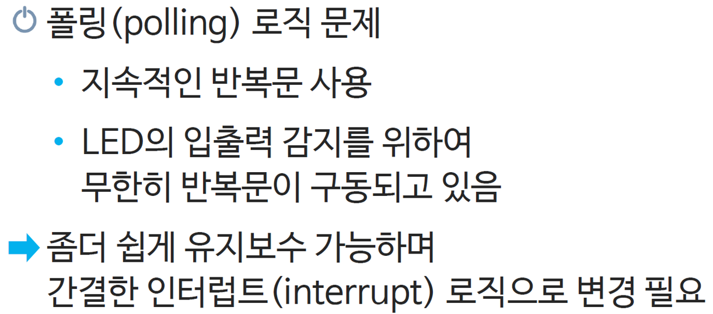
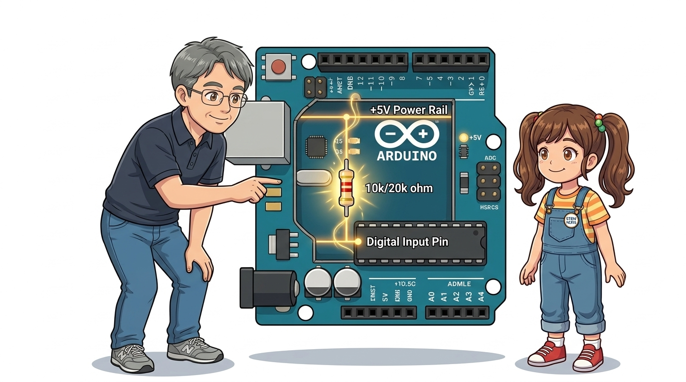
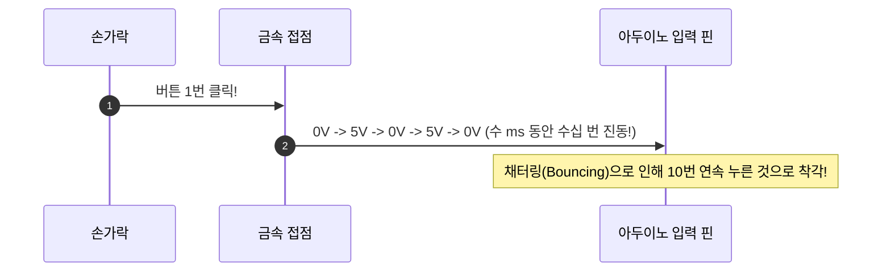

# 047_도깨비신호잡기_풀업저항 🚦🎛️



**도로시와 지니가 함께하는 흔들리는 도깨비 신호를 닻처럼 꽉 잡아주는 풀업 저항과 `INPUT_PULLUP` 완벽 정복**
* 👧 **도로시**: "지니야 큰일 났어! 스위치에 손도 안 댔는데 시리얼 모니터에 0과 1이 도깨비처럼 마구 뒤섞여서 찍혀! 손을 가까이 가져가기만 해도 불이 제멋대로 번쩍거려! 혹시 아두이노에 유령이 들린 거야?!"
* **👨‍🏫 이호진 교수님**: "하하, 유령이 아니라 전자공학의 가장 유명한 불청객인 **'플로팅(Floating, 부유) 현상'** 때문이란다! 전선이 공중에 둥둥 떠서 주변 공기의 미세한 정전기를 안테나처럼 주워 먹고 있는 상태지! 이 도깨비 신호를 닻처럼 바닥이나 천장에 꽉 묶어주는 부품이 바로 **풀업(Pull-up) 저항**이란다!"
* 🐶 **토토**: "바우! 도깨비 신호를 단칼에 쫓아내는 마법의 저항이다 멍!"
* 📖 **상세 강의 교재**: [index.md](./index.md)


> 여러분 안녕하세요! 이번 시간에는 '047. 도깨비신호잡기 풀업저항 🚦🎛️'을 주제로 함께 흥미진진한 탐험을 떠나보겠습니다. 오늘 강의에서는 특히 도로시와 지니가 함께하는 흔들리는 도깨비 신호를 닻처럼 꽉 잡아주는 풀업 저항과 INPUTPULLUP 완벽 정복, 👧 도로시: "지니야 큰일 났어! 스위치에 손도 안 댔는데 시리얼 모니터에 0과 1이 도깨비처럼 마구 뒤섞여서 찍혀! 손을 가까이 가져가기만 해도 불이 제멋대로 번쩍거려! 혹시 아두이노에 유령이 들린 거야?!"를 중심으로 핵심 원리와 응용 방법을 차근차근 배워보겠습니다. 이호진 교수님과 똑똑한 조수 지니, 호기심 많은 도로시와 토토와 함께 신나는 아두이노 모험을 힘차게 시작해 봅시다. 준비되셨나요?

---

## 1. 도로시의 공포: 버튼을 안 눌렀는데 혼자 깜빡이는 이유


* **안테나 효과 (Antenna Effect)**:
* 마이크로컨트롤러 입력 핀의 내부 저항은 $100\text{M}\Omega$ 이상으로 극도로 높아서, 주변 형광등의 교류 자기장이나 사람 손의 미세한 정전기 유도만으로도 전압이 0V에서 5V 사이를 정신없이 오르내립니다.
* **결과**:
* 아두이노가 "HIGH인가? LOW인가?" 혼란에 빠져 1초에 수천 번 0과 1을 번갈아 읽는 오작동을 일으킵니다.

### 👻 공중에 붕 뜬 핀(High Impedance)의 비극
스위치를 5V 전원과 2번 핀 사이에만 달랑 달아놓으면, 스위치를 누르지 않았을 때 2번 핀은 **5V에도, GND(0V)에도 연결되지 않은 허공 상태**가 됩니다.

> 이번 슬라이드에서는 '1. 도로시의 공포: 버튼을 안 눌렀는데 혼자 깜빡이는 이유'에 대해 자세히 살펴보겠습니다. 화면의 다이어그램과 사진을 함께 참고해 주시기 바랍니다. 첫 번째 핵심은 안테나 효과 (Antenna Effect)이며, 두 번째로는 마이크로컨트롤러 입력 핀의 내부 저항은 $100\text{M}\Omega$ 이상으로 극도로 높아서, 주변 형광등의 교류 자기장이나 사람 손의 미세한 정전기 유도만으로도 전압이 0V에서 5V 사이를 정신없이 오르내립니다.입니다. 여기에 덧붙여 아두이노가 "HIGH인가? LOW인가?" 혼란에 빠져 1초에 수천 번 0과 1을 번갈아 읽는 오작동을 일으킵니다. 내용까지 함께 이해해 두시면 완벽합니다. 이 원리는 아두이노 시스템 전체를 관통하는 핵심 논리이므로 머릿속에 꼭 정리해 두시기 바랍니다.

---

## 2. 플로팅(Floating) vs 풀업(Pull-up) 전압 상태 비교



### ⚓ 닻을 내려 기준 전위를 명확히 고정하라!
스위치 회로의 기본 철칙은 **스위치를 떼고 있을 때도 전압이 확실히 5V 또는 0V 중 하나로 고정**되어 있어야 한다는 것입니다.



> 이번 슬라이드에서는 '2. 플로팅(Floating) vs 풀업(Pull-up) 전압 상태 비교'에 대한 실제 동작 코드를 분석해 보겠습니다. 화면의 코드를 살펴보시면, 컴퓨터가 아두이노 하드웨어에 단계별로 명령을 내리는 흐름을 명확하게 확인할 수 있습니다. 각 함수의 역할과 괄호 안의 매개변수가 하드웨어 핀과 어떤 관계를 맺고 동작하는지 주의 깊게 살펴보시기 바랍니다.

---

## 3. 외장 풀업 저항(Pull-up Resistor) 회로의 동작 원리



* [!CAUTION]
* **풀업 회로의 역논리(Negative Logic)**:
* 풀업 회로에서는 **버튼을 누르지 않았을 때가 HIGH(1)** 이고, **버튼을 꾹 눌렀을 때가 LOW(0)** 가 됩니다! 초보자들이 가장 헷갈려하는 부분이므로 꼭 기억하세요.

| 스위치 상태 | 전류의 이동 경로 | 2번 핀 전압 레벨 | `digitalRead(2)` 값 |
| :---: | :--- | :---: | :---: |
| **안 눌렀을 때 (평상시)** | 10k$\Omega$ 저항을 통해 5V 전원과 연결됨 | **5.0 V (HIGH)** | **`HIGH (1)`** |
| **버튼을 꾹 눌렀을 때** | 저항 없는 GND(0V) 경로로 전류가 직행! | **0.0 V (LOW)** | **`LOW (0)`** |

### 📈 평소에는 5V로 당겨두고, 누르면 접지로 방전!
5V 전원과 입력 핀 사이에 **10k$\Omega$ 고정 저항**을 연결하고, 입력 핀과 GND 사이에 스위치를 배치합니다.

> 이번에 살펴볼 내용은 '3. 외장 풀업 저항(Pull-up Resistor) 회로의 동작 원리'입니다. 슬라이드에 정리된 표를 통해 각 항목의 특징과 수치, 차이점을 한눈에 비교해 보실 수 있습니다. 이 기본 개념을 확실히 잡아두셔야 실제 부품을 브레드보드에 꽂고 코딩할 때 실수 없이 완성할 수 있습니다.

---

## 4. 아두이노의 특급 선물: 내부 풀업 저항 `INPUT_PULLUP`



* **배선법**: 스위치의 한쪽 다리를 **디지털 2번 핀**, 다른 쪽 다리를 **아두이노 GND**에 바로 꽂으면 끝납니다!

### 🎁 외장 저항 없이 점퍼선 2가닥으로 끝내는 마법!
매번 브레드보드에 10k$\Omega$ 저항을 꽂고 5V 선을 따오는 것은 번거롭습니다. ATmega328P 칩 내부에는 각 GPIO 핀마다 **약 20k$\Omega$ ~ 50k$\Omega$의 내장 풀업 저항**이 이미 심어져 있습니다!

```cpp
void setup() {
  // 외장 저항 10kΩ 완벽 불필요! 내부 풀업 저항 가동!
  pinMode(2, INPUT_PULLUP);
  pinMode(13, OUTPUT);
}

void loop() {
  int buttonState = digitalRead(2);
  
  // 버튼을 꾹 누르면 접지(GND)로 떨어져 LOW가 됨!
  if (buttonState == LOW) {
    digitalWrite(13, HIGH); // LED 점등
  } else {
    digitalWrite(13, LOW);  // LED 소등
  }
}
```

> 이번 슬라이드에서는 '4. 아두이노의 특급 선물: 내부 풀업 저항 INPUT PULLUP'에 대한 실제 동작 코드를 분석해 보겠습니다. 화면의 코드를 살펴보시면, 컴퓨터가 아두이노 하드웨어에 단계별로 명령을 내리는 흐름을 명확하게 확인할 수 있습니다. 여기서 핵심은 배선법: 스위치의 한쪽 다리를 디지털 2번 핀, 다른 쪽 다리를 아두이노 GND에 바로 꽂으면 끝납니다!입니다. 각 함수의 역할과 괄호 안의 매개변수가 하드웨어 핀과 어떤 관계를 맺고 동작하는지 주의 깊게 살펴보시기 바랍니다.

---

## 5. 기계식 스위치의 잔상: 채터링(Chattering)과 디바운싱


* **소프트웨어 디바운싱(Debounce) 해결법**:
* 버튼이 눌린 것을 감지한 직후 `delay(30~50);`의 짧은 안정화 시간을 주어 금속의 기계적 떨림이 완전히 잦아든 뒤 신호를 확정합니다.

### 🔨 1번 눌렀는데 10번 카운트되는 바운싱 현상 해결법
스위치 내부의 금속 접점은 스프링 탄성 때문에 닿는 찰나의 순간(수 ms) 동안 미세하게 튀면서 수십 번 붙었다 떨어졌다를 반복합니다.



> 이번 슬라이드에서는 '5. 기계식 스위치의 잔상: 채터링(Chattering)과 디바운싱'에 대한 실제 동작 코드를 분석해 보겠습니다. 화면의 코드를 살펴보시면, 컴퓨터가 아두이노 하드웨어에 단계별로 명령을 내리는 흐름을 명확하게 확인할 수 있습니다. 여기서 핵심은 소프트웨어 디바운싱(Debounce) 해결법입니다. 각 함수의 역할과 괄호 안의 매개변수가 하드웨어 핀과 어떤 관계를 맺고 동작하는지 주의 깊게 살펴보시기 바랍니다.

---

## 🌟 도로시와 지니의 핵심 요약 노트!


* 👧 **도로시**: "플로팅은 핀이 공중에 떠서 노이즈를 타는 거였고, `pinMode(2, INPUT_PULLUP)` 한 줄만 쓰면 외부 저항 없이도 스위치와 GND 연결만으로 도깨비 신호를 완벽히 잡을 수 있구나!"
* **👨‍🏫 이호진 교수님**: "맞아! 풀업에서는 누르면 LOW, 떼면 HIGH라는 역논리만 익숙해지면 어떤 버튼 회로든 가장 안전하게 만들 수 있단다."
* 🐶 **토토**: "바우! 이제 버튼을 누르면 경쾌한 멜로디가 삑- 울리는 **부저 스위치**를 만들러 가보자 멍!"

> 오늘 배운 '🌟 도로시와 지니의 핵심 요약 노트!'의 핵심 내용을 모두 정리해 보았습니다. 오늘 다룬 내용 중에서도 👧 도로시: "플로팅은 핀이 공중에 떠서 노이즈를 타는 거였고, pinMode(2, INPUTPULLUP) 한 줄만 쓰면 외부 저항 없이도 스위치와 GND 연결만으로 도깨비 신호를 완벽히 잡을 수 있구나!" 부분은 앞으로의 아두이노 실습과 프로젝트에서 계속 사용되는 매우 중요한 기초 지식입니다. 오늘 배운 내용을 꼭 다시 한번 복습해 보시고, 다음 강의에서 더욱 신나고 유익한 모험으로 다시 만나겠습니다. 모두 수고 많으셨습니다!