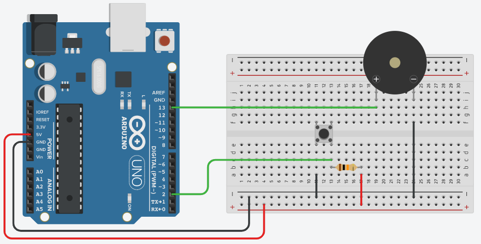

# 048_부저스위치_스마트초인종 🔔

> **초인종의 원리! 스위치 입력과 부저 출력을 결합한 소리 제어 프로젝트**  
> 버튼을 누르면 즉각 반응하는 스마트 알림 장치를 직접 제작해 봅니다.


* 🖥️ **강의 슬라이드**: [slides.md](./slides.md)

---

## 👧 도로시의 아이디어: "우리 집 전자 벨 만들기!"

어느 날 오즈의 마법사 오두막집에 손님이 찾아왔지만, 똑똑 노크 소리가 바람 소리에 묻혀 도로시가 듣지 못했어요!

> **👧 도로시**: "교수님! 지니야! 손님이 문앞에서 벨을 꾹 누르면 집안 가득 '딩동~' 소리가 울리는 전자 초인종을 만들고 싶어!"  
> **👨‍🏫 이호진 교수님**: "정말 실용적인 아이디어야! 우리가 배운 **스위치(입력 장치)** 와 **피에조 부저(출력 장치)** 를 아두이노에 함께 연결하면 멋진 초인종이 완성된단다!"  
> **🐶 토토**: "멍멍! (누가 오면 내가 부저 소리를 듣고 먼저 꼬리를 흔들게!)"


> [!NOTE]
> **입력과 출력(I/O)의 완벽한 상호작용**  
> 아두이노는 스위치가 눌렸는지(입력) 1초에 수만 번 감시하다가, 신호가 들어오는 즉시 부저(출력)를 울려 주변 사람들에게 알려줍니다. 이것이 현대 모든 스마트 가전제품의 기본 작동 메커니즘입니다.

---

## 🔔 입력(스위치)과 출력(부저)의 구조 분석

아두이노는 입력 신호를 받아 연산하고 출력 장치를 작동시키는 중앙 제어 센터 역할을 수행합니다.

| 구분 | 장치명 | 아두이노 핀 | 작동 원리 및 신호 흐름 |
| :--- | :--- | :--- | :--- |
| **입력 (Input)** | 택트 스위치 | 디지털 2번 핀 (`INPUT_PULLUP`) | 평소 `HIGH (1)`, 버튼을 누르면 접지되어 `LOW (0)` 발생 |
| **제어 (Brain)** | 아두이노 UNO | MCU (`ATmega328P`) | `if (digitalRead(2) == LOW)` 조건을 실시간 판단 |
| **출력 (Output)** | 피에조 부저 | 디지털 13번 핀 (`OUTPUT`) | 조건 만족 시 전류를 흘려(`HIGH`) 또는 주파수(`tone`)로 진동 발생 |



---

## 🔌 회로 연결 가이드

외장 저항 없이 아두이노의 내장 풀업 저항 기능(`INPUT_PULLUP`)을 활용하여 배선을 최소화합니다.


### 📌 핀 연결 상세표

1. **택트 스위치 배선 (2가닥)**:
   * 스위치 한쪽 다리 ➡️ 아두이노 **디지털 2번 핀 (D2)**
   * 스위치 대각선 다리 ➡️ 아두이노 **GND 핀**
2. **능동 부저(Active Buzzer) 배선 (2가닥)**:
   * 긴 다리 또는 `+` 표시 핀 ➡️ 아두이노 **디지털 13번 핀 (D13)**
   * 짧은 다리 또는 `-` 표시 핀 ➡️ 아두이노 **GND 핀**

> [!TIP]
> 능동 부저는 극성이 있습니다. 부저 윗면 스티커에 `+` 표시가 되어 있는 핀을 반드시 디지털 신호 핀에 연결해야 정상 작동합니다.

---

## 💻 기본 실습: 누를 때만 울리는 전자 경적 (Active Buzzer)

버튼을 누르고 있는 동안에만 `HIGH` 전압을 보내 삐- 소리를 내는 코드입니다.


```cpp
// 04.2-3 기본 초인종 코드
const int BUTTON_PIN = 2; // 스위치 연결 핀
const int BUZZER_PIN = 13; // 부저 연결 핀

void setup() {
  // 스위치 핀을 내부 풀업 모드로 설정
  pinMode(BUTTON_PIN, INPUT_PULLUP);
  
  // 부저 핀을 출력 모드로 설정
  pinMode(BUZZER_PIN, OUTPUT);
}

void loop() {
  // 스위치 상태 읽기 (누르면 LOW, 떼면 HIGH)
  int buttonState = digitalRead(BUTTON_PIN);
  
  if (buttonState == LOW) {
    // 버튼이 눌렸을 때: 부저 울림
    digitalWrite(BUZZER_PIN, HIGH);
  } else {
    // 버튼에서 손을 뗐을 때: 부저 끔
    digitalWrite(BUZZER_PIN, LOW);
  }
}
```

---

## 🎵 심화 실습: 수동 부저로 딩동~ 멜로디 벨 연주하기

수동 부저(Passive Buzzer)와 `tone()` 함수를 이용하면 진짜 현관문처럼 청아한 '솔-미' 딩동 소리를 만들 수 있습니다.


```cpp
// 딩동 멜로디 초인종 코드
const int BUTTON_PIN = 2;
const int BUZZER_PIN = 13;

// 음계 주파수 정의 (Hz)
const int NOTE_G5 = 784; // 높은 '솔'
const int NOTE_E5 = 659; // 높은 '미'

void setup() {
  pinMode(BUTTON_PIN, INPUT_PULLUP);
  pinMode(BUZZER_PIN, OUTPUT);
}

void loop() {
  // 스위치를 누르면 딩~동~ 멜로디 재생
  if (digitalRead(BUTTON_PIN) == LOW) {
    // '딩' 소리 (솔, 784Hz) 0.35초 연주
    tone(BUZZER_PIN, NOTE_G5, 350);
    delay(400); // 음 사이의 짧은 간격
    
    // '동' 소리 (미, 659Hz) 0.6초 연주
    tone(BUZZER_PIN, NOTE_E5, 600);
    delay(700); // 연주 완료 대기
  }
}
```

> [!NOTE]
> `tone(핀번호, 주파수, 지속시간)` 함수는 백그라운드 타이머 인터럽트로 소리를 재생하므로, 다음 음을 연주하기 전에 적절한 `delay()`를 주어야 음이 겹치지 않고 자연스럽게 들립니다.

---

## 🌟 도로시와 지니의 초인종 프로젝트 정리

축하합니다! 직접 제작한 초인종으로 방문객을 맞이할 준비가 끝났습니다.


### 📋 핵심 요약 체크리스트

* [x] **입출력 이벤트 루프**: `digitalRead()`로 상태를 감지하고, `if` 조건문으로 즉시 `digitalWrite()` 또는 `tone()`을 작동시킵니다.
* [x] **내장 풀업 활용**: 외장 저항 부품 없이도 플로팅 현상을 100% 방지하는 배선법을 익혔습니다.
* [x] **능동 부저 vs 수동 부저 차이점**: 전원만 넣으면 단일음이 나는 능동 부저와 주파수 제어로 멜로디를 만드는 수동 부저의 제어 차이를 실습했습니다.

> **👧 도로시**: "버튼을 딸깍 누르니까 집안에 맑은 딩동 벨소리가 울려 퍼져! 정말 신기해!"  
> **👨‍🏫 이호진 교수님**: "다음 시간에는 버튼을 여러 개 연결해서 멋진 도-레-미 피아노 건반을 함께 만들어보자!"
