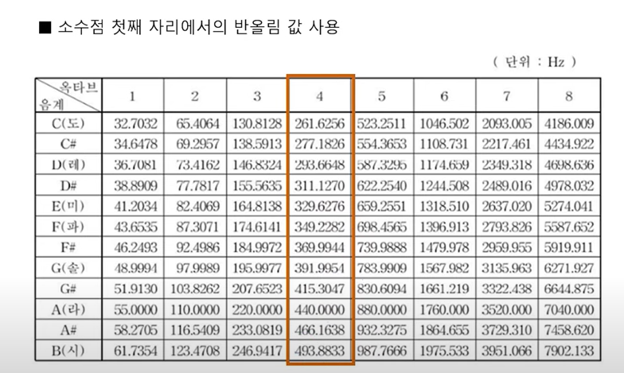
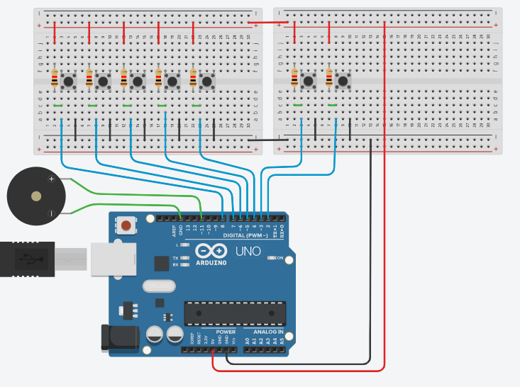
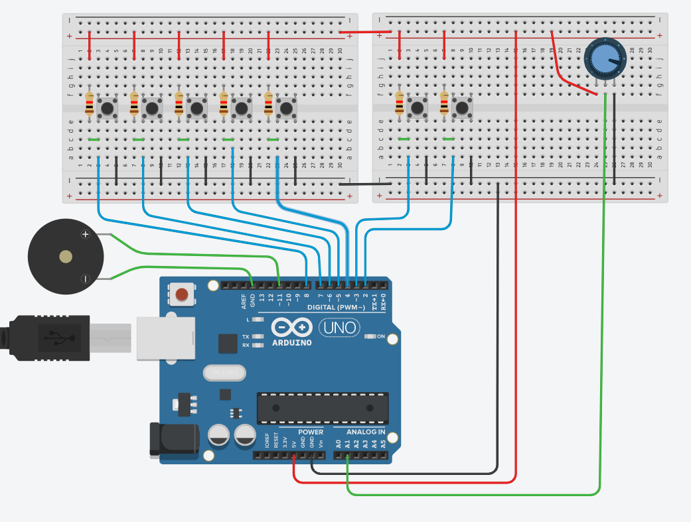
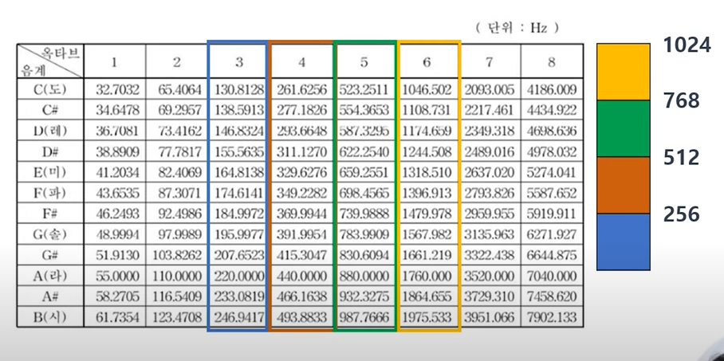

# 049_부저피아노_아두이노미니건반 🎹


* **7개의 푸시버튼과 수동 부저로 도-레-미-파-솔-라-시 연주하기!**
* 배열과 반복문을 활용하여 깔끔하고 확장성 높은 다중 입력 음계 연주 시스템을 구축합니다.
* 📖 **상세 강의 교재**: [index.md](./index.md)


> 여러분 안녕하세요! 이번 시간에는 '049. 부저피아노 아두이노미니건반 🎹'을 주제로 함께 흥미진진한 탐험을 떠나보겠습니다. 이호진 교수님과 똑똑한 조수 지니, 호기심 많은 도로시와 토토와 함께 신나는 아두이노 모험을 힘차게 시작해 봅시다. 준비되셨나요?

---

## 👧 도로시의 꿈: "동요를 직접 연주하고 싶어요!"


* **👧 도로시**: "교수님! 지니야! 버튼 1개로 삑 소리만 내는 건 아쉬워! 버튼을 여러 개 달아서 진짜 장난감 피아노처럼 '학교종이 땡땡땡'이나 '반짝반짝 작은 별'을 칠 수 있을까?"
* **👨‍🏫 이호진 교수님**: "물론이지! 버튼마다 다른 음계 주파수(Hz)를 지정해 주면 멋진 7음계 전자 건반 피아노가 탄생한단다!"
* **🐶 토토**: "왈왈! (노래에 맞춰 발바닥 춤출 준비 완료!)"
* [!NOTE]
* **다중 입력 스캔(Key Scanning)**
* 컴퓨터 키보드나 전자 피아노는 수많은 건반을 지속적으로 검사(Scan)하여 어떤 키가 눌렸는지 알아냅니다. 이번 실습에서는 `for` 반복문과 배열(Array)을 사용하여 7개의 버튼 핀을 단 몇 줄의 코드로 완벽하게 제어합니다.

단일음 벨소리 실습을 마친 도로시가 더 신나는 음악 프로젝트를 제안합니다!

> 이번 슬라이드에서는 '👧 도로시의 꿈: "동요를 직접 연주하고 싶어요!"'에 대해 자세히 살펴보겠습니다. 화면의 다이어그램과 사진을 함께 참고해 주시기 바랍니다. 도로시와 지니의 대화처럼, 지니야! 버튼 1개로 삑 소리만 내는 건 아쉬워! 버튼을 여러 개 달아서 진짜 장난감 피아노처럼 라는 상황에 대해 물론이지! 버튼마다 다른 음계 주파수(Hz)를 지정해 주면 멋진 7음계 전자 건반 피아노가 탄생한단다!라는 원리가 작동하는 것입니다. 이 원리는 아두이노 시스템 전체를 관통하는 핵심 논리이므로 머릿속에 꼭 정리해 두시기 바랍니다.

---

## 🎼 도-레-미-파-솔-라-시 주파수 비밀 사전



| 음계 (Note) | 주파수 (Hz) | 버튼 연결 핀 | 작동 상태 (`INPUT_PULLUP`) |
| :---: | :---: | :---: | :---: |
| **도 (C4)** | **262** | 디지털 2번 핀 | 누르면 `LOW` ➡️ 262Hz 출력 |
| **레 (D4)** | **294** | 디지털 3번 핀 | 누르면 `LOW` ➡️ 294Hz 출력 |
| **미 (E4)** | **330** | 디지털 4번 핀 | 누르면 `LOW` ➡️ 330Hz 출력 |
| **파 (F4)** | **350** | 디지털 5번 핀 | 누르면 `LOW` ➡️ 350Hz 출력 |
| **솔 (G4)** | **392** | 디지털 6번 핀 | 누르면 `LOW` ➡️ 392Hz 출력 |
| **라 (A4)** | **440** | 디지털 7번 핀 | 누르면 `LOW` ➡️ 440Hz 출력 |
| **시 (B4)** | **492** | 디지털 8번 핀 | 누르면 `LOW` ➡️ 492Hz 출력 |

각 음계는 공기가 1초 동안 진동하는 횟수인 고유 주파수(Hz)로 정의됩니다.

> 이번에 살펴볼 내용은 '🎼 도-레-미-파-솔-라-시 주파수 비밀 사전'입니다. 슬라이드에 정리된 표를 통해 각 항목의 특징과 수치, 차이점을 한눈에 비교해 보실 수 있습니다. 이 기본 개념을 확실히 잡아두셔야 실제 부품을 브레드보드에 꽂고 코딩할 때 실수 없이 완성할 수 있습니다.

---

## 🎹 브레드보드 건반 회로 구성하기



* [!TIP]
* 아두이노 내부 풀업 저항(`INPUT_PULLUP`) 덕분에 외장 풀업 저항 7개를 생략할 수 있어 배선이 매우 깔끔해집니다.

1. **푸시버튼 7개 (D2 ~ D8)**:
* 각 스위치의 1번 다리 ➡️ 아두이노 **디지털 2번 ~ 8번 핀**에 순서대로 연결
* 각 스위치의 대각선 2번 다리 ➡️ 브레드보드 **GND 레일 (공통 접지)** 에 연결
2. **수동 부저 (Passive Buzzer)**:
* `+` 다리 ➡️ 아두이노 **디지털 11번 PWM 핀**
* `-` 다리 ➡️ 아두이노 **GND 핀**

브레드보드에 푸시버튼 7개를 나란히 꽂고, 수동 부저와 연결합니다.
### 📌 부품 연결 가이드

> 이번에 살펴볼 내용은 '🎹 브레드보드 건반 회로 구성하기'입니다. 화면의 회로도와 부품 사진을 보면서 각 핀과 배선이 어떻게 구성되어 있는지 눈으로 직접 따라와 주시기 바랍니다. 첫째로 푸시버튼 7개 (D2 ~ D8)에 유의해야 하며, 둘째로 각 스위치의 1번 다리 ➡️ 아두이노 디지털 2번 ~ 8번 핀에 순서대로 연결라는 점이 핵심입니다. 이 기본 개념을 확실히 잡아두셔야 실제 부품을 브레드보드에 꽂고 코딩할 때 실수 없이 완성할 수 있습니다.

---

## 💻 실습 코드: 미니 피아노 스케치


배열(`array`)과 `for` 반복문으로 7개 핀을 한꺼번에 스캔하는 간결한 코드입니다.

```cpp
// 04.2-4 아두이노 미니 피아노
const int BUZZER_PIN = 11; // 수동 부저 연결 핀

// 도-레-미-파-솔-라-시 주파수 배열
const int notes[7] = {262, 294, 330, 350, 392, 440, 492};

void setup() {
  pinMode(BUZZER_PIN, OUTPUT);
  
  // 2번부터 8번 핀까지 7개 버튼을 내부 풀업으로 일괄 설정!
  for (int pin = 2; pin <= 8; pin++) {
    pinMode(pin, INPUT_PULLUP);
  }
}

void loop() {
  bool isPressed = false; // 현재 건반이 눌렸는지 확인하는 플래그
  
  // 7개의 버튼 핀을 순차적으로 확인 (0~6 인덱스)
  for (int i = 0; i < 7; i++) {
    // pin 번호는 i + 2 (즉, 2번 ~ 8번)
    if (digitalRead(i + 2) == LOW) {
      tone(BUZZER_PIN, notes[i]); // 해당 인덱스의 음계 주파수 출력
      isPressed = true;
      break; // 동시에 여러 개를 누를 경우 가장 낮은 음 우선 처리
    }
  }
  
  // 어떤 버튼도 눌려있지 않다면 소리 정지
  if (!isPressed) {
    noTone(BUZZER_PIN);
  }
}
```

> 이번 슬라이드에서는 '💻 실습 코드: 미니 피아노 스케치'에 대한 실제 동작 코드를 분석해 보겠습니다. 화면의 코드를 살펴보시면, 컴퓨터가 아두이노 하드웨어에 단계별로 명령을 내리는 흐름을 명확하게 확인할 수 있습니다. 각 함수의 역할과 괄호 안의 매개변수가 하드웨어 핀과 어떤 관계를 맺고 동작하는지 주의 깊게 살펴보시기 바랍니다.

---

## 🎚️ 심화 응용: 가변저항으로 옥타브 조절하기!



* [!NOTE]
* 주파수를 2배로 올리면 음악적으로 정확히 한 옥타브 높은 음이 됩니다! (예: C4 262Hz ➡️ C5 524Hz)

가변저항(Potentiometer)의 아날로그 입력을 결합하면 음높이를 한 옥타브 또는 두 옥타브 올려서 연주할 수 있습니다.

```cpp
// 가변저항 값을 읽어 옥타브 승수 계산 (1배, 2배, 4배)
int potValue = analogRead(A0);
int octaveMultiplier = 1;

if (potValue > 680) {
  octaveMultiplier = 4; // 2옥타브 위 (아주 높은 음)
} else if (potValue > 340) {
  octaveMultiplier = 2; // 1옥타브 위
} else {
  octaveMultiplier = 1; // 기본 옥타브
}

// 음계 연주 시 곱하기 적용
tone(BUZZER_PIN, notes[i] * octaveMultiplier);
```

> 이번 슬라이드에서는 '🎚️ 심화 응용: 가변저항으로 옥타브 조절하기!'에 대한 실제 동작 코드를 분석해 보겠습니다. 화면의 코드를 살펴보시면, 컴퓨터가 아두이노 하드웨어에 단계별로 명령을 내리는 흐름을 명확하게 확인할 수 있습니다. 각 함수의 역할과 괄호 안의 매개변수가 하드웨어 핀과 어떤 관계를 맺고 동작하는지 주의 깊게 살펴보시기 바랍니다.

---

## 📊 디버깅 및 시리얼 모니터 음계 모니터링



* 스위치 불량이나 접촉 불량이 발생하면 특정 건반만 소리가 나지 않습니다.
* `Serial.print("Pressed Key: "); Serial.println(i);` 코드를 추가하여 하드웨어 접촉 여부를 소프트웨어로 즉시 진단할 수 있습니다.

각 버튼이 제대로 감지되고 있는지 시리얼 모니터로 실시간 확인할 수 있습니다.

> 이번 슬라이드에서는 '📊 디버깅 및 시리얼 모니터 음계 모니터링'에 대해 자세히 살펴보겠습니다. 화면의 다이어그램과 사진을 함께 참고해 주시기 바랍니다. 첫 번째 핵심은 스위치 불량이나 접촉 불량이 발생하면 특정 건반만 소리가 나지 않습니다.이며, 두 번째로는 Serial.print("Pressed Key: "); Serial.println(i); 코드를 추가하여 하드웨어 접촉 여부를 소프트웨어로 즉시 진단할 수 있습니다.입니다. 이 원리는 아두이노 시스템 전체를 관통하는 핵심 논리이므로 머릿속에 꼭 정리해 두시기 바랍니다.

---

## 🌟 도로시와 지니의 피아노 완성 축하! 🏆


* **👧 도로시**: "도-레-미-파-솔-라-시! 소리가 너무 맑고 예뻐! 진짜 내가 연주하는 건반이야!"
* **👨‍🏫 이호진 교수님**: "훌륭해! 다음 시간에는 버튼 입력으로 여러 개의 LED를 순차적으로 제어하는 **디지털 다중 LED 실습**으로 넘어가 보자!"

* [x] **배열(Array) 활용**: `notes[7]` 배열로 음계 주파수를 관리하여 하드코딩 중복을 제거했습니다.
* [x] **반복문 키 스캔**: `for` 루프를 사용해 7개의 입력 핀을 단 한 번의 순회로 효율적으로 검사했습니다.
* [x] **tone() 과 noTone()의 조화**: 건반을 누를 때만 울리고 손을 떼면 즉시 멈추는 직관적인 악기를 완성했습니다.

축하합니다! 직접 제작한 7음계 미니 피아노로 나만의 음악회를 열어보세요.
### 📋 핵심 요약 체크리스트

> 오늘 배운 '🌟 도로시와 지니의 피아노 완성 축하! 🏆'의 핵심 내용을 모두 정리해 보았습니다. 오늘 다룬 내용 중에서도 [x] 배열(Array) 활용: notes[7] 배열로 음계 주파수를 관리하여 하드코딩 중복을 제거했습니다. 부분은 앞으로의 아두이노 실습과 프로젝트에서 계속 사용되는 매우 중요한 기초 지식입니다. 지니 멘토가 강조했듯이 훌륭해! 다음 시간에는 버튼 입력으로 여러 개의 LED를 순차적으로 제어하는 디지털 다중 LED 실습으로 넘어가 보자!라는 점을 꼭 마음에 새겨두시길 바랍니다. 오늘 배운 내용을 꼭 다시 한번 복습해 보시고, 다음 강의에서 더욱 신나고 유익한 모험으로 다시 만나겠습니다. 모두 수고 많으셨습니다!