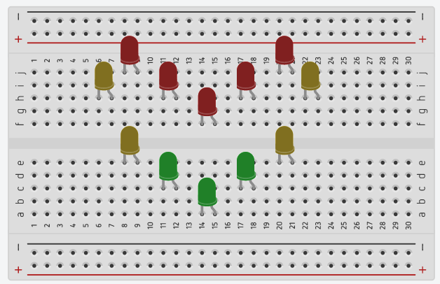
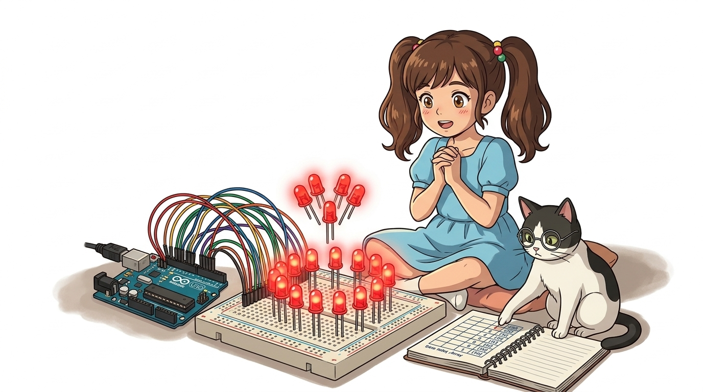
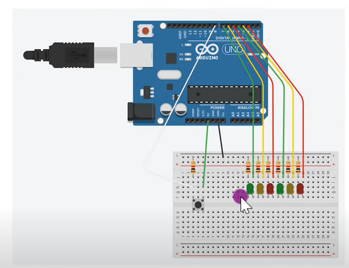

# 050_12개LED하트와_룰렛게임 ❤️🎲

> **아날로그 핀(A0~A5)까지 총동원하여 만드는 대형 LED 애니메이션 및 인터랙티브 룰렛**  
> 핀 번호 배열 관리와 타이밍 제어로 완성하는 화려한 디지털 출력 프로젝트


* 🖥️ **강의 슬라이드**: [slides.md](./slides.md)

---

## 👧 도로시의 도전: "LED 12개로 하트를 만들래요!"

스위치와 부저 제어를 마친 도로시가 새로운 아이디어를 떠올렸습니다!

> **👧 도로시**: "교수님! 지니야! 브레드보드에 빨간 LED 12개를 하트 모양으로 꽂아서 생일 축하 전광판을 만들고 싶어! 그런데 아두이노 우노의 남은 디지털 핀이 12개가 안 되는데 어떡하지?"  
> **👨‍🏫 이호진 교수님**: "걱정 마! 아두이노 보드 아래쪽 **A0부터 A5까지의 아날로그 핀도 디지털 14~19번 핀으로 변신**시켜서 사용할 수 있단다!"  
> **🐶 토토**: "왈왈! (빙글빙글 돌아가는 행운의 룰렛 게임도 만들자!)"


> [!NOTE]
> **아두이노 핀의 숨은 비밀: 아날로그 핀의 디지털 겸용**  
> 아두이노 UNO의 `A0 ~ A5` 핀은 전압을 연속적으로 읽는 아날로그 입력 전용인 것처럼 보이지만, 내부 회로상 디지털 입출력(GPIO) 기능도 완벽히 지원합니다. 따라서 필요 시 최대 20개의 디지털 핀(D0~D13 + A0~A5)을 운용할 수 있습니다.

---

## 핀 확장 마법: A0 ~ A5를 디지털 핀으로!

아두이노 우노의 아날로그 핀 번호는 소프트웨어에서 디지털 번호로 직접 매핑됩니다:

| 아날로그 명칭 | 디지털 핀 번호 매핑 | 사용 가능한 모드 |
| :---: | :---: | :---: |
| **A0** | **디지털 14번 핀** | `INPUT`, `INPUT_PULLUP`, `OUTPUT` |
| **A1** | **디지털 15번 핀** | `INPUT`, `INPUT_PULLUP`, `OUTPUT` |
| **A2** | **디지털 16번 핀** | `INPUT`, `INPUT_PULLUP`, `OUTPUT` |
| **A3** | **디지털 17번 핀** | `INPUT`, `INPUT_PULLUP`, `OUTPUT` |
| **A4** | **디지털 18번 핀** (I2C SDA 겸용) | `INPUT`, `INPUT_PULLUP`, `OUTPUT` |
| **A5** | **디지털 19번 핀** (I2C SCL 겸용) | `INPUT`, `INPUT_PULLUP`, `OUTPUT` |



> [!TIP]
> 코드 작성 시 `pinMode(14, OUTPUT);` 또는 `pinMode(A0, OUTPUT);` 두 가지 방식 모두 동일하게 컴파일됩니다. 숫자로 일관성 있게 관리하려면 14~19 번호를 사용하면 편리합니다.

---

## 🗂️ 배열로 12개 핀 일괄 관리하기

12개의 핀을 일일이 제어하지 않고 정수형 배열에 담아 반복문으로 초기화합니다.



```cpp
// 12개 LED가 꽂힌 핀 번호들을 순서대로 배열에 저장
// 디지털 핀(2~8)과 아날로그 겸용 디지털 핀(15~19)을 하트 순서대로 배치
int led[12] = {8, 7, 15, 6, 16, 5, 17, 4, 18, 3, 19, 2};

void setup() {
  // 12줄 쓰던 pinMode 선언을 for 루프 3줄로 해결!
  for (int i = 0; i < 12; i++) {
    pinMode(led[i], OUTPUT);
  }
}
```

---

## 💓 실습 1: 두근두근 뛰는 심장 하트 애니메이션

하트 모양으로 꽂힌 12개 LED 전체가 실제 사람 심장 박동처럼 '두근-쾅' 박자에 맞춰 깜빡입니다.



```cpp
void loop() {
  // 1. 첫 번째 박동 (두근!)
  for (int i = 0; i < 12; i++) digitalWrite(led[i], HIGH);
  delay(120);
  for (int i = 0; i < 12; i++) digitalWrite(led[i], LOW);
  delay(120);
  
  // 2. 두 번째 더 강한 박동 (쾅!)
  for (int i = 0; i < 12; i++) digitalWrite(led[i], HIGH);
  delay(180);
  for (int i = 0; i < 12; i++) digitalWrite(led[i], LOW);
  
  // 3. 심장 이완 휴식 시간
  delay(650);
}
```

---

## 🎯 실습 2: 빙글빙글 회전 룰렛 게임!

원형으로 배치된 12개 LED 불빛이 시계 방향으로 빠르게 회전하며 룰렛 효과를 냅니다.

```cpp
void loop() {
  // 빛이 한 칸씩 시계 방향으로 빠르게 회전!
  for (int i = 0; i < 12; i++) {
    digitalWrite(led[i], HIGH); // 현재 LED 켜기
    delay(40);                  // 40ms 동안 켜짐 유지
    digitalWrite(led[i], LOW);  // 끄고 다음 칸으로 이동
  }
}
```

---

## 🕹️ 실습 3: 버튼을 누르면 서서히 감속하는 행운의 룰렛!

버튼을 누르면 회전 속도가 서서히 느려지다가, 마침내 하나의 당첨 LED에 멈추는 리얼 룰렛 게임기입니다.

```cpp
const int BUTTON_PIN = 10; // 스위치 연결 핀

void setup() {
  pinMode(BUTTON_PIN, INPUT_PULLUP);
  for (int i = 0; i < 12; i++) {
    pinMode(led[i], OUTPUT);
  }
}

void loop() {
  // 스위치를 누르면 룰렛 추첨 시작!
  if (digitalRead(BUTTON_PIN) == LOW) {
    int currentDelay = 30; // 시작 속도 (매우 빠름)
    
    // 점차 지연 시간을 늘려가며 서서히 멈춤
    while (currentDelay < 400) {
      for (int i = 0; i < 12; i++) {
        digitalWrite(led[i], HIGH);
        delay(currentDelay);
        digitalWrite(led[i], LOW);
      }
      currentDelay += 35; // 한 바퀴 돌 때마다 속도 감속!
    }
    
    // 최종 당첨 LED를 5번 깜빡이며 축하!
    for (int k = 0; k < 5; k++) {
      digitalWrite(led[0], HIGH);
      delay(200);
      digitalWrite(led[0], LOW);
      delay(200);
    }
  }
}
```

---

## 📐 하드웨어 배선 점검 및 감속 알고리즘 분석

안정적인 LED 구동을 위해 전류 제한 저항 계산과 공통 접지(GND) 결선을 점검합니다.

* **전류 소모량 계산**: 12개 LED가 동시에 켜질 경우 각 LED당 약 10~15mA, 총 120~180mA가 소모됩니다. 아두이노 5V 레귤레이터의 허용 용량(최대 500mA) 이내인지 항상 확인합니다.
* **지수 감속(Exponential Deceleration)**: 단순 덧셈 감속 대신 `currentDelay = currentDelay * 1.15;`와 같이 곱셈을 적용하면 실제 카지노 룰렛 바퀴의 자연스러운 물리적 마찰 감속을 시뮬레이션할 수 있습니다.

---

## 🌟 04단원 디지털 입력 실습 완료! 🏆

축하합니다! 04단원 디지털 입력 실습의 모든 과정을 성공적으로 완수했습니다.


### 📋 04단원 총정리 체크리스트

* [x] **디지털 입력 기초**: `pinMode(pin, INPUT)`와 `digitalRead()`로 사람의 물리적 조작을 전기 신호로 변환했습니다.
* [x] **풀업 저항과 INPUT_PULLUP**: 도깨비 플로팅 전압을 완벽히 차단하고 간결한 2선 스위치 배선을 구현했습니다.
* [x] **입출력 상호작용**: 스위치 입력에 따른 피에조 부저 멜로디 연주 및 다중 LED 건반/룰렛 시스템을 완성했습니다.
* [x] **핀 확장 마법**: 아두이노의 A0~A5 핀을 디지털 14~19번 핀으로 변환하여 대규모 I/O 제어를 달성했습니다.

> **👧 도로시**: "버튼 하나로 피아노도 치고, 12개 LED로 반짝반짝 하트와 룰렛 게임까지 만드니까 아두이노가 정말 마법 상자 같아!"  
> **👨‍🏫 이호진 교수님**: "훌륭해 도로시! 이제 정지된 제어를 넘어 물리적으로 직접 회전하고 각도를 움직이는 **05단원 모터 구동 교실(서보모터, DC모터, 스텝모터)** 로 신나게 나아가 보자!"  
> **🐶 토토**: "왈왈! (지니야, 로봇 팔 만들러 가자!)"
