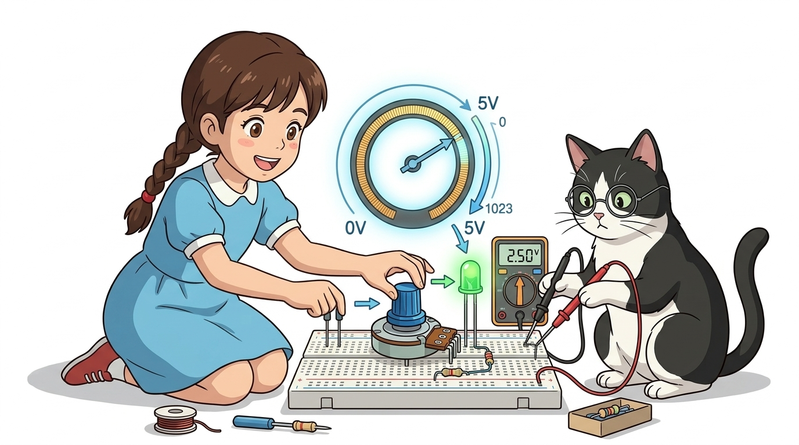
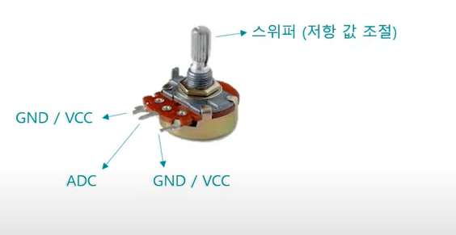
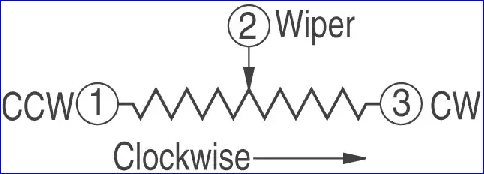
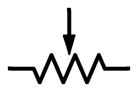
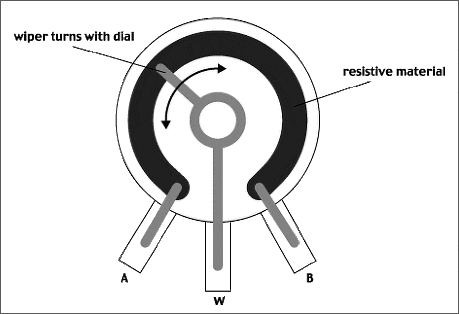
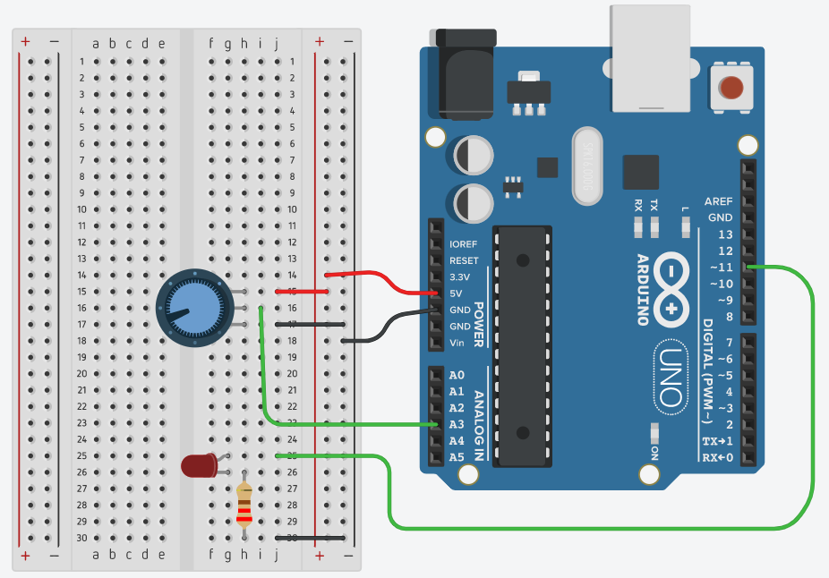
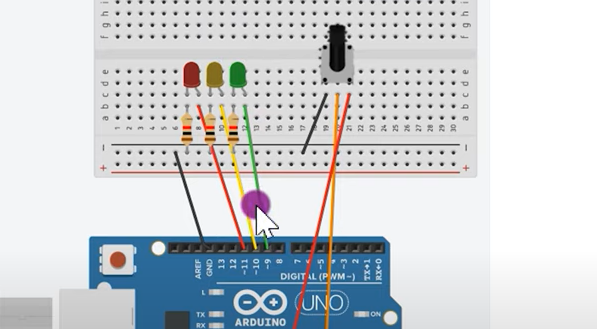

# 051_가변저항_전압분배손잡이 🔘🕹️



**도로시와 지니가 함께하는 와이퍼 접촉식 분압 원리, ADC 10비트 변환 및 아날로그 다이얼 제어 실습**
* 👧 **도로시**: "교수님! 지니야! 오디오 볼륨을 올리거나 선풍기 바람 세기를 조절할 때 부드럽게 돌리는 손잡이 있잖아! 아두이노는 내가 손잡이를 몇 도 돌렸는지 어떻게 정확히 알아채?"
* **👨‍🏫 이호진 교수님**: "그 회전 손잡이 속 핵심 부품이 바로 **가변저항(Potentiometer, 포텐셔미터)** 이란다! 손잡이를 돌리는 물리적 각도에 따라 0V부터 5V까지 전압을 자유자재로 나누어 만들어내지!"
* 🐶 **토토**: "바우! 손잡이를 오른쪽으로 돌리면 숫자가 1023까지 쑥쑥 올라간다 멍!"
* 📖 **상세 강의 교재**: [index.md](./index.md)


> 여러분 안녕하세요! 이번 시간에는 '051. 가변저항 전압분배손잡이 🔘🕹️'을 주제로 함께 흥미진진한 탐험을 떠나보겠습니다. 오늘 강의에서는 특히 도로시와 지니가 함께하는 와이퍼 접촉식 분압 원리, ADC 10비트 변환 및 아날로그 다이얼 제어 실습, 👧 도로시: "교수님! 지니야! 오디오 볼륨을 올리거나 선풍기 바람 세기를 조절할 때 부드럽게 돌리는 손잡이 있잖아! 아두이노는 내가 손잡이를 몇 도 돌렸는지 어떻게 정확히 알아채?"를 중심으로 핵심 원리와 응용 방법을 차근차근 배워보겠습니다. 이호진 교수님과 똑똑한 조수 지니, 호기심 많은 도로시와 토토와 함께 신나는 아두이노 모험을 힘차게 시작해 봅시다. 준비되셨나요?

---

## 1. 가변저항의 외형과 3개 핀의 비밀


* **양쪽 1번 & 3번 단자 (고정 저항선 양단)**:
* 각각 아두이노 **5V** 전원과 **GND(0V)** 에 연결합니다.
* 내부의 원호 모양 저항체 전체가 연결되므로 두 핀 사이의 총 저항값(예: 10kΩ)은 항상 일정합니다.
* **가운데 2번 단자 (와이퍼 / 신호 출력 핀)**:
* 회전축(Knob)을 돌릴 때마다 내부의 금속 접촉자(Wiper)가 저항선 위를 부드럽게 미끄러집니다.
* 접촉 위치에 따라 **0V ~ 5V 사이의 중간 분배 전압**이 아두이노 **A0 ~ A5 아날로그 핀**으로 출력됩니다!

### 🎛️ 양 끝 전원과 가운데 가변 출력 단자
가변저항에는 3개의 금속 다리가 나란히 배치되어 있습니다:

> 이번에 살펴볼 내용은 '1. 가변저항의 외형과 3개 핀의 비밀'입니다. 화면의 회로도와 부품 사진을 보면서 각 핀과 배선이 어떻게 구성되어 있는지 눈으로 직접 따라와 주시기 바랍니다. 첫째로 양쪽 1번 & 3번 단자 (고정 저항선 양단)에 유의해야 하며, 둘째로 각각 아두이노 5V 전원과 GND(0V) 에 연결합니다.라는 점이 핵심입니다. 이 기본 개념을 확실히 잡아두셔야 실제 부품을 브레드보드에 꽂고 코딩할 때 실수 없이 완성할 수 있습니다.

---

## 2. 작동 메커니즘: 와이퍼 접촉과 전압 분배 법칙




* 내부 저항체의 전체 길이를 $L$, 와이퍼가 위치한 지점까지의 길이를 $x$라 하면:
* 가운데 2번 단자에서 출력되는 전압 $V_{\text{out}}$은 전압 분배 법칙에 의해 완벽한 선형 관계식을 따릅니다:
* **손잡이를 왼쪽 끝으로 끝까지 돌렸을 때 ($x = 0$)**: $V_{\text{out}} = 0\text{V}$ (ADC 값: **0**)
* **손잡이를 정중앙에 두었을 때 ($x = 0.5L$)**: $V_{\text{out}} = 2.5\text{V}$ (ADC 값: **약 512**)
* **손잡이를 오른쪽 끝으로 돌렸을 때 ($x = L$)**: $V_{\text{out}} = 5.0\text{V}$ (ADC 값: **1023**)

### 🔬 저항체 길이의 비율이 곧 전압의 비율!
$$R_1 = R_{\text{total}} \times \frac{x}{L}, \quad R_2 = R_{\text{total}} - R_1$$
$$V_{\text{out}} = 5\text{V} \times \frac{R_1}{R_1 + R_2} = 5\text{V} \times \left(\frac{x}{L}\right)$$

> 이번 슬라이드에서는 '2. 작동 메커니즘: 와이퍼 접촉과 전압 분배 법칙'에 대해 자세히 살펴보겠습니다. 화면의 다이어그램과 사진을 함께 참고해 주시기 바랍니다. 첫 번째 핵심은 내부 저항체의 전체 길이를 $L$, 와이퍼가 위치한 지점까지의 길이를 $x$라 하면이며, 두 번째로는 가운데 2번 단자에서 출력되는 전압 $V{\text{out}}$은 전압 분배 법칙에 의해 완벽한 선형 관계식을 따릅니다입니다. 여기에 덧붙여 손잡이를 왼쪽 끝으로 끝까지 돌렸을 때 ($x = 0$): $V{\text{out}} = 0\text{V}$ (ADC 값: 0) 내용까지 함께 이해해 두시면 완벽합니다. 이 원리는 아두이노 시스템 전체를 관통하는 핵심 논리이므로 머릿속에 꼭 정리해 두시기 바랍니다.

---
## 3. 하드웨어 결선과 브레드보드 배선도




1. **가변저항 1번 핀**: 아두이노 **5V** 파워 레일에 연결.
2. **가변저항 2번 핀 (가운데)**: 아두이노 **A3 아날로그 핀**에 연결.
3. **가변저항 3번 핀**: 아두이노 **GND** 파워 레일에 연결.
4. **PWM 출력 LED**: 아두이노 **디지털 11번 핀** ➡️ 220Ω 저항 ➡️ LED 애노드(+) ➡️ 캐소드(-) ➡️ GND.

### 🔌 브레드보드 3핀 연결 가이드

```cpp
// 가변저항 분배 전압(0~5V)을 10비트 디지털 값(0~1023)으로 읽기
int potVal = analogRead(A3);
```

> 이번 슬라이드에서는 '3. 하드웨어 결선과 브레드보드 배선도'에 대한 실제 동작 코드를 분석해 보겠습니다. 화면의 코드를 살펴보시면, 컴퓨터가 아두이노 하드웨어에 단계별로 명령을 내리는 흐름을 명확하게 확인할 수 있습니다. 여기서 핵심은 가변저항 1번 핀: 아두이노 5V 파워 레일에 연결.입니다. 각 함수의 역할과 괄호 안의 매개변수가 하드웨어 핀과 어떤 관계를 맺고 동작하는지 주의 깊게 살펴보시기 바랍니다.
---
## 4. 실습 1 전체 코드: 가변저항 아날로그 값 읽기 (Arduino C++)




### 💻 시리얼 모니터로 손잡이 회전 각도 관측하기

```cpp
// 가변저항 가운데 핀이 연결된 아날로그 입력 핀 정의
const int POT_PIN = A3;

void setup() {
  // PC 시리얼 모니터 통신 시작 (9600 bps)
  Serial.begin(9600);
  
  Serial.println("==========================================");
  Serial.println("   Potentiometer ADC Reader Initialized   ");
  Serial.println("==========================================");
}

void loop() {
  // 1. A3 핀의 아날로그 전압을 10비트 디지털 숫자로 변환 (0 ~ 1023)
  int adcValue = analogRead(POT_PIN);

  // 2. 아날로그 숫자를 실제 전압(0.0V ~ 5.0V)으로 환산
  float voltage = adcValue * (5.0 / 1023.0);

  // 3. 시리얼 모니터에 정돈된 데이터 출력
  Serial.print("Raw ADC: ");
  Serial.print(adcValue);
  Serial.print(" | Calculated Voltage: ");
  Serial.print(voltage, 2);
  Serial.println(" V");

  // 0.1초 대기
  delay(100);
}
```

> 이번 슬라이드에서는 '4. 실습 1 전체 코드: 가변저항 아날로그 값 읽기 (Arduino C++)'에 대한 실제 동작 코드를 분석해 보겠습니다. 화면의 코드를 살펴보시면, 컴퓨터가 아두이노 하드웨어에 단계별로 명령을 내리는 흐름을 명확하게 확인할 수 있습니다. 각 함수의 역할과 괄호 안의 매개변수가 하드웨어 핀과 어떤 관계를 맺고 동작하는지 주의 깊게 살펴보시기 바랍니다.
---

## 5. 실습 2 전체 코드: `map()` 함수로 LED 밝기 조광 다이얼 만들기



### 💻 0~1023 입력을 0~255 PWM 밝기로 부드럽게 연동하기

```cpp
const int POT_PIN = A3; // 가변저항 핀
const int LED_PIN = 11; // PWM 밝기 제어 핀

void setup() {
  pinMode(LED_PIN, OUTPUT);
  Serial.begin(9600);
}

void loop() {
  // 1. 가변저항 입력 읽기 (0 ~ 1023)
  int potValue = analogRead(POT_PIN);

  // 2. 10비트 입력을 8비트 PWM 출력 범위(0 ~ 255)로 선형 변환
  int brightness = map(potValue, 0, 1023, 0, 255);

  // 3. LED에 아날로그(PWM) 신호 출력
  analogWrite(LED_PIN, brightness);

  // 디버깅 출력
  Serial.print("Pot: ");
  Serial.print(potValue);
  Serial.print(" -> LED Brightness: ");
  Serial.println(brightness);

  delay(50);
}
```

> 이번 슬라이드에서는 '5. 실습 2 전체 코드: map() 함수로 LED 밝기 조광 다이얼 만들기'에 대한 실제 동작 코드를 분석해 보겠습니다. 화면의 코드를 살펴보시면, 컴퓨터가 아두이노 하드웨어에 단계별로 명령을 내리는 흐름을 명확하게 확인할 수 있습니다. 각 함수의 역할과 괄호 안의 매개변수가 하드웨어 핀과 어떤 관계를 맺고 동작하는지 주의 깊게 살펴보시기 바랍니다.

---

## 6. 실습 3 확장: 3개 가변저항으로 RGB 무지개 팔레트 만들기



* **3채널 아날로그 입력 (A0, A1, A2)**:
* 3개의 가변저항을 각각 아두이노의 A0(빨강), A1(초록), A2(파랑)에 연결합니다.
* **RGB LED 컬러 믹싱**:
* 각 손잡이를 돌려 $R, G, B$ 각각의 빛의 세기(0~255)를 독립적으로 조절하면, 빛의 삼원색 합성을 통해 **16,777,216가지(24비트 트루 컬러)** 의 모든 빛깔을 자유자재로 만들어낼 수 있습니다!

```cpp
// 가변저항 측정값 구간에 따라 LED 단계별 점등
if (value < 256) {
  digitalWrite(ledPins[0], HIGH);
} else if (value < 512) {
  digitalWrite(ledPins[1], HIGH);
} else if (value < 768) {
  digitalWrite(ledPins[2], HIGH);
} else {
  digitalWrite(ledPins[3], HIGH);
}
```

> 이번 슬라이드에서는 '6. 실습 3 확장: 3개 가변저항으로 RGB 무지개 팔레트 만들기'에 대한 실제 동작 코드를 분석해 보겠습니다. 화면의 코드를 살펴보시면, 컴퓨터가 아두이노 하드웨어에 단계별로 명령을 내리는 흐름을 명확하게 확인할 수 있습니다. 여기서 핵심은 채널 아날로그 입력 (A0, A1, A2)입니다. 각 함수의 역할과 괄호 안의 매개변수가 하드웨어 핀과 어떤 관계를 맺고 동작하는지 주의 깊게 살펴보시기 바랍니다.

---
## 🌟 도로시와 지니의 핵심 요약 노트!


* 👧 **도로시**: "가변저항 손잡이를 돌리는 물리적 각도가 0V부터 5V까지 전압으로 나뉘고, `analogRead()`로 0~1023 숫자로 읽히는 과정이 너무 신기해!"
* **👨‍🏫 이호진 교수님**: "맞아! `map()` 함수를 쓰면 LED 조명 다이얼부터 서보 모터 각도 컨트롤러까지 무엇이든 조종할 수 있단다."
* 🐶 **토토**: "바우! 다음 시간엔 가변저항 2개가 합체된 게임기 조이스틱을 만나러 가자 멍!"

| 손잡이 위치 | 내부 와이퍼 접촉점 | 출력 전압 ($V_{\text{out}}$) | 아두이노 ADC 값 | LED 밝기 (`brightness`) |
| :--- | :--- | :---: | :---: | :---: |
| **반시계 방향 끝** | GND에 밀착 | **0.0 V** | **0** | **0 (소등)** |
| **정중앙 (12시 방향)** | 저항체 정중앙 | **2.5 V** | **약 512** | **128 (중간 밝기)** |
| **시계 방향 끝** | 5V에 밀착 | **5.0 V** | **1023** | **255 (최대 밝기)** |

> 오늘 배운 '🌟 도로시와 지니의 핵심 요약 노트!'의 핵심 내용을 모두 정리해 보았습니다. 오늘 다룬 내용 중에서도 👧 도로시: "가변저항 손잡이를 돌리는 물리적 각도가 0V부터 5V까지 전압으로 나뉘고, analogRead()로 0~1023 숫자로 읽히는 과정이 너무 신기해!" 부분은 앞으로의 아두이노 실습과 프로젝트에서 계속 사용되는 매우 중요한 기초 지식입니다. 오늘 배운 내용을 꼭 다시 한번 복습해 보시고, 다음 강의에서 더욱 신나고 유익한 모험으로 다시 만나겠습니다. 모두 수고 많으셨습니다!