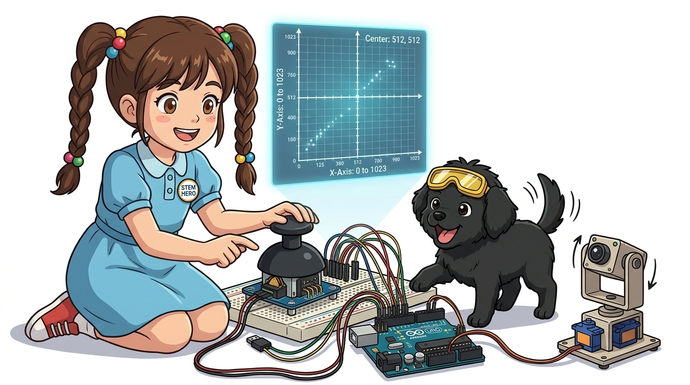
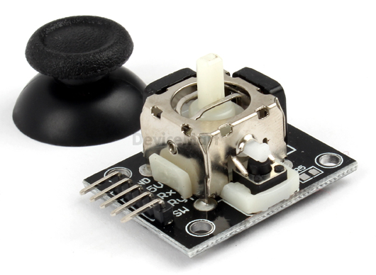
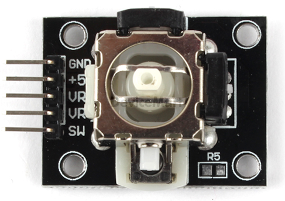
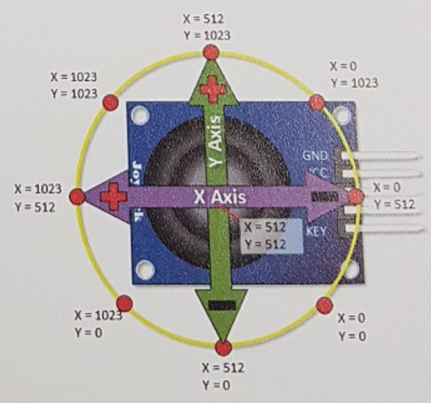
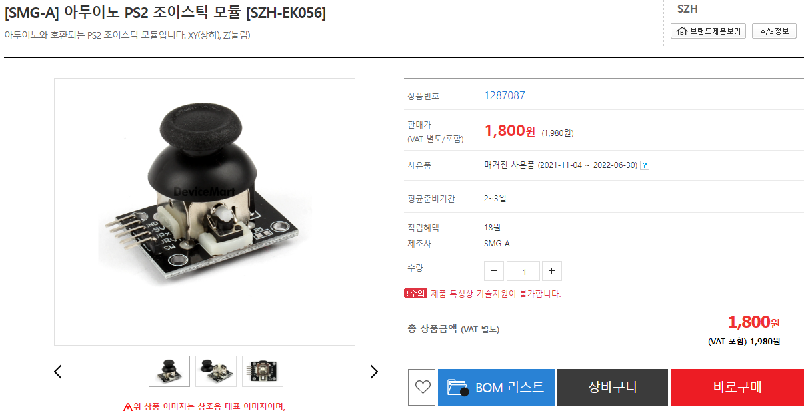
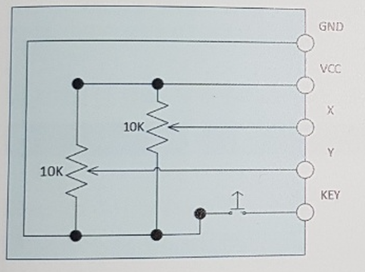
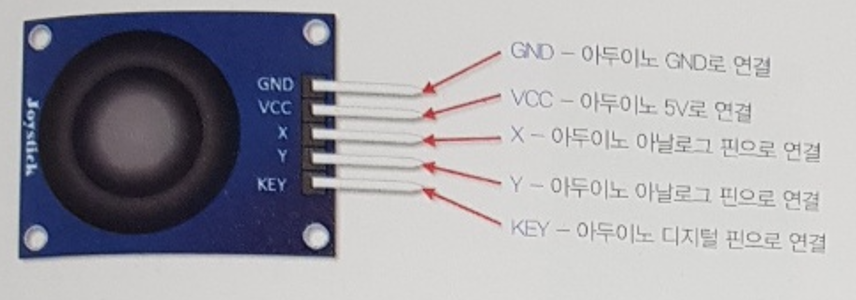

# 052_2축조이스틱_게임기조종간 🕹️💡



**도로시와 지니가 함께하는 직교 2축 가변저항 결합 원리, 2D 2차원 평면 좌표계 및 팬/틸트(Pan-Tilt) 로봇 제어 실습**

* 👧 **도로시**: "교수님! 지니야! 오락실 게임기나 비행기 조종간에 달린 조이스틱 레버는 상하좌우 대각선까지 360도로 부드럽게 기울어지고, 꾹 누르면 딸깍 버튼도 눌려! 아두이노는 이 복잡한 손놀림을 어떻게 알아채?"
* **👨‍🏫 이호진 교수님**: "이 작은 모듈 안에는 90도 직교 방향으로 배치된 **X축 가변저항**과 **Y축 가변저항**, 그리고 **푸시 버튼 스위치**가 한 몸으로 조립되어 있기 때문이란다!"
* 🐶 **토토**: "바우! 엄지손가락 하나로 전후좌우 RC카를 부드럽게 운전하자 멍!"

* 🖥️ **강의 슬라이드**: [slides.md](./slides.md)

---

## 1. 2축 조이스틱 모듈의 내부 기계 구조



### 🕹️ 직교하는 2개의 가변저항과 중앙 복원 스프링
* **X축 가변저항 (VRx)**:
  * 레버를 좌우로 기울일 때 기계식 김벌 기어가 회전하며 저항값이 변합니다.
* **Y축 가변저항 (VRy)**:
  * 레버를 앞뒤(상하)로 기울일 때 다른 쪽 가변저항이 회전하며 저항값이 변합니다.
* **택트 스위치 (SW, Switch)**:
  * 스틱을 수직으로 꾹 누르면 레버 아래의 마이크로 푸시 버튼이 딸깍 눌립니다.
* **중앙 복원 스프링 (Self-Centering Spring)**:
  * 손가락을 떼면 내부 용수철에 의해 레버가 즉시 **정중앙 중립 위치(Neutral Center)** 로 자동 복귀합니다.

---

## 2. 5개 핀아웃과 전기적 인터페이스



### 📌 단자별 기능 및 아두이노 연결 규격

| 핀 레이블 | 신호 종류 | 아두이노 연결 핀 | 기능 및 전압 특성 |
| :---: | :---: | :---: | :--- |
| **GND** | 전원 접지 | **아두이노 GND** | 공통 0V 접지 |
| **+5V** | 전원 입력 | **아두이노 5V** | 5V 직류 전원 공급 |
| **VRx** | 아날로그 출력 | **아두이노 A0 핀** | X축 회전각에 비례하는 0V ~ 5V 전압 출력 |
| **VRy** | 아날로그 출력 | **아두이노 A1 핀** | Y축 회전각에 비례하는 0V ~ 5V 전압 출력 |
| **SW** | 디지털 출력 | **아두이노 디지털 2번** | 누르면 0V(LOW), 떼면 풀업에 의해 5V(HIGH) |

---

## 3. 2차원 카테시안(Cartesian) 평면 좌표계 매핑



### 🧭 0부터 1023까지 십자 좌표로 읽는 손놀림
아두이노의 10비트 ADC(0 ~ 1023)를 통해 조이스틱 레버의 2차원 위치를 즉시 파악할 수 있습니다:

* **중립 위치 (손을 뗐을 때)**:
  * $X \approx 512, \quad Y \approx 512$ (기계적 오차로 인해 $\pm 30$ 정도의 편차 발생)
* **좌측 끝 (Left)**: $X \approx 0, \quad Y \approx 512$
* **우측 끝 (Right)**: $X \approx 1023, \quad Y \approx 512$
* **상단 끝 (Up)**: $X \approx 512, \quad Y \approx 0$ (또는 1023, 모듈 방향에 따라 결정)
* **하단 끝 (Down)**: $X \approx 512, \quad Y \approx 1023$ (또는 0)
* **대각선 (우상단 1시 방향)**: $X \approx 1023, \quad Y \approx 0$

---

## 4. 하드웨어 배선과 스위치 내부 풀업 (`INPUT_PULLUP`)



### 🔌 푸시 버튼을 위한 깔끔한 풀업 회로



* 조이스틱 모듈의 SW 핀은 스위치가 눌렸을 때 GND와 연결되는 단순 접점 구조입니다.
* 외부에 별도의 풀업 저항을 달지 않고, 아두이노 내부의 20kΩ 풀업 저항을 켜는 **`pinMode(PIN_SW, INPUT_PULLUP)`** 기능을 사용합니다:
  * 평상시 (버튼 안 누름): 풀업 저항에 의해 **`HIGH (1)`** 유지
  * 클릭 시 (버튼 꾹 누름): 접점이 GND로 닫혀 **`LOW (0)`** 로 반전!

---

## 5. 실습 전체 코드: 조이스틱 3차원 입력 리더 (Arduino C++)

### 💻 X축, Y축 아날로그 좌표와 클릭 스위치를 동시에 읽는 펌웨어

```cpp
// 핀 번호 상수 정의
const int PIN_VRX = A0; // X축 아날로그 핀
const int PIN_VRY = A1; // Y축 아날로그 핀
const int PIN_SW  = 2;  // 푸시 버튼 디지털 핀 (외부 인터럽트 0번 사용 가능)

void setup() {
  // PC 시리얼 모니터 통신 시작 (빠른 좌표 갱신을 위해 115200 bps)
  Serial.begin(115200);

  // SW 핀을 아두이노 내부 풀업 입력 모드로 설정
  pinMode(PIN_SW, INPUT_PULLUP);

  Serial.println("==========================================");
  Serial.println("   Dual-Axis Joystick Controller Ready!   ");
  Serial.println("==========================================");
}

void loop() {
  // 1. X축과 Y축 아날로그 전압 읽기 (0 ~ 1023)
  int xVal = analogRead(PIN_VRX);
  int yVal = analogRead(PIN_VRY);

  // 2. 푸시 스위치 디지털 상태 읽기 (LOW = 누름, HIGH = 뗌)
  int swState = digitalRead(PIN_SW);

  // 3. 512 기준 방향 분석 (데드존 100 적용)
  String direction = "CENTER";
  if (xVal < 400)      direction = "LEFT";
  else if (xVal > 650) direction = "RIGHT";

  if (yVal < 400)      direction += " UP";
  else if (yVal > 650) direction += " DOWN";

  // 4. 시리얼 모니터에 정돈된 데이터 출력
  Serial.print("X: ");
  Serial.print(xVal);
  Serial.print("\t| Y: ");
  Serial.print(yVal);
  Serial.print("\t| Dir: ");
  Serial.print(direction);
  Serial.print("\t| Button: ");
  if (swState == LOW) {
    Serial.println("🔴 CLICKED! (Fire!)");
  } else {
    Serial.println("⚪ Released");
  }

  // 0.1초 간격으로 출력
  delay(100);
}
```

---

## 6. 코드 상세 해설 및 데드존(Deadband) 필터링



### 🔍 미세 떨림을 방지하는 데드존(Deadband) 처리
* 레버의 스프링 복원력 오차로 인해 중립 상태에서도 `512` 정중앙이 아니라 `505 ~ 525` 사이를 미세하게 출렁입니다.
* 코드에서 `400` 미만, `650` 초과처럼 **가운데 150 단위의 완충 구역(데드존, Deadband)** 을 두면, 손가락을 대지 않았을 때 로봇이나 화면 속 캐릭터가 제멋대로 비틀거리며 움직이는 현상을 100% 방지할 수 있습니다!

---

## 🌟 도로시와 지니의 핵심 요약 노트!

| 입력 항목 | 하드웨어 부품 | 신호 규격 | 중립 상태 값 | 액션 상태 값 |
| :--- | :--- | :---: | :---: | :--- |
| **X축** | 10kΩ 수평 가변저항 | 아날로그 (A0) | 약 512 | 좌: 0 / 우: 1023 |
| **Y축** | 10kΩ 수직 가변저항 | 아날로그 (A1) | 약 512 | 상: 0 / 하: 1023 |
| **스위치 (SW)**| 푸시 버튼 스위치 | 디지털 (D2) | **HIGH (1)** | **클릭 시: LOW (0)** |

* 👧 **도로시**: "가변저항 2개와 스위치 1개가 합쳐져서 상하좌우 대각선 조종과 발사 버튼까지 완벽한 게임 패드가 되었어!"
* **👨‍🏫 이호진 교수님**: "맞아! 여기에 2개의 서보 모터를 연결하면 감시 카메라를 상하좌우로 돌리는 팬/틸트(Pan-Tilt) 로봇 헤드를 직접 조종할 수 있단다."
* 🐶 **토토**: "바우! 다음 시간엔 아날로그 기준 전압을 맞추는 AREF 핀의 비밀을 알아보자 멍!"
