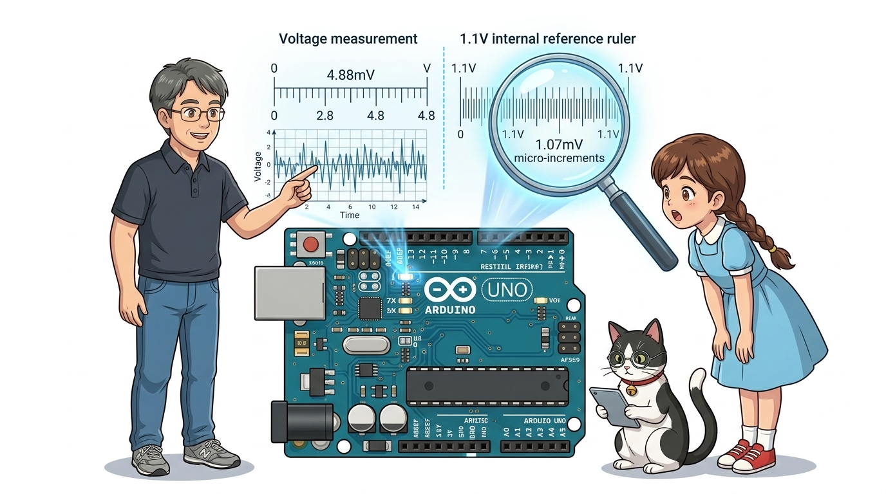
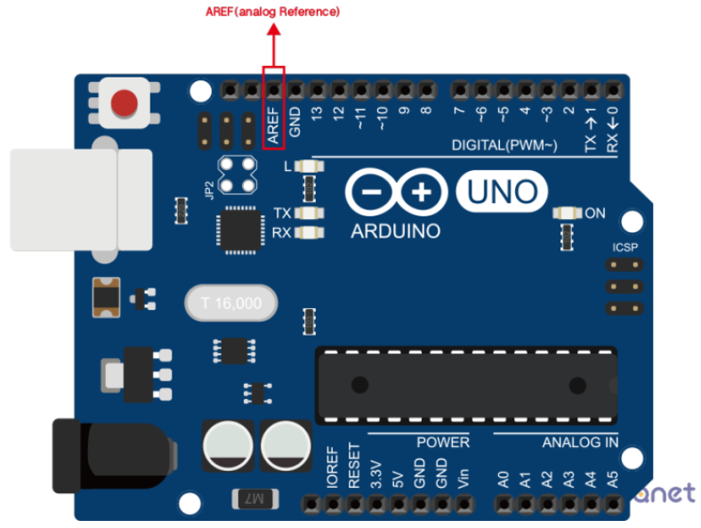
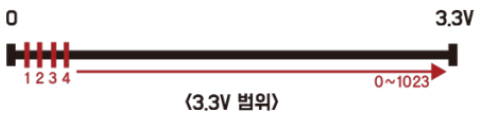
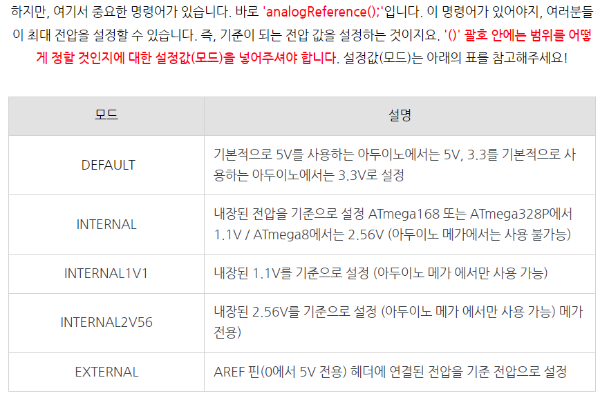
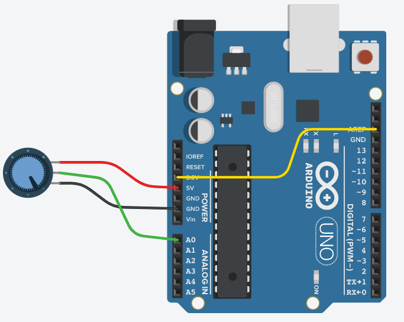

# 053_미세전압정밀측정_AREF핀 🎛️📏



**도로시와 지니가 함께하는 아날로그 기준 전압(AREF), ADC 분해능 향상 공식 및 정밀 미세 센서 측정 실습**

* 👧 **도로시**: "교수님! 지니야! 정밀 온도 센서나 심박 센서를 달았는데, 신호가 너무 약해서 아날로그 측정값이 20, 21, 22처럼 좁은 구석에서만 꼼지락거려! 좀 더 돋보기로 보듯 시원하게 확대해서 정밀하게 측정할 순 없을까?"
* **👨‍🏫 이호진 교수님**: "아주 날카로운 통찰력이야! 아두이노는 기본적으로 **5V(5000mV)** 를 1024칸으로 쪼개기 때문에 미세 전압을 놓치기 쉽거든! 아날로그 눈금자의 크기를 자유롭게 변경해 주는 비밀 핀이 바로 **AREF(Analog Reference)** 란다!"
* 🐶 **토토**: "바우! 눈금자의 간격을 5배 더 촘촘하게 줄이는 특급 마법이다 멍!"

* 🖥️ **강의 슬라이드**: [slides.md](./slides.md)

---

## 1. 아날로그 분해능(Resolution)과 1칸의 전압 크기



### 📏 왜 미세 신호 측정이 어려웠을까요?
아두이노 우노의 ATmega328P 마이크로컨트롤러는 10비트 아날로그-디지털 변환기(ADC)를 탑재하고 있습니다. ADC는 입력 전압을 **$0 \sim 1023$ (총 1024칸)** 의 계단으로 나누어 숫자로 변환합니다:

1. **기본 5V 전원 기준 (`DEFAULT`)**:
   * 1계단(1 LSB)의 전압 크기:
     $$\text{Resolution} = \frac{5.0\text{V}}{1024} = \frac{5000\text{ mV}}{1024} \approx \mathbf{4.88\text{ mV}}$$
   * 즉, 센서 전압이 최소 $4.88\text{mV}$ 이상 변해야만 아두이노 숫자가 겨우 '1' 바뀝니다.
   * 만약 센서의 최대 출력이 $1.0\text{V}$밖에 안 되는 미세 센서라면, 전체 1024칸 중 겨우 **$0 \sim 204$칸(약 20% 공간)** 만 사용하므로 정밀도가 심각하게 떨어집니다.

---

## 2. 1.1V 내부 기준 (`INTERNAL`)으로 해상도 4.5배 극대화!

```cpp
void setup() {
  analogReference(EXTERNAL); // AREF 핀에 인가된 1.1V 외부 기준 전압 사용
  Serial.begin(115200);
}

void loop() {
  int data = analogRead(A0); // 정밀 아날로그 전압 측정
  Serial.println(data);
  delay(10);
}
```

### 🔬 눈금자를 1.1V로 줄이면 일어나는 마법!
* 기준 전압을 5V에서 칩 내부의 초정밀 밴드갭 기준 전압인 **1.1V**로 변경하면:
  $$\text{Resolution}_{\text{internal}} = \frac{1.1\text{V}}{1024} = \frac{1100\text{ mV}}{1024} \approx \mathbf{1.07\text{ mV}}$$
* 1계단의 크기가 $4.88\text{mV} \rightarrow 1.07\text{mV}$로 줄어들어 **약 4.55배 더 정밀한 측정**이 가능해집니다!
* $0 \sim 1.0\text{V}$ 신호가 전체 눈금의 $90\%$ 이상(약 0 ~ 930칸)을 꽉 채워 표현되므로, 소수점 이하의 미세한 변화까지 놓치지 않고 생생하게 포착합니다.

---

## 3. `analogReference()` 함수의 3가지 동작 모드



### ⚙️ 코드 한 줄로 바꾸는 아두이노 눈금자

```cpp
void setup() {
  // 1. DEFAULT 모드: 아두이노 동작 전원(5V 또는 3.3V 보드 전원)을 기준으로 사용 (기본값)
  analogReference(DEFAULT);

  // 2. INTERNAL 모드: ATmega328P 칩 내부에 내장된 1.1V 정밀 밴드갭 기준 전압 사용
  analogReference(INTERNAL);

  // 3. EXTERNAL 모드: 아두이노 AREF 핀에 외부에서 직접 인가한 전압(0V ~ 5V)을 기준으로 사용
  analogReference(EXTERNAL);
}
```

---

## 4. 🚨 초특급 하드웨어 주의사항: AREF 핀 쇼트(Short) 방지



### ⚠️ 아두이노 칩 파손을 막는 골든 룰 (Golden Rule)
만약 AREF 핀에 외부 3.3V 전압을 꽂아 기준 전압으로 사용하고 싶다면, **반드시 지켜야 할 순서**가 있습니다:

1. **절대 금지**: 아두이노가 `DEFAULT(5V)` 모드인 상태에서 AREF 핀에 외부 3.3V 전선을 꽂으면 안 됩니다!
2. **이유**: 칩 내부의 5V 전원 회로와 외부 3.3V 전선이 AREF 핀 내부에서 직접 맞부딪혀 거대한 단락(Short) 전류가 발생하고, **ATmega328P 칩의 ADC 멀티플렉서가 불타버립니다.**
3. **올바른 순서**:
   * ① 스케치 코드 `setup()`에 **`analogReference(EXTERNAL);`** 을 먼저 작성하여 업로드합니다.
   * ② 코드가 정상 실행된 후 아두이노 전원을 끄고, 그 다음에 AREF 핀에 전선을 연결합니다!

---

## 5. 실습 전체 코드: 1.1V 내부 기준을 활용한 정밀 온도계 (Arduino C++)

### 💻 4.5배 높은 분해능으로 미세 온도를 정밀 계측하는 펌웨어

```cpp
const int SENSOR_PIN = A0; // 미세 신호 출력 센서 연결 핀

void setup() {
  // 1. PC 시리얼 모니터 통신 시작 (115200 bps)
  Serial.begin(115200);

  // 2. ADC 기준 전압을 내부 1.1V 정밀 밴드갭으로 설정 (돋보기 모드 활성화!)
  analogReference(INTERNAL);

  // 3. 기준 전압 변경 후 ADC 내부 커패시터 안정을 위해 더미 측정 1회 수행
  analogRead(SENSOR_PIN);
  delay(20);

  Serial.println("==========================================");
  Serial.println("   AREF 1.1V High-Precision ADC Ready!    ");
  Serial.println("==========================================");
}

void loop() {
  // 1. 아날로그 핀에서 10비트 ADC 값 읽기 (0 ~ 1023)
  int rawADC = analogRead(SENSOR_PIN);

  // 2. 1.1V 기준 전압을 적용하여 정확한 밀리볼트(mV) 전압 계산
  // 공식: ADC * (1100.0 mV / 1024.0)
  float millivolts = rawADC * (1100.0 / 1024.0);

  // 3. 시리얼 모니터에 정돈된 데이터 출력
  Serial.print("Raw ADC (0~1023): ");
  Serial.print(rawADC);
  Serial.print("\t| Precision Voltage: ");
  Serial.print(millivolts, 2);
  Serial.println(" mV");

  // 0.5초 대기
  delay(500);
}
```

---

## 6. 코드 상세 해설 및 더미 리드(Dummy Read)의 필수성



### 🔍 정밀 측정 전문가들이 사용하는 노하우

1. **더미 리드 (`analogRead(SENSOR_PIN); delay(20);`)**:
   * `analogReference()`를 호출하여 기준 전압 소스를 변경하면, 아두이노 칩 내부의 아날로그 샘플링 커패시터가 새 전압으로 충전/방전되는 데 약간의 물리적 시간이 걸립니다.
   * 설정을 바꾼 직후 첫 번째로 읽은 1~2회의 아날로그 값은 오차가 발생하므로, `setup()`에서 한 번 버리는 측정(Dummy Read)을 수행하여 측정 신뢰도를 100% 보장합니다.

---

## 🌟 도로시와 지니의 핵심 요약 노트!

| 모드 이름 | 기준 전압 ($V_{\text{ref}}$) | 1 LSB 단위 전압 | 추천 센서 및 용도 |
| :--- | :---: | :---: | :--- |
| **`DEFAULT`** | **5.0 V** | **4.88 mV** | 가변저항, 조이스틱, 수위 센서 등 0~5V 풀스케일 센서 |
| **`INTERNAL`** | **1.1 V** | **1.07 mV** | LM35 온도 센서, 심박 센서, 미세 증폭 센서 (0~1V) |
| **`EXTERNAL`** | **AREF 입력값 (예: 3.3V)** | **3.22 mV** | 3.3V 전용 저전력 센서, 정밀 전압 레퍼런스 IC 연동 |

* 👧 **도로시**: "센서의 최대 출력 범위에 맞춰 눈금자의 크기를 줄이면 미세한 신호도 돋보기로 보듯 4.5배나 더 정밀하게 측정할 수 있구나!"
* **👨‍🏫 이호진 교수님**: "맞아! 외부 전압을 AREF에 꽂을 때는 반드시 `analogReference(EXTERNAL)` 코드를 먼저 올리는 안전 수칙도 잊지 마."
* 🐶 **토토**: "바우! 다음 시간엔 박쥐처럼 소리를 쏘아 거리를 재는 초음파 센서를 만나보자 멍!"
