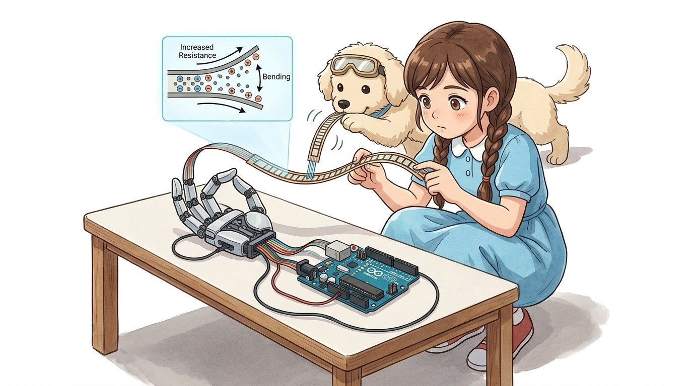
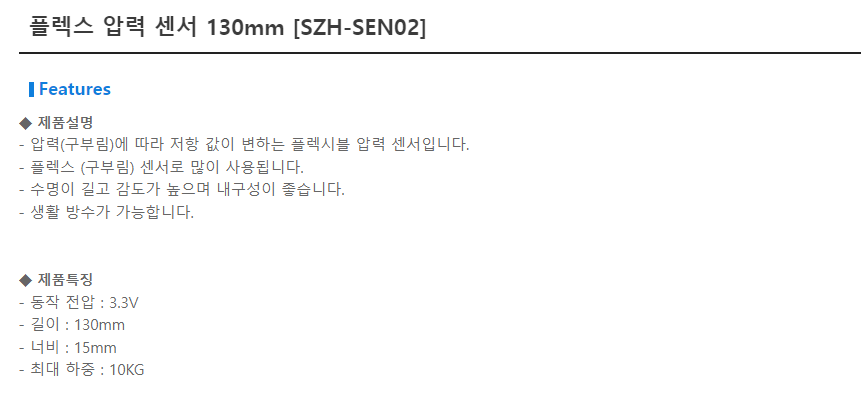
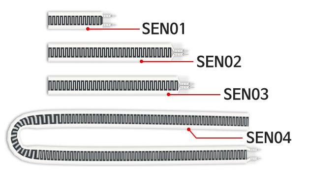
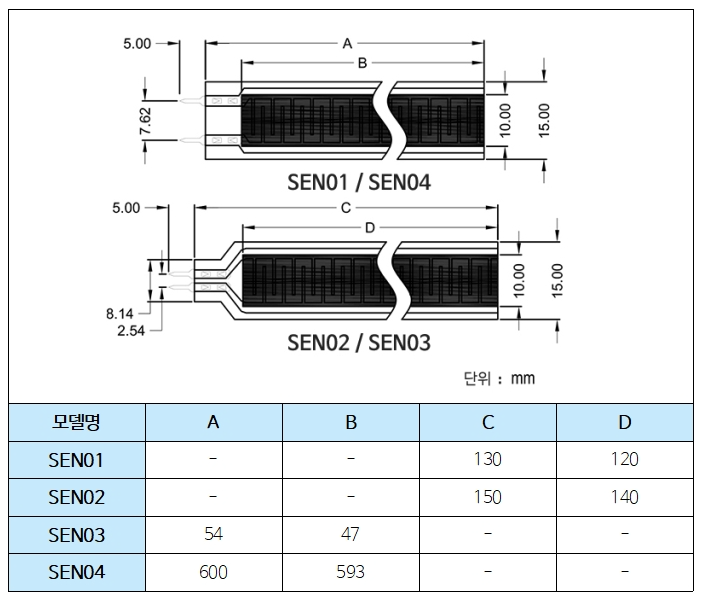
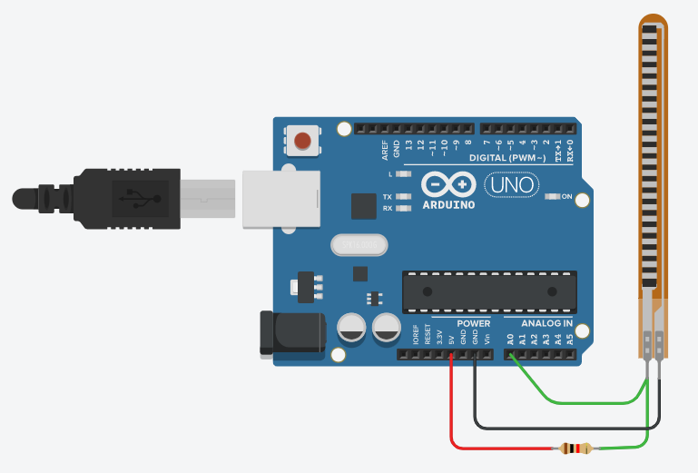
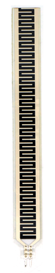
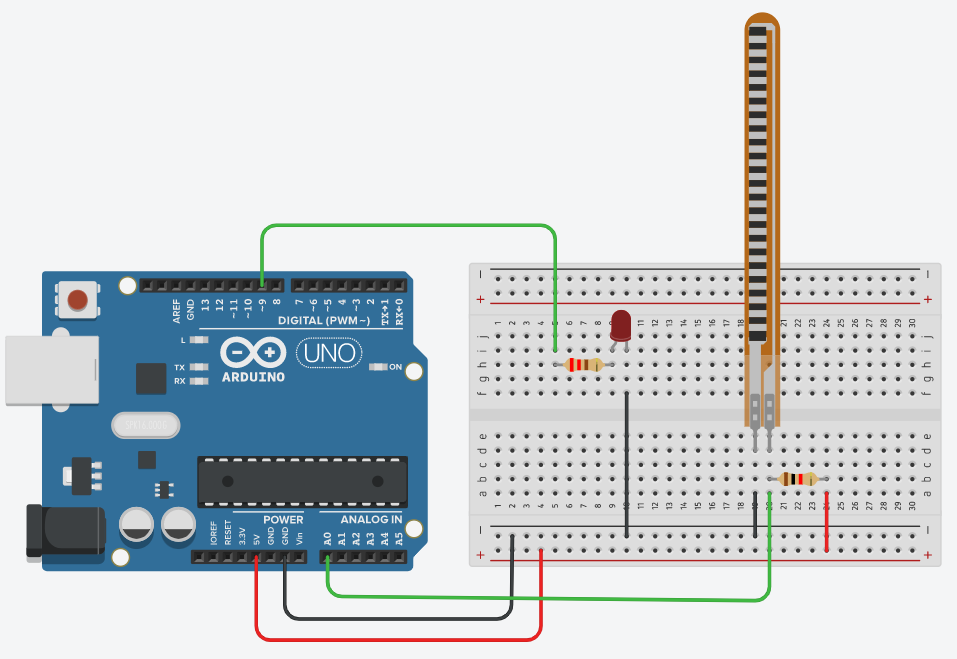

# 054_플렉스휨센서_구부림각도측정 🎛️💡



**도로시와 지니가 함께하는 탄소 전도성 잉크 원리, 전압 분배 회로 및 손가락 관절 각도 측정 실습**
* 👧 **도로시**: "교수님! 지니야! 종이처럼 얇고 기다란 플라스틱 막대를 손가락으로 살짝 구부리기만 해도 아두이노가 얼마나 휘었는지 알아맞힐 수 있어?"
* **👨‍🏫 이호진 교수님**: "그럼! 구부러지는 곡률(각도)에 따라 내부 저항이 변하는 **플렉스 센서(Flex Sensor)** 란다! 가상현실(VR) 데이터 장갑이나 로봇 의수의 손가락 관절 제어에 널리 쓰이지!"
* 🐶 **토토**: "바우! 손가락을 굽히면 로봇 손도 똑같이 주먹을 쥔다 멍!"
* 📖 **상세 강의 교재**: [index.md](./index.md)


> 여러분 안녕하세요! 이번 시간에는 '054. 플렉스휨센서 구부림각도측정 🎛️💡'을 주제로 함께 흥미진진한 탐험을 떠나보겠습니다. 오늘 강의에서는 특히 도로시와 지니가 함께하는 탄소 전도성 잉크 원리, 전압 분배 회로 및 손가락 관절 각도 측정 실습, 👧 도로시: "교수님! 지니야! 종이처럼 얇고 기다란 플라스틱 막대를 손가락으로 살짝 구부리기만 해도 아두이노가 얼마나 휘었는지 알아맞힐 수 있어?"를 중심으로 핵심 원리와 응용 방법을 차근차근 배워보겠습니다. 이호진 교수님과 똑똑한 조수 지니, 호기심 많은 도로시와 토토와 함께 신나는 아두이노 모험을 힘차게 시작해 봅시다. 준비되셨나요?

---

## 1. 플렉스 센서(Flex Sensor)의 구조와 물리적 외형



* **유연한 폴리이미드 기판**: 얇고 잘 휘어지는 특수 필름(Kapton 등)을 베이스로 제작됩니다.
* **탄소 전도성 잉크 (Carbon Resistive Ink)**: 미세한 탄소 입자들이 포함된 전도성 잉크가 빗살무늬 패턴으로 정교하게 인쇄되어 있습니다.
* **무극성(Non-polarized) 2단자 소자**:
* 일반 저항처럼 극성(+/- 구분)이 없으므로, 2개의 리드선 중 어느 쪽을 5V나 신호선에 연결해도 동일하게 정상 작동합니다.

### 📏 유연한 기판 위에 도포된 탄소 저항체

> 이번 슬라이드에서는 '1. 플렉스 센서(Flex Sensor)의 구조와 물리적 외형'에 대해 자세히 살펴보겠습니다. 화면의 다이어그램과 사진을 함께 참고해 주시기 바랍니다. 첫 번째 핵심은 유연한 폴리이미드 기판: 얇고 잘 휘어지는 특수 필름(Kapton 등)을 베이스로 제작됩니다.이며, 두 번째로는 탄소 전도성 잉크 (Carbon Resistive Ink): 미세한 탄소 입자들이 포함된 전도성 잉크가 빗살무늬 패턴으로 정교하게 인쇄되어 있습니다.입니다. 여기에 덧붙여 무극성(Non-polarized) 2단자 소자 내용까지 함께 이해해 두시면 완벽합니다. 이 원리는 아두이노 시스템 전체를 관통하는 핵심 논리이므로 머릿속에 꼭 정리해 두시기 바랍니다.

---

## 2. 작동 원리: 굽힘 곡률과 탄소 입자 간격의 변화



1. **평평하게 펴져 있을 때 (Flat State)**:
* 센서 표면의 탄소 전도성 입자들이 서로 빽빽하게 밀착되어 있습니다.
* 전자가 이동할 수 있는 통로가 넓어 전류가 비교적 수월하게 흐릅니다 (**낮은 저항: 약 10kΩ ~ 30kΩ**).
2. **바깥쪽으로 구부릴 때 (Bent State)**:
* 기판이 휠수록 바깥쪽 표면이 인장력(Tension)을 받아 미세하게 늘어납니다.
* 밀착되어 있던 탄소 입자들 사이가 벌어지면서 전자의 이동 경로가 좁아지고 방해를 받습니다.
* 결과적으로 저항값이 급격히 상승합니다 (**높은 저항: 약 60kΩ ~ 100kΩ 이상**).

### 🔬 마이크로 레벨에서 일어나는 전도 경로의 변화

> 이번 슬라이드에서는 '2. 작동 원리: 굽힘 곡률과 탄소 입자 간격의 변화'에 대해 자세히 살펴보겠습니다. 화면의 다이어그램과 사진을 함께 참고해 주시기 바랍니다. 첫 번째 핵심은 평평하게 펴져 있을 때 (Flat State)이며, 두 번째로는 센서 표면의 탄소 전도성 입자들이 서로 빽빽하게 밀착되어 있습니다.입니다. 여기에 덧붙여 전자가 이동할 수 있는 통로가 넓어 전류가 비교적 수월하게 흐릅니다 (낮은 저항: 약 10kΩ ~ 30kΩ). 내용까지 함께 이해해 두시면 완벽합니다. 이 원리는 아두이노 시스템 전체를 관통하는 핵심 논리이므로 머릿속에 꼭 정리해 두시기 바랍니다.

---

## 3. 전압 분배 회로(Voltage Divider)의 필요성과 설계



* 센서를 구부리면 $R_{\text{flex}}$가 커지므로 분모가 커져 $V_{\text{out}}$ 전압은 낮아집니다.
* 센서를 펴면 $R_{\text{flex}}$가 작아지므로 $V_{\text{out}}$ 전압은 높아집니다.
* 아두이노는 이 $V_{\text{out}}$을 10비트 ADC(0 ~ 1023) 디지털 정수로 읽어냅니다!

### ⚖️ 변화하는 저항값($R$)을 아날로그 전압($V$)으로 변환하는 공식
아두이노의 아날로그 핀(A0)은 저항값 자체를 직접 측정하지 못하고, 오직 **0V ~ 5V 사이의 전압**만을 감지할 수 있습니다. 따라서 고정 기준 저항($R_1 = 10\text{k}\Omega$)과 플렉스 센서($R_{\text{flex}}$)를 직렬로 연결하여 전압 분배기를 구성합니다:
$$V_{\text{out}} = V_{\text{cc}} \times \frac{R_1}{R_{\text{flex}} + R_1}$$

> 이번에 살펴볼 내용은 '3. 전압 분배 회로(Voltage Divider)의 필요성과 설계'입니다. 화면의 회로도와 부품 사진을 보면서 각 핀과 배선이 어떻게 구성되어 있는지 눈으로 직접 따라와 주시기 바랍니다. 첫째로 센서를 구부리면 $R{\text{flex}}$가 커지므로 분모가 커져 $V{\text{out}}$ 전압은 낮아집니다.에 유의해야 하며, 둘째로 센서를 펴면 $R{\text{flex}}$가 작아지므로 $V{\text{out}}$ 전압은 높아집니다.라는 점이 핵심입니다. 이 기본 개념을 확실히 잡아두셔야 실제 부품을 브레드보드에 꽂고 코딩할 때 실수 없이 완성할 수 있습니다.

---

## 4. 하드웨어 배선 및 브레드보드 결선



1. **플렉스 센서 단자 1**: 아두이노 **5V 전원선**에 연결합니다.
2. **플렉스 센서 단자 2**: 브레드보드의 동일한 열에서 **아두이노 A0 핀**과 연결합니다.
3. **10kΩ 고정 저항**: A0 노드와 **아두이노 GND** 사이에 직렬로 연결합니다.
4. **PWM 출력 LED**: 디지털 **9번 핀** ➡️ 220Ω 저항 ➡️ LED 긴 다리(+) ➡️ 짧은 다리(-) ➡️ GND.

### 🔌 브레드보드 연결 체크리스트

> 이번 슬라이드에서는 '4. 하드웨어 배선 및 브레드보드 결선'에 대해 자세히 살펴보겠습니다. 화면의 다이어그램과 사진을 함께 참고해 주시기 바랍니다. 첫 번째 핵심은 플렉스 센서 단자 1: 아두이노 5V 전원선에 연결합니다.이며, 두 번째로는 플렉스 센서 단자 2: 브레드보드의 동일한 열에서 아두이노 A0 핀과 연결합니다.입니다. 여기에 덧붙여 kΩ 고정 저항: A0 노드와 아두이노 GND 사이에 직렬로 연결합니다. 내용까지 함께 이해해 두시면 완벽합니다. 이 원리는 아두이노 시스템 전체를 관통하는 핵심 논리이므로 머릿속에 꼭 정리해 두시기 바랍니다.

---
## 5. 실습 전체 코드: 휨 각도 측정 및 LED 밝기 연동 (Arduino C++)




### 💻 구부린 정도에 따라 LED 밝기가 비례하여 변하는 펌웨어

```cpp
// 핀 번호 정의
const int FLEX_PIN = A0;  // 전압 분배 회로 출력이 연결된 아날로그 입력 핀
const int LED_PIN  = 9;   // PWM 밝기 제어가 가능한 디지털 출력 핀

// 센서 캘리브레이션 임계값 (실제 환경 측정치에 맞게 조절)
const int FLEX_FLAT = 750; // 센서를 완전히 폈을 때의 A0 측정값
const int FLEX_BENT = 950; // 센서를 90도 이상 최대로 구부렸을 때의 A0 측정값

void setup() {
  // PC 시리얼 모니터 통신 시작 (9600 bps)
  Serial.begin(9600);
  
  // LED 핀을 출력 모드로 설정
  pinMode(LED_PIN, OUTPUT);
  
  Serial.println("============================================");
  Serial.println("   Flex Sensor Angle & LED Dimmer Ready!    ");
  Serial.println("============================================");
}

void loop() {
  // 1. 플렉스 센서의 분배 전압을 아날로그 값으로 읽기 (0 ~ 1023)
  int rawValue = analogRead(FLEX_PIN);

  // 2. 센서 측정 범위를 LED PWM 제어 범위(0 ~ 255)로 비례 매핑
  int brightness = map(rawValue, FLEX_FLAT, FLEX_BENT, 0, 255);

  // 3. 센서가 범위를 벗어나더라도 0~255 내에 머물도록 안전 제한
  brightness = constrain(brightness, 0, 255);

  // 4. 계산된 듀티비로 LED 아날로그(PWM) 출력
  analogWrite(LED_PIN, brightness);

  // 5. 시리얼 모니터로 실시간 디버깅 수치 출력
  Serial.print("Raw ADC: ");
  Serial.print(rawValue);
  Serial.print(" | LED Brightness: ");
  Serial.println(brightness);

  // 0.1초 대기 (안정적인 관측용 지연)
  delay(100);
}
```

> 이번 슬라이드에서는 '5. 실습 전체 코드: 휨 각도 측정 및 LED 밝기 연동 (Arduino C++)'에 대한 실제 동작 코드를 분석해 보겠습니다. 화면의 코드를 살펴보시면, 컴퓨터가 아두이노 하드웨어에 단계별로 명령을 내리는 흐름을 명확하게 확인할 수 있습니다. 각 함수의 역할과 괄호 안의 매개변수가 하드웨어 핀과 어떤 관계를 맺고 동작하는지 주의 깊게 살펴보시기 바랍니다.
---

## 6. 코드 상세 해설 및 `map()` / `constrain()` 원리



1. **`map(rawValue, FLEX_FLAT, FLEX_BENT, 0, 255)`**:
* 센서에서 읽은 임의의 ADC 범위(예: 750 ~ 950)를 LED PWM 출력 규격인 `0 ~ 255`로 수학적 일차방정식 비례 변환합니다:
2. **`constrain(brightness, 0, 255)`**:
* 손가락을 과도하게 구부리거나 폈을 때 `map()` 함수는 음수나 255를 초과하는 값을 뱉을 수 있습니다.
* `constrain()`은 값이 0 미만이면 0으로, 255 초과면 255로 단단하게 고정하여 마이크로컨트롤러의 오동작을 원천 방지합니다.

### 🔍 데이터 가공 함수의 핵심 메커니즘
$$\text{brightness} = (\text{rawValue} - 750) \times \frac{255 - 0}{950 - 750} + 0$$

> 이번 슬라이드에서는 '6. 코드 상세 해설 및 map() / constrain() 원리'에 대해 자세히 살펴보겠습니다. 화면의 다이어그램과 사진을 함께 참고해 주시기 바랍니다. 첫 번째 핵심은 map(rawValue, FLEXFLAT, FLEXBENT, 0, 255)이며, 두 번째로는 센서에서 읽은 임의의 ADC 범위(예: 750 ~ 950)를 LED PWM 출력 규격인 0 ~ 255로 수학적 일차방정식 비례 변환합니다입니다. 여기에 덧붙여 constrain(brightness, 0, 255) 내용까지 함께 이해해 두시면 완벽합니다. 이 원리는 아두이노 시스템 전체를 관통하는 핵심 논리이므로 머릿속에 꼭 정리해 두시기 바랍니다.

---
## 🌟 도로시와 지니의 핵심 요약 노트!


* 👧 **도로시**: "플렉스 센서와 10kΩ 저항으로 전압 분배기를 만들고, `map()`과 `constrain()`으로 손가락 구부림을 LED 밝기로 바꾸니 로봇 손가락을 만든 기분이야!"
* **👨‍🏫 이호진 교수님**: "서보 모터를 연결하면 도로시가 손가락을 굽힐 때 로봇 손가락도 똑같이 굽히는 마스터-슬레이브 글러브를 만들 수 있단다!"
* 🐶 **토토**: "바우! 다음 시간엔 꾹 누르는 힘을 재는 압력 센서를 만나보자 멍!"

| 핵심 요소 | 내용 |
| :--- | :--- |
| **감지 물리량** | 굽힘 곡률(각도, Bending Angle) |
| **변환 메커니즘**| 탄소 잉크 입자 간격 변화 ➡️ 저항값 변화 |
| **필수 보조 회로**| 10kΩ 저항을 이용한 전압 분배 회로 (Voltage Divider) |
| **주요 응용 분야**| VR 데이터 글러브, 로봇 의수 제어, 물리치료 관절 모니터링 |

> 오늘 배운 '🌟 도로시와 지니의 핵심 요약 노트!'의 핵심 내용을 모두 정리해 보았습니다. 오늘 다룬 내용 중에서도 👧 도로시: "플렉스 센서와 10kΩ 저항으로 전압 분배기를 만들고, map()과 constrain()으로 손가락 구부림을 LED 밝기로 바꾸니 로봇 손가락을 만든 기분이야!" 부분은 앞으로의 아두이노 실습과 프로젝트에서 계속 사용되는 매우 중요한 기초 지식입니다. 오늘 배운 내용을 꼭 다시 한번 복습해 보시고, 다음 강의에서 더욱 신나고 유익한 모험으로 다시 만나겠습니다. 모두 수고 많으셨습니다!