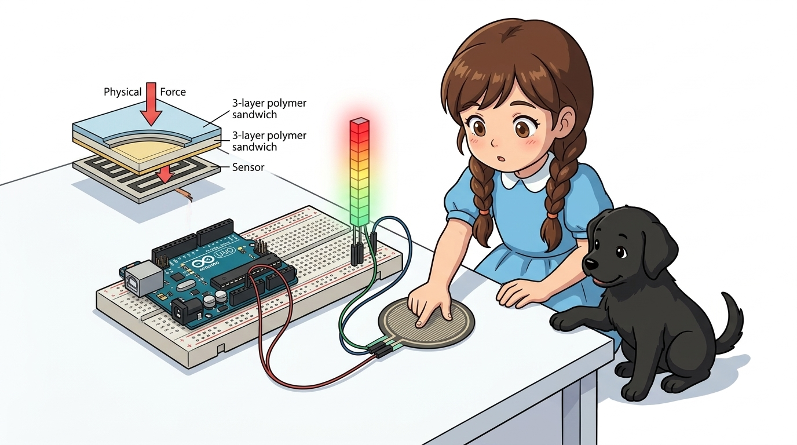
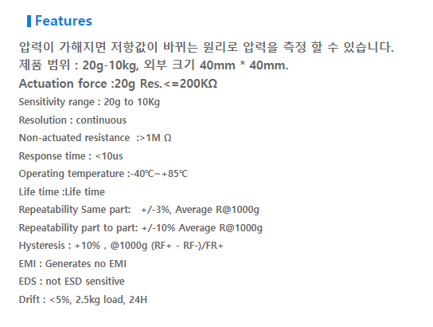
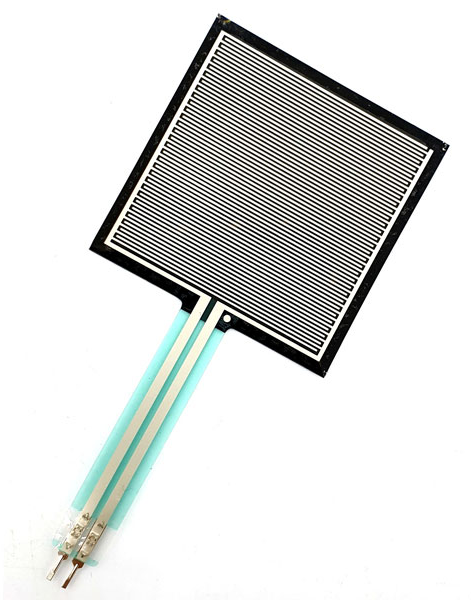
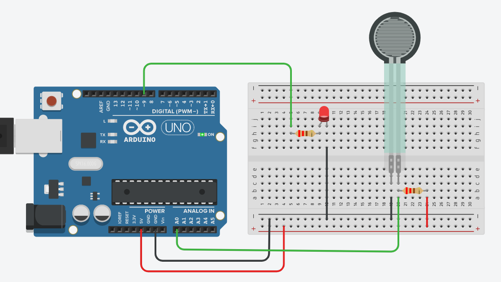
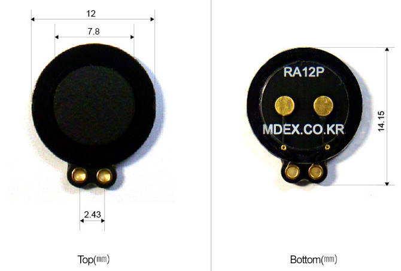
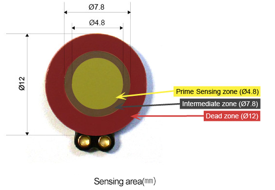
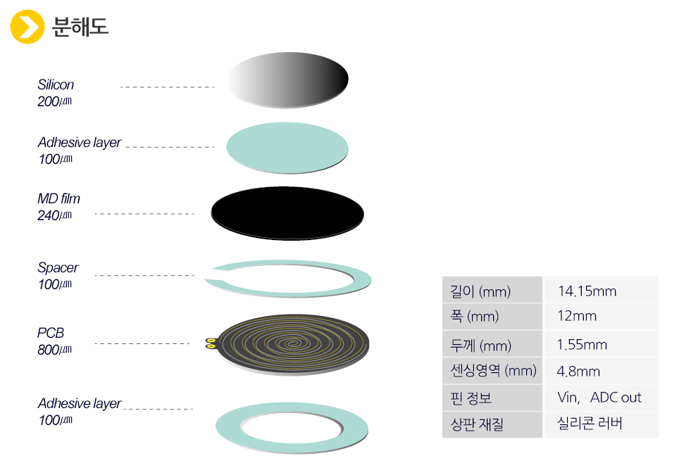
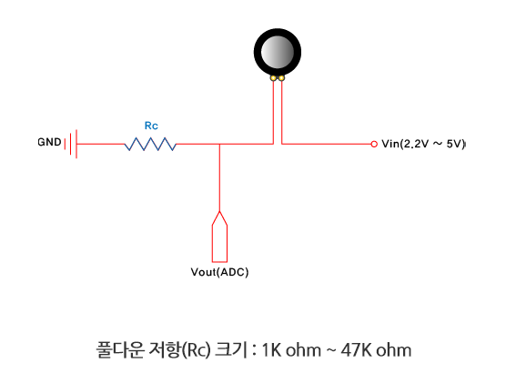

# 055_압력센서FSR_누르는힘측정 🌡️🧪



**도로시와 지니가 함께하는 압력 감응 저항(FSR)의 물리적 원리, 전압 분배 회로 및 가변 터치 감도 측정 실습**
* 👧 **도로시**: "교수님! 지니야! 동그란 센서 패드를 손가락으로 살짝 건드렸을 때랑 온 힘을 다해 꾹 눌렀을 때를 아두이노가 어떻게 구별해?"
* **👨‍🏫 이호진 교수님**: "누르는 물리적인 힘(Force)의 세기에 반비례하여 전기 저항이 뚝 떨어지는 **FSR(Force Sensing Resistor) 압력 센서** 덕분이란다!"
* 🐶 **토토**: "바우! 전자 드럼 패드를 세게 치면 큰 소리가 나는 원리와 똑같다 멍!"
* 📖 **상세 강의 교재**: [index.md](./index.md)


> 여러분 안녕하세요! 이번 시간에는 '055. 압력센서FSR 누르는힘측정 🌡️🧪'을 주제로 함께 흥미진진한 탐험을 떠나보겠습니다. 오늘 강의에서는 특히 도로시와 지니가 함께하는 압력 감응 저항(FSR)의 물리적 원리, 전압 분배 회로 및 가변 터치 감도 측정 실습, 👧 도로시: "교수님! 지니야! 동그란 센서 패드를 손가락으로 살짝 건드렸을 때랑 온 힘을 다해 꾹 눌렀을 때를 아두이노가 어떻게 구별해?"를 중심으로 핵심 원리와 응용 방법을 차근차근 배워보겠습니다. 이호진 교수님과 똑똑한 조수 지니, 호기심 많은 도로시와 토토와 함께 신나는 아두이노 모험을 힘차게 시작해 봅시다. 준비되셨나요?

---

## 1. FSR(Force Sensing Resistor) 센서의 외형과 구조



* **상부 전도성 패턴 필름**: 빗살 모양의 미세한 은(Silver) 전극 라인이 서로 닿지 않게 인쇄되어 있습니다.
* **하부 압력 감응 반도체 필름**: 압력을 받으면 입자 사이의 저항이 변하는 특수 고분자 전도성 폴리머(Polymer) 시트입니다.
* **스페이서(Spacer)**: 외력이 가해지지 않을 때는 두 필름이 서로 닿지 않도록 미세한 공기 간극을 유지해 줍니다.
* **무극성(Non-polarized) 2단자**: 극성이 없어 2개의 핀 중 어느 쪽을 5V나 신호선에 꽂아도 완벽히 동일하게 동작합니다.

### 🐾 3층 샌드위치 필름 구조

> 이번 슬라이드에서는 '1. FSR(Force Sensing Resistor) 센서의 외형과 구조'에 대해 자세히 살펴보겠습니다. 화면의 다이어그램과 사진을 함께 참고해 주시기 바랍니다. 첫 번째 핵심은 상부 전도성 패턴 필름: 빗살 모양의 미세한 은(Silver) 전극 라인이 서로 닿지 않게 인쇄되어 있습니다.이며, 두 번째로는 하부 압력 감응 반도체 필름: 압력을 받으면 입자 사이의 저항이 변하는 특수 고분자 전도성 폴리머(Polymer) 시트입니다.입니다. 여기에 덧붙여 스페이서(Spacer): 외력이 가해지지 않을 때는 두 필름이 서로 닿지 않도록 미세한 공기 간극을 유지해 줍니다. 내용까지 함께 이해해 두시면 완벽합니다. 이 원리는 아두이노 시스템 전체를 관통하는 핵심 논리이므로 머릿속에 꼭 정리해 두시기 바랍니다.

---

## 2. 작동 메커니즘: 압력과 저항의 반비례 관계 (Logarithmic Curve)



1. **외력이 없을 때 (No Pressure)**:
* 스페이서에 의해 두 필름이 격리되어 있으므로 전기가 통하지 않습니다 (**저항: 무한대 $\infty$, 수 MΩ 이상**).
2. **가볍게 터치했을 때 (Light Touch, 약 20g ~ 100g)**:
* 미세한 돌기들이 살짝 접촉하며 전도가 시작됩니다 (**저항: 약 50kΩ ~ 100kΩ**).
3. **강하게 꾹 눌렀을 때 (Heavy Press, 1kg ~ 10kg 이상)**:
* 전도성 고분자 입자들이 강한 압력으로 압축 밀착되어 무수히 많은 미세 전도 통로가 열립니다 (**저항: 수백 $\Omega$ 이하로 급감**).

### 🔬 힘을 가할수록 전도 경로가 폭발적으로 증가!

> 이번 슬라이드에서는 '2. 작동 메커니즘: 압력과 저항의 반비례 관계 (Logarithmic Curve)'에 대해 자세히 살펴보겠습니다. 화면의 다이어그램과 사진을 함께 참고해 주시기 바랍니다. 첫 번째 핵심은 외력이 없을 때 (No Pressure)이며, 두 번째로는 스페이서에 의해 두 필름이 격리되어 있으므로 전기가 통하지 않습니다 (저항: 무한대 $\infty$, 수 MΩ 이상).입니다. 여기에 덧붙여 가볍게 터치했을 때 (Light Touch, 약 20g ~ 100g) 내용까지 함께 이해해 두시면 완벽합니다. 이 원리는 아두이노 시스템 전체를 관통하는 핵심 논리이므로 머릿속에 꼭 정리해 두시기 바랍니다.

---

## 3. 전압 분배 회로(Voltage Divider)의 결선과 수학 공식



* **누르지 않았을 때**: $R_{\text{FSR}} \approx \infty$ 이므로 $V_{\text{out}} \approx 0\text{V}$ (ADC 측정값 0 부근).
* **약하게 눌렀을 때**: $R_{\text{FSR}} \approx 50\text{k}\Omega \rightarrow V_{\text{out}} \approx 0.83\text{V}$ (ADC 측정값 약 170).
* **강하게 눌렀을 때**: $R_{\text{FSR}} \approx 200\Omega \rightarrow V_{\text{out}} \approx 4.9\text{V}$ (ADC 측정값 약 1000).

### ⚡ $R_{\text{FSR}}$ 저항 변화를 아날로그 전압 $V_{\text{out}}$으로 변환
아두이노 A0 핀은 저항을 직접 읽을 수 없으므로 10kΩ 기준 저항과 직렬로 연결합니다:
$$V_{\text{out}} = 5\text{V} \times \frac{10\text{k}\Omega}{R_{\text{FSR}} + 10\text{k}\Omega}$$

> 이번에 살펴볼 내용은 '3. 전압 분배 회로(Voltage Divider)의 결선과 수학 공식'입니다. 화면의 회로도와 부품 사진을 보면서 각 핀과 배선이 어떻게 구성되어 있는지 눈으로 직접 따라와 주시기 바랍니다. 첫째로 누르지 않았을 때: $R{\text{FSR}} \approx \infty$ 이므로 $V{\text{out}} \approx 0\text{V}$ (ADC 측정값 0 부근).에 유의해야 하며, 둘째로 약하게 눌렀을 때: $R{\text{FSR}} \approx 50\text{k}\Omega \rightarrow V{\text{out}} \approx 0.83\text{V}$ (ADC 측정값 약 170).라는 점이 핵심입니다. 이 기본 개념을 확실히 잡아두셔야 실제 부품을 브레드보드에 꽂고 코딩할 때 실수 없이 완성할 수 있습니다.

---

## 4. 팅커캐드 시뮬레이터 배선 연결



1. **FSR 단자 1**: 아두이노 **5V** 레일에 연결.
2. **FSR 단자 2**: 브레드보드 동일 열에서 아두이노 **A0 핀**에 연결.
3. **10kΩ 고정 풀다운 저항**: A0 노드와 **GND** 사이에 연결.
4. **PWM 출력 LED**: 아두이노 **9번 핀** ➡️ 220Ω 저항 ➡️ LED 애노드(+) ➡️ 캐소드(-) ➡️ GND.

### 🔌 브레드보드 연결 체크리스트

> 이번 슬라이드에서는 '4. 팅커캐드 시뮬레이터 배선 연결'에 대해 자세히 살펴보겠습니다. 화면의 다이어그램과 사진을 함께 참고해 주시기 바랍니다. 첫 번째 핵심은 FSR 단자 1: 아두이노 5V 레일에 연결.이며, 두 번째로는 FSR 단자 2: 브레드보드 동일 열에서 아두이노 A0 핀에 연결.입니다. 여기에 덧붙여 kΩ 고정 풀다운 저항: A0 노드와 GND 사이에 연결. 내용까지 함께 이해해 두시면 완벽합니다. 이 원리는 아두이노 시스템 전체를 관통하는 핵심 논리이므로 머릿속에 꼭 정리해 두시기 바랍니다.

---
## 5. 실습 전체 코드: 압력 감응형 스마트 무드등 (Arduino C++)




### 💻 누르는 힘의 세기에 비례하여 LED 밝기를 정밀 조절하는 펌웨어

```cpp
// 핀 번호 상수 정의
const int FSR_PIN = A0;  // FSR 전압 분배 회로가 연결된 아날로그 입력 핀
const int LED_PIN = 9;   // PWM 아날로그 출력이 가능한 디지털 핀

// 센서 측정 임계치 (환경에 따라 보정 가능)
const int FSR_MIN_THRESHOLD = 50;  // 가벼운 노이즈를 필터링하는 최솟값
const int FSR_MAX_THRESHOLD = 900; // 최대 압력 기준값

void setup() {
  // PC 시리얼 모니터 통신 시작 (9600 bps)
  Serial.begin(9600);
  
  // LED 핀을 출력 모드로 설정
  pinMode(LED_PIN, OUTPUT);
  
  Serial.println("=========================================");
  Serial.println("   FSR Pressure Sensor & PWM LED Ready!  ");
  Serial.println("=========================================");
}

void loop() {
  // 1. A0 핀에서 아날로그 전압 측정 (0 ~ 1023)
  int fsrRaw = analogRead(FSR_PIN);

  int brightness = 0;

  // 2. 최소 압력 이상일 때만 반응하도록 노이즈 컷오프 적용
  if (fsrRaw > FSR_MIN_THRESHOLD) {
    // 측정된 ADC 범위를 0 ~ 255 LED PWM 범위로 매핑
    brightness = map(fsrRaw, FSR_MIN_THRESHOLD, FSR_MAX_THRESHOLD, 0, 255);
    // 0 ~ 255 범위를 벗어나지 않도록 안전 제한
    brightness = constrain(brightness, 0, 255);
  }

  // 3. LED에 계산된 밝기 출력
  analogWrite(LED_PIN, brightness);

  // 4. 시리얼 모니터 디버깅 출력
  Serial.print("FSR Raw Value: ");
  Serial.print(fsrRaw);
  Serial.print(" -> LED Brightness: ");
  Serial.println(brightness);

  // 0.1초 지연 후 다음 루프 실행
  delay(100);
}
```

> 이번 슬라이드에서는 '5. 실습 전체 코드: 압력 감응형 스마트 무드등 (Arduino C++)'에 대한 실제 동작 코드를 분석해 보겠습니다. 화면의 코드를 살펴보시면, 컴퓨터가 아두이노 하드웨어에 단계별로 명령을 내리는 흐름을 명확하게 확인할 수 있습니다. 각 함수의 역할과 괄호 안의 매개변수가 하드웨어 핀과 어떤 관계를 맺고 동작하는지 주의 깊게 살펴보시기 바랍니다.
---

## 6. 코드 상세 해설 및 노이즈 필터링 원리



1. **`if (fsrRaw > FSR_MIN_THRESHOLD)`**:
* 센서 표면이 공기 중에 노출되어 있을 때 정전기나 미세한 기계적 접촉으로 인해 0~30 사이의 불필요한 노이즈가 발생할 수 있습니다.
* `FSR_MIN_THRESHOLD(50)` 이상으로 확실하게 손가락이 닿았을 때만 LED를 켜도록 하여 불필요한 미세 깜빡임을 완벽히 차단합니다.
2. **선형 보간과 `constrain()`**:
* FSR의 저항 변화는 실제로는 비선형(로그 곡선)이지만, `map()`과 `constrain()`을 통해 인간의 눈에 가장 자연스러운 선형 밝기 변화로 매끄럽게 매핑합니다.

### 🔍 노이즈 컷오프(Deadband)와 비례 제어 분석

> 이번 슬라이드에서는 '6. 코드 상세 해설 및 노이즈 필터링 원리'에 대해 자세히 살펴보겠습니다. 화면의 다이어그램과 사진을 함께 참고해 주시기 바랍니다. 첫 번째 핵심은 if (fsrRaw > FSRMINTHRESHOLD)이며, 두 번째로는 센서 표면이 공기 중에 노출되어 있을 때 정전기나 미세한 기계적 접촉으로 인해 0~30 사이의 불필요한 노이즈가 발생할 수 있습니다.입니다. 여기에 덧붙여 FSRMINTHRESHOLD(50) 이상으로 확실하게 손가락이 닿았을 때만 LED를 켜도록 하여 불필요한 미세 깜빡임을 완벽히 차단합니다. 내용까지 함께 이해해 두시면 완벽합니다. 이 원리는 아두이노 시스템 전체를 관통하는 핵심 논리이므로 머릿속에 꼭 정리해 두시기 바랍니다.

---

## 7. 실생활 속 압력 센서의 다양한 응용 사례



* **전자 악기 (MIDI Touch Sensitive Keyboards & Drums)**:
* 피아노 건반이나 전자 드럼 패드를 세게 치면 큰 소리(Velocity), 살살 치면 부드러운 소리를 내는 다이내믹 터치 감도 구현.
* **로봇 그리퍼 (Robotic Soft Gripper)**:
* 로봇 팔이 두부나 달걀, 유리잔처럼 깨지기 쉬운 물체를 잡을 때 물체가 으스러지지 않도록 정밀한 파지력 제어.
* **스마트 헬스케어 방석 & 깔창**:
* 의자에 앉은 자세의 좌우 균형을 분석하여 거북목이나 척추 측만 교정 알림 제공.

> 이번 슬라이드에서는 '7. 실생활 속 압력 센서의 다양한 응용 사례'에 대해 자세히 살펴보겠습니다. 화면의 다이어그램과 사진을 함께 참고해 주시기 바랍니다. 첫 번째 핵심은 전자 악기 (MIDI Touch Sensitive Keyboards & Drums)이며, 두 번째로는 피아노 건반이나 전자 드럼 패드를 세게 치면 큰 소리(Velocity), 살살 치면 부드러운 소리를 내는 다이내믹 터치 감도 구현.입니다. 여기에 덧붙여 로봇 그리퍼 (Robotic Soft Gripper) 내용까지 함께 이해해 두시면 완벽합니다. 이 원리는 아두이노 시스템 전체를 관통하는 핵심 논리이므로 머릿속에 꼭 정리해 두시기 바랍니다.

---
## 🌟 도로시와 지니의 핵심 요약 노트!


* 👧 **도로시**: "누르는 힘에 따라 저항이 쑥 떨어져서 전압 분배로 손가락의 미세한 힘까지 측정할 수 있구나!"
* **👨‍🏫 이호진 교수님**: "맞아! 이 압력 센서로 토토의 발바닥 도어 매트를 만들면 토토가 문 앞에 왔을 때 자동으로 차임벨을 울려줄 수 있단다."
* 🐶 **토토**: "바우! 다음엔 빛을 감지하는 포토 인터럽터 센서를 만나러 가자 멍!"

| 비교 항목 | 플렉스(Flex) 센서 | 압력(FSR) 센서 |
| :--- | :--- | :--- |
| **감지 대상** | 휨 각도 및 곡률 | 수직으로 누르는 힘 (Weight / Pressure) |
| **저항 변화** | 구부릴수록 **저항 증가** ($\uparrow$) | 누를수록 **저항 급감** ($\downarrow$) |
| **핵심 회로** | 10kΩ 풀다운 전압 분배기 | 10kΩ 풀다운 전압 분배기 |
| **출력 신호** | 아날로그 전압 (0 ~ 5V) | 아날로그 전압 (0 ~ 5V) |

> 오늘 배운 '🌟 도로시와 지니의 핵심 요약 노트!'의 핵심 내용을 모두 정리해 보았습니다. 오늘 다룬 내용 중에서도 👧 도로시: "누르는 힘에 따라 저항이 쑥 떨어져서 전압 분배로 손가락의 미세한 힘까지 측정할 수 있구나!" 부분은 앞으로의 아두이노 실습과 프로젝트에서 계속 사용되는 매우 중요한 기초 지식입니다. 오늘 배운 내용을 꼭 다시 한번 복습해 보시고, 다음 강의에서 더욱 신나고 유익한 모험으로 다시 만나겠습니다. 모두 수고 많으셨습니다!