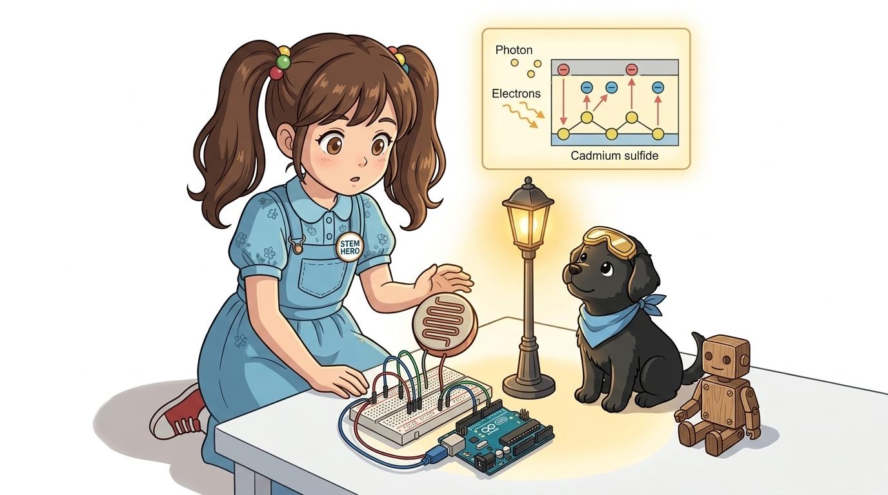
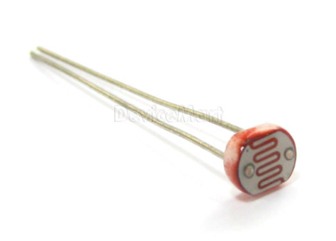
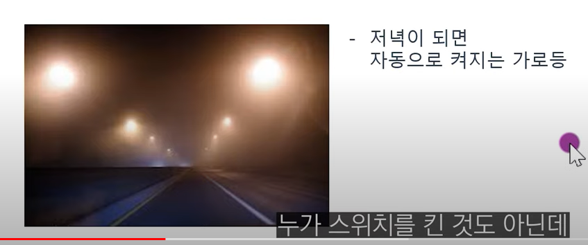
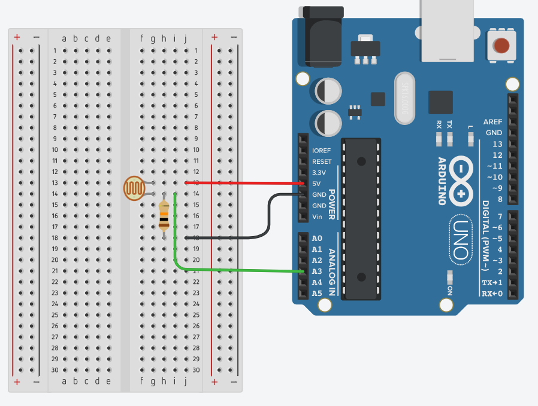
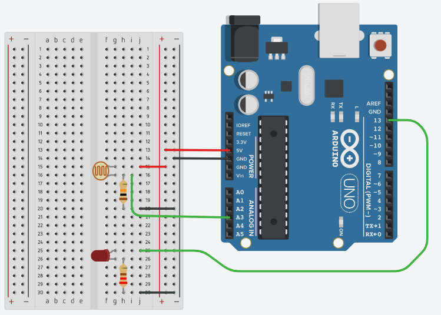
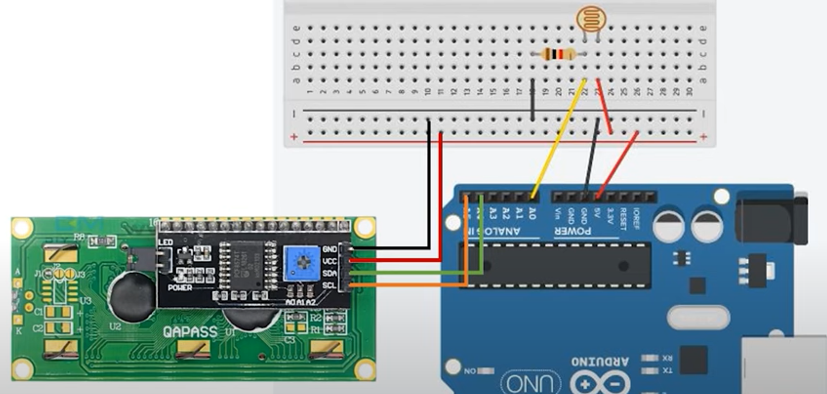

# 056_조도CdS센서_스마트가로등 🔥💧



**도로시와 지니가 함께하는 광전도 효과(Photoelectric Effect), 10kΩ 전압 분배 회로 및 스마트 가로등 자동 제어 실습**

* 👧 **도로시**: "교수님! 지니야! 해가 지고 밤이 되면 길가의 가로등이 스스로 환하게 켜지잖아! 아두이노도 낮과 밤의 밝기를 눈으로 볼 수 있어?"
* **👨‍🏫 이호진 교수님**: "그럼! 빛의 광자 에너지를 받으면 내부 저항이 뚝 떨어지는 **CdS 광도전 셀(Photoresistor / 조도 센서)** 이 아두이노의 반짝이는 눈동자 역할을 해준단다!"
* 🐶 **토토**: "바우! 손바닥으로 센서를 덮어 가리면 캄캄한 밤인 줄 알고 불을 켠다 멍!"

* 🖥️ **강의 슬라이드**: [slides.md](./slides.md)

---

## 1. CdS 조도 센서(Photoresistor)의 외형과 구조



### ☀️ 황화카드뮴(CdS) 반도체 소자
* **세라믹 기판과 물결무늬 패턴**:
  * 둥근 세라믹 원판 위에 황화카드뮴(Cadmium Sulfide, CdS) 박막이 구불구불한 뱀 모양(인터디지털 전극)으로 인쇄되어 있습니다.
  * 표면적을 극대화하여 미세한 자연광이라도 최대한 많이 포집하도록 설계되었습니다.
* **무극성(Non-polarized) 2단자 소자**:
  * 일반 저항과 마찬가지로 플러스(+)와 마이너스(-)의 구분이 없으므로 어느 방향으로 꽂아도 완벽히 정상 동작합니다.

---

## 2. 작동 원리: 광도전 효과 (Photoconductive Effect)



### 🔬 빛 에너지가 만들어내는 전자의 자유로운 행진

1. **빛이 없을 때 (Dark State, 어두운 밤)**:
   * 반도체 결정 내부의 원자가띠(Valence Band)에 묶여 있는 전자들이 열에너지만으로는 전도띠(Conduction Band)로 뛰어넘지 못합니다.
   * 자유 전자가 거의 존재하지 않으므로 전류가 흐르지 못하고 저항이 매우 큽니다 (**암저항: 약 1MΩ ~ 10MΩ 이상**).
2. **빛이 쏟아질 때 (Light State, 밝은 대낮)**:
   * 빛의 광자(Photon) 에너지가 반도체 밴드갭 에너지보다 크면, 충돌한 전자가 에너지를 흡수하여 전도띠로 탈출(전자-양공 쌍 생성)합니다.
   * 수많은 자유 전자가 전하 운반자(Carrier) 역할을 수행하면서 저항이 급격히 낮아집니다 (**명저항: 수백 $\Omega$ ~ 수 k$\Omega$**).

---

## 3. 전압 분배 회로(Voltage Divider)와 전압 변화 특성



### ⚡ 10kΩ 기준 저항과의 직렬 결선 공식
아두이노 A3 핀에서 전압을 측정할 수 있도록 CdS 센서($R_{\text{cds}}$)와 10kΩ 고정 저항($R_1$)을 직렬 연결합니다:

$$V_{\text{out}} = 5\text{V} \times \frac{10\text{k}\Omega}{R_{\text{cds}} + 10\text{k}\Omega}$$

* **밝을 때 ($R_{\text{cds}} \approx 1\text{k}\Omega$)**:
  * 분모가 작아져 $V_{\text{out}} \approx 4.5\text{V}$ (ADC 아날로그 값: **900 ~ 1000** 고전압).
* **어두울 때 ($R_{\text{cds}} \approx 100\text{k}\Omega$)**:
  * 분모가 커져 $V_{\text{out}} \approx 0.45\text{V}$ (ADC 아날로그 값: **50 ~ 200** 저전압).

---

## 4. 스마트 가로등 회로 배선 가이드



### 🔌 부품 결선 체크리스트
1. **CdS 단자 1**: 아두이노 **5V** 전원 레일과 연결.
2. **CdS 단자 2**: 아두이노 **A3 아날로그 핀**에 연결.
3. **10kΩ 풀다운 저항**: 동일한 A3 노드에서 **GND**로 연결.
4. **가로등 LED**: 디지털 **13번 핀** ➡️ 220Ω 저항 ➡️ LED 긴 다리(+) ➡️ 짧은 다리(-) ➡️ GND.

---

## 5. 실습 전체 코드: 스마트 자동 가로등 (Arduino C++)

### 💻 주변 밝기를 감지하여 밤이 되면 자동으로 불을 켜는 펌웨어

```cpp
// 핀 번호 상수 정의
const int CDS_PIN = A3;  // 조도 센서 전압 분배 회로가 연결된 아날로그 핀
const int LED_PIN = 13;  // 스마트 가로등 제어용 디지털 출력 핀

// 조도 기준 임계값 (설치 환경 조명에 맞춰 조정)
const int DARK_THRESHOLD = 500; // 500 미만으로 어두워지면 밤으로 판단

void setup() {
  // PC 시리얼 모니터 통신 시작 (9600 bps)
  Serial.begin(9600);
  
  // LED 핀을 출력 모드로 설정
  pinMode(LED_PIN, OUTPUT);
  
  Serial.println("==========================================");
  Serial.println("   Smart Street Light & CdS Sensor Ready! ");
  Serial.println("==========================================");
}

void loop() {
  // 1. 현재 주변 밝기 아날로그 전압 읽기 (0 ~ 1023)
  int lightLevel = analogRead(CDS_PIN);

  // 2. 조도값에 따른 가로등 점멸 조건 분기
  if (lightLevel < DARK_THRESHOLD) {
    // 임계값 미만: 어두운 밤이 되었으므로 가로등 점등!
    digitalWrite(LED_PIN, HIGH);
    Serial.print("[NIGHT] Light Level: ");
    Serial.print(lightLevel);
    Serial.println(" -> Street Light ON 💡");
  } else {
    // 임계값 이상: 밝은 낮이므로 가로등 소등하여 절전!
    digitalWrite(LED_PIN, LOW);
    Serial.print("[DAY]   Light Level: ");
    Serial.print(lightLevel);
    Serial.println(" -> Street Light OFF 🌑");
  }

  // 0.2초 대기
  delay(200);
}
```

---

## 6. 코드 상세 해설 및 히스테리시스(Hysteresis) 안정화 팁



### 🔍 깜빡임(Flickering) 방지 제어 기법

1. **단일 임계값의 한계**:
   * 만약 해 질 녘 노을빛이 정확히 `500` 근처에서 일렁이면 가로등이 1초에도 수십 번 켜졌다 꺼졌다 하는 채터링(Flickering) 현상이 일어날 수 있습니다.
2. **히스테리시스 밴드(두 개의 임계값) 기법**:
   * 켤 때는 `450` 이하로 완전히 어두워졌을 때 켜고,
   * 끌 때는 `550` 이상으로 확실하게 밝아졌을 때 끄도록 상한선과 하한선을 분리하면 깜빡임 없는 명품 가로등이 완성됩니다:

```cpp
if (lightLevel < 450) {
  digitalWrite(LED_PIN, HIGH); // 어두워지면 점등
} else if (lightLevel > 550) {
  digitalWrite(LED_PIN, LOW);  // 충분히 밝아지면 소등
}
```

---

## 🌟 도로시와 지니의 핵심 요약 노트!

| 동작 상태 | 주변 조도 | CdS 내부 저항 | A3 핀 전압 / ADC 값 | 가로등 LED 동작 |
| :--- | :--- | :--- | :--- | :---: |
| **밝은 낮 (Day)** | 강한 조도 (형광등/태양광) | **수백 $\Omega$ ~ 수 k$\Omega$ (급감)** | 약 4.5V / **800 ~ 1000** | **소등 (OFF)** |
| **어두운 밤 (Night)**| 어두운 조도 (암실/손가락 차광)| **수백 k$\Omega$ ~ 수 M$\Omega$ (급증)** | 약 0.5V / **100 ~ 400** | **점등 (ON)** |

* 👧 **도로시**: "CdS 센서는 빛을 받으면 전자가 넘쳐나서 저항이 뚝 떨어지는 원리로 낮과 밤을 구분하는구나!"
* **👨‍🏫 이호진 교수님**: "맞아! 히스테리시스 기법까지 적용하면 도시 전체의 가로등을 제어하는 실제 스마트 시티 인프라를 만든 셈이란다."
* 🐶 **토토**: "바우! 다음 시간엔 물의 높이를 측정하는 수위 센서를 만나보자 멍!"
