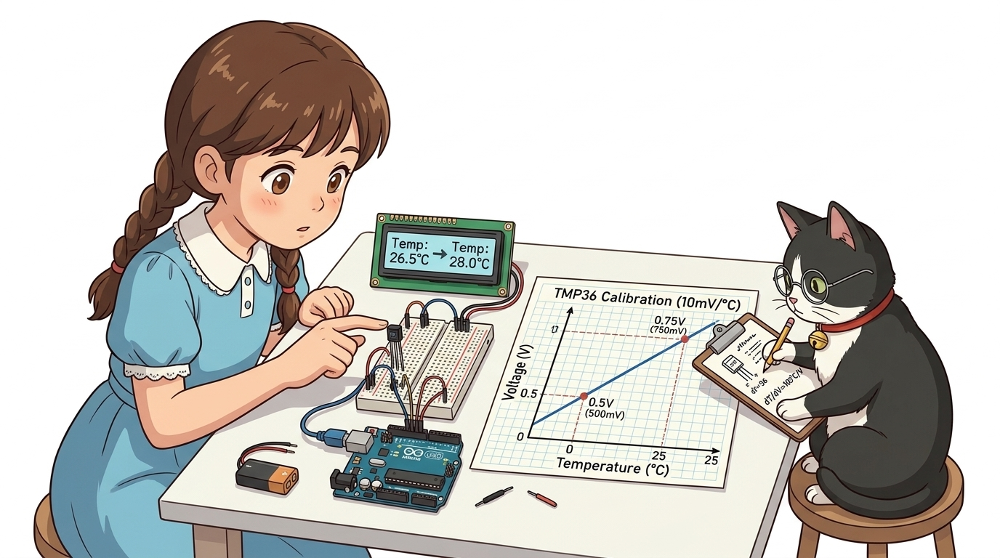
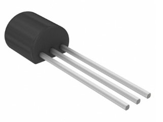
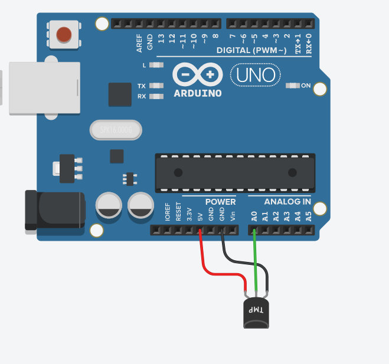
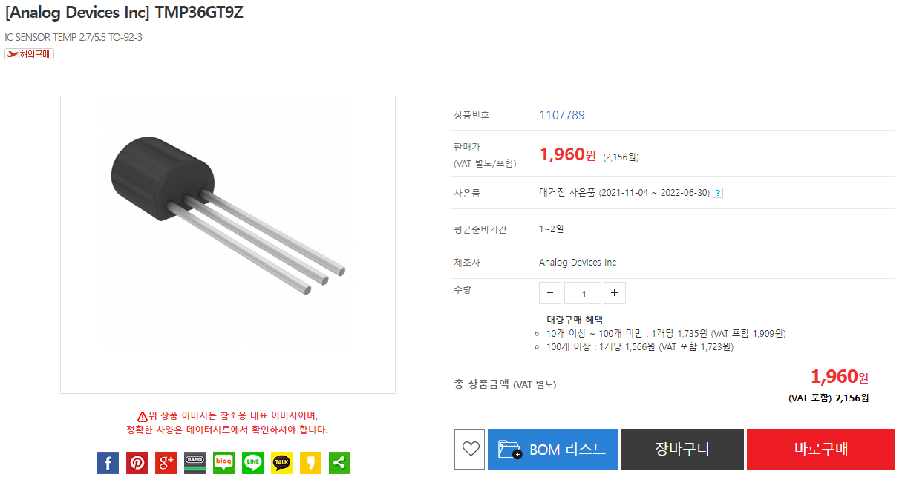

# 057_아날로그온도센서_TMP36 💡🌙



**도로시와 지니가 함께하는 반도체 접합 온도 특성, $10\text{mV}/^\circ\text{C}$ 전압 변환 공식 및 디지털 온도계 제작**
* 👧 **도로시**: "교수님! 지니야! 오늘 우리 교실이 얼마나 더운지, 아두이노가 온도계처럼 정확한 섭씨 몇 도인지 숫자로 알려줄 수 있어?"
* **👨‍🏫 이호진 교수님**: "그럼! 온도가 1℃ 변할 때마다 출력 전압을 정확히 10mV씩 올려주는 **TMP36 아날로그 정밀 온도 센서** 덕분이란다!"
* 🐶 **토토**: "바우! 온도가 30도를 넘어가면 선풍기를 자동으로 켜자 멍!"
* 📖 **상세 강의 교재**: [index.md](./index.md)


> 여러분 안녕하세요! 이번 시간에는 '057. 아날로그온도센서 TMP36 💡🌙'을 주제로 함께 흥미진진한 탐험을 떠나보겠습니다. 오늘 강의에서는 특히 도로시와 지니가 함께하는 반도체 접합 온도 특성, $10\text{mV}/^\circ\text{C}$ 전압 변환 공식 및 디지털 온도계 제작, 👧 도로시: "교수님! 지니야! 오늘 우리 교실이 얼마나 더운지, 아두이노가 온도계처럼 정확한 섭씨 몇 도인지 숫자로 알려줄 수 있어?"를 중심으로 핵심 원리와 응용 방법을 차근차근 배워보겠습니다. 이호진 교수님과 똑똑한 조수 지니, 호기심 많은 도로시와 토토와 함께 신나는 아두이노 모험을 힘차게 시작해 봅시다. 준비되셨나요?

---

## 1. TMP36 반도체 온도 센서의 특징과 장점


* **측정 온도 범위**: **$-40^\circ\text{C} \sim +125^\circ\text{C}$** 로 실내외 및 냉장고/냉동고 온도까지 폭넓게 측정 가능합니다.
* **선형 비례 출력 (Linear Output)**:
* 비선형 곡선을 갖는 써미스터(NTC)와 달리, 온도와 출력 전압이 완벽한 1차 직선 비례 관계를 갖습니다.
* 온도 계수: **$10\text{mV} / ^\circ\text{C}$** ($0.01\text{V} / ^\circ\text{C}$).
* **영하($-^\circ\text{C}$) 측정 오프셋 ($500\text{mV}$)**:
* 섭씨 $0^\circ\text{C}$일 때 정확히 $0.5\text{V}(500\text{mV})$를 출력하도록 베이스라인이 설계되어 있어 단일 5V 전원만으로도 영하 40도까지 오차 없이 측정할 수 있습니다.

### 🌡️ 작지만 오차가 적은 정밀 실리콘 IC 센서

> 이번 슬라이드에서는 '1. TMP36 반도체 온도 센서의 특징과 장점'에 대해 자세히 살펴보겠습니다. 화면의 다이어그램과 사진을 함께 참고해 주시기 바랍니다. 첫 번째 핵심은 측정 온도 범위: $-40^\circ\text{C} \sim +125^\circ\text{C}$ 로 실내외 및 냉장고/냉동고 온도까지 폭넓게 측정 가능합니다.이며, 두 번째로는 선형 비례 출력 (Linear Output)입니다. 여기에 덧붙여 비선형 곡선을 갖는 써미스터(NTC)와 달리, 온도와 출력 전압이 완벽한 1차 직선 비례 관계를 갖습니다. 내용까지 함께 이해해 두시면 완벽합니다. 이 원리는 아두이노 시스템 전체를 관통하는 핵심 논리이므로 머릿속에 꼭 정리해 두시기 바랍니다.

---

## 2. ⚠️ 극성 주의! TO-92 패키지 3개 핀 핀아웃



* [!CAUTION]
* TMP36은 트랜지스터와 똑같은 검은색 쌀알 모양(TO-92)입니다. **VCC와 GND를 반대로 꽂으면 칩 내부가 역방향 전류로 수 초 만에 손을 델 정도로 뜨거워지며 영구 손상**될 수 있으므로, 반드시 평평한 면의 글자를 보고 핀 위치를 확인하세요!

| 핀 번호 | 핀 이름 | 아두이노 연결 | 기능 설명 |
| :---: | :---: | :---: | :--- |
| **1번 (왼쪽)** | **$V_{\text{in}}$ (VCC)** | **5V** | 센서 구동 전원 ($2.7\text{V} \sim 5.5\text{V}$) |
| **2번 (가운데)**| **$V_{\text{out}}$ (Signal)** | **A0 핀** | 온도에 비례하는 아날로그 출력 전압 ($0.1\text{V} \sim 1.75\text{V}$) |
| **3번 (오른쪽)**| **GND** | **GND** | 공통 접지 단자 (0V) |

### 🚨 평평한 글자 면(Flat Face)을 바라보고 왼쪽부터 확인!

> 이번에 살펴볼 내용은 '2. ⚠️ 극성 주의! TO-92 패키지 3개 핀 핀아웃'입니다. 슬라이드에 정리된 표를 통해 각 항목의 특징과 수치, 차이점을 한눈에 비교해 보실 수 있습니다. 이 기본 개념을 확실히 잡아두셔야 실제 부품을 브레드보드에 꽂고 코딩할 때 실수 없이 완성할 수 있습니다.

---

## 3. 센서값을 섭씨온도($^\circ\text{C}$)로 변환하는 수학 공식



1. **1단계: 아날로그 ADC 측정값(0 ~ 1023)을 실제 전압($V$)으로 변환**:
2. **2단계: 전압에서 섭씨온도($^\circ\text{C}$) 계산**:
* $0^\circ\text{C}$일 때 전압이 $0.5\text{V}$이므로, 먼저 오프셋 $0.5\text{V}$를 빼줍니다.
* $1^\circ\text{C}$당 $0.01\text{V}(10\text{mV})$이므로 $0.01$로 나누어줍니다 (즉, $100$을 곱합니다):
* *계산 예시*:
* A0 아날로그 측정값이 `153`인 경우:
* $V_{\text{out}} = 153 \times (5.0 / 1024.0) \approx 0.747\text{V}$
* $\text{온도}(^\circ\text{C}) = (0.747 - 0.5) \times 100 = 24.7^\circ\text{C}$ (쾌적한 실내 온도!)

### 📐 2단계 수학적 변환의 원리
$$V_{\text{out}} = \text{analogRead(A0)} \times \left(\frac{5.0\text{V}}{1024.0}\right)$$
$$\text{온도}(^\circ\text{C}) = (V_{\text{out}} - 0.5) \times 100$$

> 이번 슬라이드에서는 '3. 센서값을 섭씨온도($^\circ\text{C}$)로 변환하는 수학 공식'에 대해 자세히 살펴보겠습니다. 화면의 다이어그램과 사진을 함께 참고해 주시기 바랍니다. 첫 번째 핵심은 단계: 아날로그 ADC 측정값(0 ~ 1023)을 실제 전압($V$)으로 변환이며, 두 번째로는 단계: 전압에서 섭씨온도($^\circ\text{C}$) 계산입니다. 여기에 덧붙여 $0^\circ\text{C}$일 때 전압이 $0.5\text{V}$이므로, 먼저 오프셋 $0.5\text{V}$를 빼줍니다. 내용까지 함께 이해해 두시면 완벽합니다. 이 원리는 아두이노 시스템 전체를 관통하는 핵심 논리이므로 머릿속에 꼭 정리해 두시기 바랍니다.

---

## 4. 팅커캐드 시뮬레이터 배선 연결



* 평평한 글자 면을 바라보았을 때:
1. 1번 핀(왼쪽) ➡️ **아두이노 5V 전원선**
2. 2번 핀(가운데) ➡️ **아두이노 A0 핀**
3. 3번 핀(오른쪽) ➡️ **아두이노 GND 접지선**
* 별도의 저항 부품이 전혀 필요 없이 3가닥 점퍼선만으로 완성됩니다!

### 🔌 브레드보드 초간단 결선

> 이번 슬라이드에서는 '4. 팅커캐드 시뮬레이터 배선 연결'에 대해 자세히 살펴보겠습니다. 화면의 다이어그램과 사진을 함께 참고해 주시기 바랍니다. 첫 번째 핵심은 평평한 글자 면을 바라보았을 때이며, 두 번째로는 번 핀(왼쪽) ➡️ 아두이노 5V 전원선입니다. 여기에 덧붙여 번 핀(가운데) ➡️ 아두이노 A0 핀 내용까지 함께 이해해 두시면 완벽합니다. 이 원리는 아두이노 시스템 전체를 관통하는 핵심 논리이므로 머릿속에 꼭 정리해 두시기 바랍니다.

---
## 5. 실습 전체 코드: 실시간 디지털 온도계 (Arduino C++)


### 💻 섭씨(℃)와 화씨(℉)를 동시 계산하여 출력하는 펌웨어

```cpp
// 핀 번호 상수 정의
const int TEMP_PIN = A0; // TMP36 Vout 핀이 연결된 아날로그 핀

void setup() {
  // PC 시리얼 모니터 통신 시작 (고속 115200 bps 권장)
  Serial.begin(115200);

  Serial.println("==========================================");
  Serial.println("   TMP36 Precision Digital Thermometer    ");
  Serial.println("==========================================");
}

void loop() {
  // 노이즈 완화를 위해 10회 연속 측정 후 평균 필터링 적용
  long sumADC = 0;
  for (int i = 0; i < 10; i++) {
    sumADC += analogRead(TEMP_PIN);
    delay(10); // 10ms 간격 샘플링
  }
  float avgADC = sumADC / 10.0;

  // 1. ADC 값을 아날로그 실제 전압(V)으로 변환
  float voltage = avgADC * (5.0 / 1024.0);

  // 2. 전압을 섭씨온도(°C)로 계산: (전압 - 0.5) * 100
  float tempC = (voltage - 0.5) * 100.0;

  // 3. 섭씨를 화씨온도(°F)로 환산: (C * 9/5) + 32
  float tempF = (tempC * 9.0 / 5.0) + 32.0;

  // 4. 시리얼 모니터에 정돈된 측정값 출력
  Serial.print("Raw ADC: ");
  Serial.print(avgADC, 1);
  Serial.print(" | Voltage: ");
  Serial.print(voltage, 3);
  Serial.print(" V | Temp: ");
  Serial.print(tempC, 1);
  Serial.print(" °C (");
  Serial.print(tempF, 1);
  Serial.println(" °F)");

  // 1초 간격으로 반복 측정
  delay(1000);
}
```

> 이번 슬라이드에서는 '5. 실습 전체 코드: 실시간 디지털 온도계 (Arduino C++)'에 대한 실제 동작 코드를 분석해 보겠습니다. 화면의 코드를 살펴보시면, 컴퓨터가 아두이노 하드웨어에 단계별로 명령을 내리는 흐름을 명확하게 확인할 수 있습니다. 각 함수의 역할과 괄호 안의 매개변수가 하드웨어 핀과 어떤 관계를 맺고 동작하는지 주의 깊게 살펴보시기 바랍니다.
---
## 6. 코드 상세 해설 및 10회 평균 필터링 기법


1. **10회 누적 평균 필터 (Moving Average Filter)**:
* 아날로그 핀의 전압은 주변 전자기 노이즈나 USB 전원 전압의 미세한 흔들림으로 인해 1~2비트씩 출렁일 수 있습니다.
* `10mV`가 곧 `1℃`를 나타내므로, 작은 전압 흔들림이 온도 수치를 0.5℃ 이상 출렁이게 만듭니다.
* 코드에서 10ms 간격으로 10번 측정하여 평균을 내면 측정값이 흔들리지 않고 매우 안정적인 결과를 얻을 수 있습니다!

### 🔍 미세 전압 측정의 안정성을 극대화하는 노하우

> 이번 슬라이드에서는 '6. 코드 상세 해설 및 10회 평균 필터링 기법'에 대해 자세히 살펴보겠습니다. 첫 번째 핵심은 회 누적 평균 필터 (Moving Average Filter)이며, 두 번째로는 아날로그 핀의 전압은 주변 전자기 노이즈나 USB 전원 전압의 미세한 흔들림으로 인해 1~2비트씩 출렁일 수 있습니다.입니다. 여기에 덧붙여 mV가 곧 1℃를 나타내므로, 작은 전압 흔들림이 온도 수치를 0.5℃ 이상 출렁이게 만듭니다. 내용까지 함께 이해해 두시면 완벽합니다. 이 원리는 아두이노 시스템 전체를 관통하는 핵심 논리이므로 머릿속에 꼭 정리해 두시기 바랍니다.
---
## 🌟 도로시와 지니의 핵심 요약 노트!


* 👧 **도로시**: "평평한 면을 보고 5V, A0, GND를 꽂고, `(전압 - 0.5) * 100` 공식만 적용하면 정확한 섭씨온도가 짠 하고 계산되네!"
* **👨‍🏫 이호진 교수님**: "맞아! 여기에 10회 평균 필터링까지 넣어서 흔들림 없는 완벽한 디지털 체온계를 완성했단다."
* 🐶 **토토**: "바우! 이제 오전 센서 7개 챕터를 모두 정복했다 멍!"

| 변환 단계 | 입력값 | 변환 수식 | 출력값 예시 |
| :--- | :--- | :--- | :--- |
| **1단계 (전압 변환)** | `analogRead(A0)` (0~1023) | $\text{ADC} \times (5.0 / 1024.0)$ | $0.750\text{V}$ |
| **2단계 (섭씨 환산)** | 측정 전압 ($V_{\text{out}}$) | $(V_{\text{out}} - 0.5) \times 100$ | **$25.0^\circ\text{C}$** |
| **3단계 (화씨 환산)** | 섭씨온도 ($^\circ\text{C}$) | $(^\circ\text{C} \times 1.8) + 32$ | **$77.0^\circ\text{F}$** |

> 오늘 배운 '🌟 도로시와 지니의 핵심 요약 노트!'의 핵심 내용을 모두 정리해 보았습니다. 오늘 다룬 내용 중에서도 👧 도로시: "평평한 면을 보고 5V, A0, GND를 꽂고, (전압 - 0.5) 100 공식만 적용하면 정확한 섭씨온도가 짠 하고 계산되네!" 부분은 앞으로의 아두이노 실습과 프로젝트에서 계속 사용되는 매우 중요한 기초 지식입니다. 오늘 배운 내용을 꼭 다시 한번 복습해 보시고, 다음 강의에서 더욱 신나고 유익한 모험으로 다시 만나겠습니다. 모두 수고 많으셨습니다!