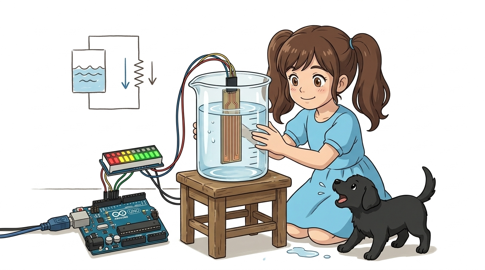
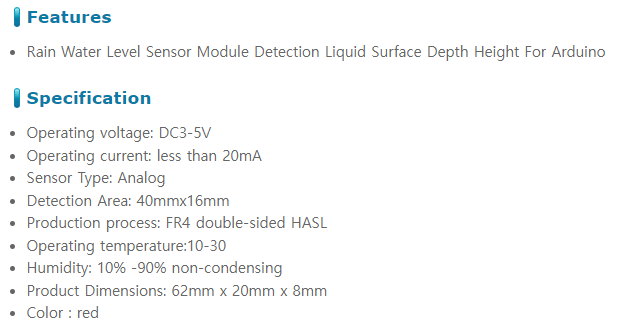
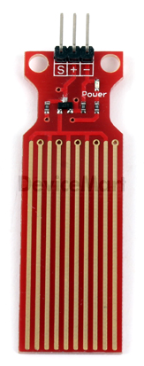
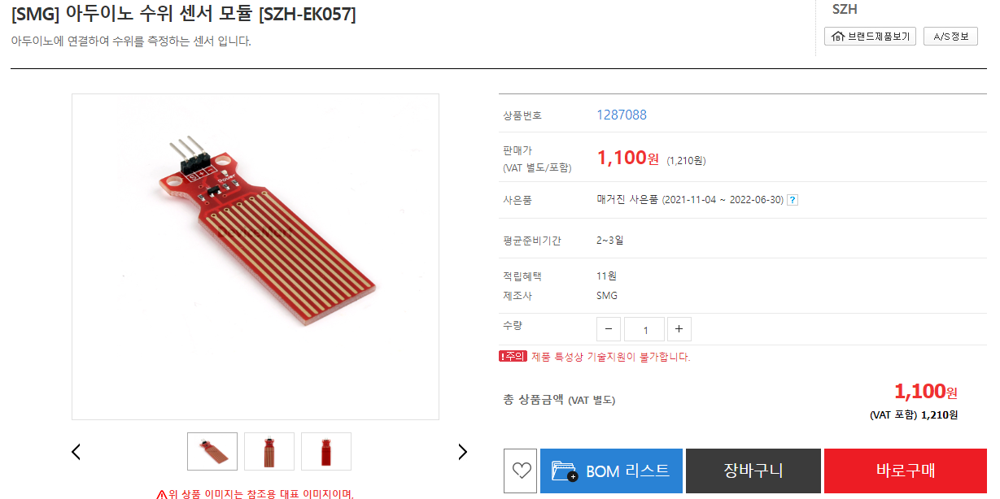
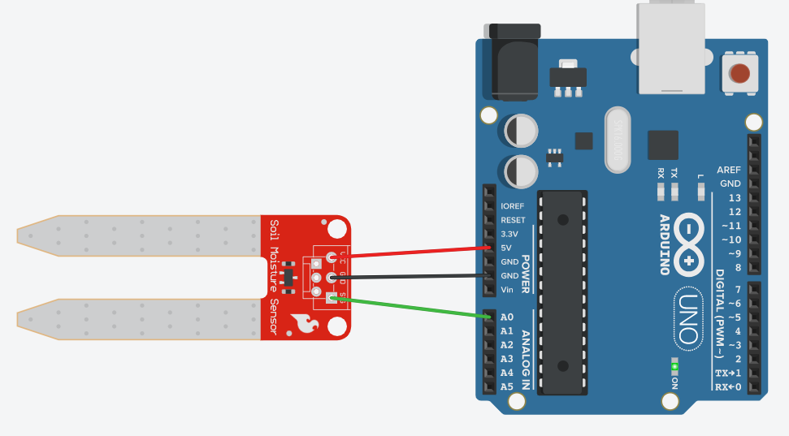
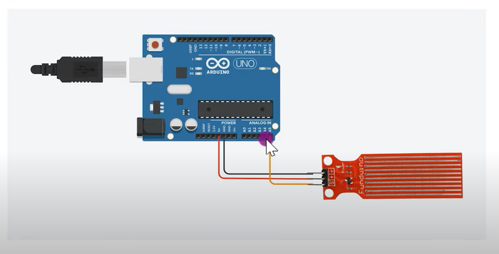

# 058_수위감지센서_물높이측정 💧📏



**도로시와 지니가 함께하는 병렬 도체 트레이스 전도도 원리, 3핀 배선 및 스마트 물탱크 넘침 방지 경보기 제작**

* 👧 **도로시**: "교수님! 지니야! 어항이나 물탱크 안에 물이 얼마나 차올랐는지 눈으로 보지 않고도 아두이노가 정확한 깊이를 알아낼 수 있어?"
* **👨‍🏫 이호진 교수님**: "그럼! 기판 표면에 인쇄된 빗살무늬 구리 도체선이 물에 잠기는 깊이에 따라 전기 전도도가 달라지는 **수위 감지 센서(Water Level Sensor)** 덕분이란다!"
* 🐶 **토토**: "바우! 물탱크가 가득 차서 넘치려고 하면 삐- 삐- 사이렌을 울리자 멍!"

* 🖥️ **강의 슬라이드**: [slides.md](./slides.md)

---

## 1. 수위 감지 센서의 외형과 빗살무늬 전극 구조



### 🌊 번갈아 배치된 10개의 병렬 구리 트레이스
* **기판 하부 감지 영역**:
  * 5개의 전원선($V_{\text{cc}}$)과 5개의 신호 접지선(GND)이 일정한 간격으로 서로 맞닿지 않게 교대로 배열되어 있습니다.
* **센서 상부 회로 영역**:
  * 아날로그 증폭 및 풀다운 바이어스 회로가 집적되어 있어 외부에 별도의 10kΩ 저항을 달 필요 없이 아두이노와 1:1로 직결됩니다.
* **방수 주의 구역**:
  * 빗살무늬가 있는 **하단 감지부만 물속에 담가야** 하며, 상단의 전자 부품과 연결 핀 헤더는 방수가 되지 않으므로 물이 닿지 않도록 주의해야 합니다!

---

## 2. 작동 메커니즘: 물의 전해질과 저항 변화 원리



### 🔬 물에 잠긴 면적에 비례하는 전도성

1. **공기 중 노출 상태 (물 없음, Dry)**:
   * 공기는 전기가 통하지 않는 완벽한 절연체이므로 두 구리 전극 사이의 저항은 무한대($\approx \infty$)입니다.
   * 아날로그 출력 핀($S$)의 전압은 **0V (ADC 값: 0)** 입니다.
2. **물이 조금 잠겼을 때 (저수위, Low Level)**:
   * 수돗물 속에는 미네랄 이온(전해질)이 녹아 있어 약한 전기가 통합니다.
   * 물에 잠긴 부분의 도체 사이로 미세한 전류가 흐르기 시작합니다 (**ADC 값: 약 200 ~ 400**).
3. **물이 깊숙이 차올랐을 때 (고수위, High Level)**:
   * 물과 접촉하는 전극의 표면적이 넓어지면서 전기 저항이 급격히 낮아집니다.
   * 통과하는 전류가 증가하여 출력 전압이 상승합니다 (**ADC 값: 약 500 ~ 700 이상**).


---

## 3. 센서 3핀 규격과 하드웨어 배선



### 🔌 단 3가닥 점퍼선으로 완성하는 인터페이스

| 센서 핀 마킹 | 기능 | 아두이노 연결 핀 | 결선 설명 |
| :---: | :--- | :---: | :--- |
| **`+` (VCC)** | 센서 동작 전원 | **아두이노 5V** | 센서 구동 직류 전압 공급 |
| **`-` (GND)** | 접지 단자 | **아두이노 GND** | 공통 기준 전위 0V 연결 |
| **`S` (Signal)**| 아날로그 수위 출력 | **아두이노 A0 핀** | 물높이에 비례하는 0~5V 전압 출력 |

---

## 4. 실습 전체 코드: 스마트 수위 경보 시스템 (Arduino C++)

### 💻 실시간 물높이 측정 및 3단계 침수/부족 경보 펌웨어

```cpp
// 핀 번호 상수 정의
const int WATER_SENSOR_PIN = A0; // 수위 센서 신호선 연결 핀
const int BUZZER_PIN       = 8;  // 위험 경보용 피에조 부저 핀
const int LED_PIN          = 13; // 침수 경고 표시용 LED 핀

// 수위 단계별 임계값 (설치 환경 실측치에 맞게 보정)
const int LEVEL_EMPTY = 100; // 물 없음 판별 기준
const int LEVEL_WARN  = 400; // 주의 수위 기준
const int LEVEL_DANGER= 600; // 범람 위험 임계값

void setup() {
  // PC 시리얼 모니터 통신 시작 (9600 bps)
  Serial.begin(9600);
  
  // 출력 핀 모드 설정
  pinMode(BUZZER_PIN, OUTPUT);
  pinMode(LED_PIN, OUTPUT);

  digitalWrite(BUZZER_PIN, LOW);
  digitalWrite(LED_PIN, LOW);
  
  Serial.println("==========================================");
  Serial.println("   Smart Water Level & Flood Alarm System ");
  Serial.println("==========================================");
}

void loop() {
  // 1. 수위 센서의 아날로그 전압 읽기 (0 ~ 1023)
  int waterValue = analogRead(WATER_SENSOR_PIN);

  // 2. 시리얼 모니터로 현재 수위 값 출력
  Serial.print("Current Water Level ADC: ");
  Serial.print(waterValue);

  // 3. 3단계 수위 상태 판별 및 경보 제어
  if (waterValue < LEVEL_EMPTY) {
    // 물이 거의 없는 안전/갈수 상태
    digitalWrite(LED_PIN, LOW);
    noTone(BUZZER_PIN);
    Serial.println(" -> Status: [EMPTY / DRY]");
  } 
  else if (waterValue < LEVEL_DANGER) {
    // 적정 수위 유지 상태
    digitalWrite(LED_PIN, LOW);
    noTone(BUZZER_PIN);
    Serial.println(" -> Status: [NORMAL]");
  } 
  else {
    // 600 초과: 물탱크 넘침 위험 또는 바닥 침수 발생!
    digitalWrite(LED_PIN, HIGH);
    tone(BUZZER_PIN, 1000); // 1kHz 경고음 울림
    Serial.println(" -> Status: 🚨 [DANGER! OVERFLOW DETECTED!]");
  }

  // 0.5초 대기
  delay(500);
}
```

---

## 5. 코드 상세 해설 및 침식(Electrolysis) 방지 꿀팁



### 🔍 장시간 안정적 사용을 위한 하드웨어 수명 연장 노하우

1. **상시 전원 인가 시의 전기분해(Electrolysis) 부식 문제**:
   * 구리 전극에 5V 직류 전압을 계속 걸어두고 물에 담가두면, 화학적 전기분해로 인해 양극(+) 구리선이 산화되어 녹슬고 벗겨집니다.
2. **소프트웨어 펄스 전원 기법 (Professional Tip)**:
   * 수위 센서의 `+` 핀을 아두이노의 5V 상시 전원에 꽂지 않고, **일반 디지털 핀(예: 7번 핀)** 에 꽂습니다.
   * 평소에는 `digitalWrite(7, LOW)`로 꺼두었다가, 측정이 필요한 찰나(1초에 한 번, 10ms 동안만)에 `HIGH`를 켜서 `analogRead(A0)`를 실행하고 즉시 `LOW`로 끄면 센서 수명이 10배 이상 늘어납니다!

---

## 6. 실생활 속 수위 감지 센서의 응용



* **반려동물 스마트 자동 급수기**:
  * 물그릇의 수위가 `LEVEL_EMPTY` 이하로 떨어지면 워터 펌프 릴레이를 가동하여 신선한 물을 자동으로 보충합니다.
* **지하실 및 빗물 침수 조기 경보기**:
  * 장마철 반지하 주택이나 빌딩 지하 기계실 바닥에 센서를 밀착시켜 바닥에 물이 1cm만 차올라도 즉시 사이렌을 울립니다.
* **스마트 빗물 저금통(Rainwater Harvester)**:
  * 옥상 빗물 집수 탱크의 수위를 실시간 측정하여 가뭄 시 정원용수로 활용합니다.

---

## 🌟 도로시와 지니의 핵심 요약 노트!

| 수위 상태 | 침수 깊이 | 센서 저항 | A0 아날로그 값 | 시스템 동작 |
| :--- | :--- | :--- | :---: | :--- |
| **건조 (Dry)** | 0 mm | 무한대 ($\infty$) | 0 ~ 50 | LED OFF, 부저 OFF |
| **적정 (Normal)**| 10 ~ 30 mm | 중간 저항 | 200 ~ 500 | 안전 유지 상태 |
| **위험 (Danger)**| 40 mm 이상 (만수)| 낮은 저항 | **600 ~ 750** | **LED ON, 1kHz 부저 경보 🚨** |

* 👧 **도로시**: "구리선이 물에 닿는 면적에 따라 전압이 달라져서 물의 높이를 정밀하게 측정할 수 있구나!"
* **👨‍🏫 이호진 교수님**: "맞아! 센서 수명을 늘리기 위해 펄스 전원 기법을 적용하면 훌륭한 산업용 IoT 장비가 된단다."
* 🐶 **토토**: "바우! 다음 시간엔 화분 흙 속의 습기를 재는 토양습도 센서를 만나보자 멍!"
