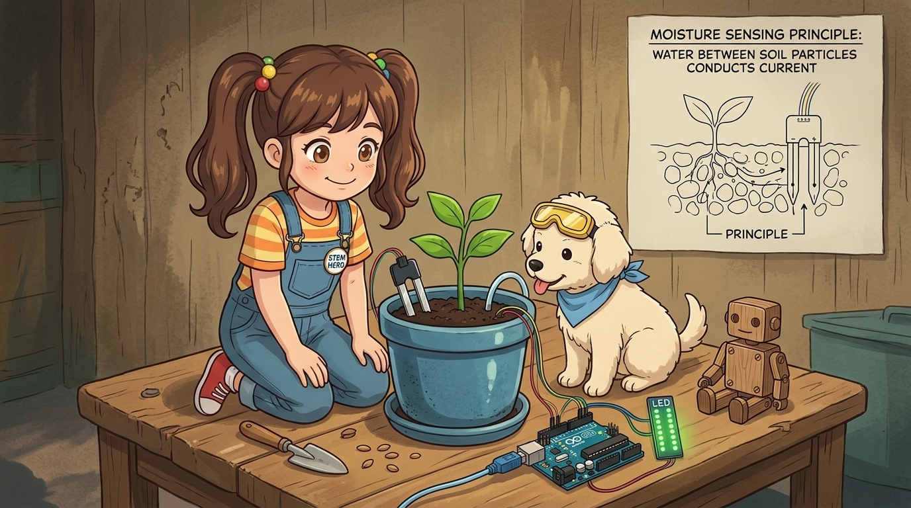
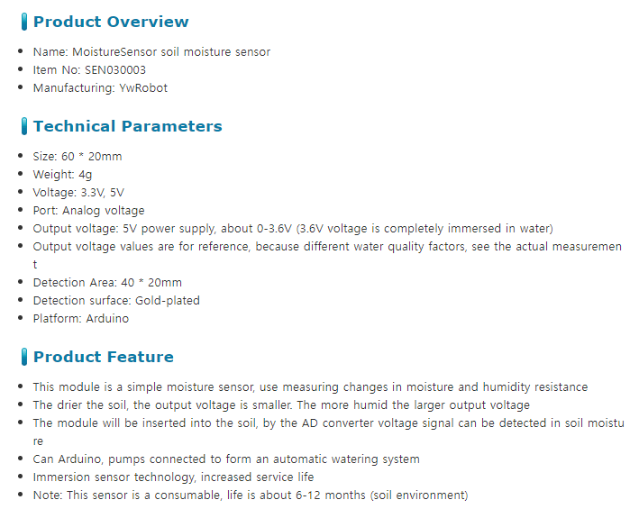
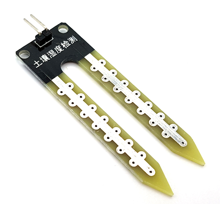
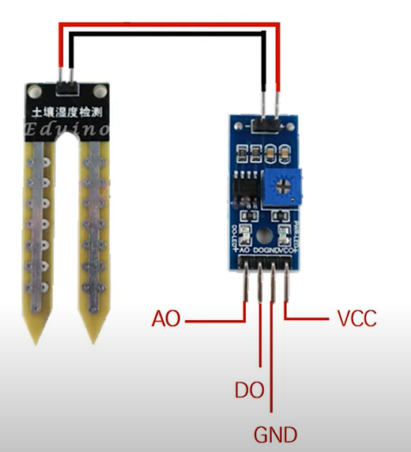
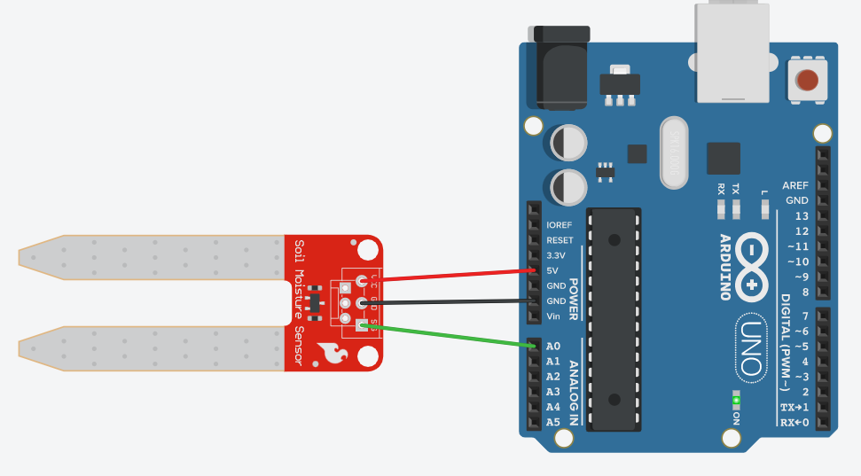
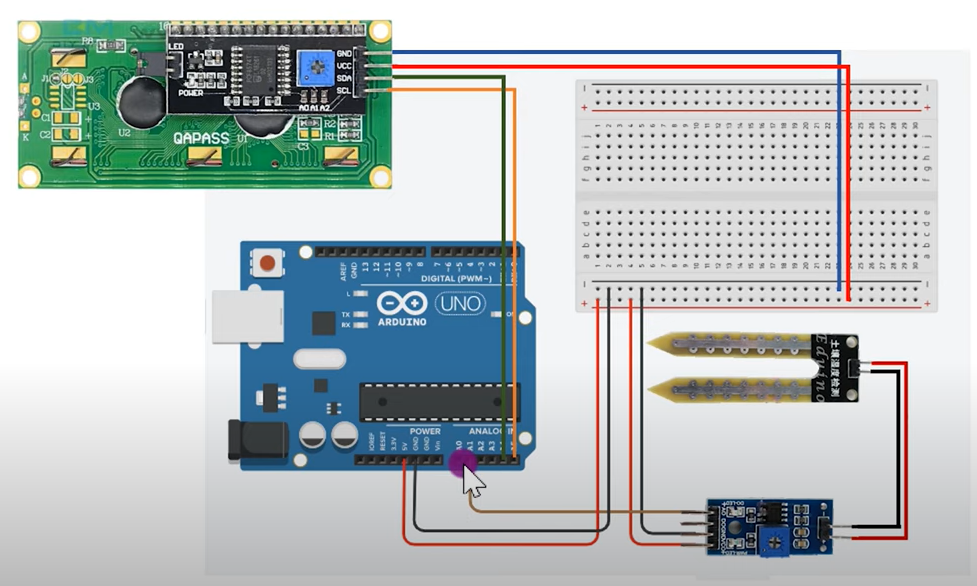

# 059_토양수분센서_스마트화분 🌱🪴



**도로시와 지니가 함께하는 토양 유전율 및 저항 측정 원리, LM393 비교기 모듈 및 스마트 화분 자동 급수기 제작**
* 👧 **도로시**: "교수님! 지니야! 내 반려 식물 화분의 흙이 바짝 말라 시들어가고 있는지, 아니면 뿌리가 썩을 정도로 물이 흥건한지 어떻게 알 수 있어?"
* **👨‍🏫 이호진 교수님**: "흙 속에 쏙 꽂아두면 토양 속 수분과 미네랄이 전도하는 미세 전류를 측정하는 **포크 모양의 토양 습도 센서(Soil Moisture Sensor)** 덕분이란다!"
* 🐶 **토토**: "바우! 흙이 마르면 목마르다고 빨간 불을 깜빡이고 스스로 물을 뿜어주자 멍!"
* 📖 **상세 강의 교재**: [index.md](./index.md)


> 여러분 안녕하세요! 이번 시간에는 '059. 토양수분센서 스마트화분 🌱🪴'을 주제로 함께 흥미진진한 탐험을 떠나보겠습니다. 오늘 강의에서는 특히 도로시와 지니가 함께하는 토양 유전율 및 저항 측정 원리, LM393 비교기 모듈 및 스마트 화분 자동 급수기 제작, 👧 도로시: "지니야! 내 반려 식물 화분의 흙이 바짝 말라 시들어가고 있는지, 아니면 뿌리가 썩을 정도로 물이 흥건한지 어떻게 알 수 있어?"를 중심으로 핵심 원리와 응용 방법을 차근차근 배워보겠습니다. 이호진 교수님과 똑똑한 조수 지니, 호기심 많은 도로시와 토토와 함께 신나는 아두이노 모험을 힘차게 시작해 봅시다. 준비되셨나요?

---

## 1. 토양 수분 센서의 구조와 2개 금속 탐침(Probe)



* **포크형 탐침 프로브 (Fork-style Probe)**:
* 흙 속에 직접 꽂는 두 갈래의 길쭉한 금속 다리입니다.
* 표면에 주석이나 금 도금 처리가 되어 있어 부식을 방지하고 흙 속의 전도도를 감지합니다.
* **신호 처리 모듈 (LM393 Comparator)**:
* 프로브에서 측정한 미세 신호를 아날로그 전압(AO)으로 정밀하게 증폭하고,
* 파란색 가변저항(트리머)을 돌려 기준점을 설정하면 임계치에 따라 0V/5V 디지털 신호(DO)를 생성해 줍니다.

### 🍴 포크 모양 탐침과 LM393 비교기 드라이버

> 이번 슬라이드에서는 '1. 토양 수분 센서의 구조와 2개 금속 탐침(Probe)'에 대해 자세히 살펴보겠습니다. 화면의 다이어그램과 사진을 함께 참고해 주시기 바랍니다. 첫 번째 핵심은 포크형 탐침 프로브 (Fork-style Probe)이며, 두 번째로는 흙 속에 직접 꽂는 두 갈래의 길쭉한 금속 다리입니다.입니다. 여기에 덧붙여 표면에 주석이나 금 도금 처리가 되어 있어 부식을 방지하고 흙 속의 전도도를 감지합니다. 내용까지 함께 이해해 두시면 완벽합니다. 이 원리는 아두이노 시스템 전체를 관통하는 핵심 논리이므로 머릿속에 꼭 정리해 두시기 바랍니다.

---

## 2. 작동 메커니즘: 토양 내 수분량과 전기 전도도



1. **바짝 마른 흙 (Dry Soil)**:
* 흙 알갱이들 사이의 틈(공극)에 전기가 통하지 않는 건조한 공기만 가득합니다.
* 탐침 사이의 전기 저항이 매우 높아 전기가 거의 흐르지 못합니다 (**아날로그 측정값: 약 800 ~ 1023 건조**).
2. **물을 듬뿍 준 촉촉한 흙 (Moist Soil)**:
* 흙 속의 공극에 물이 가득 차오르고, 토양에 포함된 미네랄 염분이 전해질 역할을 합니다.
* 두 전극 사이에 풍부한 전류가 흐르며 저항이 급격히 낮아집니다 (**아날로그 측정값: 약 300 ~ 600 적정 습도**).
3. **물속에 완전히 담갔을 때 (In Water)**:
* 전기 전도가 극대화되어 저항이 최저점으로 떨어집니다 (**아날로그 측정값: 약 200 ~ 300**).

### 🔬 흙 알갱이 사이의 물 분자가 만드는 전도 통로

> 이번 슬라이드에서는 '2. 작동 메커니즘: 토양 내 수분량과 전기 전도도'에 대해 자세히 살펴보겠습니다. 화면의 다이어그램과 사진을 함께 참고해 주시기 바랍니다. 첫 번째 핵심은 바짝 마른 흙 (Dry Soil)이며, 두 번째로는 흙 알갱이들 사이의 틈(공극)에 전기가 통하지 않는 건조한 공기만 가득합니다.입니다. 여기에 덧붙여 탐침 사이의 전기 저항이 매우 높아 전기가 거의 흐르지 못합니다 (아날로그 측정값: 약 800 ~ 1023 건조). 내용까지 함께 이해해 두시면 완벽합니다. 이 원리는 아두이노 시스템 전체를 관통하는 핵심 논리이므로 머릿속에 꼭 정리해 두시기 바랍니다.

---

## 3. 센서 모듈의 핀 구성과 하드웨어 배선



| 모듈 핀 | 기능 설명 | 아두이노 연결 핀 | 역할 |
| :---: | :--- | :---: | :--- |
| **VCC** | 전원 입력 (3.3V ~ 5V) | **아두이노 5V** | 센서 구동 전원 공급 |
| **GND** | 전원 접지 (0V) | **아두이노 GND** | 공통 기준 전위 결선 |
| **AO** | 아날로그 습도 출력 | **아두이노 A0 핀** | 0 ~ 1023 연속 수치 전압 출력 |
| **DO** | 디지털 임계값 출력 | 디지털 핀 (선택사항) | 가변저항 기준값 초과 시 LOW/HIGH 출력 |

### 🔌 4핀 커넥터 인터페이스 규격

> 이번에 살펴볼 내용은 '3. 센서 모듈의 핀 구성과 하드웨어 배선'입니다. 슬라이드에 정리된 표를 통해 각 항목의 특징과 수치, 차이점을 한눈에 비교해 보실 수 있습니다. 이 기본 개념을 확실히 잡아두셔야 실제 부품을 브레드보드에 꽂고 코딩할 때 실수 없이 완성할 수 있습니다.

---
## 4. 실습 전체 코드: 스마트 화분 자동 수분 감시 (Arduino C++)




### 💻 흙의 상태를 실시간 진단하고 물 부족 경보를 울리는 펌웨어

```cpp
// 핀 번호 상수 정의
const int SOIL_PIN   = A0; // 토양 습도 센서 아날로그 출력 핀
const int PUMP_LED   = 9;  // 워터 펌프 또는 급수 알림 LED 핀
const int BUZZER_PIN = 8;  // 물 부족 경보용 부저 핀

// 토양 습도 상태 임계값 (실제 화분 흙 환경에 맞게 보정)
const int DRY_THRESHOLD  = 750; // 750 초과 시 바짝 마름 (물 공급 필요)
const int WET_THRESHOLD  = 450; // 450 미만 시 수분 과다/충분

void setup() {
  // PC 시리얼 모니터 통신 시작 (9600 bps)
  Serial.begin(9600);

  // 출력 핀 설정
  pinMode(PUMP_LED, OUTPUT);
  pinMode(BUZZER_PIN, OUTPUT);

  digitalWrite(PUMP_LED, LOW);
  digitalWrite(BUZZER_PIN, LOW);

  Serial.println("==========================================");
  Serial.println("   Smart Plant Moisture Monitor Ready!    ");
  Serial.println("==========================================");
}

void loop() {
  // 1. 토양 습도 아날로그 ADC 값 읽기 (저항형 센서: 마를수록 값이 커짐)
  int soilRaw = analogRead(SOIL_PIN);

  // 2. 센서값을 직관적인 0 ~ 100% 수분 백분율로 환산 (1023->0%, 300->100%)
  int moisturePercent = map(soilRaw, 1023, 300, 0, 100);
  moisturePercent = constrain(moisturePercent, 0, 100);

  // 3. 시리얼 모니터 출력
  Serial.print("Soil ADC: ");
  Serial.print(soilRaw);
  Serial.print(" | Moisture: ");
  Serial.print(moisturePercent);
  Serial.print("% -> ");

  // 4. 수분 상태에 따른 조건 분기 및 자동 급수 제어
  if (soilRaw > DRY_THRESHOLD) {
    // 흙이 바짝 마른 상태: 빨간 LED 점등 및 물 공급 알림
    digitalWrite(PUMP_LED, HIGH);
    tone(BUZZER_PIN, 500, 200); // 삐- 짧은 비프음
    Serial.println("🚨 [THIRSTY] Soil is too dry! Please water the plant!");
  } 
  else if (soilRaw < WET_THRESHOLD) {
    // 흙이 충분히 촉촉한 상태: 펌프 정지
    digitalWrite(PUMP_LED, LOW);
    noTone(BUZZER_PIN);
    Serial.println("💧 [SOAKED] Moisture is very high.");
  } 
  else {
    // 완벽한 적정 수분 상태
    digitalWrite(PUMP_LED, LOW);
    noTone(BUZZER_PIN);
    Serial.println("🌿 [OPTIMAL] Plant is happy and healthy!");
  }

  // 1초 대기
  delay(1000);
}
```

> 이번 슬라이드에서는 '4. 실습 전체 코드: 스마트 화분 자동 수분 감시 (Arduino C++)'에 대한 실제 동작 코드를 분석해 보겠습니다. 화면의 코드를 살펴보시면, 컴퓨터가 아두이노 하드웨어에 단계별로 명령을 내리는 흐름을 명확하게 확인할 수 있습니다. 각 함수의 역할과 괄호 안의 매개변수가 하드웨어 핀과 어떤 관계를 맺고 동작하는지 주의 깊게 살펴보시기 바랍니다.
---
## 5. 코드 상세 해설 및 저항형 센서의 반비례 매핑


1. **저항형 전압 분배 구조**:
* 토양 센서 모듈의 AO 핀은 흙의 저항이 커질수록 5V에 가까운 전압을 출력하도록 회로가 설계되어 있습니다.
* 따라서 **공기 중(완전 건조)** 에서는 약 `1023`, **물속(완전 젖음)** 에서는 약 `250 ~ 300`의 역방향 수치가 나옵니다.
2. **`map(soilRaw, 1023, 300, 0, 100)`의 반전 기법**:
* 인간이 이해하기 쉽게 `1023`을 `0%`, `300`을 `100%`로 거꾸로 매핑하여 직관적인 "토양 습도 65%" 같은 백분율로 손쉽게 환산할 수 있습니다.

### 🔍 왜 값이 커질수록 흙이 마른 것일까요?

```cpp
int soilPin = A1;

void setup() {
  Serial.begin(9600);
}

void loop() {
  int value = analogRead(soilPin);
  Serial.print("Soil Moisture: ");
  Serial.println(value);
  delay(500);
}
```

> 이번 슬라이드에서는 '5. 코드 상세 해설 및 저항형 센서의 반비례 매핑'에 대한 실제 동작 코드를 분석해 보겠습니다. 화면의 코드를 살펴보시면, 컴퓨터가 아두이노 하드웨어에 단계별로 명령을 내리는 흐름을 명확하게 확인할 수 있습니다. 여기서 핵심은 저항형 전압 분배 구조입니다. 각 함수의 역할과 괄호 안의 매개변수가 하드웨어 핀과 어떤 관계를 맺고 동작하는지 주의 깊게 살펴보시기 바랍니다.
---

## 6. 스마트 팜(Smart Farm) 워터 펌프 자동 급수 확장



* **워터 펌프 릴레이 모듈 연동**:
* 흙이 마르면 디지털 9번 핀으로 5V 릴레이를 ON 시켜 미니 잠수 펌프를 3초간 가동하여 자동으로 물을 급수합니다.
* **과급수 방지 안전 타이머**:
* 물이 흙 속으로 스며들어 프로브에 도달하기까지 1~2분의 지연 시간이 걸리므로, 1회 급수 후 최소 5분간 급수를 멈추는 딜레이 로직을 넣어 과습으로 인한 뿌리 썩음을 방지합니다.

```cpp
void loop() {
  int value = analogRead(soilPin);
  delay(100);
  if (value > 450) {
    mylcd.clear();
    mylcd.setCursor(0, 0);
    mylcd.print("Soil: DRY! Water");
  } else {
    mylcd.clear();
    mylcd.setCursor(0, 0);
    mylcd.print("Soil: MOIST OK");
  }
}
```

> 이번 슬라이드에서는 '6. 스마트 팜(Smart Farm) 워터 펌프 자동 급수 확장'에 대한 실제 동작 코드를 분석해 보겠습니다. 화면의 코드를 살펴보시면, 컴퓨터가 아두이노 하드웨어에 단계별로 명령을 내리는 흐름을 명확하게 확인할 수 있습니다. 여기서 핵심은 워터 펌프 릴레이 모듈 연동입니다. 각 함수의 역할과 괄호 안의 매개변수가 하드웨어 핀과 어떤 관계를 맺고 동작하는지 주의 깊게 살펴보시기 바랍니다.

---
## 🌟 도로시와 지니의 핵심 요약 노트!


* 👧 **도로시**: "흙이 마르면 저항이 커져서 ADC 값이 올라간다는 원리를 알고, `map()`으로 0~100%로 뒤집어 계산하니 화분의 목마름을 한눈에 알 수 있어!"
* **👨‍🏫 이호진 교수님**: "맞아! 여기에 릴레이 펌프까지 더하면 여행을 떠나도 식물이 혼자 무럭무럭 자라는 스마트 팜이 된단다."
* 🐶 **토토**: "바우! 다음 시간엔 하늘에서 떨어지는 비를 감지하는 빗물 센서다 멍!"

| 토양 상태 | 수분량 | 탐침 저항 | AO 아날로그 값 | 환산 습도 | 시스템 동작 |
| :--- | :--- | :--- | :---: | :---: | :--- |
| **바짝 마름 (Dry)** | 공기 가득 | 매우 높음 | **800 ~ 1023** | 0 ~ 20% | **급수 펌프 가동 / 알림 🚨** |
| **적정 습도 (Good)** | 촉촉함 | 중간 저항 | **450 ~ 750** | 30 ~ 70% | 최적 생장 상태 (대기) |
| **수분 과다 (Wet)** | 물 흥건 | 매우 낮음 | **200 ~ 450** | 70 ~ 100%| 급수 차단 |

> 오늘 배운 '🌟 도로시와 지니의 핵심 요약 노트!'의 핵심 내용을 모두 정리해 보았습니다. 오늘 다룬 내용 중에서도 👧 도로시: "흙이 마르면 저항이 커져서 ADC 값이 올라간다는 원리를 알고, map()으로 0~100%로 뒤집어 계산하니 화분의 목마름을 한눈에 알 수 있어!" 부분은 앞으로의 아두이노 실습과 프로젝트에서 계속 사용되는 매우 중요한 기초 지식입니다. 오늘 배운 내용을 꼭 다시 한번 복습해 보시고, 다음 강의에서 더욱 신나고 유익한 모험으로 다시 만나겠습니다. 모두 수고 많으셨습니다!