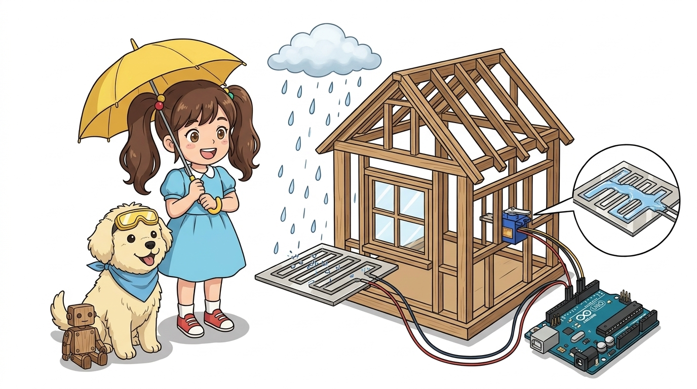
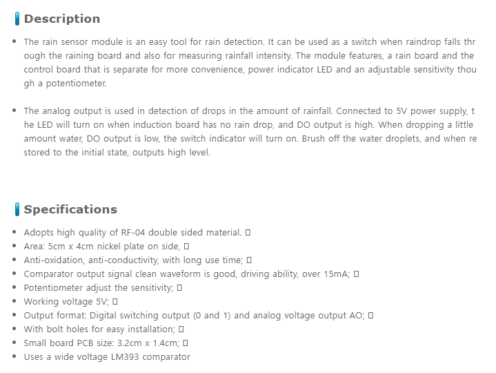
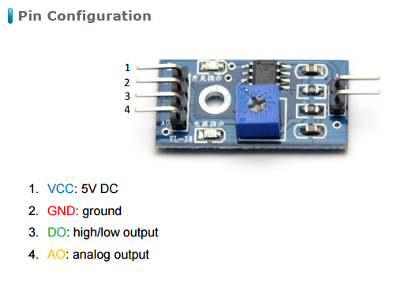
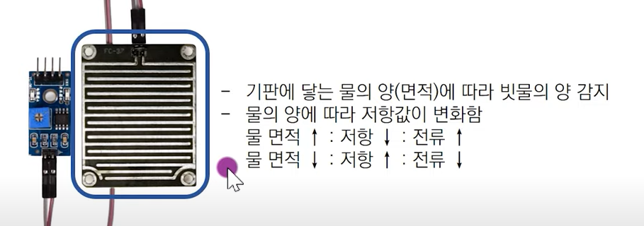
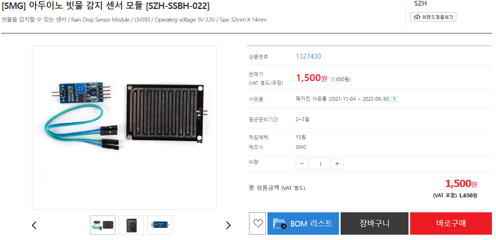
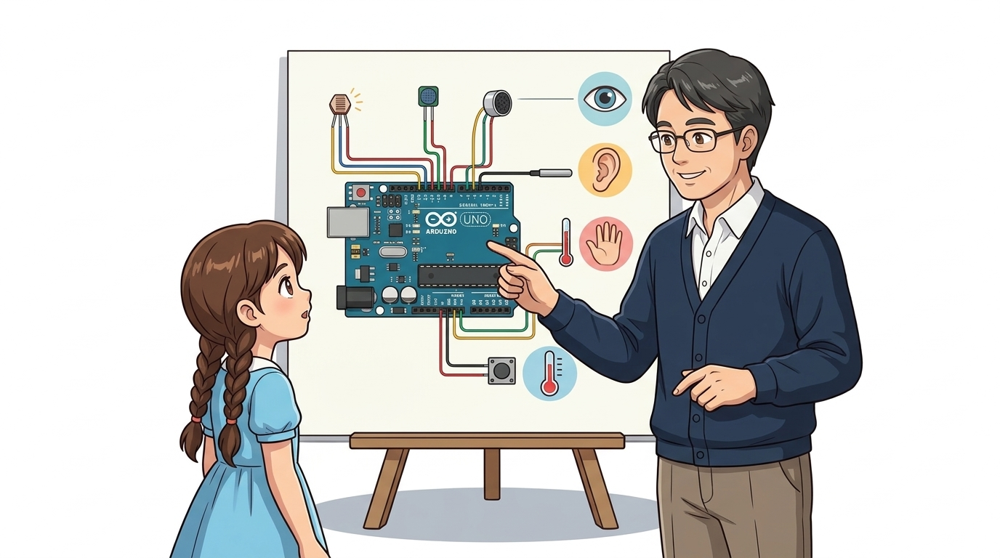
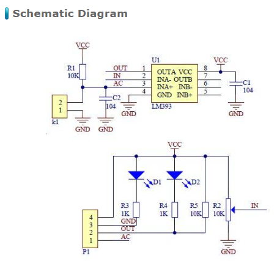
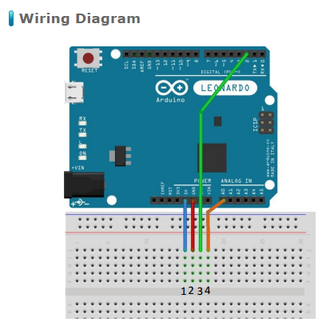

# 060_빗물감지센서_자동창문 🌧️🪟



**도로시와 지니가 함께하는 빗방울 전도도 감지, 니켈 도금 지그재그 전극판 및 스마트 자동 창문 제어 시스템**
* 👧 **도로시**: "교수님! 지니야! 외출했을 때 갑자기 소나기가 쏟아져도 아두이노가 첫 빗방울을 바로 감지해서 열린 창문을 스르륵 닫아줄 수 있을까?"
* **👨‍🏫 이호진 교수님**: "당연하지! 넓은 기판 표면에 인쇄된 빗살무늬 니켈 전극에 빗방울이 톡 떨어지는 순간 저항이 변하는 **빗물 감지 센서(Raindrop Sensor)** 덕분이란다!"
* 🐶 **토토**: "바우! 베란다에 널어둔 빨래가 비에 젖기 전에 지켜주자 멍!"
* 📖 **상세 강의 교재**: [index.md](./index.md)


> 여러분 안녕하세요! 이번 시간에는 '060. 빗물감지센서 자동창문 🌧️🪟'을 주제로 함께 흥미진진한 탐험을 떠나보겠습니다. 오늘 강의에서는 특히 도로시와 지니가 함께하는 빗방울 전도도 감지, 니켈 도금 지그재그 전극판 및 스마트 자동 창문 제어 시스템, 👧 도로시: "지니야! 외출했을 때 갑자기 소나기가 쏟아져도 아두이노가 첫 빗방울을 바로 감지해서 열린 창문을 스르륵 닫아줄 수 있을까?"를 중심으로 핵심 원리와 응용 방법을 차근차근 배워보겠습니다. 이호진 교수님과 똑똑한 조수 지니, 호기심 많은 도로시와 토토와 함께 신나는 아두이노 모험을 힘차게 시작해 봅시다. 준비되셨나요?

---

## 1. 빗물 감지 센서의 외형과 2단 분리형 구조



* **대형 니켈 도금 전극판 (Raindrop Sensing Plate)**:
* 비를 직접 맞도록 창문 밖이나 옥상에 비스듬히 노출시키는 감지판입니다.
* 표면이 부식에 강한 고품질 니켈(Nickel)로 특수 도금되어 있어 산성비에도 녹슬지 않고 오래 견딥니다.
* **LM393 비교기 신호 제어 모듈**:
* 빗물판의 미세한 저항 변화를 전압(AO)으로 변환하고, 파란색 가변저항으로 민감도를 맞추면 스위치 신호(DO)를 아두이노로 보냅니다.
* 비를 맞지 않는 안전한 실내나 방수 케이스 안에 설치합니다.

### 🌧️ 야외 수광부 전극판과 실내 신호 처리 모듈

> 이번 슬라이드에서는 '1. 빗물 감지 센서의 외형과 2단 분리형 구조'에 대해 자세히 살펴보겠습니다. 화면의 다이어그램과 사진을 함께 참고해 주시기 바랍니다. 첫 번째 핵심은 대형 니켈 도금 전극판 (Raindrop Sensing Plate)이며, 두 번째로는 비를 직접 맞도록 창문 밖이나 옥상에 비스듬히 노출시키는 감지판입니다.입니다. 여기에 덧붙여 표면이 부식에 강한 고품질 니켈(Nickel)로 특수 도금되어 있어 산성비에도 녹슬지 않고 오래 견딥니다. 내용까지 함께 이해해 두시면 완벽합니다. 이 원리는 아두이노 시스템 전체를 관통하는 핵심 논리이므로 머릿속에 꼭 정리해 두시기 바랍니다.

---

## 2. 작동 메커니즘: 빗방울이 만드는 미세 단락(Short) 원리



1. **맑은 날 (건조 상태, Dry)**:
* 지그재그로 마주 보는 두 전극선 사이가 완전히 분리되어 공기층으로 절연되어 있습니다.
* 전기가 전혀 흐르지 못하므로 전기 저항은 무한대($\approx \infty$)입니다 (**AO 측정값: 1000 ~ 1023 부근**).
2. **가랑비가 내릴 때 (이슬비, Light Rain)**:
* 미세한 빗방울 몇 개가 전극선 사이에 떨어지면 물방울 속의 전해질을 타고 미세한 전류가 흐르기 시작합니다 (**AO 측정값: 약 600 ~ 800**).
3. **폭우가 쏟아질 때 (집중호우, Heavy Rain)**:
* 전극판 전체가 물막(수막)으로 완전히 덮이면서 수많은 전도 경로가 동시에 열립니다.
* 저항이 수백 $\Omega$ 수준으로 급격히 떨어집니다 (**AO 측정값: 약 200 ~ 400 이하**).

### 🔬 빗방울이 전기 다리(Bridge)를 놓아줍니다!

> 이번 슬라이드에서는 '2. 작동 메커니즘: 빗방울이 만드는 미세 단락(Short) 원리'에 대해 자세히 살펴보겠습니다. 화면의 다이어그램과 사진을 함께 참고해 주시기 바랍니다. 첫 번째 핵심은 맑은 날 (건조 상태, Dry)이며, 두 번째로는 지그재그로 마주 보는 두 전극선 사이가 완전히 분리되어 공기층으로 절연되어 있습니다.입니다. 여기에 덧붙여 전기가 전혀 흐르지 못하므로 전기 저항은 무한대($\approx \infty$)입니다 (AO 측정값: 1000 ~ 1023 부근). 내용까지 함께 이해해 두시면 완벽합니다. 이 원리는 아두이노 시스템 전체를 관통하는 핵심 논리이므로 머릿속에 꼭 정리해 두시기 바랍니다.

---

## 3. 센서 모듈의 회로 구조와 핀 결선




| 모듈 핀 | 기능 | 아두이노 연결 핀 | 역할 및 설명 |
| :---: | :--- | :---: | :--- |
| **VCC** | 전원 입력 | **아두이노 5V** | 센서 구동 전원 공급 (3.3V ~ 5V) |
| **GND** | 전원 접지 | **아두이노 GND** | 공통 0V 접지 결선 |
| **AO** | 아날로그 강수량 출력 | **아두이노 A0 핀** | 비의 양(0~1023)에 반비례하는 전압 출력 |
| **DO** | 디지털 비 감지 출력 | **디지털 2번 핀** | 빗방울 감지 시 LOW(0) 인터럽트 신호 출력 |

### 🔌 아두이노와의 4핀 인터페이스 연결

> 이번에 살펴볼 내용은 '3. 센서 모듈의 회로 구조와 핀 결선'입니다. 슬라이드에 정리된 표를 통해 각 항목의 특징과 수치, 차이점을 한눈에 비교해 보실 수 있습니다. 이 기본 개념을 확실히 잡아두셔야 실제 부품을 브레드보드에 꽂고 코딩할 때 실수 없이 완성할 수 있습니다.

---
## 4. 실습 전체 코드: 스마트 창문 자동 제어 펌웨어 (Arduino C++)




### 💻 빗방울을 감지하면 서보 모터 창문을 닫고 경보를 울리는 코드

```cpp
#include <Servo.h>

// 핀 번호 상수 정의
const int RAIN_ANALOG_PIN  = A0; // 빗물 센서 아날로그 출력 핀
const int SERVO_PIN        = 9;  // 창문 개폐용 서보 모터 핀
const int BUZZER_PIN       = 8;  // 빗물 알림 피에조 부저 핀

// 강수량 판별 임계값 (실제 빗물 테스트에 맞게 보정)
const int RAIN_HEAVY_THRESHOLD = 450; // 폭우 판별 기준
const int RAIN_LIGHT_THRESHOLD = 750; // 가랑비 판별 기준

Servo windowServo; // 서보 모터 객체 생성

void setup() {
  // PC 시리얼 모니터 통신 시작 (9600 bps)
  Serial.begin(9600);

  // 부저 핀 출력 설정
  pinMode(BUZZER_PIN, OUTPUT);
  digitalWrite(BUZZER_PIN, LOW);

  // 서보 모터 9번 핀에 연결 및 초기 창문 열림(0도) 설정
  windowServo.attach(SERVO_PIN);
  windowServo.write(0); // 0도: 창문 활짝 열림 (맑음)

  Serial.println("==========================================");
  Serial.println("   Smart Automatic Rain Window Ready!     ");
  Serial.println("==========================================");
}

void loop() {
  // 1. 빗물 감지판의 아날로그 전압 읽기 (0 ~ 1023)
  int rainVal = analogRead(RAIN_ANALOG_PIN);

  // 2. 시리얼 모니터로 측정 수치 출력
  Serial.print("Raindrop Sensor ADC: ");
  Serial.print(rainVal);

  // 3. 강수량에 따른 스마트 창문 자동 제어
  if (rainVal < RAIN_HEAVY_THRESHOLD) {
    // 450 미만: 폭우 쏟아짐! 창문 긴급 폐쇄(90도) 및 알림음
    windowServo.write(90); // 창문 90도 회전하여 완전히 닫음
    tone(BUZZER_PIN, 1200, 100);
    Serial.println(" -> ⛈️ [HEAVY RAIN] Window CLOSED! Alarm ON!");
  } 
  else if (rainVal < RAIN_LIGHT_THRESHOLD) {
    // 450 ~ 750: 가랑비 내림! 창문 닫기
    windowServo.write(90);
    noTone(BUZZER_PIN);
    Serial.println(" -> 🌦️ [LIGHT RAIN] Window CLOSED!");
  } 
  else {
    // 750 이상: 맑은 날씨! 창문 열어 신선한 바람 환기
    windowServo.write(0);
    noTone(BUZZER_PIN);
    Serial.println(" -> ☀️ [CLEAR / DRY] Window OPEN for fresh air.");
  }

  // 0.5초 대기
  delay(500);
}
```

> 이번 슬라이드에서는 '4. 실습 전체 코드: 스마트 창문 자동 제어 펌웨어 (Arduino C++)'에 대한 실제 동작 코드를 분석해 보겠습니다. 화면의 코드를 살펴보시면, 컴퓨터가 아두이노 하드웨어에 단계별로 명령을 내리는 흐름을 명확하게 확인할 수 있습니다. 각 함수의 역할과 괄호 안의 매개변수가 하드웨어 핀과 어떤 관계를 맺고 동작하는지 주의 깊게 살펴보시기 바랍니다.
---

## 5. 코드 상세 해설 및 서보 모터 기계적 연동



1. **`windowServo.write(90)`**:
* 비가 감지되는 즉시 서보 모터 혼(Horn)을 90도로 돌려 창문 경첩이나 레버를 밀어 창문을 물리적으로 닫습니다.
2. **센서판 각도 설치 꿀팁**:
* 빗물 감지판을 지면과 완전히 수평으로 두면 비가 그친 후에도 물웅덩이가 고여 있어 비가 계속 오는 것으로 오작동합니다.
* 따라서 감지판을 **약 15도 ~ 30도 비스듬히 기울여 설치**해야 비가 그쳤을 때 물방울이 아래로 자연스럽게 흘러내려 신속하게 건조 상태로 복귀합니다!

### 🔍 안전한 창문 자동화 제어 기법

> 이번 슬라이드에서는 '5. 코드 상세 해설 및 서보 모터 기계적 연동'에 대해 자세히 살펴보겠습니다. 화면의 다이어그램과 사진을 함께 참고해 주시기 바랍니다. 첫 번째 핵심은 windowServo.write(90)이며, 두 번째로는 비가 감지되는 즉시 서보 모터 혼(Horn)을 90도로 돌려 창문 경첩이나 레버를 밀어 창문을 물리적으로 닫습니다.입니다. 여기에 덧붙여 센서판 각도 설치 꿀팁 내용까지 함께 이해해 두시면 완벽합니다. 이 원리는 아두이노 시스템 전체를 관통하는 핵심 논리이므로 머릿속에 꼭 정리해 두시기 바랍니다.

---

## 6. 실생활 속 빗물 센서의 창의적인 응용



* **자동차 오토 와이퍼 (Auto Wiper System)**:
* 자동차 앞유리에 떨어지는 빗방울의 양을 실시간 분석하여 와이퍼의 작동 주기(저속/고속)를 자동으로 조절합니다.
* **스마트 빨래 건조대**:
* 비가 오면 DC 모터가 회전하여 야외 베란다에 널려 있던 빨래 건조대를 지붕 밑 실내로 자동으로 밀어 넣습니다.
* **스마트 농업 온실 개폐기**:
* 비가 올 때 비닐하우스 천장 통풍창을 자동으로 닫아 작물이 침수 피해를 입지 않도록 보호합니다.

> 이번 슬라이드에서는 '6. 실생활 속 빗물 센서의 창의적인 응용'에 대해 자세히 살펴보겠습니다. 화면의 다이어그램과 사진을 함께 참고해 주시기 바랍니다. 첫 번째 핵심은 자동차 오토 와이퍼 (Auto Wiper System)이며, 두 번째로는 자동차 앞유리에 떨어지는 빗방울의 양을 실시간 분석하여 와이퍼의 작동 주기(저속/고속)를 자동으로 조절합니다.입니다. 여기에 덧붙여 스마트 빨래 건조대 내용까지 함께 이해해 두시면 완벽합니다. 이 원리는 아두이노 시스템 전체를 관통하는 핵심 논리이므로 머릿속에 꼭 정리해 두시기 바랍니다.

---
## 🌟 도로시와 지니의 핵심 요약 노트!


* 👧 **도로시**: "빗방울이 지그재그 니켈 전극을 이어주면 저항이 뚝 떨어져서 비의 양까지 알아맞힐 수 있구나!"
* **👨‍🏫 이호진 교수님**: "맞아! 센서판을 15도 정도 비스듬히 기울여 설치하는 작은 센스가 프로페셔널한 사물인터넷을 만든단다."
* 🐶 **토토**: "바우! 다음 시간엔 주변 공기의 온도를 재는 온도 센서를 만나러 가자 멍!"

| 날씨 상태 | 전극판 수분량 | 센서 저항 | AO 아날로그 값 | 창문 상태 |
| :--- | :--- | :--- | :---: | :---: |
| **맑음 (Dry)** | 물방울 없음 | 무한대 ($\approx \infty$) | **800 ~ 1023** | **열림 (0도 환기)** |
| **가랑비 (Light)**| 몇 방울 떨어짐 | 중간 저항 | **450 ~ 750** | **닫힘 (90도 폐쇄)** |
| **폭우 (Heavy)** | 물막 형성 | 매우 낮음 | **100 ~ 450** | **닫힘 + 부저 경보 🚨** |

> 오늘 배운 '🌟 도로시와 지니의 핵심 요약 노트!'의 핵심 내용을 모두 정리해 보았습니다. 오늘 다룬 내용 중에서도 👧 도로시: "빗방울이 지그재그 니켈 전극을 이어주면 저항이 뚝 떨어져서 비의 양까지 알아맞힐 수 있구나!" 부분은 앞으로의 아두이노 실습과 프로젝트에서 계속 사용되는 매우 중요한 기초 지식입니다. 오늘 배운 내용을 꼭 다시 한번 복습해 보시고, 다음 강의에서 더욱 신나고 유익한 모험으로 다시 만나겠습니다. 모두 수고 많으셨습니다!