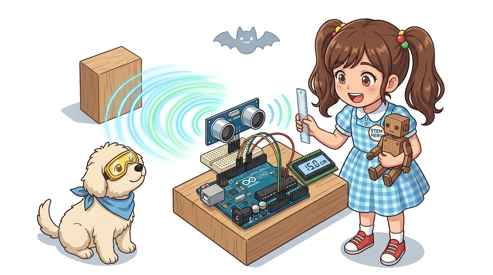
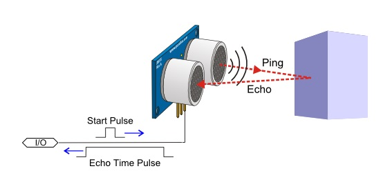
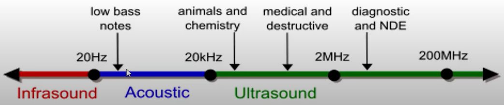
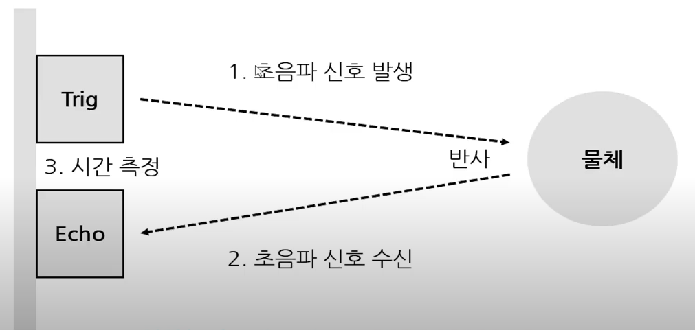
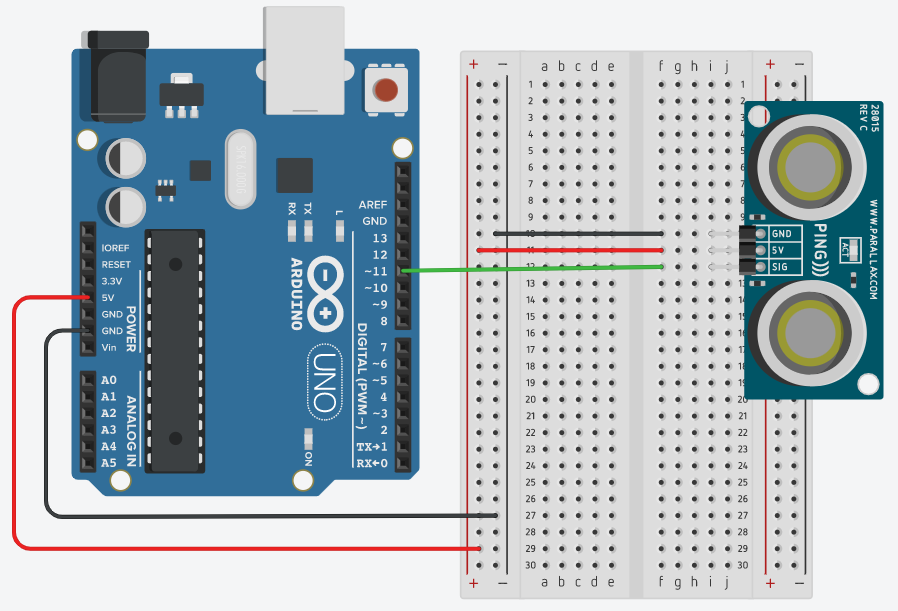
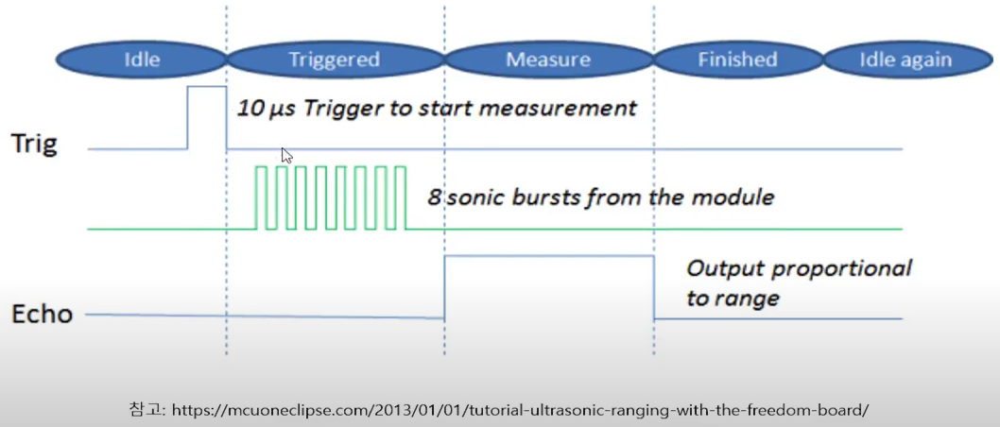
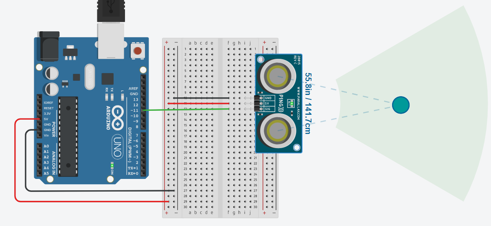

# 061_초음파센서_HCSR04거리측정 🦇🔊



**도로시와 지니가 함께하는 초음파 에코 반사 원리, 음속 계산 공식 및 2cm ~ 400cm 거리 측정 실습**

* 👧 **도로시**: "교수님! 지니야! 박쥐나 돌고래는 깜깜한 동굴이나 깊은 바닷속에서도 벽이나 먹이에 전혀 부딪히지 않고 쏜살같이 헤엄치잖아! 아두이노도 눈을 감은 채로 앞의 장애물까지의 거리를 알아낼 수 있어?"
* **👨‍🏫 이호진 교수님**: "그럼! 박쥐처럼 사람이 들을 수 없는 초고주파 소리(40,000Hz)를 쏘아서 되돌아오는 메아리(Echo)의 비행 시간을 측정하는 **HC-SR04 초음파 거리 센서** 덕분이란다!"
* 🐶 **토토**: "바우! 동그란 눈이 2개 달린 귀여운 로봇 눈동자 센서다 멍!"

* 🖥️ **강의 슬라이드**: [slides.md](./slides.md)

---

## 1. HC-SR04 모듈의 외형과 발신기(T)와 수신기(R)



### 🦇 40kHz 초음파를 쏘고 듣는 2개의 음향 캔
* **초음파 (Ultrasound)**:
  * 인간의 가청 주파수 대역($20\text{Hz} \sim 20,000\text{Hz}$)을 훌쩍 뛰어넘는 고주파 음파입니다.
* **T 트랜스듀서 (Transmitter, 송신부)**:
  * 압전 세라믹 소자를 진동시켜 $40\text{kHz}$ 주파수의 강력한 지향성 음파 펄스 8개를 허공으로 쏘아 올립니다.
* **R 트랜스듀서 (Receiver, 수신부)**:
  * 물체에 부딪혀 되돌아오는 미세한 초음파 메아리를 포착하여 미세 전압 신호로 복원합니다.
* **측정 유효 사거리**: **$2\text{cm} \sim 400\text{cm}$ (최대 4미터)**, 측정 오차 약 $3\text{mm}$.

---

## 2. 4핀 인터페이스 핀아웃 규격



### 📌 단자별 기능과 아두이노 결선

| 핀 이름 | 신호 종류 | 아두이노 연결 핀 | 기능 및 동작 설명 |
| :---: | :---: | :---: | :--- |
| **VCC** | 전원 입력 | **아두이노 5V** | DC 5V 구동 전원 공급 |
| **GND** | 전원 접지 | **아두이노 GND** | 공통 0V 접지 |
| **Trig** | 디지털 입력 | **디지털 11번 핀** | 초음파 발사 명령 신호 (10마이크로초 HIGH 펄스 인가) |
| **Echo** | 디지털 출력 | **디지털 12번 핀** | 메아리가 되돌아올 때까지 HIGH를 유지하는 시간 펄스 출력 |

---

## 3. 작동 타이밍 다이어그램과 음파 비행 시간 (Time of Flight)



### ⏱️ 마이크로초($\mu\text{s}$) 단위의 정밀한 시간 계측 과정

```text
[1단계] 아두이노가 Trig 핀에 10마이크로초(10us) 동안 HIGH 펄스를 쏜다.
            ↓
[2단계] 센서 모듈이 자동으로 40kHz 초음파 펄스 8개를 허공으로 발사한다.
            ↓
[3단계] 센서는 초음파가 발사되는 순간 Echo 핀을 HIGH(5V)로 올린다.
            ↓
[4단계] 초음파가 물체에 부딪혀 되돌아와 R 수신기에 닿는 순간 Echo 핀을 LOW(0V)로 내린다.
            ↓
[결과] Echo 핀이 HIGH를 유지한 시간 = 초음파가 왕복한 총 비행 시간(duration, us)!
```

---

## 4. 거리 계산 수학 공식 유도 ($d = v \times t / 2$)



### 📐 공기 중의 음속과 마이크로초 환산
상온(약 20℃)에서 공기 중 소리의 전파 속도는 **초당 약 340미터 ($340\text{ m/s}$)** 입니다:

$$340\text{ m/s} = \frac{34000\text{ cm}}{1,000,000\text{ }\mu\text{s}} = 0.034\text{ cm/\mu s} = \frac{1}{29.41}\text{ cm/\mu s}$$

* 메아리 비행 시간 $t(\mu\text{s})$ 동안 소리가 날아간 거리는 왕복 거리이므로, 편도 거리 $d$는 절반으로 나눕니다:
  $$d = \frac{t \times 0.034}{2} = \frac{t}{2 \times 29.41} = \frac{t}{58.2}\text{ (cm)}$$
* 즉, **Echo 핀의 HIGH 시간($\mu\text{s}$)을 $58.2$로 나누면 곧바로 센티미터(cm) 거리**가 계산됩니다!

---

## 5. 실습 전체 코드: 실시간 초음파 거리 측정기 (Arduino C++)

### 💻 `pulseIn()` 함수를 활용한 정밀 거리 계측 펌웨어

```cpp
// 핀 번호 상수 정의
const int TRIG_PIN = 11; // 초음파 발사 트리거 핀
const int ECHO_PIN = 12; // 메아리 수신 에코 핀

void setup() {
  // PC 시리얼 모니터 통신 시작 (115200 bps)
  Serial.begin(115200);

  // 핀 입출력 모드 설정
  pinMode(TRIG_PIN, OUTPUT);
  pinMode(ECHO_PIN, INPUT);

  // 트리거 핀 초기화 (안정적인 LOW 유지)
  digitalWrite(TRIG_PIN, LOW);

  Serial.println("==========================================");
  Serial.println("   HC-SR04 Ultrasonic Range Finder Ready  ");
  Serial.println("==========================================");
}

void loop() {
  // 1. Trig 핀에 10마이크로초 HIGH 펄스 인가하여 초음파 8클럭 발사
  digitalWrite(TRIG_PIN, LOW);
  delayMicroseconds(2);
  digitalWrite(TRIG_PIN, HIGH);
  delayMicroseconds(10);
  digitalWrite(TRIG_PIN, LOW);

  // 2. Echo 핀이 HIGH로 유지된 시간(us)을 정밀 타이머로 측정
  // 타임아웃 30,000us (약 5미터 거리 초과 시 무한 대기 방지)
  long duration = pulseIn(ECHO_PIN, HIGH, 30000);

  // 3. 타임아웃 예외 처리 및 거리 계산
  if (duration == 0) {
    Serial.println("Out of Range (거리 초과 또는 장애물 없음)");
  } else {
    // 왕복 시간 / 58.2 = 편도 거리(cm)
    float distance = duration / 58.2;

    // 4. 시리얼 모니터에 정돈된 측정값 출력
    Serial.print("Echo Duration: ");
    Serial.print(duration);
    Serial.print(" us | Distance: ");
    Serial.print(distance, 1);
    Serial.println(" cm");
  }

  // 센서 음향 잔향이 가라앉도록 100ms 대기 후 다음 측정
  delay(100);
}
```

---

## 6. 코드 상세 해설 및 `pulseIn()` 타임아웃 최적화



### 🔍 무한 블로킹을 방지하는 방어적 코딩 기법

1. **`pulseIn(ECHO_PIN, HIGH, 30000)`**:
   * 기본 `pulseIn()` 함수는 신호가 돌아오지 않으면 최대 1초 동안 CPU를 멈추고 기다립니다.
   * 세 번째 인자로 타임아웃 값 `30000`($30\text{ms}$)을 지정하면, 소리가 5m 이상 허공으로 날아가 반사되지 않아도 0.03초 만에 0을 반환하고 즉시 다음 루프를 실행하므로 프로그램이 멈추지 않고 쾌적하게 유지됩니다!



---

## 🌟 도로시와 지니의 핵심 요약 노트!

| 단계 | 하드웨어 동작 | 코드 명령 |
| :--- | :--- | :--- |
| **1. 발사 트리거** | Trig 핀에 10us HIGH 펄스 전송 | `digitalWrite(TRIG, HIGH); delayMicroseconds(10);` |
| **2. 음파 왕복** | 40kHz 초음파 발사 및 반사파 수신 | 하드웨어 자동 처리 |
| **3. 시간 측정** | Echo 핀이 HIGH를 유지한 마이크로초 계측 | `long duration = pulseIn(ECHO, HIGH, 30000);` |
| **4. 거리 환산** | 왕복 비행 시간을 $58.2$로 나누기 | `float distance = duration / 58.2; (cm)` |

* 👧 **도로시**: "Trig로 10us 펄스를 쏘고, Echo 핀의 HIGH 시간을 재서 58.2로 나누니 벽과의 거리가 0.1cm 오차 없이 측정되었어!"
* **👨‍🏫 이호진 교수님**: "축하해 도로시! 이제 아두이노는 박쥐처럼 어둠 속에서도 장애물의 위치를 꿰뚫어 볼 수 있게 되었단다."
* 🐶 **토토**: "바우! 다음 시간에 이 초음파 센서로 자동차 후방 주차 경보기를 완성해보자 멍!"
