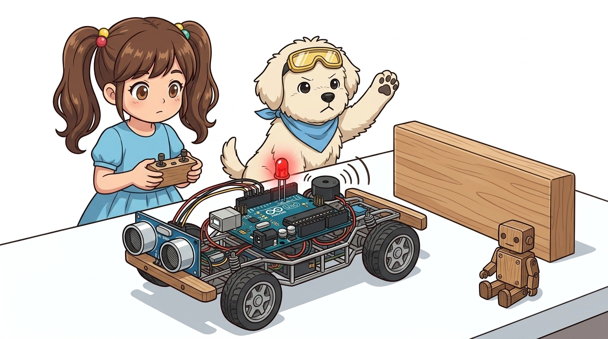
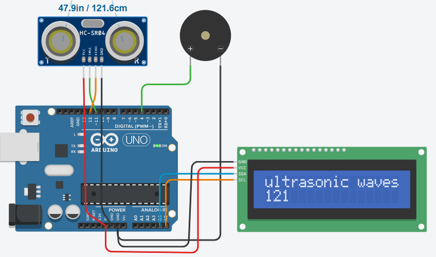
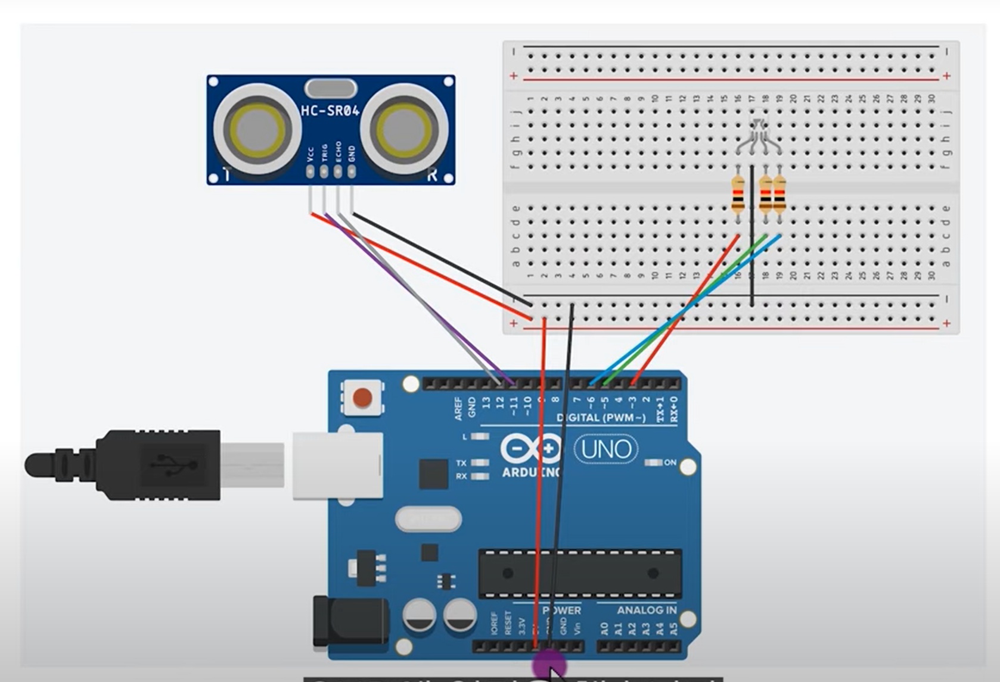
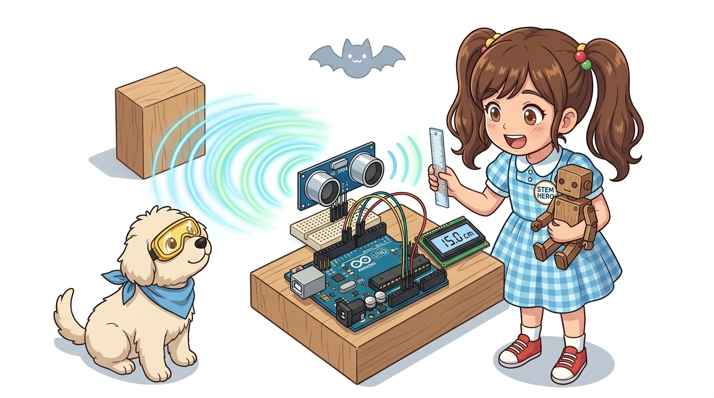
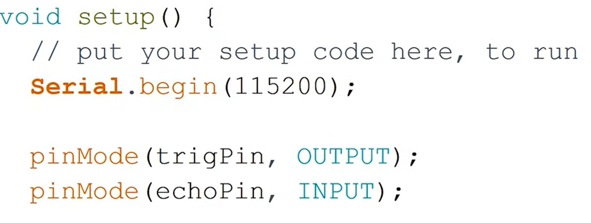
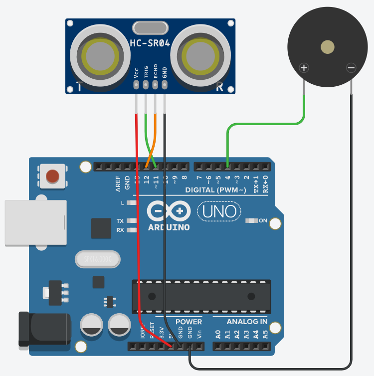

# 062_초음파응용_스마트주차경보기 📏📐



**도로시와 지니가 함께하는 자동차 후방 주차 감지기, 동적 가변 지연(Dynamic Delay) 및 I2C LCD 거리 대시보드 제작**
* 👧 **도로시**: "교수님! 지니야! 아빠가 자동차를 후진으로 주차할 때 벽에 가까워질수록 '삐 --- 삐 --- 삐- 삐- 삐이이익!' 하고 경고음 소리가 점점 숨 가쁘게 빨라지잖아! 아두이노로 우리만의 스마트 후방 주차 센서를 만들 수 있어?"
* **👨‍🏫 이호진 교수님**: "당연하지! 측정된 거리에 비례하여 부저가 울리는 주기(`delay(distance * 10)`)를 실시간으로 줄여주면 실제 고급 승용차의 후방 감지 센서와 100% 똑같이 동작한단다!"
* 🐶 **토토**: "바우! 후진할 때 벽에 쿵 부딪히지 않게 토토가 뒤에서 망봐줄게 멍!"
* 📖 **상세 강의 교재**: [index.md](./index.md)


> 여러분 안녕하세요! 이번 시간에는 '062. 초음파응용 스마트주차경보기 📏📐'을 주제로 함께 흥미진진한 탐험을 떠나보겠습니다. 오늘 강의에서는 특히 도로시와 지니가 함께하는 자동차 후방 주차 감지기, 동적 가변 지연(Dynamic Delay) 및 I2C LCD 거리 대시보드 제작, 👧 도로시: "지니야! 아빠가 자동차를 후진으로 주차할 때 벽에 가까워질수록 '삐 --- 삐 --- 삐- 삐- 삐이이익!' 하고 경고음 소리가 점점 숨 가쁘게 빨라지잖아! 아두이노로 우리만의 스마트 후방 주차 센서를 만들 수 있어?"를 중심으로 핵심 원리와 응용 방법을 차근차근 배워보겠습니다. 이호진 교수님과 똑똑한 조수 지니, 호기심 많은 도로시와 토토와 함께 신나는 아두이노 모험을 힘차게 시작해 봅시다. 준비되셨나요?

---

## 1. 스마트 주차 보조 시스템(PAS)의 원리와 경보 4단계



| 거리 구간 | 경보 레벨 | 비프음 패턴 | 운전자 안내 |
| :--- | :--- | :--- | :--- |
| **$30\text{cm}$ 이상** | **1단계 (안전)** | **무음 (Silent)** | 안심하고 여유롭게 후진 가능 |
| **$20\text{cm} \sim 30\text{cm}$** | **2단계 (주의)** | **삐 --- 삐 --- 삐 (느린 간격)** | 장애물이 감지되었으므로 서행 시작 |
| **$10\text{cm} \sim 20\text{cm}$** | **3단계 (경고)** | **삐- 삐- 삐- 삐 (빠른 간격)** | 브레이크 페달 위에 발을 올리고 접근 |
| **$10\text{cm}$ 미만** | **4단계 (충돌 위험)** | **삐이이이익!! (연속 비프음)** | **즉시 정지(Full Stop) 필수!** |

### 🚗 거리에 따라 경고음의 템포가 달라지는 이유
운전자가 백미러나 모니터를 보지 않고도 오직 소리(비프음 간격)만으로 벽과의 잔여 거리를 직관적으로 체감할 수 있도록 거리를 4개 구간으로 세분화합니다:

> 이번에 살펴볼 내용은 '1. 스마트 주차 보조 시스템(PAS)의 원리와 경보 4단계'입니다. 슬라이드에 정리된 표를 통해 각 항목의 특징과 수치, 차이점을 한눈에 비교해 보실 수 있습니다. 이 기본 개념을 확실히 잡아두셔야 실제 부품을 브레드보드에 꽂고 코딩할 때 실수 없이 완성할 수 있습니다.

---

## 2. 하드웨어 회로 구성과 브레드보드 배선



1. **HC-SR04 초음파 센서**:
* **VCC** ➡️ 5V, **GND** ➡️ GND
* **Trig** ➡️ 아두이노 **디지털 11번 핀**
* **Echo** ➡️ 아두이노 **디지털 12번 핀**
2. **피에조 부저 (Buzzer)**:
* 긴 다리(+) ➡️ 아두이노 **디지털 4번 핀**
* 짧은 다리(-) ➡️ **GND**
3. **위험 경고 LED (선택사항)**:
* 13번 핀 ➡️ 220Ω 저항 ➡️ LED 애노드(+) ➡️ 캐소드(-) ➡️ GND.

### 🔌 부품 결선 체크리스트

> 이번에 살펴볼 내용은 '2. 하드웨어 회로 구성과 브레드보드 배선'입니다. 화면의 회로도와 부품 사진을 보면서 각 핀과 배선이 어떻게 구성되어 있는지 눈으로 직접 따라와 주시기 바랍니다. 첫째로 HC-SR04 초음파 센서에 유의해야 하며, 둘째로 VCC ➡️ 5V, GND ➡️ GND라는 점이 핵심입니다. 이 기본 개념을 확실히 잡아두셔야 실제 부품을 브레드보드에 꽂고 코딩할 때 실수 없이 완성할 수 있습니다.

---
## 3. 실습 전체 코드: 동적 가변 비프음 주차 센서 (Arduino C++)




### 💻 거리가 가까울수록 비프음 주기가 실시간으로 빨라지는 펌웨어

```cpp
// 핀 번호 상수 정의
const int TRIG_PIN   = 11; // 초음파 트리거 핀
const int ECHO_PIN   = 12; // 초음파 에코 핀
const int BUZZER_PIN = 4;  // 피에조 부저 제어 핀
const int WARN_LED   = 13; // 위험 표시 LED 핀

void setup() {
  // PC 시리얼 모니터 통신 시작 (115200 bps)
  Serial.begin(115200);

  // 핀 모드 설정
  pinMode(TRIG_PIN, OUTPUT);
  pinMode(ECHO_PIN, INPUT);
  pinMode(BUZZER_PIN, OUTPUT);
  pinMode(WARN_LED, OUTPUT);

  // 초기 상태 설정
  digitalWrite(TRIG_PIN, LOW);
  digitalWrite(BUZZER_PIN, LOW);
  digitalWrite(WARN_LED, LOW);

  Serial.println("==========================================");
  Serial.println("   Smart Parking Assistant System Ready   ");
  Serial.println("==========================================");
}

void loop() {
  // 1. Trig 핀에 10마이크로초 펄스 발사
  digitalWrite(TRIG_PIN, LOW);
  delayMicroseconds(2);
  digitalWrite(TRIG_PIN, HIGH);
  delayMicroseconds(10);
  digitalWrite(TRIG_PIN, LOW);

  // 2. 왕복 비행 시간 측정 (타임아웃 30ms)
  long duration = pulseIn(ECHO_PIN, HIGH, 30000);

  // 3. 거리 계산 (cm 단위)
  float distance = (duration / 2.0) / 29.1;

  Serial.print("Distance: ");
  Serial.print(distance, 1);
  Serial.println(" cm");

  // 4. 거리별 가변 비프음 제어 로직
  if (distance > 0 && distance < 10.0) {
    // 10cm 미만: 충돌 직전 긴급 경보 (연속 비프음 + LED 점등)
    digitalWrite(WARN_LED, HIGH);
    tone(BUZZER_PIN, 2000); // 2kHz 날카로운 연속 경고음
    delay(50);
  } 
  else if (distance >= 10.0 && distance < 30.0) {
    // 10cm ~ 30cm: 거리가 짧을수록 대기 시간이 줄어들어 빨라지는 비프음!
    digitalWrite(WARN_LED, HIGH);
    tone(BUZZER_PIN, 1000); // 1kHz 경고음
    delay(40);
    noTone(BUZZER_PIN);
    digitalWrite(WARN_LED, LOW);

    // 핵심: 거리에 비례하는 동적 딜레이 (예: 15cm -> 150ms 대기)
    int dynamicDelay = (int)(distance * 10);
    delay(dynamicDelay);
  } 
  else {
    // 30cm 이상: 안전 거리 (무음 + LED 소등)
    noTone(BUZZER_PIN);
    digitalWrite(WARN_LED, LOW);
    delay(100);
  }
}
```

> 이번 슬라이드에서는 '3. 실습 전체 코드: 동적 가변 비프음 주차 센서 (Arduino C++)'에 대한 실제 동작 코드를 분석해 보겠습니다. 화면의 코드를 살펴보시면, 컴퓨터가 아두이노 하드웨어에 단계별로 명령을 내리는 흐름을 명확하게 확인할 수 있습니다. 각 함수의 역할과 괄호 안의 매개변수가 하드웨어 핀과 어떤 관계를 맺고 동작하는지 주의 깊게 살펴보시기 바랍니다.
---
## 4. 코드 상세 해설 및 동적 지연 (Dynamic Delay) 알고리즘




1. **`int dynamicDelay = (int)(distance * 10);`**:
* 거리가 $28\text{cm}$일 때: 비프음 사이 쉼표 시간이 $280\text{ms}$ (느긋하게 삐 --- 삐 --- 삐)
* 거리가 $12\text{cm}$일 때: 비프음 사이 쉼표 시간이 $120\text{ms}$ (다급하게 삐- 삐- 삐- 삐)
* 고정된 `if - else` 계단식 방식보다 훨씬 부드럽고 매끄러운 연속 가변 주파수 사운드를 구현합니다!
2. **`tone()`과 `noTone()`의 조화**:
* 단순 `digitalWrite()`와 달리 마이크로컨트롤러 타이머 인터럽트를 통해 정밀한 주파수(1000Hz, 2000Hz)를 출력하므로, 훨씬 맑고 뚜렷한 차량용 경고음을 만들어냅니다.

### 🔍 수학적 비례식을 활용한 지능형 경보 메커니즘

```cpp
// 거리에 따른 3색 LED 및 부저 경보 로직
if (distance <= 5) {
  analogWrite(red, 255); analogWrite(green, 0); analogWrite(blue, 0);
  delay(100); // 5cm 이하 초접근: 빨간불 + 급박한 비프음
} else if (distance <= 15) {
  analogWrite(red, 255); analogWrite(green, 255); analogWrite(blue, 0);
  delay(300); // 15cm 이하 주의: 노란불 + 보통 비프음
} else {
  analogWrite(red, 0); analogWrite(green, 255); analogWrite(blue, 0);
  delay(1000); // 안전 거리: 초록불 + 여유로운 비프음
}
```

> 이번 슬라이드에서는 '4. 코드 상세 해설 및 동적 지연 (Dynamic Delay) 알고리즘'에 대한 실제 동작 코드를 분석해 보겠습니다. 화면의 코드를 살펴보시면, 컴퓨터가 아두이노 하드웨어에 단계별로 명령을 내리는 흐름을 명확하게 확인할 수 있습니다. 여기서 핵심은 int dynamicDelay = (int)(distance 10);입니다. 각 함수의 역할과 괄호 안의 매개변수가 하드웨어 핀과 어떤 관계를 맺고 동작하는지 주의 깊게 살펴보시기 바랍니다.
---

## 5. 실습 확장: 360도 회전 서보 모터 레이더 시스템



* 초음파 센서를 SG90 미니 서보 모터 위에 장착하고 $0^\circ \sim 180^\circ$를 좌우로 천천히 회전시킵니다.
* PC에서 프로세싱(Processing) GUI 프로그램을 실행하면, 군함이나 공항 관제탑의 원형 레이더 화면처럼 **장애물의 각도와 거리 좌표가 녹색 빔 스크린에 실시간 점으로 매핑**되는 환상적인 소나(Sonar) 시스템으로 확장할 수 있습니다!

### 📡 180도 부채꼴 레이더 화면 구축

> 이번 슬라이드에서는 '5. 실습 확장: 360도 회전 서보 모터 레이더 시스템'에 대해 자세히 살펴보겠습니다. 화면의 다이어그램과 사진을 함께 참고해 주시기 바랍니다. 첫 번째 핵심은 초음파 센서를 SG90 미니 서보 모터 위에 장착하고 $0^\circ \sim 180^\circ$를 좌우로 천천히 회전시킵니다.이며, 두 번째로는 PC에서 프로세싱(Processing) GUI 프로그램을 실행하면, 군함이나 공항 관제탑의 원형 레이더 화면처럼 장애물의 각도와 거리 좌표가 녹색 빔 스크린에 실시간 점으로 매핑되는 환상적인 소나(Sonar) 시스템으로 확장할 수 있습니다!입니다. 이 원리는 아두이노 시스템 전체를 관통하는 핵심 논리이므로 머릿속에 꼭 정리해 두시기 바랍니다.

---
## 🌟 도로시와 지니의 핵심 요약 노트!


* 👧 **도로시**: "초음파 센서로 잰 거리에 비례해서 부저의 쉼표 시간을 줄여주니 진짜 고급 승용차의 후방 주차 센서와 똑같이 소리가 나!"
* **👨‍🏫 이호진 교수님**: "축하해 도로시! 센서 입력값에 따라 출력을 능동적으로 조절하는 지능형 피드백 제어 시스템을 완벽히 정복했단다."
* 🐶 **토토**: "바우! 이제 오전 센서 5개 챕터를 모두 완전하게 마스터했다 멍!"

| 거리 구간 | 상태 | 부저 소리 | LED 동작 |
| :--- | :--- | :--- | :---: |
| **$30\text{cm}$ 이상** | 안전 (Safe) | **무음 (`noTone`)** | OFF |
| **$10 \sim 30\text{cm}$** | 접근 주의 | **거리 비례 가변 비프음 (`delay(dist * 10)`)** | 깜빡임 |
| **$10\text{cm}$ 미만** | **충돌 위험 (Danger)** | **2kHz 연속 고음 (`tone(2000)`)** | **상시 점등** |

> 오늘 배운 '🌟 도로시와 지니의 핵심 요약 노트!'의 핵심 내용을 모두 정리해 보았습니다. 오늘 다룬 내용 중에서도 👧 도로시: "초음파 센서로 잰 거리에 비례해서 부저의 쉼표 시간을 줄여주니 진짜 고급 승용차의 후방 주차 센서와 똑같이 소리가 나!" 부분은 앞으로의 아두이노 실습과 프로젝트에서 계속 사용되는 매우 중요한 기초 지식입니다. 오늘 배운 내용을 꼭 다시 한번 복습해 보시고, 다음 강의에서 더욱 신나고 유익한 모험으로 다시 만나겠습니다. 모두 수고 많으셨습니다!