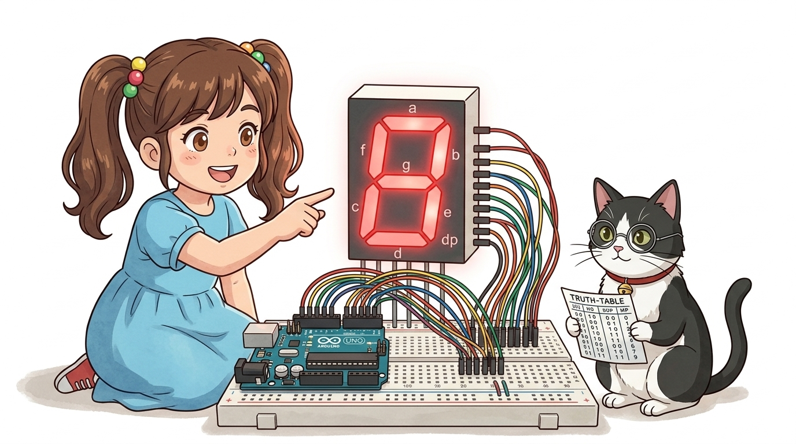
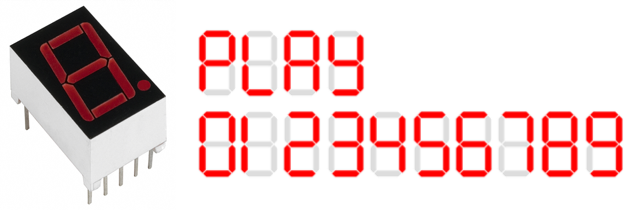
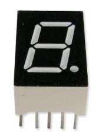
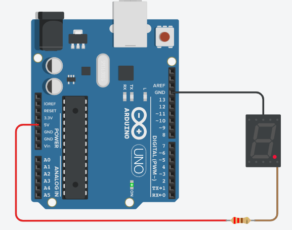
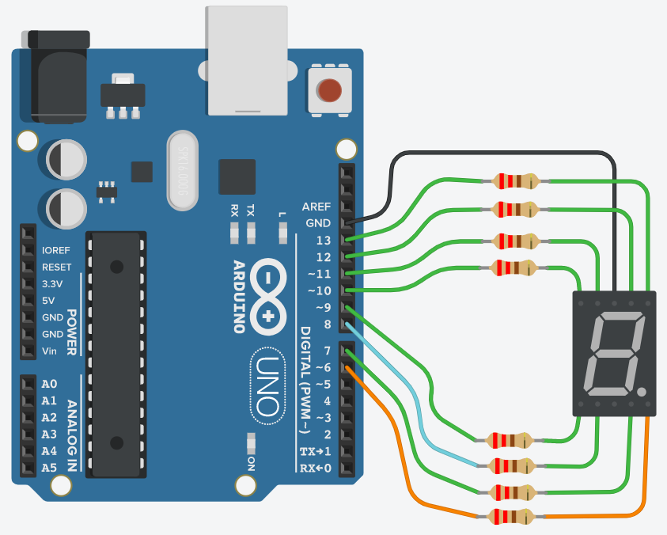
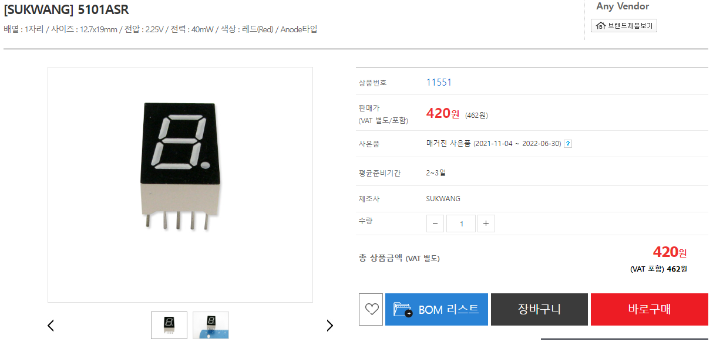
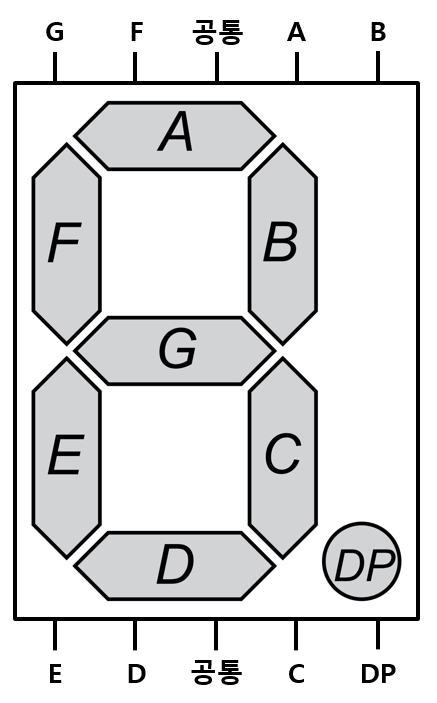
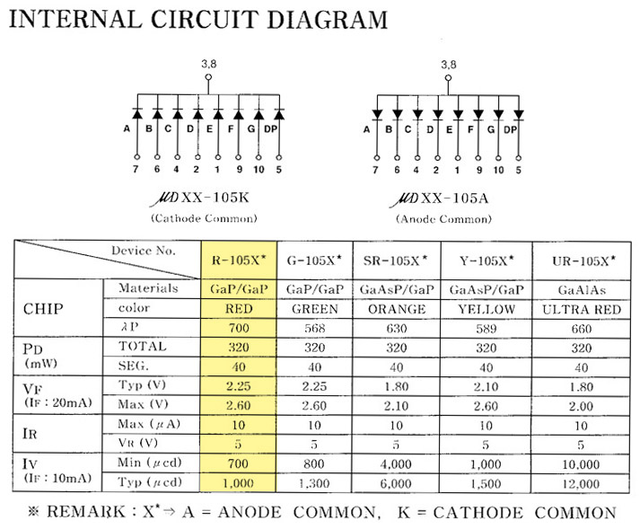

# 063_7세그먼트_숫자표시원리 🔢✨

> **숫자 표기의 표준! 7개의 막대 LED로 0부터 9까지 완벽하게 표현하기**  
> FND의 내부 구조와 공통 핀 연결 원리, 2차원 배열을 이용한 세그먼트 제어를 학습합니다.



* 🖥️ **강의 슬라이드**: [slides.md](./slides.md)

---

## 1. 7-세그먼트(FND)란 무엇일까요? 🏢⏰

엘리베이터의 현재 층수 표시판, 전자레인지의 남은 시간, 디지털 벽시계에서 흔히 볼 수 있는 붉은색 숫자의 비밀을 알아봅니다!

> **👧 도로시**: "지니야! 엘리베이터 층수 표시판이나 전자시계에 나오는 반듯반듯한 빨간 숫자는 어떻게 그리는 거야?"  
> **🐱 지니**: "막대 모양 LED 7개를 숫자 '8' 자 형태로 모아놓은 **'7-세그먼트(7-Segment / FND)'**를 사용하면 0부터 9까지 모든 숫자를 완벽하게 띄울 수 있단다!"  
> **🐶 토토**: "멍멍! (엘리베이터가 1층, 2층, 3층 올라간다 멍!)"



> [!NOTE]
> **FND(Flexible Numeric Display)**  
> 7개의 기다란 막대 LED(a, b, c, d, e, f, g)와 오른쪽 아래 소수점 LED(dp) 하나를 합쳐 총 **8개의 독립된 LED**가 하나의 플라스틱 패키지에 들어있는 디스플레이 모듈입니다.

---

## 2. 7개의 막대 이름표: a부터 g까지 🏷️

각 막대 LED는 국제 표준으로 정해진 알파벳 소문자 이름표를 가지고 있습니다.

| 세그먼트 기호 | 막대 위치 | 세그먼트 기호 | 막대 위치 |
| :---: | :---: | :---: | :---: |
| **`a`** | 맨 위 가로 막대 | **`e`** | 왼쪽 아래 세로 막대 |
| **`b`** | 오른쪽 위 세로 막대 | **`f`** | 왼쪽 위 세로 막대 |
| **`c`** | 오른쪽 아래 세로 막대 | **`g`** | 한가운데 가로 막대 |
| **`d`** | 맨 아래 가로 막대 | **`dp`** | 오른쪽 아래 소수점 점(Dot Point) |



> [!TIP]
> 12시 방향의 맨 위 가로 막대 `a`부터 시작하여 시계 방향으로 `b, c, d, e, f` 순서로 돌고, 마지막 가운데 막대가 `g`입니다.

---

## 3. 공통 캐소드(-) vs 공통 애노드(+) ⚖️

8개의 LED 다리를 모두 밖으로 빼면 16개의 핀이 필요하지만, 한쪽 극성을 모두 하나로 묶은 **공통 핀(Common Pin)** 구조 덕분에 10개의 핀만으로 제어할 수 있습니다.



### 📌 두 가지 구동 방식 비교

* **공통 캐소드 (Common Cathode, CC - 일반 교육용)**:
  * 8개 LED의 음극(-)이 공통 핀에 묶여 있습니다.
  * 공통 핀 ➡️ **GND(-)** 연결
  * 각 막대 핀에 **`HIGH (1)`** 신호를 주면 해당 막대에 불이 켜집니다.
* **공통 애노드 (Common Anode, CA)**:
  * 8개 LED의 양극(+)이 공통 핀에 묶여 있습니다.
  * 공통 핀 ➡️ **5V(+)** 연결
  * 각 막대 핀에 **`LOW (0)`** 신호를 주어야 불이 켜집니다 (반전 논리).

---

## 4. 아두이노와 7-세그먼트 회로 연결 🛠️

공통 캐소드형 7-세그먼트를 아두이노 디지털 핀에 직관적으로 연결합니다.



### 📌 핀 연결 매핑표

| 세그먼트 핀 | 아두이노 핀 | 역할 및 비고 |
| :---: | :---: | :--- |
| **`a`** | **디지털 12번** | 맨 위 가로 |
| **`b`** | **디지털 13번** | 오른쪽 위 |
| **`c`** | **디지털 7번** | 오른쪽 아래 |
| **`d`** | **디지털 8번** | 맨 아래 가로 |
| **`e`** | **디지털 9번** | 왼쪽 아래 |
| **`f`** | **디지털 11번** | 왼쪽 위 |
| **`g`** | **디지털 10번** | 가운데 가로 |
| **`dp`** | **디지털 6번** | 소수점 |
| **공통 핀 (COM)** | **GND** | $220\Omega$ 또는 $330\Omega$ 저항을 거쳐 접지 연결 |

---

## 5. 실습 ①: 막대 LED 하나씩 순서대로 켜보기 💡

알파벳 a부터 g까지 차례대로 점등하여 8자 궤적을 그리는 테스트 코드입니다.



```cpp
// 03.1-1 세그먼트 각 막대 핀 정의
const int a = 12, b = 13, c = 7, d = 8;
const int e = 9,  f = 11, g = 10, dp = 6;

void setup() {
  pinMode(a, OUTPUT); pinMode(b, OUTPUT); pinMode(c, OUTPUT);
  pinMode(d, OUTPUT); pinMode(e, OUTPUT); pinMode(f, OUTPUT);
  pinMode(g, OUTPUT); pinMode(dp, OUTPUT);
}

void loop() {
  // a -> b -> c -> d -> e -> f -> g 순서로 회전 점등
  int segs[7] = {a, b, c, d, e, f, g};
  
  for (int i = 0; i < 7; i++) {
    digitalWrite(segs[i], HIGH);
    delay(200);
    digitalWrite(segs[i], LOW);
  }
}
```

---

## 6. 2차원 배열로 0부터 9까지 숫자 지도 만들기 🗺️

숫자마다 켜야 하는 8개 세그먼트의 상태(0과 1)를 2차원 바이트 배열로 체계화합니다.



```cpp
// {a, b, c, d, e, f, g, dp} 점등 데이터 (1: ON, 0: OFF)
byte number[10][8] = {
  {1, 1, 1, 1, 1, 1, 0, 0}, // 숫자 0: g와 dp 빼고 전체 ON
  {0, 1, 1, 0, 0, 0, 0, 0}, // 숫자 1: b, c만 ON
  {1, 1, 0, 1, 1, 0, 1, 0}, // 숫자 2: a, b, d, e, g ON
  {1, 1, 1, 1, 0, 0, 1, 0}, // 숫자 3: a, b, c, d, g ON
  {0, 1, 1, 0, 0, 1, 1, 0}, // 숫자 4: b, c, f, g ON
  {1, 0, 1, 1, 0, 1, 1, 0}, // 숫자 5: a, c, d, f, g ON
  {1, 0, 1, 1, 1, 1, 1, 0}, // 숫자 6: a, c, d, e, f, g ON
  {1, 1, 1, 0, 0, 1, 0, 0}, // 숫자 7: a, b, c, f ON
  {1, 1, 1, 1, 1, 1, 1, 0}, // 숫자 8: 전체 ON
  {1, 1, 1, 1, 0, 1, 1, 0}  // 숫자 9: e 빼고 ON
};
```

---

## 7. 실습 ②: 1초마다 0에서 9까지 카운트업! ⏱️🎉

이중 `for` 루프로 숫자를 0부터 9까지 순차적으로 출력하는 완벽한 카운터 프로그램입니다.



```cpp
// 핀 번호 배열: a, b, c, d, e, f, g, dp 순서
const int led[8] = {12, 13, 7, 8, 9, 11, 10, 6};

void setup() {
  for (int i = 0; i < 8; i++) {
    pinMode(led[i], OUTPUT);
  }
}

void loop() {
  // num: 0부터 9까지 변경
  for (int num = 0; num < 10; num++) {
    // seg: 8개 막대 핀에 배열의 비트값(0 또는 1) 쓰기
    for (int seg = 0; seg < 8; seg++) {
      digitalWrite(led[seg], number[num][seg]);
    }
    delay(1000); // 1초 간격 카운트업
  }
}
```

> **👧 도로시**: "이중 `for` 문으로 만드니까 코드가 마법처럼 간결해졌는데 0부터 9까지 숫자가 착착 올라가!"

---

## 🌟 도로시와 지니의 이번 시간 핵심 정리! 🏆

축하합니다! 7-세그먼트의 원리와 2차원 배열 제어 기법을 완벽히 마스터했습니다.


### 📋 핵심 요약 체크리스트

* [x] **7-세그먼트 구성**: 7개의 세그먼트 막대(a~g)와 소수점(dp)으로 모든 10진수 숫자를 형성합니다.
* [x] **공통 핀 구동 원리**: 캐소드형은 `HIGH`로 켜고, 애노드형은 `LOW`로 점등합니다.
* [x] **2차원 배열 활용**: `byte number[10][8]` 룩업 테이블(LUT)을 작성하여 복잡한 조건문 없이 루프문으로 일괄 제어했습니다.

> **👧 도로시**: "다음 시간에는 버튼을 누르면 랜덤으로 1부터 6까지 숫자가 나오는 **'전자 주사위'**를 만들어보고 싶어!"  
> **🐱 지니**: "최고의 아이디어야 도로시! 다음 시간에는 세븐세그먼트 전자 주사위를 함께 만들어보자!"
