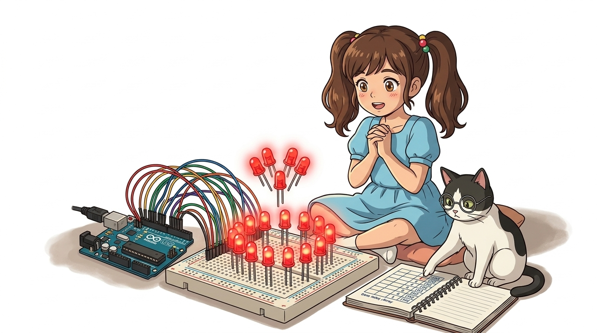
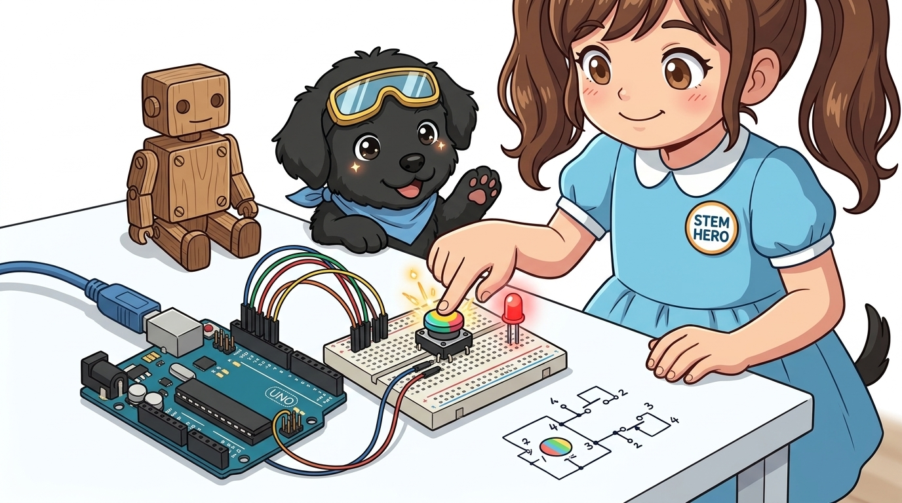
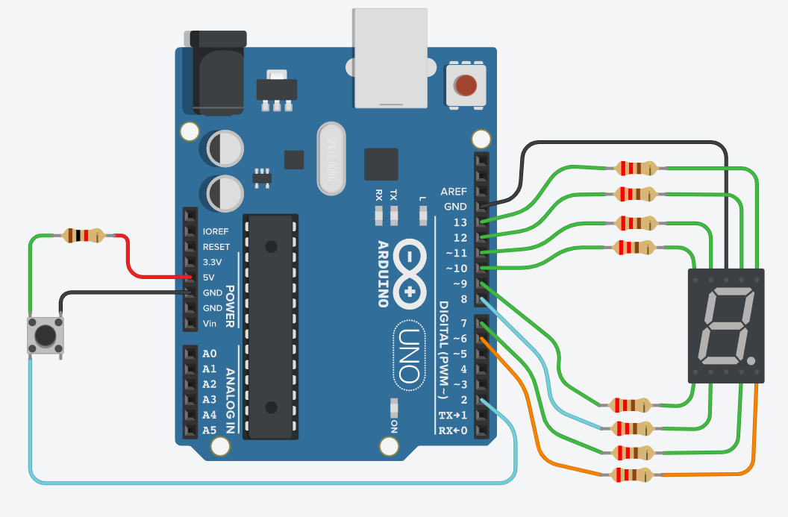
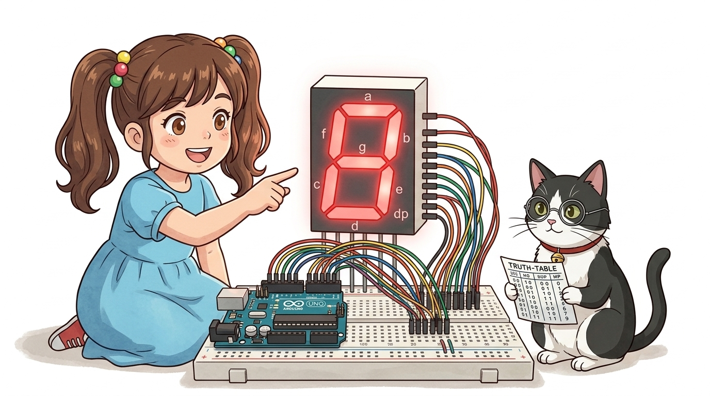
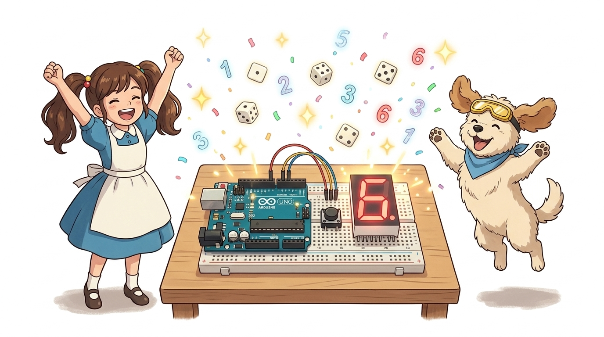

# 064_7세그먼트_전자주사위 🎲✨



* **푸시 버튼 입력과 7-세그먼트 출력을 융합한 인터랙티브 난수 게임기 제작**
* `random()` 난수 생성 함수와 `randomSeed()`의 원리를 이해하고 스릴 넘치는 룰렛 애니메이션을 구현합니다.
* 📖 **상세 강의 교재**: [index.md](./index.md)


> 여러분 안녕하세요! 이번 시간에는 '064. 7세그먼트 전자주사위 🎲✨'을 주제로 함께 흥미진진한 탐험을 떠나보겠습니다. 이호진 교수님과 똑똑한 조수 지니, 호기심 많은 도로시와 토토와 함께 신나는 아두이노 모험을 힘차게 시작해 봅시다. 준비되셨나요?

---

## 1. 전자 주사위(Digital Dice)란? 🎲


* **👧 도로시**: "지니야! 보드게임할 때 주사위를 맨날 잃어버려서 속상해! 아두이노 버튼을 누르면 1부터 6까지 진짜 주사위 숫자가 나오는 기계를 만들 수 있을까?"
* **🐱 지니**: "최고의 아이디어야 도로시! 7-세그먼트와 랜덤(난수) 함수의 마법을 합쳐 세상에 단 하나뿐인 **'아두이노 전자 주사위'**를 만들어보자!"
* **🐶 토토**: "멍멍! (잭팟 6번 나와라 멍!)"
* [!NOTE]
* **전자 주사위의 작동 흐름**
* 1. 대기 상태: 세그먼트에 대시표시(`-`) 또는 이전 주사위 눈금 표시
* 2. 버튼 클릭: 사용자가 택트 스위치를 누르면 난수 추첨 루틴 시작
* 3. 룰렛 애니메이션: 1부터 6까지의 숫자가 빠르게 회전하다가 서서히 감속
* 4. 최종 결과 출력: 엄격한 난수 알고리즘으로 선정된 1~6 중 하나의 숫자에 정지

보드게임을 하다가 주사위를 바닥에 떨어뜨려 잃어버리는 일은 이제 그만!

> 자, 이번 슬라이드의 질문을 함께 보시겠습니다. 바로 '1. 전자 주사위(Digital Dice)란? 🎲'라는 아주 흥미로운 질문입니다. 도로시가 던진 ' 최고의 아이디어야 도로시! 7-세그먼트와 랜덤(난수) 함수의 마법을 합쳐 세상에 단 하나뿐인  '라는 궁금증처럼, 누구나 한 번쯤 품어보았을 만한 이야기입니다. 이 질문 속에 숨겨진 전자 회로와 컴퓨팅의 핵심 원리를 지금부터 차근차근 하나씩 파헤쳐 보겠습니다.

---

## 2. 회로 설계: 버튼 스위치 추가하기 🛠️



* **7-세그먼트 배선 (디지털 6~13번 핀)**:
* `a`: D12, `b`: D13, `c`: D7, `d`: D8, `e`: D9, `f`: D11, `g`: D10, `dp`: D6
* 공통 캐소드 핀 ➡️ $220\Omega$ 저항 ➡️ **GND**
* **푸시 버튼 스위치 배선 (디지털 2번 핀)**:
* 스위치 한쪽 다리 ➡️ 아두이노 **디지털 2번 핀 (D2)**
* 대각선 반대쪽 다리 ➡️ **GND**
* `pinMode(2, INPUT_PULLUP)` 설정으로 외장 풀업 저항 생략!

기존의 7-세그먼트 8개 핀 배선에 푸시 버튼 스위치 회로를 추가합니다.
### 📌 부품 연결 상세표

> 이번에 살펴볼 내용은 '2. 회로 설계: 버튼 스위치 추가하기 🛠️'입니다. 화면의 회로도와 부품 사진을 보면서 각 핀과 배선이 어떻게 구성되어 있는지 눈으로 직접 따라와 주시기 바랍니다. 첫째로 세그먼트 배선 (디지털 6~13번 핀)에 유의해야 하며, 둘째로 a: D12, b: D13, c: D7, d: D8, e: D9, f: D11, g: D10, dp: D6라는 점이 핵심입니다. 이 기본 개념을 확실히 잡아두셔야 실제 부품을 브레드보드에 꽂고 코딩할 때 실수 없이 완성할 수 있습니다.

---

## 3. 무작위 수 뽑기: `random()` 함수 🎰



* [!IMPORTANT]
* `random(min, max)` 함수에서 상한값 `max`는 결과에 **포함되지 않습니다(Exclusive)**! 주사위의 눈인 1부터 6까지를 뽑으려면 반드시 `random(1, 7)`을 호출해야 합니다.

컴퓨터에게 무작위 숫자를 요청할 때는 아두이노 내장 `random()` 함수를 사용합니다.

```cpp
// 1. 단일 매개변수: 0부터 (max-1)까지
int val1 = random(6); // 0, 1, 2, 3, 4, 5 중 하나

// 2. 두 개 매개변수: min부터 (max-1)까지
int dice = random(1, 7); // 1, 2, 3, 4, 5, 6 중 하나!
```

> 이번 슬라이드에서는 '3. 무작위 수 뽑기: random() 함수 🎰'에 대한 실제 동작 코드를 분석해 보겠습니다. 화면의 코드를 살펴보시면, 컴퓨터가 아두이노 하드웨어에 단계별로 명령을 내리는 흐름을 명확하게 확인할 수 있습니다. 각 함수의 역할과 괄호 안의 매개변수가 하드웨어 핀과 어떤 관계를 맺고 동작하는지 주의 깊게 살펴보시기 바랍니다.

---

## 4. 진짜 무작위를 만드는 비밀: `randomSeed()` 🌱



* **🐱 지니**: "아무것도 연결되지 않은 아날로그 A0 핀은 공기 중의 미세한 정전기와 전자파 노이즈를 0~1023 사이의 값으로 흡수해! 이 예측 불가능한 물리 노이즈를 씨앗(Seed)으로 심으면 매번 완벽하게 무작위인 주사위가 만들어진단다!"

컴퓨터는 결정론적(Deterministic) 기계이기 때문에 내부 수학 공식(의사 난수 생성기, PRNG)에 의존합니다. 시작할 때 같은 씨앗(Seed)을 사용하면 매번 전원을 켤 때마다 동일한 숫자 순서(예: 3 ➡️ 6 ➡️ 1 ➡️ 2...)로 주사위가 나옵니다!
### 🌟 플로팅 아날로그 핀을 이용한 완벽한 난수 생성법

```cpp
void setup() {
  // 아무 센서도 연결되지 않은 빈 아날로그 A0 핀의 미세 전자기 노이즈를 읽어 시드로 지정
  randomSeed(analogRead(A0));
}
```

> 이번 슬라이드에서는 '4. 진짜 무작위를 만드는 비밀: randomSeed() 🌱'에 대한 실제 동작 코드를 분석해 보겠습니다. 화면의 코드를 살펴보시면, 컴퓨터가 아두이노 하드웨어에 단계별로 명령을 내리는 흐름을 명확하게 확인할 수 있습니다. 각 함수의 역할과 괄호 안의 매개변수가 하드웨어 핀과 어떤 관계를 맺고 동작하는지 주의 깊게 살펴보시기 바랍니다.

---

## 5. 실습: 주사위 굴리기 및 회전 룰렛 애니메이션 🎡



버튼을 누르면 숫자가 빠르게 돌아가다 점점 느려지며 최종 숫자가 결정되는 박진감 넘치는 코드입니다.

```cpp
// 03.1-2 전자 주사위 스케치
const int led[8] = {12, 13, 7, 8, 9, 11, 10, 6}; // a,b,c,d,e,f,g,dp
const int BUTTON_PIN = 2;

// 0부터 9까지 7세그먼트 폰트 데이터
byte number[10][8] = {
  {1,1,1,1,1,1,0,0}, // 0
  {0,1,1,0,0,0,0,0}, // 1
  {1,1,0,1,1,0,1,0}, // 2
  {1,1,1,1,0,0,1,0}, // 3
  {0,1,1,0,0,1,1,0}, // 4
  {1,0,1,1,0,1,1,0}, // 5
  {1,0,1,1,1,1,1,0}, // 6
  {1,1,1,0,0,1,0,0}, // 7
  {1,1,1,1,1,1,1,0}, // 8
  {1,1,1,1,0,1,1,0}  // 9
};

void showNumber(int n) {
  for (int j = 0; j < 8; j++) {
    digitalWrite(led[j], number[n][j]);
  }
}

void setup() {
  for (int i = 0; i < 8; i++) pinMode(led[i], OUTPUT);
  pinMode(BUTTON_PIN, INPUT_PULLUP);
  randomSeed(analogRead(A0)); // 난수 시드 초기화
  showNumber(0); // 시작할 때 0 표시
}

void loop() {
  // 버튼이 눌리면 주사위 굴리기 시작!
  if (digitalRead(BUTTON_PIN) == LOW) {
    int finalNumber = 1;
    
    // 15회 동안 숫자가 회전하며 지연시간이 점차 증가 (감속 룰렛)
    for (int r = 0; r < 15; r++) {
      finalNumber = random(1, 7); // 1 ~ 6 임의 선택
      showNumber(finalNumber);
      delay(20 + r * 20); // 20ms에서 320ms까지 점차 지연
    }
    
    // 당첨 숫자 확정 깜빡임 (2회)
    for (int k = 0; k < 2; k++) {
      delay(250);
      for (int j = 0; j < 8; j++) digitalWrite(led[j], LOW);
      delay(250);
      showNumber(finalNumber);
    }
  }
}
```

> 이번 슬라이드에서는 '5. 실습: 주사위 굴리기 및 회전 룰렛 애니메이션 🎡'에 대한 실제 동작 코드를 분석해 보겠습니다. 화면의 코드를 살펴보시면, 컴퓨터가 아두이노 하드웨어에 단계별로 명령을 내리는 흐름을 명확하게 확인할 수 있습니다. 각 함수의 역할과 괄호 안의 매개변수가 하드웨어 핀과 어떤 관계를 맺고 동작하는지 주의 깊게 살펴보시기 바랍니다.

---

## 🌟 도로시와 지니의 이번 시간 핵심 정리! 🏆


* **👧 도로시**: "버튼을 누르니까 차르르륵 돌다가 6에 딱 멈췄어! 보드게임할 때 정말 인기 만점이겠어!"
* **🐱 지니**: "멋져! 그런데 7-세그먼트는 전선이 8가닥이나 필요해서 선 연결이 복잡했지? 다음 시간에는 단 2개의 신호선으로 4자리 숫자를 시원하게 띄우는 **'TM1637 4자리 세그먼트 모듈'**을 배워보자!"

* [x] **`random(1, 7)`**: 1부터 6까지 6개의 눈금을 공평하게 무작위로 추첨합니다.
* [x] **`randomSeed(analogRead(A0))`**: 미연결 아날로그 핀의 전자기 노이즈를 시드로 주입하여 의사 난수의 주기성을 극복했습니다.
* [x] **시간 지연 증가 애니메이션**: `delay(20 + r * 20)` 루프를 통해 실제 물리 주사위가 굴러가다 멈추는 효과를 소프트웨어적으로 완벽 구현했습니다.

축하합니다! 완성도 높은 인터랙티브 전자 주사위를 성공적으로 제작했습니다.
### 📋 핵심 요약 체크리스트

> 오늘 배운 '🌟 도로시와 지니의 이번 시간 핵심 정리! 🏆'의 핵심 내용을 모두 정리해 보았습니다. 오늘 다룬 내용 중에서도 [x] random(1, 7): 1부터 6까지 6개의 눈금을 공평하게 무작위로 추첨합니다. 부분은 앞으로의 아두이노 실습과 프로젝트에서 계속 사용되는 매우 중요한 기초 지식입니다. 지니 멘토가 강조했듯이 멋져! 그런데 7-세그먼트는 전선이 8가닥이나 필요해서 선 연결이 복잡했지? 다음 시간에는 단 2개의 신호선으로 4자리 숫자를 시원하게 띄우는 라는 점을 꼭 마음에 새겨두시길 바랍니다. 오늘 배운 내용을 꼭 다시 한번 복습해 보시고, 다음 강의에서 더욱 신나고 유익한 모험으로 다시 만나겠습니다. 모두 수고 많으셨습니다!