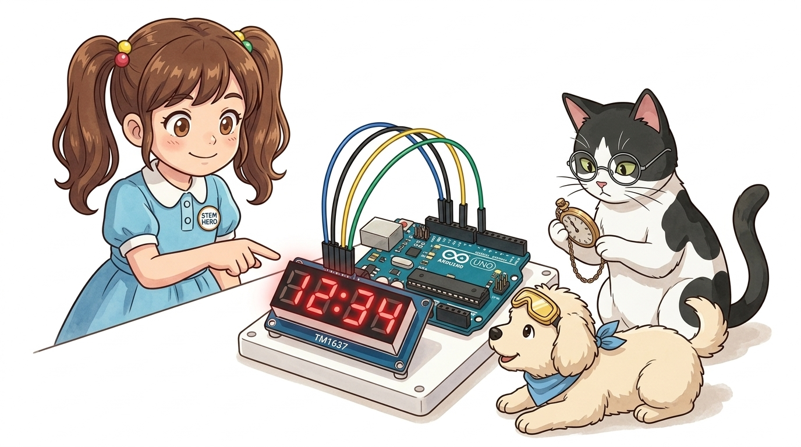
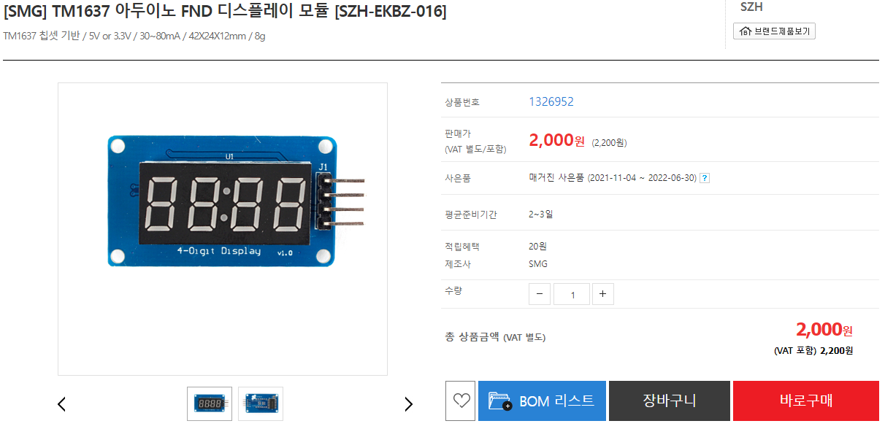
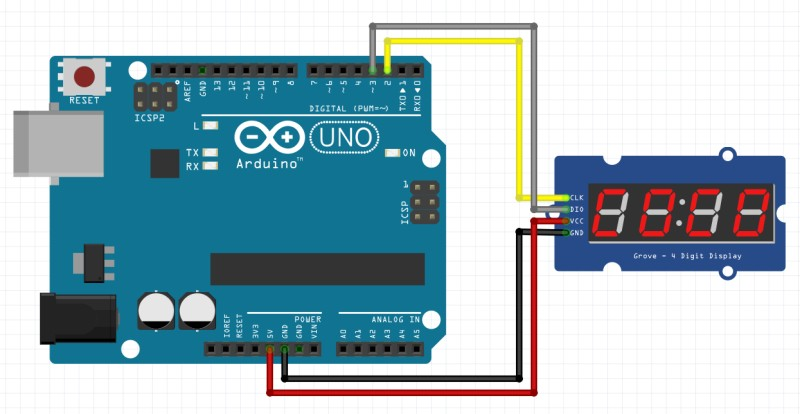
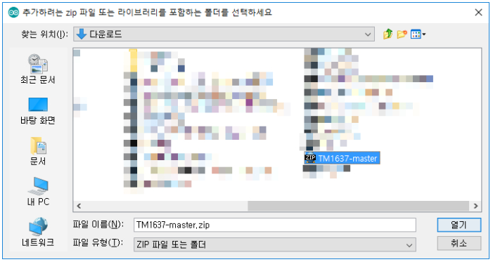
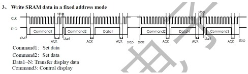
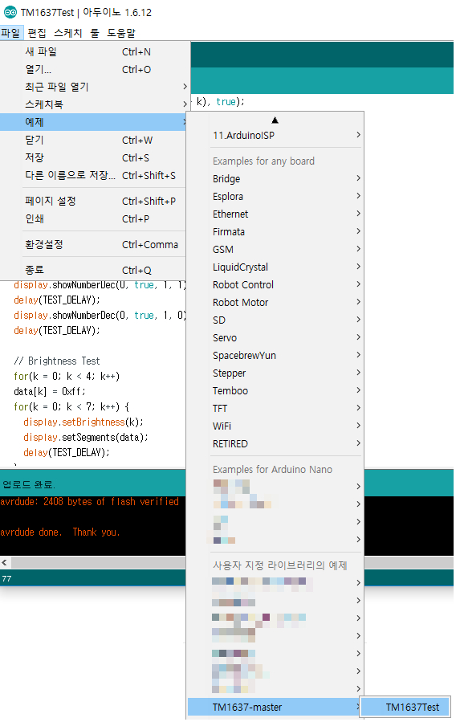
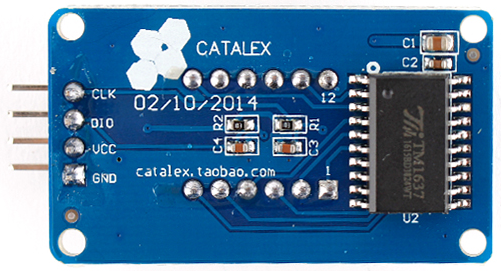

# 065_TM1637_4자리시계모듈 ⏰✨

> **배선 혁신! 전용 드라이버 칩으로 4자리 7-세그먼트를 간결하게 제어하기**  
> `TM1637Display` 라이브러리를 활용하여 타이머, 스톱워치, 콜론(`:`) 깜빡임 시계를 구현합니다.



* 🖥️ **강의 슬라이드**: [slides.md](./slides.md)

---

## 1. 4자리 FND의 핀 부족 딜레마 🤯

1자리 7-세그먼트를 구동할 때 아두이노의 디지털 핀 8개를 전부 소진했던 기억이 나시나요?

> **👧 도로시**: "지니야! 7-세그먼트 1개 꽂는데도 선이 8개나 필요했는데, 4자리 시계를 만들려면 선이 32개나 필요한 거야? 아두이노 구멍이 모자라!"  
> **🐱 지니**: "걱정 마 도로시! 똑똑한 전용 운전수 칩 **'TM1637'**이 있으면 신호선 단 2가닥(CLK, DIO)으로 4자리 숫자를 거뜬히 띄울 수 있어!"  
> **🐶 토토**: "멍멍! (선이 깔끔해져서 토토 발에 안 걸린다 멍!)"



> [!NOTE]
> **다이나믹 드라이브(Multiplexing)와 전용 드라이버**  
> 4자리 세그먼트를 순수하게 제어하려면 최소 12개(세그먼트 8개 + 자리수 공통 핀 4개) 이상의 핀이 필요합니다. TM1637 칩은 모듈 뒷면에 내장되어 있어 고속 시분할 점등(Multiplexing) 처리를 스스로 도맡아 처리하므로 아두이노의 CPU 부담과 핀 낭비를 획기적으로 줄여줍니다.

---

## 2. 구원투수 TM1637 모듈의 특징 🦸‍♂️

TM1637 모듈은 가전제품과 임베디드 기기에 널리 탑재되는 고신뢰성 디스플레이 모듈입니다.


### 📌 주요 기술 사양

* **2선식 시리얼 통신**: 오직 **CLK(클록)**과 **DIO(데이터)** 2개의 GPIO 핀만으로 모든 자리수와 밝기를 제어합니다.
* **디스플레이 RAM 내장**: 아두이노가 한 번 데이터를 전송해 두면, 화면이 계속 유지되므로 루프문에서 끊임없이 리프레시할 필요가 없습니다.
* **8단계 디지털 디밍 (Dimming)**: `0x00`(최소 밝기)부터 `0x0f`(최대 밝기)까지 소프트웨어적으로 밝기를 자유롭게 조절할 수 있습니다.
* **중앙 시간 콜론(`:`) 지원**: 시/분 표시용 시계 콜론 LED가 중앙에 탑재되어 있어 디지털 탁상시계 제작에 최적화되어 있습니다.

---

## 3. 초간단 회로 연결: 단 4가닥! 🔌

복잡한 저항 배선 없이 암-수 점퍼선 4가닥으로 아두이노에 직결합니다.



### 📌 핀 결선 상세표

| TM1637 핀 | 아두이노 UNO 연결 핀 | 기능 설명 |
| :---: | :---: | :--- |
| **`VCC`** | **5V** | 모듈 전원 공급 (3.3V ~ 5V 호환) |
| **`GND`** | **GND** | 공통 접지 |
| **`CLK`** | **디지털 2번 핀 (D2)** | 데이터 동기화 클록 신호선 |
| **`DIO`** | **디지털 3번 핀 (D3)** | 양방향 직렬 데이터 신호선 |

---

## 4. 편리한 오픈소스 라이브러리 설치 (TM1637Display) 📚

비트 단위 통신 프로토콜을 직접 구현할 필요 없이 안정적인 공식 라이브러리를 사용합니다.



### 🛠️ 라이브러리 설치 순서

1. 아두이노 IDE 상단 메뉴: **[스케치] ➡️ [라이브러리 포함하기] ➡️ [라이브러리 관리...]**
2. 라이브러리 매니저 검색창에 **"TM1637"** 입력
3. 제작자가 **"Avishay Orpaz"**로 표기된 **TM1637** 라이브러리를 찾아 **[설치]** 버튼 클릭!

---

## 5. 기본 초기화 및 화면 밝기 제어 🌟

라이브러리 헤더를 포함하고 객체를 선언하여 밝기를 세팅하는 기본 템플릿입니다.



```cpp
#include <TM1637Display.h>

// 연결 핀 매핑
#define CLK 2
#define DIO 3

// TM1637Display 객체 인스턴스 생성
TM1637Display display(CLK, DIO);

void setup() {
  // 밝기 설정 (0x00 ~ 0x0f)
  display.setBrightness(0x0a); 
  
  // 화면 초기화 (모든 세그먼트 소등)
  display.clear();
}
```

> [!TIP]
> `setBrightness(0x0f, true)`에서 두 번째 매개변수를 `true`로 주면 화면을 켜고, `false`로 주면 디스플레이 자체를 끌 수 있어 절전 모드 구현에 유용합니다.

---

## 6. 실습 ①: 10진수 숫자 바로 출력하기 🔢

`showNumberDec()` 함수로 양수, 음수, 0 채우기(Leading Zeros)를 직관적으로 다룹니다.



```cpp
void loop() {
  // 1. 4자리 정수 출력 ("1234")
  display.showNumberDec(1234);
  delay(2000);
  
  // 2. 한 자리 숫자 출력 (앞자리 공백: "   7")
  display.showNumberDec(7, false);
  delay(2000);
  
  // 3. 앞자리를 0으로 채워 4자리 맞추기 ("0007")
  display.showNumberDec(7, true);
  delay(2000);
  
  // 4. 음수 출력 (" -58")
  display.showNumberDec(-58);
  delay(2000);
}
```

---

## 7. 실습 ②: 1초씩 올라가는 디지털 시계 & 스톱워치 ⏱️🏃

`showNumberDecEx()` 함수로 중앙 콜론(`:`)을 1초마다 점멸시키는 리얼 탁상시계 코드입니다.



```cpp
void loop() {
  for (int sec = 0; sec < 10000; sec++) {
    // 짝수 초에는 콜론 점등(0x40), 홀수 초에는 소등(0x00)
    uint8_t colonDots = (sec % 2 == 0) ? 0x40 : 0x00;
    
    // showNumberDecEx(숫자, 도트/콜론비트, 0채우기여부, 자리수, 시작위치)
    display.showNumberDecEx(sec, colonDots, true);
    
    delay(1000); // 정확히 1초 대기
  }
}
```

> **👧 도로시**: "우와! 가운데 땡땡(`:`) 점이 깜빡이면서 1초마다 숫자가 올라가니 진짜 침대 머리맡 탁상시계 같아!"

---

## 🌟 도로시와 지니의 이번 시간 핵심 정리! 🏆

축하합니다! TM1637 모듈로 핀 절약과 세련된 다자리 숫자 디스플레이를 완성했습니다.


### 📋 핵심 요약 체크리스트

* [x] **2선 시리얼 통신**: 단 2가닥(CLK, DIO)으로 4자리 7-세그먼트 전체를 완벽히 통제했습니다.
* [x] **`TM1637Display` 라이브러리**: `showNumberDec()`와 `showNumberDecEx()` 함수로 복잡한 비트 연산 없이 간편 출력했습니다.
* [x] **중앙 콜론 점멸**: `0x40` 마스크 플래그를 활용해 1초 주기로 깜빡이는 디지털 탁상시계를 제작했습니다.

> **👧 도로시**: "선 4개로 4자리 시계를 만드니 너무 신기해! 다음엔 글자랑 영어가 줄줄 나오는 **'1602 LCD 화면'**을 써보고 싶어!"  
> **🐱 지니**: "좋아! 다음 시간에는 문자 디스플레이의 황제 **'1602 캐릭터 LCD'**의 세계로 넘어가 보자!"
