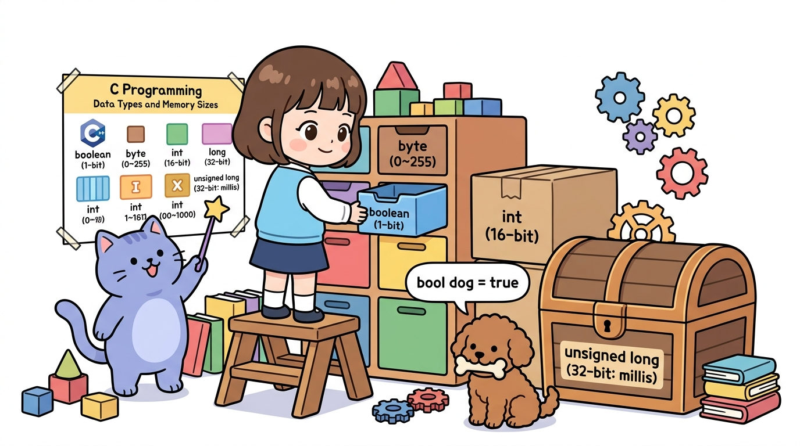
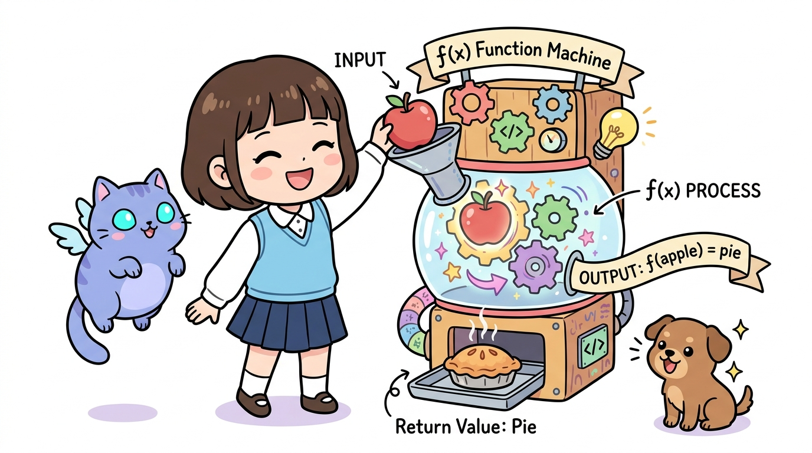
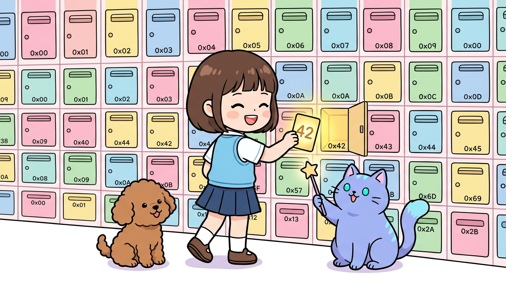
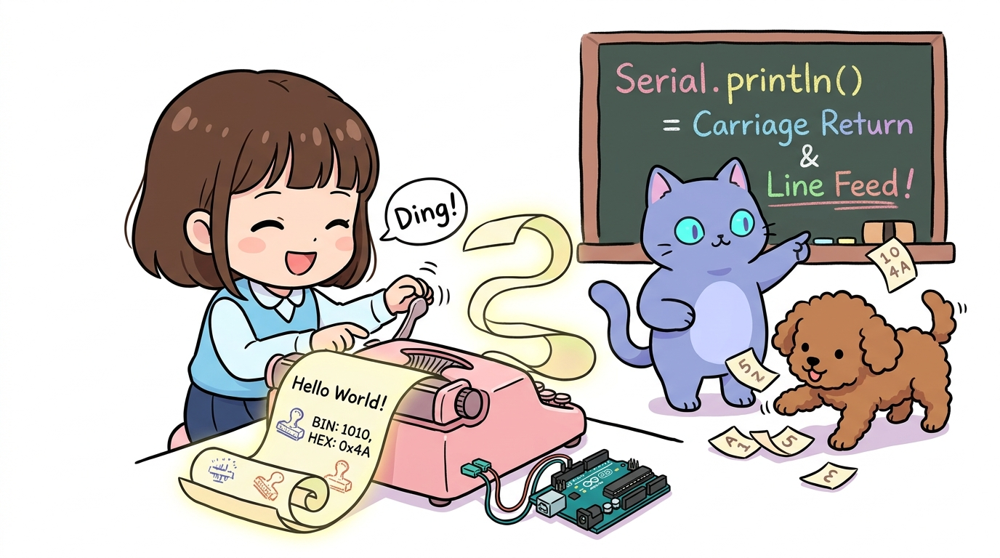

# 066_C언어변수타입_데이터보관함 📦🗄️



* **메모리 절약과 안정성의 핵심! 아두이노 C/C++ 자료형의 종류와 메모리 최적화 기법**
* `byte`, `int`, `unsigned long`, `float`, `char[]`, `String`의 차이점을 파악하고 용도에 맞는 자료형을 선택합니다.
* 📖 **상세 강의 교재**: [index.md](./index.md)


> 여러분 안녕하세요! 이번 시간에는 '066. C언어변수타입 데이터보관함 📦🗄️'을 주제로 함께 흥미진진한 탐험을 떠나보겠습니다. 이호진 교수님과 똑똑한 조수 지니, 호기심 많은 도로시와 토토와 함께 신나는 아두이노 모험을 힘차게 시작해 봅시다. 준비되셨나요?

---

## 1. 아두이노 C/C++ 변수 한눈에 보기 🗺️


* **👧 도로시**: "지니야! `int` 말고도 `byte`, `long`, `boolean` 같은 단어들이 자꾸 나와! 이 상자들은 뭐가 다른 거야?"
* **🐱 지니**: "메모리가 2KB로 작은 아두이노에서는 물건 크기에 딱 맞는 정리함을 골라 쓰는 게 핵심이야! 변수 정리함을 완벽히 정리해보자!"
* **🐶 토토**: "멍멍! (간식 뼈다귀는 뼈다귀 상자에 쏙! 이다 멍!)"

| 자료형 | 크기 (메모리) | 저장 가능한 값의 범위 | 대표 용도 및 권장 사례 |
| :--- | :---: | :--- | :--- |
| **`boolean`** | 1 바이트 | `true` (1) 또는 `false` (0) | 스위치 상태, On/Off 플래그 |
| **`byte`** | 1 바이트 (8비트) | `0 ~ 255` | 핀 번호, PWM 밝기, 7세그먼트 패턴 |
| **`char`** | 1 바이트 (8비트) | `-128 ~ 127` 또는 단일 문자 | ASCII 영문자, 제어 문자 |
| **`int`** | 2 바이트 (16비트) | `-32,768 ~ +32,767` | 일반적인 정수 계산, 센서 아날로그 읽기 |
| **`unsigned int`** | 2 바이트 (16비트) | `0 ~ 65,535` | 음수가 없는 양수 카운터 |
| **`unsigned long`**| 4 바이트 (32비트) | `0 ~ 4,294,967,295` (약 43억) | **`millis()` 시간 측정, 타임스탬프** |
| **`float`** | 4 바이트 (32비트) | $\pm 3.4028235\times 10^{38}$ | 소수점 정밀 온도, 습도, 거리 계산 |

아두이노(ATmega328P)는 단 2KB의 작은 SRAM 메모리를 가지고 있으므로, 담으려는 데이터의 크기에 꼭 맞는 서랍을 골라 쓰는 것이 매우 중요합니다.
### 📌 아두이노 주요 자료형 총정리

> 이번에 살펴볼 내용은 '1. 아두이노 C/C++ 변수 한눈에 보기 🗺️'입니다. 슬라이드에 정리된 표를 통해 각 항목의 특징과 수치, 차이점을 한눈에 비교해 보실 수 있습니다. 이 기본 개념을 확실히 잡아두셔야 실제 부품을 브레드보드에 꽂고 코딩할 때 실수 없이 완성할 수 있습니다.

---

## 2. "반환값이 없어요!" 빈 상자 `void` 📭



* [!NOTE]
* `void`는 변수를 선언할 때는 사용할 수 없으며, 함수의 반환형(Return Type)이나 매개변수가 없을 때 명시하는 용도로 사용됩니다.

`void`는 **"비어있다(Empty)"**라는 뜻을 가진 특별한 C++ 키워드입니다.

```cpp
// void는 함수가 동작을 마치고 아무런 결과값(return)을 내놓지 않을 때 사용합니다.
void setup() {
  // 초기화 작업만 수행하고 호출한 곳으로 보고서를 주지 않음!
}

void loop() {
  // 무한 반복 수행만 할 뿐 반환값이 없음!
}

// 반면 결과값을 돌려주는 함수는 해당 자료형을 앞에 적습니다.
int calculateSum(int a, int b) {
  return a + b; // int형 정수를 반환!
}
```

> 이번 슬라이드에서는 '2. "반환값이 없어요!" 빈 상자 void 📭'에 대한 실제 동작 코드를 분석해 보겠습니다. 화면의 코드를 살펴보시면, 컴퓨터가 아두이노 하드웨어에 단계별로 명령을 내리는 흐름을 명확하게 확인할 수 있습니다. 각 함수의 역할과 괄호 안의 매개변수가 하드웨어 핀과 어떤 관계를 맺고 동작하는지 주의 깊게 살펴보시기 바랍니다.

---

## 3. 알뜰살뜰 1바이트 챔피언: `byte` 🪙


* [!TIP]
* 1바이트는 8개의 비트(`00000000` ~ `11111111`)로 이루어져 있어 총 $2^8 = 256$가지의 상태를 표현합니다.

`0`부터 `255`까지의 숫자만 다루는 경우, 2바이트 `int` 대신 1바이트 `byte`를 사용하면 메모리를 50% 절약할 수 있습니다.

```cpp
// 핀 번호나 PWM 값은 0~255 범위를 절대 넘지 않습니다.
const byte LED_PIN = 13;      // 1 바이트 사용
const byte BUTTON_PIN = 2;    // 1 바이트 사용
byte pwmBrightness = 128;     // 1 바이트 사용

// int로 선언하면 각각 2바이트씩 소모되어 메모리가 2배 낭비됩니다!
```

> 이번 슬라이드에서는 '3. 알뜰살뜰 1바이트 챔피언: byte 🪙'에 대한 실제 동작 코드를 분석해 보겠습니다. 화면의 코드를 살펴보시면, 컴퓨터가 아두이노 하드웨어에 단계별로 명령을 내리는 흐름을 명확하게 확인할 수 있습니다. 각 함수의 역할과 괄호 안의 매개변수가 하드웨어 핀과 어떤 관계를 맺고 동작하는지 주의 깊게 살펴보시기 바랍니다.

---

## 4. 부호의 유무: `signed` vs `unsigned` ➕➖



* **👧 도로시**: "음수가 나올 수 없는 초음파 센서 거리나 주사위 눈금은 `unsigned`를 쓰면 훨씬 큰 숫자를 안심하고 담을 수 있네!"

* **`signed int` (기본 `int`)**:
* 부호 비트 1개 + 숫자 비트 15개 ➡️ `-32,768`부터 `+32,767`까지 표현
* **`unsigned int`**:
* "음수는 절대 취급하지 않겠다!"고 선언하여 16비트 전체를 양수에 할당 ➡️ `0`부터 `65,535`까지 2배 넓은 양수 범위 확보

컴퓨터 메모리는 맨 앞의 최상위 비트(MSB)를 부호 비트(0: 양수, 1: 음수)로 쓰는지에 따라 표현 범위가 크게 달라집니다.

> 이번 슬라이드에서는 '4. 부호의 유무: signed vs unsigned ➕➖'에 대해 자세히 살펴보겠습니다. 화면의 다이어그램과 사진을 함께 참고해 주시기 바랍니다. 첫 번째 핵심은 signed int (기본 int)이며, 두 번째로는 부호 비트 1개 + 숫자 비트 15개 ➡️ -32,768부터 +32,767까지 표현입니다. 여기에 덧붙여 unsigned int 내용까지 함께 이해해 두시면 완벽합니다. 이 원리는 아두이노 시스템 전체를 관통하는 핵심 논리이므로 머릿속에 꼭 정리해 두시기 바랍니다.

---

## 5. 거대한 시간의 보물상자: `unsigned long` ⏳👑


* 1초 = 1,000ms
* `int`의 최대값은 `32,767`이므로, 약 **32.7초**가 지나면 최대치를 초과하여 갑자기 음수 `-32,768`로 곤두박질치는 **오버플로(Overflow)** 가 일어납니다!
* 반면 **`unsigned long`**은 약 43억(4,294,967,295ms)까지 저장할 수 있어, 무려 **약 49.7일(50일)** 동안 오버플로 없이 연속 가동됩니다.

아두이노가 부팅된 후 흐른 시간을 밀리초 단위로 카운트하는 **`millis()`** 함수는 숫자가 매우 빠른 속도로 증가합니다.
### ⚠️ `int` 사용 시 치명적 오버플로(Overflow) 발생!

```cpp
// 시간 측정은 반드시 unsigned long 사용!
unsigned long previousMillis = 0;
const unsigned long INTERVAL = 1000;

void loop() {
  unsigned long currentMillis = millis();
  if (currentMillis - previousMillis >= INTERVAL) {
    previousMillis = currentMillis;
    // 1초마다 안정적으로 실행
  }
}
```

> 이번 슬라이드에서는 '5. 거대한 시간의 보물상자: unsigned long ⏳👑'에 대한 실제 동작 코드를 분석해 보겠습니다. 화면의 코드를 살펴보시면, 컴퓨터가 아두이노 하드웨어에 단계별로 명령을 내리는 흐름을 명확하게 확인할 수 있습니다. 여기서 핵심은 초 = 1,000ms입니다. 각 함수의 역할과 괄호 안의 매개변수가 하드웨어 핀과 어떤 관계를 맺고 동작하는지 주의 깊게 살펴보시기 바랍니다.

---

## 6. 문자열을 다루는 두 가지 방식: `char[]` vs `String` 📝



1. **`char text[] = "Hello";` (C 스타일 문자 배열)**:
* 메모리를 미리 정해진 바이트만큼만 정확히 사용하므로 속도가 빠르고 메모리 파편화(Fragmentation)가 없습니다.
* 임베디드 현업 프로젝트에서 가장 권장되는 표준 방식입니다.
2. **`String text = "Hello";` (아두이노 String 객체)**:
* `text += " World!";` 처럼 `+` 연산자로 쉽게 문자열을 이어 붙일 수 있어 초보자가 사용하기 편리합니다.
* 다만 동적 메모리 할당(Heap)을 반복하므로 메모리가 부족한 UNO 보드에서는 장시간 가동 시 충돌 위험이 있습니다.

영문이나 특수문자 문장을 저장할 때는 C 스타일의 문자 배열과 아두이노의 `String` 객체 중 상황에 맞추어 선택합니다.
### 📌 두 방식의 특징 비교

> 이번 슬라이드에서는 '6. 문자열을 다루는 두 가지 방식: char[] vs String 📝'에 대해 자세히 살펴보겠습니다. 화면의 다이어그램과 사진을 함께 참고해 주시기 바랍니다. 첫 번째 핵심은 char text[] = "Hello"; (C 스타일 문자 배열)이며, 두 번째로는 메모리를 미리 정해진 바이트만큼만 정확히 사용하므로 속도가 빠르고 메모리 파편화(Fragmentation)가 없습니다.입니다. 여기에 덧붙여 임베디드 현업 프로젝트에서 가장 권장되는 표준 방식입니다. 내용까지 함께 이해해 두시면 완벽합니다. 이 원리는 아두이노 시스템 전체를 관통하는 핵심 논리이므로 머릿속에 꼭 정리해 두시기 바랍니다.

---

## 🌟 도로시와 지니의 이번 시간 핵심 정리! 🏆


* **👧 도로시**: "변수 상자들의 크기를 알고 나니 메모리 낭비 없이 완벽하게 코딩할 수 있겠어!"
* **🐱 지니**: "훌륭해 도로시! 이제 이 변수들을 이용해 멋진 텍스트를 화면에 직접 띄워주는 **'1602 캐릭터 LCD'**로 신나게 넘어가 보자!"

* [x] **0~255 값은 `byte`**: 핀 번호와 밝기 제어 변수를 `byte`로 선언하여 SRAM을 절약했습니다.
* [x] **시간 측정은 `unsigned long`**: `millis()` 타이머 오버플로 문제를 완벽히 이해하고 안전한 32비트 자료형을 지정했습니다.
* [x] **부호 비트와 `unsigned`**: 음수가 필요 없는 데이터에 `unsigned`를 적용하여 양수 범위를 2배로 확장했습니다.

축하합니다! C언어의 핵심 데이터 타입과 메모리 관리 지식을 완벽히 정복했습니다.
### 📋 핵심 요약 체크리스트

> 오늘 배운 '🌟 도로시와 지니의 이번 시간 핵심 정리! 🏆'의 핵심 내용을 모두 정리해 보았습니다. 오늘 다룬 내용 중에서도 [x] 0~255 값은 byte: 핀 번호와 밝기 제어 변수를 byte로 선언하여 SRAM을 절약했습니다. 부분은 앞으로의 아두이노 실습과 프로젝트에서 계속 사용되는 매우 중요한 기초 지식입니다. 오늘 배운 내용을 꼭 다시 한번 복습해 보시고, 다음 강의에서 더욱 신나고 유익한 모험으로 다시 만나겠습니다. 모두 수고 많으셨습니다!