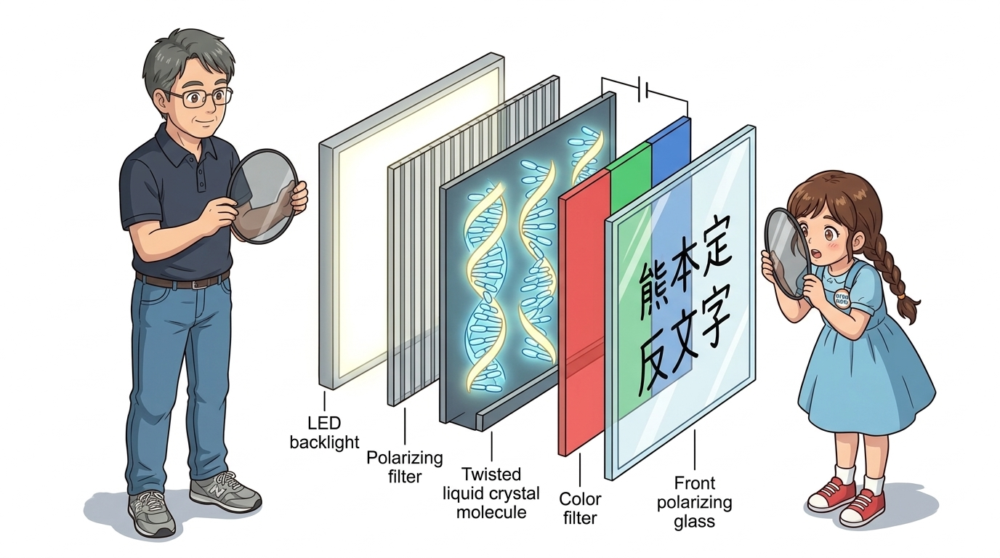
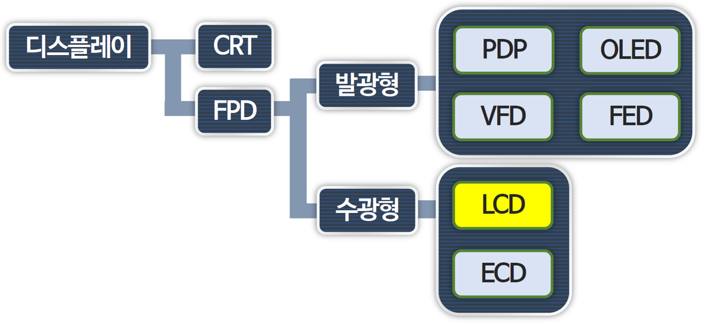
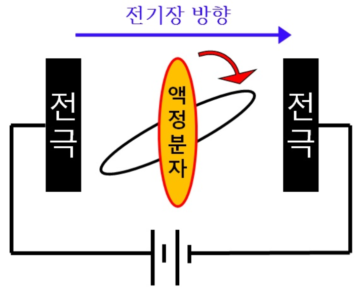
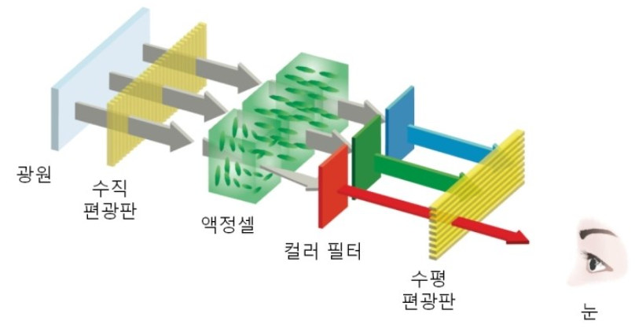
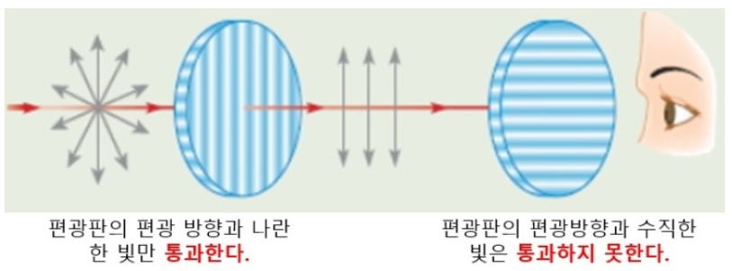
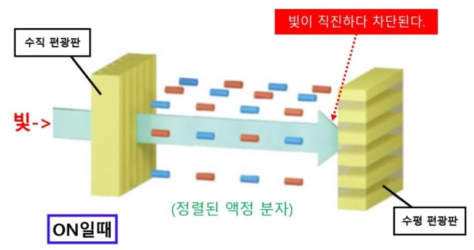
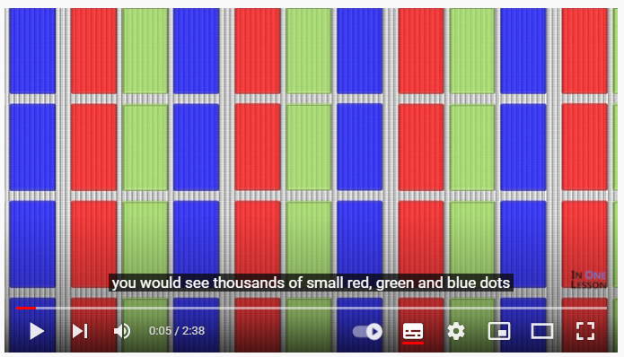
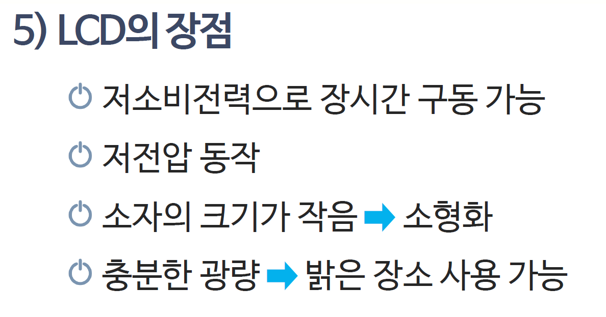
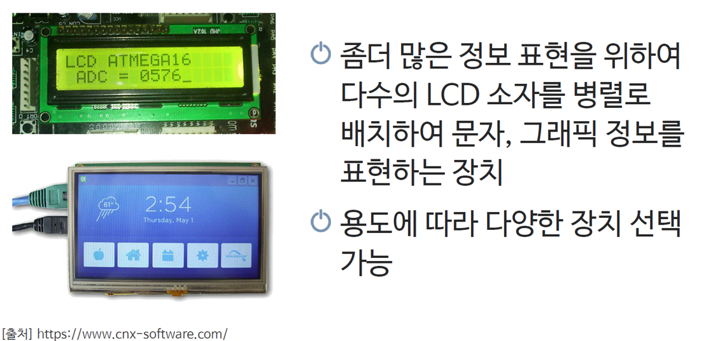

# 067_LCD란_문자디스플레이 📺✨

> **빛과 결정의 물리학! 액정(Liquid Crystal)과 편광판이 만들어내는 시각 인터페이스**  
> LCD의 광학적 작동 원리, 백라이트 구조, 패널의 진화 과정(TN, TFT, IPS), 1602 캐릭터 LCD의 특징을 학습합니다.

* 🖥️ **강의 슬라이드**: [slides.md](./slides.md)

---

## 1. 인간과 컴퓨터를 잇는 시각의 창: 디스플레이 🖥️

컴퓨터와 마이크로컨트롤러가 계산한 수많은 센서 데이터와 프로그램 상태를 사람이 직관적으로 읽을 수 있도록 변환해 주는 장치입니다.

> **👧 도로시**: "지니야! 휴대폰, 모니터, 전자계산기 화면에 나오는 글자는 전구를 촘촘히 박은 거야? 어떻게 선명한 글씨가 떠?"  
> **🐱 지니**: "그 비밀은 바로 액체처럼 흐르면서도 보석 결정처럼 규칙적인 **'액정(Liquid Crystal)'**에 있어! LCD 화면의 원리를 함께 파헤쳐보자!"  
> **🐶 토토**: "멍멍! (선글라스 끼고 빛을 관찰하자 멍!)"

### 📌 전자 디스플레이의 발전 계보

1. **CRT (음극선관, 브라운관)**: 전자총으로 형광 물질을 타격하는 부피가 크고 무거운 초창기 방식
2. **LCD (액정 디스플레이)**: 얇고 가벼우며 전력 소모가 적어 현대 전자기기의 표준으로 자리매김
3. **OLED / MicroLED**: 소자 스스로 빛을 내어 완벽한 검은색과 초슬림 폼팩터를 구현하는 차세대 디스플레이

---

## 2. LCD(Liquid Crystal Display)란? 💧💎

**LCD**는 **L**iquid **C**rystal **D**isplay의 약자로, 우리말로는 **'액정 표시 장치'**라고 부릅니다.

> [!NOTE]
> **액정(Liquid Crystal)이란?**  
> 액체(Liquid)처럼 자유롭게 흐르는 유동성을 가지면서도, 고체 결정(Crystal)처럼 분자들이 일정한 방향으로 정렬되어 있는 신비로운 중간 상태의 물질입니다. 외부에서 전기장(전압)을 걸어주면 분자의 정렬 방향이 순식간에 바뀌는 전기광학적 특성을 지닙니다.

---

## 3. LCD는 스스로 빛나지 못해요: 백라이트(Backlight) 💡

놀랍게도 액정 물질 자체는 빛을 발생시키는 발광체가 아니라, 빛을 통과시키거나 차단하는 **'광학 셔터(Optical Shutter)'** 역할을 수행합니다.

* **백라이트 유닛 (BLU, Backlight Unit)**: LCD 패널 뒷면에서 균일하고 밝은 백색광을 쏴주는 광원 (주로 고효율 백색 LED 사용)
* **도광판 및 확산 시트**: 점광원 형태의 LED 빛을 화면 전체에 얼룩 없이 고르게 퍼뜨려주는 광학 필름 계층
* 백라이트에서 출발한 빛이 액정 셔터와 컬러 필터를 거치며 우리가 보는 화면이 만들어집니다.

---

## 4. 빛을 걸러내는 마법의 격자: '편광판(Polarizer)' 🕶️

자연광이나 형광등의 빛은 진행 방향에 수직인 모든 360도 방향으로 불규칙하게 진동하는 전자기파입니다.

### 📌 편광(Polarization)의 메커니즘

* **편광 필터**: 미세한 슬릿(빗살) 구조를 가지고 있어, 특정 방향으로 진동하는 빛 성분만 통과시키고 나머지는 흡수/차단합니다.
* **직교 편광 (Crossed Nicols)**: 편광축이 90도 교차된 두 장의 편광판을 겹치면 첫 번째 판을 통과한 빛이 두 번째 판에 완벽히 차단되어 화면이 칠흑같이 어두워집니다.

---

## 5. 전압으로 빛의 밸브를 여닫는 액정 셔터 🚪✨

LCD는 두 편광판 사이에 액정 층을 배치하고, 전압 유무에 따라 빛의 진동축을 회전시키는 원리로 작동합니다.

| 전압 인가 상태 | 액정 분자의 배열 | 편광된 빛의 변화 | 화면 상태 (TN 모드 기준) |
| :---: | :---: | :---: | :---: |
| **OFF (전압 없음)** | 나선형으로 90도 꼬인 구조 | 빛이 액정을 따라 90도 회전 통과 | 두 번째 편광판 통과 ➡️ **화면 밝음 (White)** |
| **ON (전압 인가)** | 전기장 방향으로 꼿꼿이 정렬 | 빛의 편광 방향이 유지됨 | 두 번째 편광판에 차단 ➡️ **화면 어두움 (Black)** |

---

## 6. LCD 패널 기술의 눈부신 진화: TN ➡️ TFT ➡️ IPS 🚀

더 빠르고, 더 선명하며, 어느 각도에서나 왜곡 없는 화면을 만들기 위해 액정 구동 방식이 끊임없이 진화했습니다.

* **TN (Twisted Nematic)**: 가장 초창기 구조로 반응 속도가 빠르고 단가가 저렴하지만, 상하좌우 시야각이 좁아 옆에서 보면 색이 반전됩니다.
* **TFT (Thin Film Transistor)**: 각 픽셀마다 미세한 박막 트랜지스터 스위치를 배치하여 깜빡임 없는 고해상도 그래픽을 실현했습니다.
* **IPS (In-Plane Switching)**: 액정 분자를 평면상에서 수평으로 회전시켜 178도의 광시야각과 풍부한 색재현율을 제공합니다 (현대 스마트폰, 모니터의 핵심).

---

## 7. 아두이노의 단짝: 1602 캐릭터 LCD 화면 📟

임베디드 프로젝트에서 문자 정보 출력을 위해 가장 널리 사용되는 산업 표준 디스플레이입니다.

* **규격 해석**: 가로 **16문자**, 세로 **2행(Line)** = 동시에 총 **32개의 영문자/숫자/기호** 표현 가능
* **5×8 도트 매트릭스 폰트**: 한 글자는 5×8=40개의 미세 액정 도트로 구성되어 알파벳과 숫자를 선명하게 표시합니다.
* **HD44780 컨트롤러 내장**: 아두이노로부터 아스키(ASCII) 코드 값만 전달받으면 자체 폰트 ROM을 참조하여 화면에 글자를 그려줍니다.

---

## 8. 1602 LCD의 내부 블록도 및 인터페이스 📐

1602 LCD 모듈 뒷면에는 디스플레이 제어를 위한 16개의 접속 핀이 마련되어 있습니다.

* **전원부**: VSS(GND), VDD(5V), V0(화면 대비 명암 조절 단자)
* **제어 신호선**: RS(명령어/데이터 레지스터 선택), R/W(읽기/쓰기), E(동기화 Enable 펄스)
* **데이터 버스**: D0 ~ D7 (8비트 또는 4비트 병렬 전송 버스)
* **백라이트 전원**: A(LED 양극, 5V), K(LED 음극, GND)

---

## 🌟 도로시와 지니의 이번 시간 핵심 정리! 🏆

축하합니다! 액정 디스플레이의 심오한 물리 광학 원리와 1602 모듈의 구조를 완벽히 이해했습니다.

### 📋 핵심 요약 체크리스트

* [x] **액정의 본질**: 액체와 고체의 성질을 동시에 지니며, 전압에 따라 분자 정렬이 바뀌는 광학 스위치입니다.
* [x] **편광판과 백라이트**: 자체 발광하지 못하는 액정 층 전후로 편광판과 BLU를 결합하여 명암비를 생성합니다.
* [x] **1602 캐릭터 LCD**: 16×2 글자를 표시할 수 있는 HD44780 기반의 신뢰성 높은 텍스트 모듈입니다.

> **👧 도로시**: "LCD 화면의 과학 원리를 알고 나니 시계나 전자레인지 화면이 완전히 새로워 보여! 다음 시간엔 아두이노 코드로 내 이름을 직접 띄워볼래!"  
> **🐱 지니**: "훌륭해! 다음 시간에는 1602 LCD에 글자를 직접 출력하고 제어하는 **'LCD 출력 프로그래밍'**을 본격적으로 실습해 보자!"
