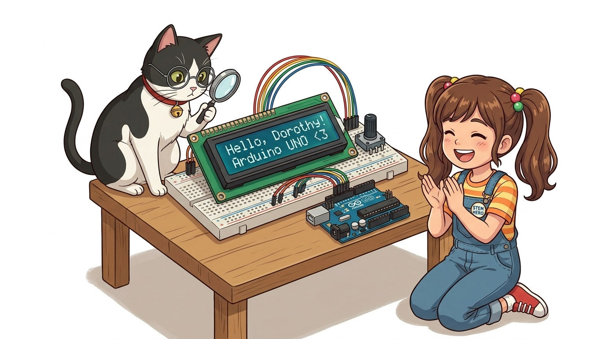
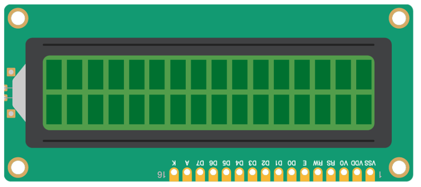
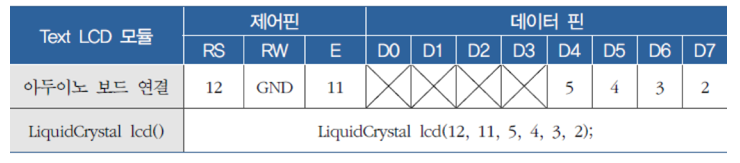
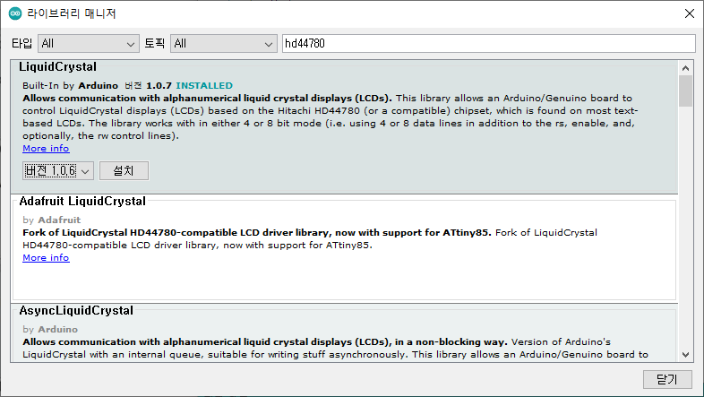
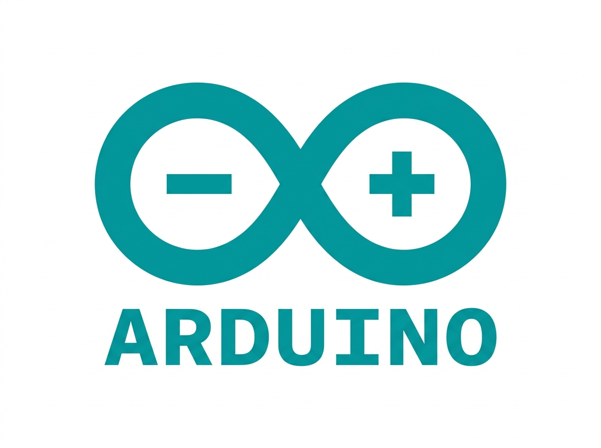
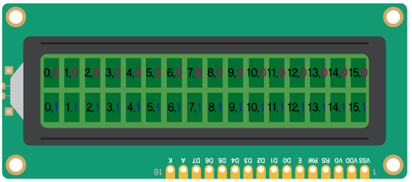
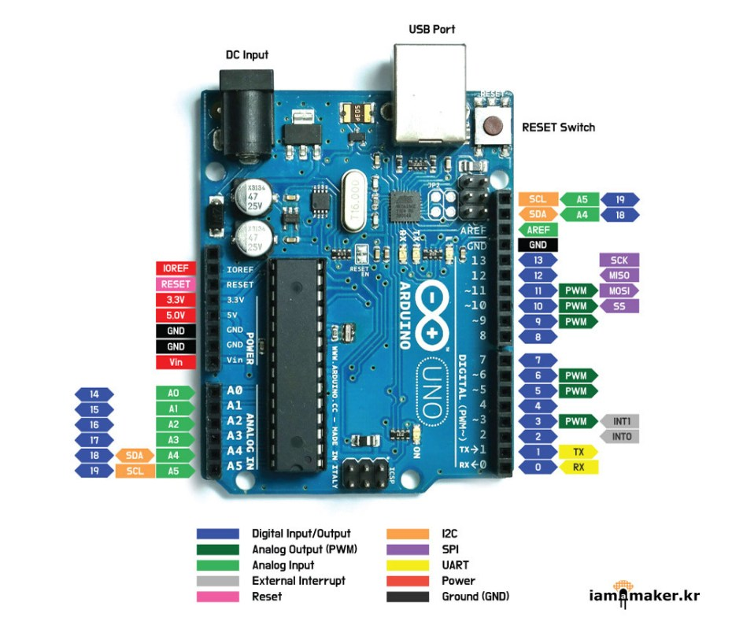

# 068_1602LCD_병렬텍스트출력 📟💬



* **문자 디스플레이 제어의 첫걸음! 1602 캐릭터 LCD의 핀 구조와 병렬 구동 프로그래밍**
* `LiquidCrystal` 내장 라이브러리를 활용하여 문자열 출력, 커서 위치 이동(`setCursor`), 가변저항 명암 튜닝을 실습합니다.
* 📖 **상세 강의 교재**: [index.md](./index.md)


> 여러분 안녕하세요! 이번 시간에는 '068. 1602LCD 병렬텍스트출력 📟💬'을 주제로 함께 흥미진진한 탐험을 떠나보겠습니다. 이호진 교수님과 똑똑한 조수 지니, 호기심 많은 도로시와 토토와 함께 신나는 아두이노 모험을 힘차게 시작해 봅시다. 준비되셨나요?

---

## 1. 1602 LCD 모듈의 핀 해부하기 🔍



* **👧 도로시**: "지니야! 1602 LCD 화면에 컴퓨터 모니터처럼 'Hello Dorothy'라는 글자를 예쁘게 찍어보고 싶어! 어떻게 명령해야 해?"
* **🐱 지니**: "아두이노의 기본 내장 마법 도구인 **`LiquidCrystal`** 라이브러리를 쓰면 단 세 줄의 코드로 화면에 글씨를 타닥타닥 띄울 수 있어!"
* **🐶 토토**: "멍멍! (화면에 글자가 뜨면 토토가 제일 먼저 읽을 거다 멍!)"

| 핀 번호 | 핀 기호 | 주요 기능 및 역할 |
| :---: | :---: | :--- |
| **1, 2** | `VSS` / `VDD` | 시스템 전원 공급 (GND / 5V) |
| **3** | `V0` (VEE) | **LCD 명암(Contrast) 조절 단자** (가변저항 연결 필수) |
| **4** | `RS` (Register Select) | 레지스터 선택 (LOW: 명령어 레지스터, HIGH: 문자 데이터 레지스터) |
| **5** | `R/W` (Read/Write) | 읽기/쓰기 모드 (아두이노에서는 주로 쓰기 모드인 GND에 직결) |
| **6** | `E` (Enable) | 데이터 전송 동기화 트리거 신호 핀 |
| **7 ~ 14**| `D0 ~ D7` | 8비트 데이터 버스 (4비트 모드 시 D4~D7 핀만 사용) |
| **15, 16**| `A` / `K` (LED+ / LED-) | 백라이트 LED 전원 (A: 5V, K: GND) |

1602 LCD 뒷면에는 전원, 제어선, 데이터선 등 총 16개의 접속 핀이 일렬로 배치되어 있습니다.
### 📌 16개 핀의 기능과 명칭

> 이번에 살펴볼 내용은 '1. 1602 LCD 모듈의 핀 해부하기 🔍'입니다. 슬라이드에 정리된 표를 통해 각 항목의 특징과 수치, 차이점을 한눈에 비교해 보실 수 있습니다. 이 기본 개념을 확실히 잡아두셔야 실제 부품을 브레드보드에 꽂고 코딩할 때 실수 없이 완성할 수 있습니다.

---

## 2. 병렬 회로 연결: 가변저항과 함께! 🛠️



1. **전원 및 백라이트 배선**:
* `VSS` (1번) ➡️ 아두이노 **GND**
* `VDD` (2번) ➡️ 아두이노 **5V**
* `A` (15번) ➡️ $220\Omega$ 저항 ➡️ **5V**
* `K` (16번) ➡️ **GND**
2. **명암 조절 (가변저항)**:
* $10\text{k}\Omega$ 가변저항의 양쪽 다리 ➡️ 각각 **5V**와 **GND**
* 가변저항의 가운데 다리(출력) ➡️ LCD **`V0` (3번 핀)**
3. **제어 및 데이터 신호선 (4비트 모드)**:
* `RS` ➡️ **디지털 12번 핀**
* `R/W` ➡️ **GND** (항상 쓰기 전용)
* `E` ➡️ **디지털 11번 핀**
* `D4` ➡️ **디지털 5번 핀**, `D5` ➡️ **디지털 4번 핀**
* `D6` ➡️ **디지털 3번 핀**, `D7` ➡️ **디지털 2번 핀**

4비트 모드를 사용하면 아두이노의 디지털 핀 6개(RS, E, D4, D5, D6, D7)와 10k$\Omega$ 가변저항을 결선합니다.
### 📌 부품 연결 상세 가이드

> 이번에 살펴볼 내용은 '2. 병렬 회로 연결: 가변저항과 함께! 🛠️'입니다. 화면의 회로도와 부품 사진을 보면서 각 핀과 배선이 어떻게 구성되어 있는지 눈으로 직접 따라와 주시기 바랍니다. 첫째로 전원 및 백라이트 배선에 유의해야 하며, 둘째로 VSS (1번) ➡️ 아두이노 GND라는 점이 핵심입니다. 이 기본 개념을 확실히 잡아두셔야 실제 부품을 브레드보드에 꽂고 코딩할 때 실수 없이 완성할 수 있습니다.

---

## 3. 기본 내장 라이브러리: `<LiquidCrystal.h>` 📚



* [!NOTE]
* `lcd.begin(16, 2)`를 호출하면 LCD 내부 컨트롤러에 초기화 명령어가 전송되면서 디스플레이가 켜지고 화면이 깨끗이 비워집니다.

별도의 다운로드 없이 아두이노 IDE에 표준 내장되어 있는 공식 라이브러리를 호출합니다.

```cpp
#include <LiquidCrystal.h>

// 연결한 핀 순서: LiquidCrystal lcd(RS, E, D4, D5, D6, D7);
const int RS = 12, E = 11;
const int D4 = 5, D5 = 4, D6 = 3, D7 = 2;

LiquidCrystal lcd(RS, E, D4, D5, D6, D7);

void setup() {
  // 가로 16칸, 세로 2줄 규격 선언
  lcd.begin(16, 2);
}
```

> 이번 슬라이드에서는 '3. 기본 내장 라이브러리: <LiquidCrystal.h> 📚'에 대한 실제 동작 코드를 분석해 보겠습니다. 화면의 코드를 살펴보시면, 컴퓨터가 아두이노 하드웨어에 단계별로 명령을 내리는 흐름을 명확하게 확인할 수 있습니다. 각 함수의 역할과 괄호 안의 매개변수가 하드웨어 핀과 어떤 관계를 맺고 동작하는지 주의 깊게 살펴보시기 바랍니다.

---
## 4. 실습 ①: 첫 줄에 "hello, world!" 출력하기 🎉




* **👧 도로시**: "우와! 시리얼 모니터 대신 내 책상 위 전용 초록 미니 모니터에 인사가 선명하게 떴어!"

`lcd.print()` 함수를 사용하여 1602 LCD 화면에 영문 문자열을 즉시 표시합니다.

```cpp
#include <LiquidCrystal.h>

// RS, E, D4, D5, D6, D7 핀 번호 할당
LiquidCrystal lcd(7, 8, 9, 10, 11, 12);

void setup() {
  lcd.begin(16, 2);      // 16열 2행 LCD 화면 초기화
  lcd.print("Hello!");   // LCD 화면에 "Hello!" 문자열 출력
}

void loop() {
}
```
```cpp
#include <LiquidCrystal.h>

LiquidCrystal lcd(12, 11, 5, 4, 3, 2);

void setup() {
  lcd.begin(16, 2);
  
  // 첫 번째 줄 맨 처음(0, 0) 위치부터 문자열 출력
  lcd.print("hello, world!");
}

void loop() {
  // 문자가 계속 유지되도록 빈 루프 유지
}
```

> 이번 슬라이드에서는 '4. 실습 ①: 첫 줄에 "hello, world!" 출력하기 🎉'에 대한 실제 동작 코드를 분석해 보겠습니다. 화면의 코드를 살펴보시면, 컴퓨터가 아두이노 하드웨어에 단계별로 명령을 내리는 흐름을 명확하게 확인할 수 있습니다. 각 함수의 역할과 괄호 안의 매개변수가 하드웨어 핀과 어떤 관계를 맺고 동작하는지 주의 깊게 살펴보시기 바랍니다.
---

## 5. 실습 ②: 2줄 모두 쓰기: `lcd.setCursor(열, 행)` 🎯



* [!TIP]
* `lcd.setCursor(col, row)`의 인자 순서는 `(가로 열, 세로 행)` 순서입니다. 가로 0~15, 세로 0~1 범위를 벗어나지 않도록 주의합니다.

1602 LCD는 가로 16열(0~15), 세로 2행(0~1)으로 이루어진 2차원 좌표계를 사용합니다.

```cpp
#include <LiquidCrystal.h>

LiquidCrystal lcd(12, 11, 5, 4, 3, 2);

void setup() {
  lcd.begin(16, 2);
  
  // 1번째 줄(행 0) 맨 처음 칸(열 0)으로 커서 이동
  lcd.setCursor(0, 0);
  lcd.print("Hello Dorothy!");
  
  // 2번째 줄(행 1) 2번째 칸(열 2)으로 커서 이동
  lcd.setCursor(2, 1);
  lcd.print("Arduino & Jiny!");
}

void loop() {
}
```

> 이번 슬라이드에서는 '5. 실습 ②: 2줄 모두 쓰기: lcd.setCursor(열, 행) 🎯'에 대한 실제 동작 코드를 분석해 보겠습니다. 화면의 코드를 살펴보시면, 컴퓨터가 아두이노 하드웨어에 단계별로 명령을 내리는 흐름을 명확하게 확인할 수 있습니다. 각 함수의 역할과 괄호 안의 매개변수가 하드웨어 핀과 어떤 관계를 맺고 동작하는지 주의 깊게 살펴보시기 바랍니다.

---

## 6. 글씨가 안 보이고 네모 상자만 뜬다면? 🔧



1. **상황 1: 하얀색 사각형 네모 블록만 가득 차 있는 경우**
* 원인: 명암 전압이 너무 높게 설정되어 액정 셀이 100% 닫혀 있는 상태입니다.
* 해결: $10\text{k}\Omega$ 가변저항의 파란색 손잡이를 일자 드라이버로 시계 또는 반시계 방향으로 천천히 돌려 전압을 낮춥니다.
2. **상황 2: 화면이 텅 비어 아무것도 보이지 않는 경우**
* 원인: 명암 전압이 0V에 가까워 글씨가 너무 옅게 렌더링된 상태입니다.
* 해결: 가변저항을 반대 방향으로 서서히 돌려 글씨 윤곽이 선명해지는 황금 각도를 찾습니다.
3. **상황 3: 백라이트가 아예 켜지지 않는 경우**
* 해결: 15번(`A`)과 16번(`K`) 핀의 5V/GND 배선 및 전류 제한 저항 결선을 점검합니다.

회로를 올바르게 연결했는데도 글자가 보이지 않을 때 취해야 할 긴급 트러블슈팅 가이드입니다.
### 📌 3단계 자가 진단 체크리스트

> 자, 이번 슬라이드의 질문을 함께 보시겠습니다. 바로 '6. 글씨가 안 보이고 네모 상자만 뜬다면? 🔧'라는 아주 흥미로운 질문입니다. 우리가 일상에서 흔히 접하는 상황 1: 하얀색 사각형 네모 블록만 가득 차 있는 경우 현상을 떠올려보면 왜 이런 의문이 생기는지 쉽게 공감할 수 있습니다. 이 질문 속에 숨겨진 전자 회로와 컴퓨팅의 핵심 원리를 지금부터 차근차근 하나씩 파헤쳐 보겠습니다.

---

## 🌟 도로시와 지니의 이번 시간 핵심 정리! 🏆


* **👧 도로시**: "그런데 지니야, 선을 6가닥이나 꽂으려니까 빵판이 너무 복잡해! 선을 획기적으로 줄일 순 없을까?"
* **🐱 지니**: "후후, 도로시! 다음 시간에 배울 **'I2C 통신 모듈(PCF8574)'**을 달면 단 2가닥의 신호선으로 모든 글자를 전송할 수 있단다!"

* [x] **16핀 병렬 인터페이스**: RS, E, D4~D7 신호선으로 4비트 데이터 통신을 수행했습니다.
* [x] **`LiquidCrystal` 라이브러리**: `lcd.begin(16, 2)`, `lcd.print()`, `lcd.setCursor()` 함수로 자유로운 화면 제어를 달성했습니다.
* [x] **`V0` 명암 제어**: $10\text{k}\Omega$ 가변저항으로 최적의 폰트 콘트라스트를 맞췄습니다.

축하합니다! 1602 캐릭터 LCD의 병렬 제어와 텍스트 출력 프로그래밍을 완벽히 마스터했습니다.
### 📋 핵심 요약 체크리스트

> 오늘 배운 '🌟 도로시와 지니의 이번 시간 핵심 정리! 🏆'의 핵심 내용을 모두 정리해 보았습니다. 오늘 다룬 내용 중에서도 [x] 16핀 병렬 인터페이스: RS, E, D4~D7 신호선으로 4비트 데이터 통신을 수행했습니다. 부분은 앞으로의 아두이노 실습과 프로젝트에서 계속 사용되는 매우 중요한 기초 지식입니다. 오늘 배운 내용을 꼭 다시 한번 복습해 보시고, 다음 강의에서 더욱 신나고 유익한 모험으로 다시 만나겠습니다. 모두 수고 많으셨습니다!