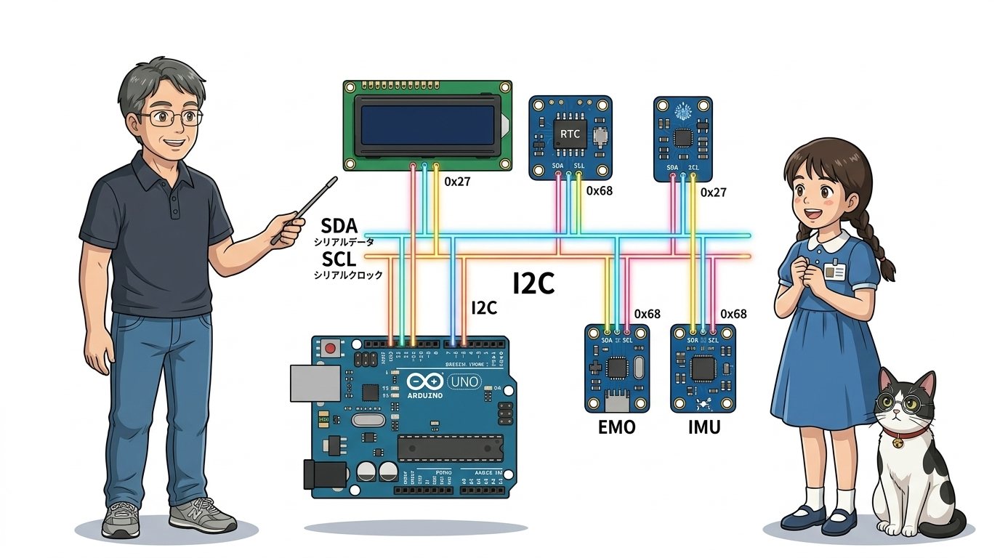
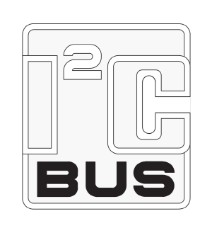
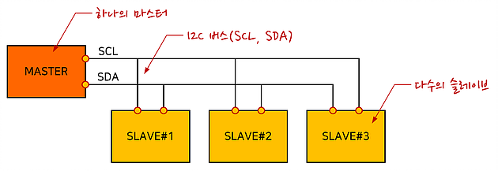
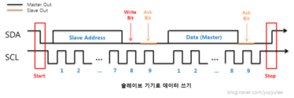
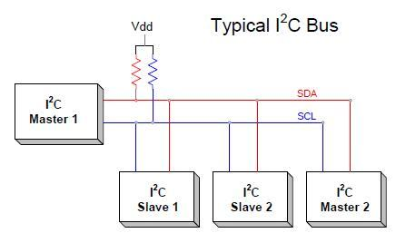
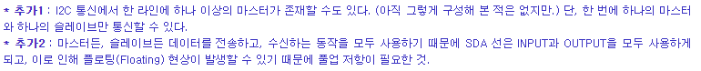
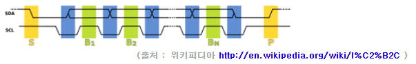
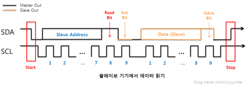

# 069_I2C통신_두가닥선의마법 🚗💨

> **임베디드 버스 통신의 표준! 단 2가닥 신호선으로 수십 개의 센서와 디스플레이를 묶는 I2C 프로토콜**  
> SDA와 SCL의 동작 원리, 마스터-슬레이브 아키텍처, 7비트 주소 체계, 오픈 드레인 풀업 회로를 심도 있게 학습합니다.



* 🖥️ **강의 슬라이드**: [slides.md](./slides.md)

---

## 1. 👧 도로시의 궁금증: "아두이노 핀이 부족해요!"

1602 LCD 화면에 점퍼선을 16개나 꽂으며 끙끙 앓던 도로시가 지니에게 고민을 털어놓습니다!

> **👧 도로시**: "지니야! LCD 화면 하나 달려고 했더니 전선이 16개나 필요하대! 아두이노 핀이 다 차버려서 온도 센서나 모터를 하나도 못 꽂겠어..."  
> **🐱 지니**: "후후, 그럴 때 쓰는 특급 마법이 바로 **I2C(아이-투-씨) 통신**이야! 전선 딱 **2개**만 있으면 부품을 100개도 넘게 줄줄이 연결할 수 있단다!"  
> **🐶 토토**: "멍멍! (선 2개로 어떻게 수다를 떨어?! 신기해!)"



> [!NOTE]
> **병렬(Parallel) vs 직렬(Serial) 통신의 차이**  
> 기존 병렬 방식은 비트 수만큼 전선이 필요해(8비트=8선) 핀 낭비가 극심했습니다. 반면 직렬 통신인 I2C는 한 가닥의 선으로 데이터를 시간 순서대로 한 비트씩 빠르게 흘려보내므로 배선을 획기적으로 줄여줍니다.

---

## 2. 🚦 I2C 통신이란 무엇일까요?

I2C는 1982년 네덜란드의 필립스(현 NXP) 사에서 기판 내 IC 칩 간의 간결한 통신을 위해 개발한 2선식 동기식 직렬 버스 규격입니다.



### 📌 I2C 통신의 핵심 스펙

* **정식 명칭**: **Inter-Integrated Circuit** (집적회로 간 통신, I²C)
* **아두이노 명칭**: 특허 회피를 위해 AVR 칩셋에서는 **TWI (Two-Wire Interface)** 로 명명됨
* **배선 간소화**: 전원(VCC, GND)을 제외하면 오직 **단 2가닥의 통신선**만 사용
* **멀티 드롭(Multi-drop) 버스**: 하나의 동일한 버스 라인에 여러 개의 서로 다른 부품이 병렬로 매달릴 수 있는 고속도로 구조

---

## 3. ⚡ 2가닥 선의 이름과 역할 (SDA & SCL)

I2C 통신을 이루는 두 신호선은 각각 데이터와 타이밍을 엄격히 분담합니다.



| 신호선 기호 | 정식 명칭 | 아두이노 UNO 전용 핀 | 주요 역할 및 기능 |
| :---: | :---: | :---: | :--- |
| **`SDA`** | **Serial Data** | **아날로그 A4 핀** (또는 AREF 옆 전용 SDA 핀) | 8비트 데이터 바이트와 주소 비트를 실어 나르는 양방향 통로 |
| **`SCL`** | **Serial Clock** | **아날로그 A5 핀** (또는 SDA 옆 전용 SCL 핀) | 비트 전송 타이밍을 맞춰주는 마스터 생성 동기화 클록 신호선 |

> **🐱 지니의 팁**: "SCL 클록이 째깍! 하고 `HIGH`로 뛸 때마다 SDA 신호선에 올라탄 0 또는 1의 전압을 읽어내는 원리란다!"

---

## 4. 👥 마스터(Master)와 슬레이브(Slave) 아키텍처

I2C 버스는 명확한 지휘 통제 체계로 데이터 충돌을 방지합니다.



* **마스터 (Master, 총지휘관)**:
  * 통신을 시작하고 종료하며, SCL 클록을 생성하여 버스를 주도하는 장치 (일반적으로 아두이노 보드)
* **슬레이브 (Slave, 작업 장치)**:
  * 마스터가 자신의 주소를 부를 때만 응답하는 수동적인 부품들 (LCD, 온습도 센서, 실시간 RTC 시계, 자이로 센서 등)
* **확장성**: 7비트 주소 체계를 통해 단 한 쌍의 SDA/SCL 라인에 **최대 127개의 서로 다른 장치**를 공통 연결할 수 있습니다.

---

## 5. 🏠 고유 주소(Address)로 콕 찍어 부르기!

동일한 두 가닥 선에 수많은 부품이 물려 있어도 신호가 뒤섞이지 않는 이유는 바로 **'7비트 고유 주소'** 체계 덕분입니다.



```
[마스터의 통신 프레임 예시]
┌─────────┬───────────────────┬─────────┬──────────────────────┬────────┐
│ START   │ 7비트 슬레이브 주소 │ R/W 비트│ 8비트 데이터 바이트   │ STOP   │
│ 신호    │ (예: 0x27)        │ (0: 쓰기)│ (예: 글자 'A')       │ 신호   │
└─────────┴───────────────────┴─────────┴──────────────────────┴────────┘
```

* 마스터가 버스에 `"0x27번 나와라!"` 하고 주소를 외치면, 0x27 주소를 가진 1602 LCD만 귀를 기울이고 나머지 센서들은 신호를 무시합니다.
* 대표적인 모듈 주소: LCD 모듈(`0x27` 또는 `0x3F`), RTC DS3231(`0x68`), MPU6050 센서(`0x68`)

---

## 6. ⏱️ I2C 데이터 전송의 3단계 흐름

마스터와 슬레이브 사이의 패킷 교환은 엄격한 프로토콜 타이밍을 준수합니다.



1. **시작 신호 (START Condition)**:
   * SCL이 `HIGH` 상태를 유지하고 있을 때 SDA가 `HIGH`에서 `LOW`로 먼저 떨어지며 버스의 모든 장치에 "주목! 대화 시작!"을 선언합니다.
2. **주소 및 데이터 전송 + ACK (응답 확인)**:
   * 8비트 데이터를 전송한 후 9번째 클록에서 수신 장치가 SDA를 `LOW`로 당겨 **"잘 받았습니다(ACK, Acknowledge)"** 신호를 회신합니다.
3. **정지 신호 (STOP Condition)**:
   * SCL이 `HIGH`인 상태에서 SDA가 `LOW`에서 `HIGH`로 복귀하며 "대화 종료, 버스 해제"를 알립니다.

---

## 7. 🔬 오픈 드레인(Open-Drain)과 풀업 저항의 원리

I2C 라인은 회로적으로 여러 장치가 동시에 선을 잡아당겨도 쇼트(단락)가 나지 않도록 설계되었습니다.



* **오픈 드레인 구조**: 칩 내부의 트랜지스터가 핀을 0V(GND)로만 당길 수 있고 5V를 직접 뿜어내지 않습니다.
* **풀업 저항 (Pull-up Resistor, 약 $4.7\text{k}\Omega$)**:
  * 아무도 선을 당기지 않을 때 버스를 안전하게 5V(`HIGH`)로 띄워 유지해 줍니다.
  * 신호를 보낼 때만 0V(`LOW`)로 당겨 전압 충돌(Contention)을 완벽히 차단합니다.
  * 아두이노 I2C LCD 모듈 뒷면 보드에 풀업 저항이 이미 장착되어 있어 별도 외장 저항 없이 바로 쓸 수 있습니다.

---

## 🌟 도로시와 지니의 I2C 통신 총정리! 🏆

축하합니다! 임베디드 통신의 핵심인 I2C 프로토콜의 모든 기본기를 완벽히 정복했습니다.


### 📋 핵심 요약 체크리스트

* [x] **단 2가닥의 혁신**: SDA(데이터, A4)와 SCL(클록, A5)만으로 통신망을 구축했습니다.
* [x] **마스터-슬레이브**: 아두이노가 클록을 주도하고 슬레이브 장치들은 호출 시에만 응답합니다.
* [x] **7비트 주소 체계**: 각 장치마다 고유한 16진수 주소(예: `0x27`)를 할당하여 혼선 없이 통신합니다.

> **🐶 토토**: "멍멍! 다음 시간엔 4가닥 선으로 LCD 화면을 진짜 켜보는 거지?!"  
> **👧 도로시**: "응! 선 2개로 멋진 LCD 글자를 띄우러 어서 달려가자!"
