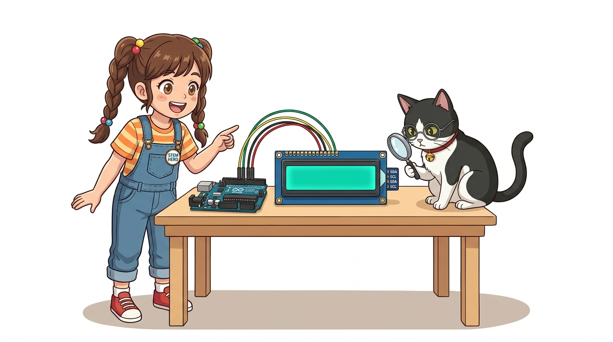
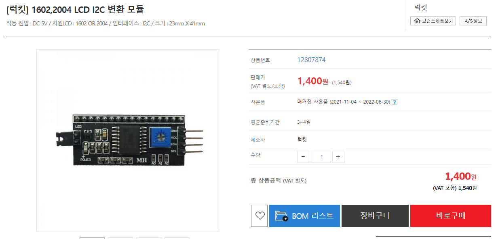
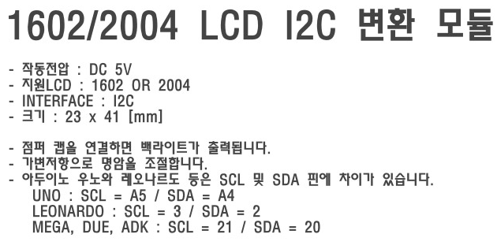
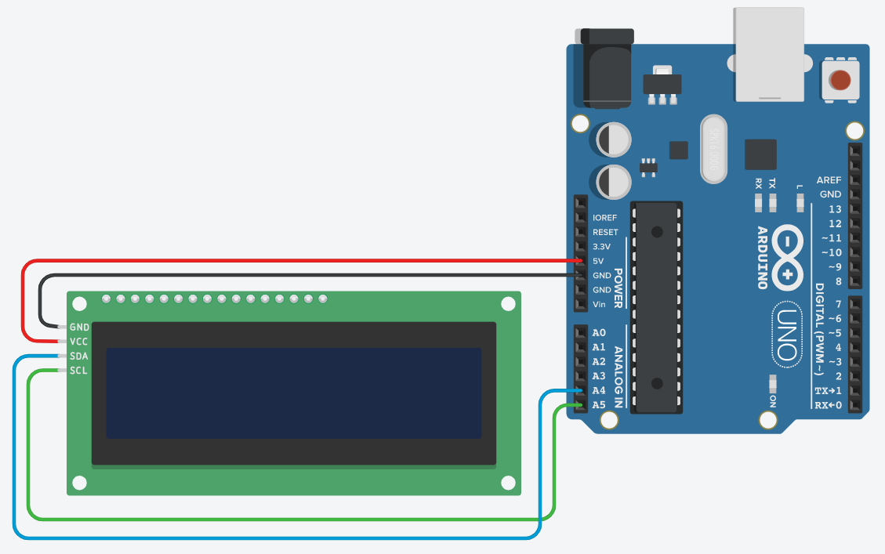
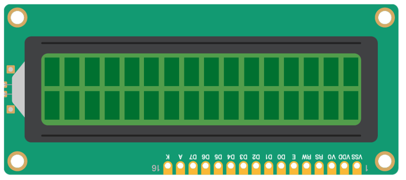
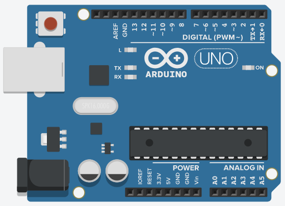
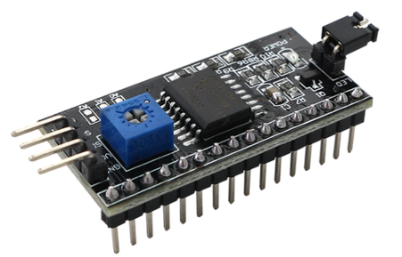

# 070_I2C_1602LCD_간결배선 📟✨

> **배선의 기적! PCF8574 I2C 어댑터 모듈로 1602 LCD를 단 4가닥(VCC, GND, SDA, SCL)으로 완벽 제어하기**  
> I2C Scanner 주소 검색 기법, `LiquidCrystal_I2C` 라이브러리 사용법, 실시간 디지털 초시계 구현을 실습합니다.



* 🖥️ **강의 슬라이드**: [slides.md](./slides.md)

---

## 1. 👧 도로시의 고민: "뒷면에 검은 배낭이 생겼어요!"

점퍼선 16개로 복잡했던 LCD 회로 뒤편에 작은 검은색 보드가 달린 모듈을 발견한 도로시!

> **👧 도로시**: "지니야! 저번 1602 LCD 뒷면에 웬 작은 기판이 납땜되어 붙어 있어! 핀이 16개가 아니라 4개밖에 안 튀어나와 있는데?!"  
> **🐱 지니**: "맞아! 그게 바로 **I2C 컨버터(PCF8574 배낭 보드)** 란다! 16개 신호를 안에서 묶어 I2C 2선(SDA, SCL)으로 변환해 주는 똑똑한 통역사야!"  
> **🐶 토토**: "멍멍! (선이 4개밖에 없어서 꽂기 훨씬 편하겠다!)"


> [!NOTE]
> **PCF8574 원격 8비트 I/O 확장기(Expander)**  
> I2C 어댑터는 I2C 명령을 받아 8개의 병렬 출력 핀으로 변환해 주는 PCF8574 칩을 탑재하고 있습니다. 이를 통해 아두이노는 복잡한 병렬 핀을 직접 제어하지 않고 오직 I2C 패킷만 전송하면 됩니다.

---

## 2. 🎒 I2C 배낭(컨버터)의 핀 구조 및 부품 구성

기존 16개의 접속 핀을 완벽히 흡수하여 단 4개의 커넥터 핀으로 단순화했습니다.



### 📌 4개 핀 연결표 및 보드 기능

| 핀 명칭 | 아두이노 연결 | 기능 및 특징 |
| :---: | :---: | :--- |
| **`GND`** | **GND** | 전원 접지 |
| **`VCC`** | **5V** | 5V 시스템 전원 |
| **`SDA`** | **아날로그 A4** | 직렬 데이터 통신선 (Data) |
| **`SCL`** | **아날로그 A5** | 직렬 클록 동기화선 (Clock) |

> [!TIP]
> 모듈 뒷면의 **파란색 네모 가변저항(포텐셔미터)** 은 명암 조절용입니다. 글자가 안 보일 때는 일자 드라이버로 이 손잡이를 돌려 맞춥니다. 점퍼 핀(Jumper)은 백라이트 전원 연결용이므로 항상 꽂혀 있어야 합니다.

---

## 3. 🛠️ 필요한 라이브러리 설치하기

I2C LCD 구동을 위해 표준 I2C 통신 라이브러리와 전용 디스플레이 라이브러리를 함께 활용합니다.



### 📚 설치 단계 가이드

1. **`<Wire.h>`**: 아두이노 IDE에 표준 내장되어 있어 별도 설치가 필요 없습니다.
2. **`<LiquidCrystal_I2C.h>`**:
   * 아두이노 IDE 상단 메뉴: **[스케치] ➡️ [라이브러리 포함하기] ➡️ [라이브러리 관리...]**
   * 검색창에 **`LiquidCrystal I2C`** 입력
   * **"LiquidCrystal I2C by Frank de Brabander"** 또는 **Marco Schwartz** 버전 확인 후 **[설치]** 클릭!

---

## 4. 🔌 초간단 4선 회로 연결도

브레드보드 없이 암-수(F-M) 점퍼선 4가닥만으로 아두이노와 1초 만에 직결할 수 있습니다.



* **VCC (빨간 선)** ➡️ 아두이노 **5V**
* **GND (검은 선)** ➡️ 아두이노 **GND**
* **SDA (초록/파란 선)** ➡️ 아두이노 **A4 핀**
* **SCL (노란/주황 선)** ➡️ 아두이노 **A5 핀**

---

## 5. 🕵️‍♂️ I2C 주소 자동 검색: I2C Scanner

LCD 모듈마다 제조사에 따라 주소가 `0x27` 또는 `0x3F`로 다를 수 있습니다. 주소 스캐너 코드로 확실한 주소를 확인합니다.



```cpp
#include <Wire.h>

void setup() {
  Serial.begin(115200);
  while (!Serial);
  Wire.begin();
  
  Serial.println("\n--- I2C 기기 검색 시작 ---");
  byte count = 0;
  
  for (byte address = 1; address < 127; address++) {
    Wire.beginTransmission(address);
    if (Wire.endTransmission() == 0) {
      Serial.print("I2C 기기 발견! 16진수 주소: 0x");
      if (address < 16) Serial.print("0");
      Serial.println(address, HEX);
      count++;
    }
  }
  
  if (count == 0) Serial.println("연결된 I2C 기기를 찾을 수 없습니다. 배선을 확인하세요!");
  else Serial.println("검색 완료!");
}

void loop() {}
```

---

## 6. 📝 첫 인사: "Hello, Dorothy!" 띄우기

발견한 주소(예: `0x27`)를 지정하여 LCD를 켜고 화면에 인삿말을 출력합니다.



```cpp
#include <Wire.h>
#include <LiquidCrystal_I2C.h>

// I2C 주소 0x27, 16열 2행 LCD 객체 생성
LiquidCrystal_I2C lcd(0x27, 16, 2);

void setup() {
  lcd.init();        // LCD 내부 제어기 초기화
  lcd.backlight();   // 백라이트 LED 점등!
  
  // 첫 번째 줄 (0, 0)
  lcd.setCursor(0, 0);
  lcd.print("Hello, Dorothy!");
  
  // 두 번째 줄 (0, 1)
  lcd.setCursor(0, 1);
  lcd.print("Jiny & Arduino");
}

void loop() {
  // 화면 유지
}
```

---

## 7. ⏱️ 응용 실습: 1초씩 올라가는 디지털 초시계

`loop()` 함수에서 1초마다 경과 시간을 갱신하는 디지털 카운터 디스플레이입니다.



```cpp
#include <Wire.h>
#include <LiquidCrystal_I2C.h>

LiquidCrystal_I2C lcd(0x27, 16, 2);
int seconds = 0;

void setup() {
  lcd.init();
  lcd.backlight();
  
  lcd.setCursor(0, 0);
  lcd.print("Stopwatch Demo");
}

void loop() {
  lcd.setCursor(0, 1);
  lcd.print("Sec: ");
  lcd.print(seconds);
  lcd.print(" s    "); // 이전 긴 자릿수를 덮어쓰기 위한 공백 문자
  
  delay(1000);
  seconds++;
}
```

---

## 🌟 도로시와 지니의 핵심 꿀팁! 🏆

축하합니다! 배선 복잡성을 75% 줄이고 I2C 통신 기반의 깔끔한 디스플레이 시스템을 완성했습니다.


### 📋 핵심 요약 체크리스트

* [x] **단 4가닥 직결**: VCC, GND, SDA(A4), SCL(A5)로 브레드보드 없이 간결하게 연결했습니다.
* [x] **I2C 스캐너 활용**: `0x27` 또는 `0x3F` 주소를 사전에 검색하여 통신 오류를 예방했습니다.
* [x] **`lcd.init()`과 `lcd.backlight()`**: 초기화와 백라이트 제어 메소드를 명확히 숙지했습니다.

> **👧 도로시**: "우와! 선이 4개밖에 안 되니까 회로가 정말 깔끔하고 예뻐!"  
> **🐱 지니**: "훌륭해! 다음 시간에는 글자가 옆으로 스르륵 전광판처럼 흘러가는 **'LCD 스크롤 효과'**를 함께 구현해 보자!"
