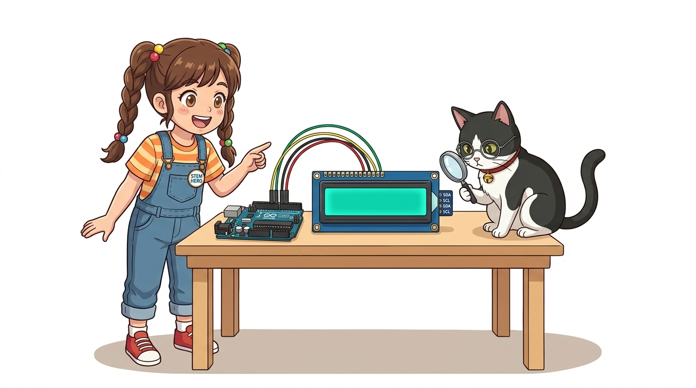
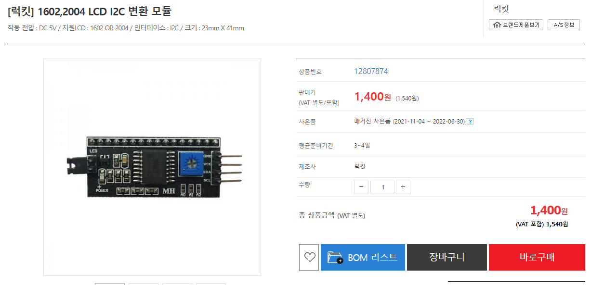
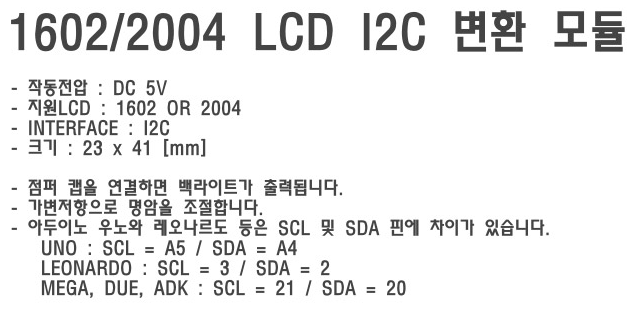
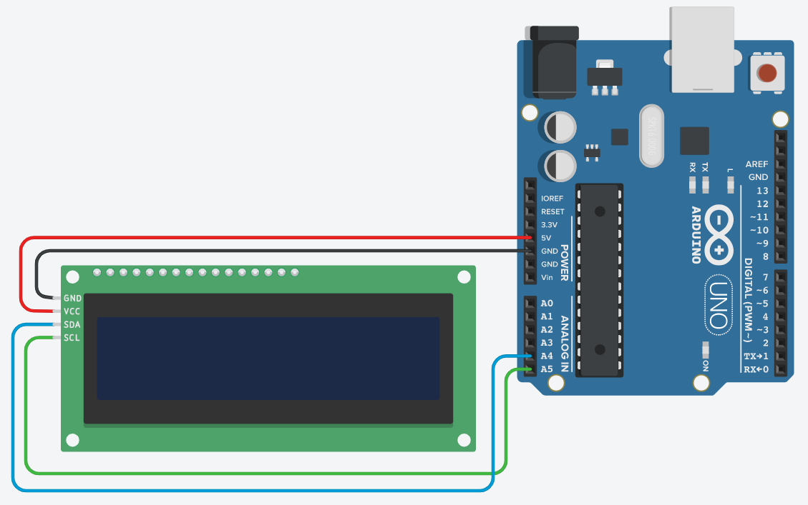
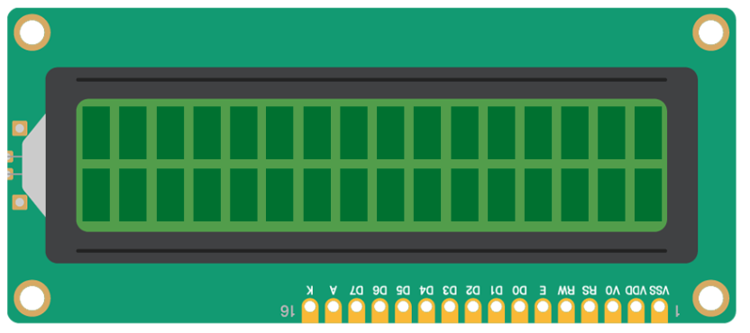
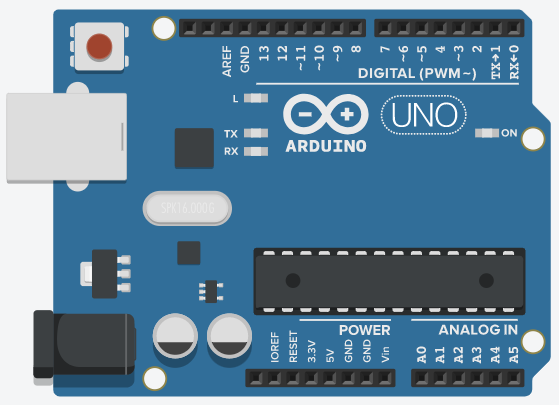
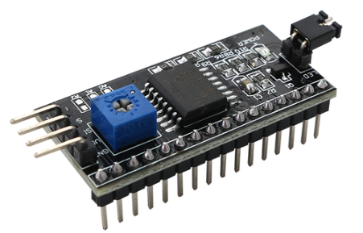

# 070_I2C_1602LCD_간결배선 📟✨



* **배선의 기적! PCF8574 I2C 어댑터 모듈로 1602 LCD를 단 4가닥(VCC, GND, SDA, SCL)으로 완벽 제어하기**
* I2C Scanner 주소 검색 기법, `LiquidCrystal_I2C` 라이브러리 사용법, 실시간 디지털 초시계 구현을 실습합니다.
* 📖 **상세 강의 교재**: [index.md](./index.md)


> 여러분 안녕하세요! 이번 시간에는 '070. I2C 1602LCD 간결배선 📟✨'을 주제로 함께 흥미진진한 탐험을 떠나보겠습니다. 이호진 교수님과 똑똑한 조수 지니, 호기심 많은 도로시와 토토와 함께 신나는 아두이노 모험을 힘차게 시작해 봅시다. 준비되셨나요?

---

## 1. 👧 도로시의 고민: "뒷면에 검은 배낭이 생겼어요!"


* **👧 도로시**: "지니야! 저번 1602 LCD 뒷면에 웬 작은 기판이 납땜되어 붙어 있어! 핀이 16개가 아니라 4개밖에 안 튀어나와 있는데?!"
* **🐱 지니**: "맞아! 그게 바로 **I2C 컨버터(PCF8574 배낭 보드)** 란다! 16개 신호를 안에서 묶어 I2C 2선(SDA, SCL)으로 변환해 주는 똑똑한 통역사야!"
* **🐶 토토**: "멍멍! (선이 4개밖에 없어서 꽂기 훨씬 편하겠다!)"
* [!NOTE]
* **PCF8574 원격 8비트 I/O 확장기(Expander)**
* I2C 어댑터는 I2C 명령을 받아 8개의 병렬 출력 핀으로 변환해 주는 PCF8574 칩을 탑재하고 있습니다. 이를 통해 아두이노는 복잡한 병렬 핀을 직접 제어하지 않고 오직 I2C 패킷만 전송하면 됩니다.

점퍼선 16개로 복잡했던 LCD 회로 뒤편에 작은 검은색 보드가 달린 모듈을 발견한 도로시!

> 이번 슬라이드에서는 '1. 👧 도로시의 고민: "뒷면에 검은 배낭이 생겼어요!"'에 대해 자세히 살펴보겠습니다. 화면의 다이어그램과 사진을 함께 참고해 주시기 바랍니다. 도로시와 지니의 대화처럼, 지니야! 저번 1602 LCD 뒷면에 웬 작은 기판이 납땜되어 붙어 있어! 핀이 16개가 아니라 4개밖에 안 튀어나와 있는데?!라는 상황에 대해 맞아! 그게 바로 I2C 컨버터(PCF8574 배낭 보드) 란다! 16개 신호를 안에서 묶어 I2C 2선(SDA, SCL)으로 변환해 주는 똑똑한 통역사야!라는 원리가 작동하는 것입니다. 이 원리는 아두이노 시스템 전체를 관통하는 핵심 논리이므로 머릿속에 꼭 정리해 두시기 바랍니다.

---

## 2. 🎒 I2C 배낭(컨버터)의 핀 구조 및 부품 구성



* [!TIP]
* 모듈 뒷면의 **파란색 네모 가변저항(포텐셔미터)** 은 명암 조절용입니다. 글자가 안 보일 때는 일자 드라이버로 이 손잡이를 돌려 맞춥니다. 점퍼 핀(Jumper)은 백라이트 전원 연결용이므로 항상 꽂혀 있어야 합니다.

| 핀 명칭 | 아두이노 연결 | 기능 및 특징 |
| :---: | :---: | :--- |
| **`GND`** | **GND** | 전원 접지 |
| **`VCC`** | **5V** | 5V 시스템 전원 |
| **`SDA`** | **아날로그 A4** | 직렬 데이터 통신선 (Data) |
| **`SCL`** | **아날로그 A5** | 직렬 클록 동기화선 (Clock) |

기존 16개의 접속 핀을 완벽히 흡수하여 단 4개의 커넥터 핀으로 단순화했습니다.
### 📌 4개 핀 연결표 및 보드 기능

> 이번에 살펴볼 내용은 '2. 🎒 I2C 배낭(컨버터)의 핀 구조 및 부품 구성'입니다. 슬라이드에 정리된 표를 통해 각 항목의 특징과 수치, 차이점을 한눈에 비교해 보실 수 있습니다. 이 기본 개념을 확실히 잡아두셔야 실제 부품을 브레드보드에 꽂고 코딩할 때 실수 없이 완성할 수 있습니다.

---

## 3. 🛠️ 필요한 라이브러리 설치하기



1. **`<Wire.h>`**: 아두이노 IDE에 표준 내장되어 있어 별도 설치가 필요 없습니다.
2. **`<LiquidCrystal_I2C.h>`**:
* 아두이노 IDE 상단 메뉴: **[스케치] ➡️ [라이브러리 포함하기] ➡️ [라이브러리 관리...]**
* 검색창에 **`LiquidCrystal I2C`** 입력
* **"LiquidCrystal I2C by Frank de Brabander"** 또는 **Marco Schwartz** 버전 확인 후 **[설치]** 클릭!

I2C LCD 구동을 위해 표준 I2C 통신 라이브러리와 전용 디스플레이 라이브러리를 함께 활용합니다.
### 📚 설치 단계 가이드

> 이번 슬라이드에서는 '3. 🛠️ 필요한 라이브러리 설치하기'에 대해 자세히 살펴보겠습니다. 화면의 다이어그램과 사진을 함께 참고해 주시기 바랍니다. 첫 번째 핵심은 <Wire.h>: 아두이노 IDE에 표준 내장되어 있어 별도 설치가 필요 없습니다.이며, 두 번째로는 <LiquidCrystalI2C.h>입니다. 여기에 덧붙여 아두이노 IDE 상단 메뉴: [스케치] ➡️ [라이브러리 포함하기] ➡️ [라이브러리 관리...] 내용까지 함께 이해해 두시면 완벽합니다. 이 원리는 아두이노 시스템 전체를 관통하는 핵심 논리이므로 머릿속에 꼭 정리해 두시기 바랍니다.

---

## 4. 🔌 초간단 4선 회로 연결도



* **VCC (빨간 선)** ➡️ 아두이노 **5V**
* **GND (검은 선)** ➡️ 아두이노 **GND**
* **SDA (초록/파란 선)** ➡️ 아두이노 **A4 핀**
* **SCL (노란/주황 선)** ➡️ 아두이노 **A5 핀**

브레드보드 없이 암-수(F-M) 점퍼선 4가닥만으로 아두이노와 1초 만에 직결할 수 있습니다.

> 이번에 살펴볼 내용은 '4. 🔌 초간단 4선 회로 연결도'입니다. 화면의 회로도와 부품 사진을 보면서 각 핀과 배선이 어떻게 구성되어 있는지 눈으로 직접 따라와 주시기 바랍니다. 첫째로 VCC (빨간 선) ➡️ 아두이노 5V에 유의해야 하며, 둘째로 GND (검은 선) ➡️ 아두이노 GND라는 점이 핵심입니다. 이 기본 개념을 확실히 잡아두셔야 실제 부품을 브레드보드에 꽂고 코딩할 때 실수 없이 완성할 수 있습니다.

---

## 5. 🕵️‍♂️ I2C 주소 자동 검색: I2C Scanner



LCD 모듈마다 제조사에 따라 주소가 `0x27` 또는 `0x3F`로 다를 수 있습니다. 주소 스캐너 코드로 확실한 주소를 확인합니다.

```cpp
#include <Wire.h>

void setup() {
  Serial.begin(115200);
  while (!Serial);
  Wire.begin();
  
  Serial.println("\n--- I2C 기기 검색 시작 ---");
  byte count = 0;
  
  for (byte address = 1; address < 127; address++) {
    Wire.beginTransmission(address);
    if (Wire.endTransmission() == 0) {
      Serial.print("I2C 기기 발견! 16진수 주소: 0x");
      if (address < 16) Serial.print("0");
      Serial.println(address, HEX);
      count++;
    }
  }
  
  if (count == 0) Serial.println("연결된 I2C 기기를 찾을 수 없습니다. 배선을 확인하세요!");
  else Serial.println("검색 완료!");
}

void loop() {}
```

> 이번 슬라이드에서는 '5. 🕵️‍♂️ I2C 주소 자동 검색: I2C Scanner'에 대한 실제 동작 코드를 분석해 보겠습니다. 화면의 코드를 살펴보시면, 컴퓨터가 아두이노 하드웨어에 단계별로 명령을 내리는 흐름을 명확하게 확인할 수 있습니다. 각 함수의 역할과 괄호 안의 매개변수가 하드웨어 핀과 어떤 관계를 맺고 동작하는지 주의 깊게 살펴보시기 바랍니다.

---

## 6. 📝 첫 인사: "Hello, Dorothy!" 띄우기



발견한 주소(예: `0x27`)를 지정하여 LCD를 켜고 화면에 인삿말을 출력합니다.

```cpp
#include <Wire.h>
#include <LiquidCrystal_I2C.h>

// I2C 주소 0x27, 16열 2행 LCD 객체 생성
LiquidCrystal_I2C lcd(0x27, 16, 2);

void setup() {
  lcd.init();        // LCD 내부 제어기 초기화
  lcd.backlight();   // 백라이트 LED 점등!
  
  // 첫 번째 줄 (0, 0)
  lcd.setCursor(0, 0);
  lcd.print("Hello, Dorothy!");
  
  // 두 번째 줄 (0, 1)
  lcd.setCursor(0, 1);
  lcd.print("Jiny & Arduino");
}

void loop() {
  // 화면 유지
}
```

> 이번 슬라이드에서는 '6. 📝 첫 인사: "Hello, Dorothy!" 띄우기'에 대한 실제 동작 코드를 분석해 보겠습니다. 화면의 코드를 살펴보시면, 컴퓨터가 아두이노 하드웨어에 단계별로 명령을 내리는 흐름을 명확하게 확인할 수 있습니다. 각 함수의 역할과 괄호 안의 매개변수가 하드웨어 핀과 어떤 관계를 맺고 동작하는지 주의 깊게 살펴보시기 바랍니다.

---

## 7. ⏱️ 응용 실습: 1초씩 올라가는 디지털 초시계



`loop()` 함수에서 1초마다 경과 시간을 갱신하는 디지털 카운터 디스플레이입니다.

```cpp
#include <Wire.h>
#include <LiquidCrystal_I2C.h>

LiquidCrystal_I2C lcd(0x27, 16, 2);
int seconds = 0;

void setup() {
  lcd.init();
  lcd.backlight();
  
  lcd.setCursor(0, 0);
  lcd.print("Stopwatch Demo");
}

void loop() {
  lcd.setCursor(0, 1);
  lcd.print("Sec: ");
  lcd.print(seconds);
  lcd.print(" s    "); // 이전 긴 자릿수를 덮어쓰기 위한 공백 문자
  
  delay(1000);
  seconds++;
}
```

> 이번 슬라이드에서는 '7. ⏱️ 응용 실습: 1초씩 올라가는 디지털 초시계'에 대한 실제 동작 코드를 분석해 보겠습니다. 화면의 코드를 살펴보시면, 컴퓨터가 아두이노 하드웨어에 단계별로 명령을 내리는 흐름을 명확하게 확인할 수 있습니다. 각 함수의 역할과 괄호 안의 매개변수가 하드웨어 핀과 어떤 관계를 맺고 동작하는지 주의 깊게 살펴보시기 바랍니다.

---

## 🌟 도로시와 지니의 핵심 꿀팁! 🏆


* **👧 도로시**: "우와! 선이 4개밖에 안 되니까 회로가 정말 깔끔하고 예뻐!"
* **🐱 지니**: "훌륭해! 다음 시간에는 글자가 옆으로 스르륵 전광판처럼 흘러가는 **'LCD 스크롤 효과'**를 함께 구현해 보자!"

* [x] **단 4가닥 직결**: VCC, GND, SDA(A4), SCL(A5)로 브레드보드 없이 간결하게 연결했습니다.
* [x] **I2C 스캐너 활용**: `0x27` 또는 `0x3F` 주소를 사전에 검색하여 통신 오류를 예방했습니다.
* [x] **`lcd.init()`과 `lcd.backlight()`**: 초기화와 백라이트 제어 메소드를 명확히 숙지했습니다.

축하합니다! 배선 복잡성을 75% 줄이고 I2C 통신 기반의 깔끔한 디스플레이 시스템을 완성했습니다.
### 📋 핵심 요약 체크리스트

> 오늘 배운 '🌟 도로시와 지니의 핵심 꿀팁! 🏆'의 핵심 내용을 모두 정리해 보았습니다. 오늘 다룬 내용 중에서도 [x] 단 4가닥 직결: VCC, GND, SDA(A4), SCL(A5)로 브레드보드 없이 간결하게 연결했습니다. 부분은 앞으로의 아두이노 실습과 프로젝트에서 계속 사용되는 매우 중요한 기초 지식입니다. 지니 멘토가 강조했듯이 훌륭해! 다음 시간에는 글자가 옆으로 스르륵 전광판처럼 흘러가는 라는 점을 꼭 마음에 새겨두시길 바랍니다. 오늘 배운 내용을 꼭 다시 한번 복습해 보시고, 다음 강의에서 더욱 신나고 유익한 모험으로 다시 만나겠습니다. 모두 수고 많으셨습니다!