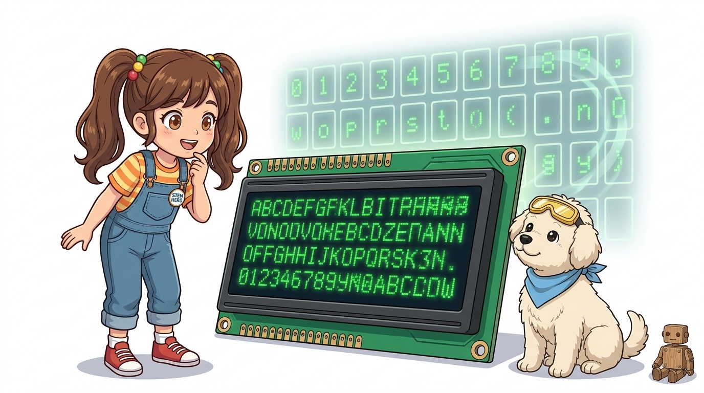
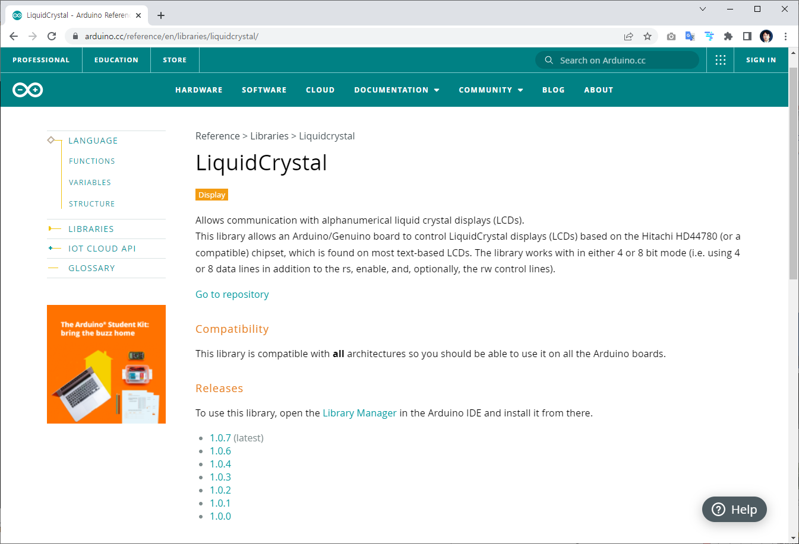
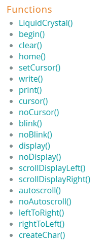
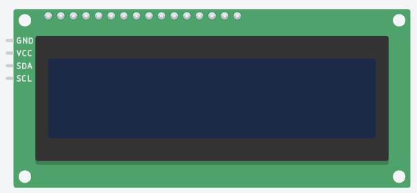
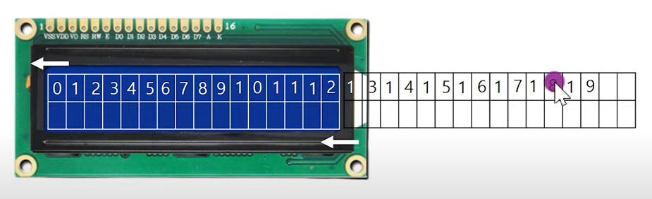

# 071_LCD문자스크롤_전광판 📜

> **16칸의 물리적 한계를 뛰어넘다! 전광판 스타일의 동적 텍스트 애니메이션 기법**  
> `autoscroll()`, `scrollDisplayLeft()`, `scrollDisplayRight()` 함수의 원리와 40바이트 DDRAM 가상 버퍼를 학습합니다.



* 🖥️ **강의 슬라이드**: [slides.md](./slides.md)

---

## 1. 👧 도로시의 고민: "16글자 넘는 긴 문장은 어떻게 보여줘요?"

1602 LCD 화면에 멋진 인사말을 적고 싶었던 도로시가 화면의 좁은 크기 때문에 고민에 빠졌습니다!

> **👧 도로시**: "지니야! LCD 화면은 한 줄에 딱 16글자밖에 못 적잖아! 'Welcome to Dorothy and Jiny Magic Arduino Lab!' 처럼 긴 문장은 뒷부분이 싹 잘려서 안 보여!"  
> **🐱 지니**: "지하철역 전광판 봤지? 글자가 오른쪽에서 왼쪽으로 스르륵 흘러가는 **스크롤(Scroll) 마법**을 쓰면 아무리 긴 문장도 관객들에게 온전히 다 보여줄 수 있어!"  
> **🐶 토토**: "왈왈! (지하철 뉴스 속보처럼 슝슝 지나가는 거구나!)"


> [!NOTE]
> **스크롤(Scroll)의 본질**  
> 모니터의 뷰포트(Viewport)는 16칸으로 고정되어 있지만, 디스플레이 컨트롤러 내부의 메모리에 긴 문장을 저장해 두고 화면 창틀을 좌우로 슬라이딩 이동시키는 기술입니다.

---

## 2. 📜 LiquidCrystal 라이브러리의 스크롤 마법 주문들

아두이노 LCD 라이브러리에는 화면 프레임을 이동시키는 고성능 함수들이 준비되어 있습니다.



| 함수 명칭 | 매개변수 | 주요 동작 및 시각 효과 |
| :--- | :---: | :--- |
| **`lcd.autoscroll()`** | 없음 | 문자를 하나 출력할 때마다 전체 디스플레이를 자동으로 1칸씩 밀어냄 (러닝머신 효과) |
| **`lcd.noAutoscroll()`** | 없음 | 자동 스크롤 모드를 해제하고 커서가 오른쪽으로 정상 전진하게 복귀 |
| **`lcd.scrollDisplayLeft()`** | 없음 | 이미 화면에 출력된 전체 픽셀을 왼쪽으로 정확히 1칸 시프트(Shift) 이동 |
| **`lcd.scrollDisplayRight()`** | 없음 | 이미 화면에 출력된 전체 픽셀을 오른쪽으로 정확히 1칸 시프트 이동 |

---

## 3. 🔍 두 가지 스크롤 방식의 명확한 차이

프로젝트 목적에 따라 글자를 찍으면서 밀어낼지, 문장을 다 쓰고 통째로 흘려보낼지 결정합니다.



1. **`autoscroll()` 방식 (입력 연동형)**:
   * 새 글자가 추가될 때마다 기존 글자들이 밀려나는 방식
   * 실시간 센서 수치나 타이머 숫자가 밀려들어오는 연출에 적합
2. **`scrollDisplayLeft()` 방식 (블록 전광판형)**:
   * 긴 안내 문장을 먼저 DDRAM에 한 번에 써둔 뒤, `for` 루프에서 일정한 간격(`delay(300)`)으로 프레임 전체를 좌측으로 슬라이드
   * 지하철 역명 안내, 뉴스 티커(Ticker), 전광판 공지 표시에 적합

---

## 4. 🏃 autoscroll()의 좌표 및 이동 원리

`autoscroll()`을 활성화하면 아두이노의 글자 출력 방향 기준점이 반전됩니다.



* **일반 모드**: 글자를 쓸 때마다 커서가 오른쪽(0 ➡️ 1 ➡️ 2...)으로 전진합니다.
* **`autoscroll()` 모드**:
  * 커서의 물리적 위치는 화면에 고정됩니다.
  * 새로운 글자가 찍히는 순간, **기존에 찍혀 있던 글자 전체가 왼쪽으로 한 칸씩 밀려납니다.**
  * 마치 트레드밀(러닝머신) 위에서 제자리걸음을 하며 발자국을 찍어내는 것과 같습니다!

> [!TIP]
> 우측 끝 칸인 `lcd.setCursor(16, 1);`에 커서를 두고 연속으로 글자를 출력하면 오른쪽에서 새로운 글자가 솟아나 왼쪽으로 흘러가는 자연스러운 효과가 납니다.

---

## 5. 💻 실습 코드: 전광판 자동 스크롤 구현

상단 줄은 일반 숫자를 출력하고, 하단 줄은 `autoscroll()`을 적용해 흘려보내는 비교 실습 코드입니다.


```cpp
#include <Wire.h>
#include <LiquidCrystal_I2C.h>

LiquidCrystal_I2C lcd(0x27, 16, 2);

void setup() {
  lcd.init();
  lcd.backlight();
}

void loop() {
  // 1. 첫 번째 줄: 일반 순차 출력 (0 1 2 3 4 5 6 7 8 9)
  lcd.setCursor(0, 0);
  for (int i = 0; i < 10; i++) {
    lcd.print(i);
    delay(250);
  }

  // 2. 두 번째 줄: 오른쪽 끝에서 밀어내는 autoscroll
  lcd.setCursor(16, 1);
  lcd.autoscroll(); // 자동 스크롤 활성화
  
  for (int i = 0; i < 10; i++) {
    lcd.print(i);
    delay(250);
  }

  // 3. 스크롤 모드 해제 및 화면 정리
  lcd.noAutoscroll(); // 반드시 해제!
  delay(1500);
  lcd.clear();
}
```

---

## 6. 📦 화면 너머의 보이지 않는 메모리: DDRAM 버퍼

1602 LCD 화면 뒤편의 컨트롤러(HD44780) 내부에는 16칸보다 훨씬 넓은 가상 버퍼가 숨어 있습니다.



* **DDRAM (Display Data RAM)**: 한 줄당 **총 40바이트**의 메모리 공간을 보유합니다.
* 실제 화면(16칸)은 40칸 중 일부분만 내다보는 **'작은 창문'**입니다.
* `scrollDisplayLeft()`를 실행하면 창문이 오른쪽으로 1칸 이동하여, 메모리에 미리 적혀 있던 17번째~40번째 글자들이 순차적으로 창문 안으로 들어옵니다.

---

## 🌟 도로시와 지니의 스크롤 마법 정리! 🏆

축하합니다! 좁은 디스플레이의 한계를 넘어 긴 정보를 동적으로 표현하는 스크롤 기술을 완성했습니다.


### 📋 핵심 요약 체크리스트

* [x] **긴 문장 표현**: 물리적 16칸 규격을 초과하는 문장도 40바이트 DDRAM 버퍼와 스크롤로 완벽 표출했습니다.
* [x] **`autoscroll()` vs `scrollDisplayLeft()`**: 실시간 데이터 유입과 사전 렌더링 전광판 모드의 차이를 명확히 구분했습니다.
* [x] **`noAutoscroll()` 해제**: 스크롤이 끝난 후 즉시 모드를 꺼서 후속 텍스트의 좌표 왜곡을 방지했습니다.

> **👧 도로시**: "와! 지하철 전광판처럼 내 생일 축하 메시지가 부드럽게 흘러가니까 진짜 멋져!"  
> **🐱 지니**: "훌륭해! 다음 시간에는 수많은 데이터를 기차 칸처럼 일렬로 묶어주는 **'C언어 배열(Array)'** 심화 과정을 정복해 보자!"
