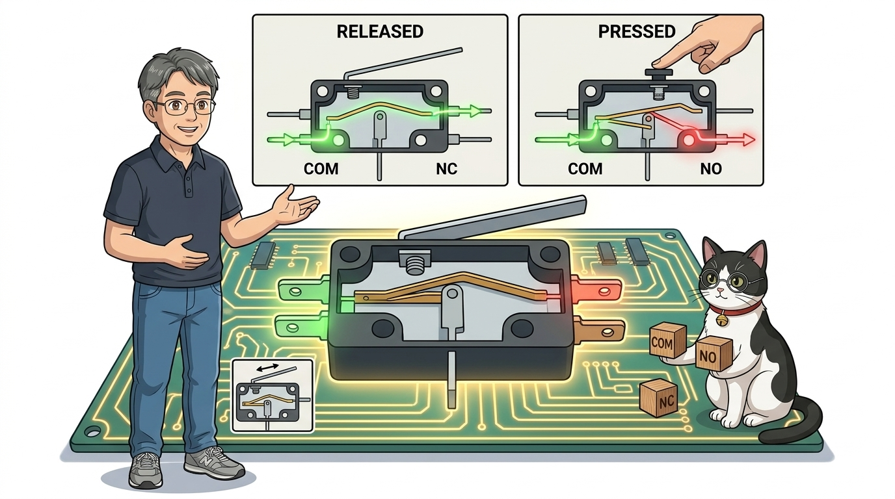
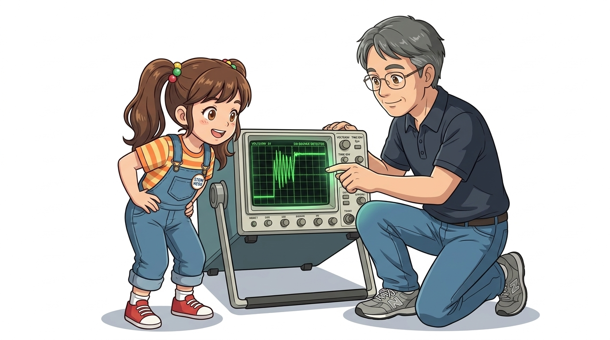
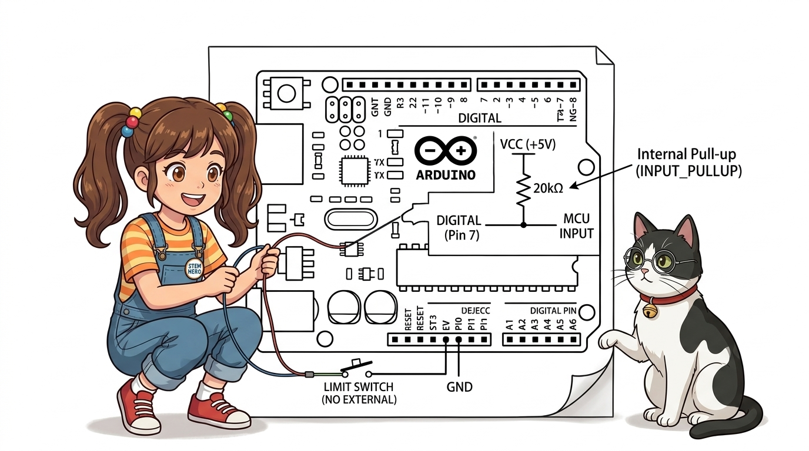
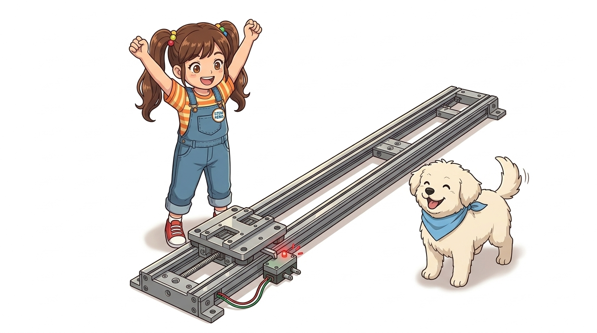

# 073_리미트스위치_기계식엔드스탑과_충돌감지 🛑🤖


* **"더 이상 가면 부딪혀요!" 3D 프린터와 자동화 기계의 끝판왕 수호자, 마이크로 리미트 스위치(Limit Switch)**
* COM, NO, NC 3대 단자의 결선 원리, 기계적 한계점(Endstop)과 원점 복귀(Homing) 감지 메커니즘, 금속 접점의 채터링(Chattering) 현상을 해결하는 완벽한 디바운스 코드를 학습합니다.
* 📖 **상세 강의 교재**: [index.md](./index.md)


> 여러분 안녕하세요! 이번 시간에는 '073. 리미트스위치 기계식엔드스탑과 충돌감지 🛑🤖'을 주제로 함께 흥미진진한 탐험을 떠나보겠습니다. 이호진 교수님과 똑똑한 조수 지니, 호기심 많은 도로시와 토토와 함께 신나는 아두이노 모험을 힘차게 시작해 봅시다. 준비되셨나요?

---
## 1. 리미트 스위치(Limit Switch)란 무엇일까요? 🛑


* **👧 도로시**: "지니야! 모터한테 계속 앞으로 가라고 코딩해 두면 벽에 부딪혀서 모터가 타버리지 않아?"
* **🐱 지니**: "아주 날카로운 질문이야! 기계가 벽에 쿵 부딪히기 직전에 물리적으로 눌려서 '여기까지가 한계야!'라고 컴퓨터에 비명을 질러주는 안전장치가 바로 **리미트 스위치**란다!"
* **🐶 토토**: "멍멍! (딸깍 누르면 모터가 얼음! 하고 멈춘다 멍!)"

3D 프린터가 출력 시작 전 "찌-익" 소리를 내며 왼쪽 모서리로 이동하다가 "딸깍!" 소리와 함께 딱 멈추는 것을 본 적이 있나요?
자동문이 끝까지 열렸을 때 모터가 타지 않고 부드럽게 멈추는 비결은 무엇일까요?
바로 물리적인 이동 한계(Limit)를 알려주는 **리미트 스위치(마이크로 스위치 / 엔드스탑, Endstop)** 덕분입니다!

> 자, 이번 슬라이드의 질문을 함께 보시겠습니다. 바로 '1. 리미트 스위치(Limit Switch)란 무엇일까요? 🛑'라는 아주 흥미로운 질문입니다. 도로시가 ' 지니야! 모터한테 계속 앞으로 가라고 코딩해 두면 벽에 부딪혀서 모터가 타버리지 않아? '라고 질문하자, 지니 멘토는 ' 아주 날카로운 질문이야! 기계가 벽에 쿵 부딪히기 직전에 물리적으로 눌려서  '라며 명쾌한 답을 들려주었는데요. 이 질문 속에 숨겨진 전자 회로와 컴퓨팅의 핵심 원리를 지금부터 차근차근 하나씩 파헤쳐 보겠습니다.
---
## 2. 3대 단자의 비밀: COM, NO, NC 완벽 구별법 🔌




* **🛡️ 왜 3D 프린터는 NC(Normally Closed) 방식을 사랑할까? (Fail-Safe 원리)**:
* 만약 센서 전선이 쥐가 갉아먹거나 빠져서 끊어졌을 때, NO 방식은 스위치가 눌려도 아두이노가 알지 못해 모터가 벽을 계속 들이받습니다!
* 하지만 NC 방식을 쓰면 선이 빠지는 순간 스위치가 눌린 것으로 인식하여 모터를 즉시 정지시키므로 기계 파손을 100% 막아줍니다!

| 단자 명칭 | 풀네임 (Full Name) | 동작 상태 및 특징 | 추천 용도 |
| :---: | :---: | :--- | :--- |
| **COM** | **Common** (공통 단자) | 전원선이나 접지(GND)가 항상 연결되는 기본 기준 단자 | 아두이노 **GND**에 연결 |
| **NO** | **Normally Open** (평상시 열림) | 평소에는 스위치가 떨어져(OFF) 있다가, **레버를 누르면 연결(ON)**됨 | 일반적인 버튼 및 터치 감지 |
| **NC** | **Normally Closed** (평상시 닫힘) | 평소에는 전기가 흐르고(ON) 있다가, **레버를 누르면 전기가 끊어짐(OFF)** | **안전 비상정지 (Fail-Safe)** |

리미트 스위치의 아랫면이나 옆면을 보면 3개의 금속 다리가 나와 있고 영어 약자가 적혀 있습니다.

```
          [ 마이크로 리미트 스위치 단자 구조 ]
          
              롤러 레버 (Roller Lever)
             \═════════════●  (누르는 부분)
          ┌───────────────────────┐
          │                       │
          │                       │
          └─────┬───────┬───────┬─┘
                │       │       │
               COM      NO      NC
              (공통)  (평상시열림) (평상시닫힘)
```

> 이번 슬라이드에서는 '2. 3대 단자의 비밀: COM, NO, NC 완벽 구별법 🔌'에 대한 실제 동작 코드를 분석해 보겠습니다. 화면의 코드를 살펴보시면, 컴퓨터가 아두이노 하드웨어에 단계별로 명령을 내리는 흐름을 명확하게 확인할 수 있습니다. 각 함수의 역할과 괄호 안의 매개변수가 하드웨어 핀과 어떤 관계를 맺고 동작하는지 주의 깊게 살펴보시기 바랍니다.
---
## 3. 기계식 스위치의 숙명: 채터링(Chattering / Bouncing) 현상 ⚡




리미트 스위치 내부의 금속 접점은 스프링 탄성을 지니고 있습니다.
따라서 스위치를 한 번 "딸깍" 누르는 찰나(수 밀리초) 동안, 내부 금속판이 눈에 보이지 않게 미세하게 덜덜 떨리면서 **수십 번 켜졌다 꺼졌다를 반복(Bouncing)**합니다.
이 채터링을 소프트웨어적으로 무시하고 깨끗한 단 1번의 클릭 신호만 골라내는 기술을 **디바운싱(Debouncing)**이라고 부릅니다.

```
  [ 사람이 한 번 눌렀을 때 실제 전기 신호의 파형 ]
  
  5V ──┐    ┌┐┌┐┌┐┌┐┌┐               ┌───────── (안정된 LOW)
       │    ││││││││││ 덜덜 떨림!    │
  0V   └───-┘└┘└┘└┘└┘└───────────────┘
            ↑ 채터링 구간 (약 5~20ms)
```

> 이번 슬라이드에서는 '3. 기계식 스위치의 숙명: 채터링(Chattering / Bouncing) 현상 ⚡'에 대한 실제 동작 코드를 분석해 보겠습니다. 화면의 코드를 살펴보시면, 컴퓨터가 아두이노 하드웨어에 단계별로 명령을 내리는 흐름을 명확하게 확인할 수 있습니다. 각 함수의 역할과 괄호 안의 매개변수가 하드웨어 핀과 어떤 관계를 맺고 동작하는지 주의 깊게 살펴보시기 바랍니다.
---
## 4. 아두이노 내부 풀업(`INPUT_PULLUP`)을 이용한 초간단 배선 📌




* **COM 단자** ➡️ 아두이노 **GND**
* **NO 단자** ➡️ 아두이노 **D3** (디지털 3번)
* **동작 원리**:
- 스위치를 안 눌렀을 때: 내부 풀업으로 **HIGH (5V)** 유지
- 스위치를 딸깍 눌렀을 때: GND와 쇼트되어 **LOW (0V)**로 떨어짐!

외부 저항을 주렁주렁 달 필요 없이, 아두이노 칩 내부의 20kΩ 풀업 저항을 켜면 전선 2가닥으로 배선이 끝납니다!

> 이번 슬라이드에서는 '4. 아두이노 내부 풀업(INPUT PULLUP)을 이용한 초간단 배선 📌'에 대해 자세히 살펴보겠습니다. 첫 번째 핵심은 COM 단자 ➡️ 아두이노 GND이며, 두 번째로는 NO 단자 ➡️ 아두이노 D3 (디지털 3번)입니다. 여기에 덧붙여 동작 원리 내용까지 함께 이해해 두시면 완벽합니다. 이 원리는 아두이노 시스템 전체를 관통하는 핵심 논리이므로 머릿속에 꼭 정리해 두시기 바랍니다.
---
## 5. 실전 실습: 채터링 없는 기계식 원점 도달 비상정지 제어 🚀




리미트 스위치가 눌렸을 때 디바운스 필터를 거쳐 즉각적인 모터 비상 정지(STOP) 신호를 출력하고 상태 LED를 제어하는 스케치입니다.

```cpp
/*
 * [아두이노 우노 리미트 스위치 엔드스탑 제어 실습]
 * 배선: COM -> GND, NO -> D3 핀
 * 13번 내장 LED: 정상 가동 시 ON, 충돌 한계 도달 시 즉시 OFF & 경보
 */

const int limitSwitchPin = 3; // 리미트 스위치 연결 핀
const int statusLedPin = 13;   // 상태 표시 LED

int lastSwitchState = HIGH;      // 이전 스위치 상태
unsigned long lastDebounceTime = 0; // 마지막 디바운스 측정 시각
const unsigned long debounceDelay = 30; // 30ms 동안 진동 무시 (채터링 완벽 차단)

void setup() {
  Serial.begin(115200);
  pinMode(limitSwitchPin, INPUT_PULLUP); // 내부 풀업 저항 활성화!
  pinMode(statusLedPin, OUTPUT);

  digitalWrite(statusLedPin, HIGH); // 정상 가동 상태 (LED ON)

  Serial.println(F("========================================"));
  Serial.println(F(" 🛑 리미트 스위치 기계식 엔드스탑 시스템 가동 "));
  Serial.println(F("========================================"));
  Serial.println(F("[상태] 기계가 정상 주행 중입니다..."));
}

void loop() {
  // 1. 현재 스위치 전압 읽기
  int reading = digitalRead(limitSwitchPin);

  // 2. 신호의 변화가 감지되면 타이머 리셋
  if (reading != lastSwitchState) {
    lastDebounceTime = millis();
  }

  // 3. 30ms 이상 안정적으로 상태가 유지되었을 때만 진짜 스위치 동작으로 인정!
  if ((millis() - lastDebounceTime) > debounceDelay) {
    // 스위치가 눌림 (LOW) -> 한계 지점(Endstop) 도달!
    if (reading == LOW) {
      digitalWrite(statusLedPin, LOW); // 모터 전원 차단 시뮬레이션
      Serial.println(F("🚨 [EMERGENCY STOP] 기계 한계점 도달! 모터 즉각 정지!"));
    } else {
      digitalWrite(statusLedPin, HIGH); // 정상 상태 복귀
    }
  }

  lastSwitchState = reading;
}
```

> 이번 슬라이드에서는 '5. 실전 실습: 채터링 없는 기계식 원점 도달 비상정지 제어 🚀'에 대한 실제 동작 코드를 분석해 보겠습니다. 화면의 코드를 살펴보시면, 컴퓨터가 아두이노 하드웨어에 단계별로 명령을 내리는 흐름을 명확하게 확인할 수 있습니다. 각 함수의 역할과 괄호 안의 매개변수가 하드웨어 핀과 어떤 관계를 맺고 동작하는지 주의 깊게 살펴보시기 바랍니다.
---

## 🌟 도로시와 지니의 핵심 요약! 🏆


* **👧 도로시**: "빛으로 비접촉 감지하는 포토 인터럽터와, 딸깍 물리적으로 닿는 리미트 스위치까지 배우니까 기계가 움직일 수 있는 경계를 완벽하게 다스릴 수 있게 되었어!"
* **🐱 지니**: "훌륭해 도로시! 눈(포토 인터럽터)과 피부(리미트 스위치)를 모두 얻은 셈이란다. 이제 센서와 액추에이터를 결합한 어떤 정밀한 기계라도 안전하게 제어할 수 있을 거야!"

* [x] **기계식 한계 수호자**: 3D 프린터의 원점 복귀(Homing)와 산업용 로봇의 한계 위치 비상 정지를 책임집니다.
* [x] **COM / NO / NC 삼총사**: 평소 열림(NO)과 Fail-Safe 단선 방지(NC)의 원리를 이해하고 알맞은 단자를 선택합니다.
* [x] **INPUT_PULLUP 간결 배선**: 외부 저항 없이 COM을 GND에, NO를 디지털 핀에 직결하여 초간단 회로를 만듭니다.
* [x] **소프트웨어 디바운싱**: 기계식 접점이 튕기는 채터링(Chattering) 현상을 30ms 지연 필터로 완벽히 해결합니다.

> 오늘 배운 '🌟 도로시와 지니의 핵심 요약! 🏆'의 핵심 내용을 모두 정리해 보았습니다. 오늘 다룬 내용 중에서도 [x] 기계식 한계 수호자: 3D 프린터의 원점 복귀(Homing)와 산업용 로봇의 한계 위치 비상 정지를 책임집니다. 부분은 앞으로의 아두이노 실습과 프로젝트에서 계속 사용되는 매우 중요한 기초 지식입니다. 오늘 배운 내용을 꼭 다시 한번 복습해 보시고, 다음 강의에서 더욱 신나고 유익한 모험으로 다시 만나겠습니다. 모두 수고 많으셨습니다!