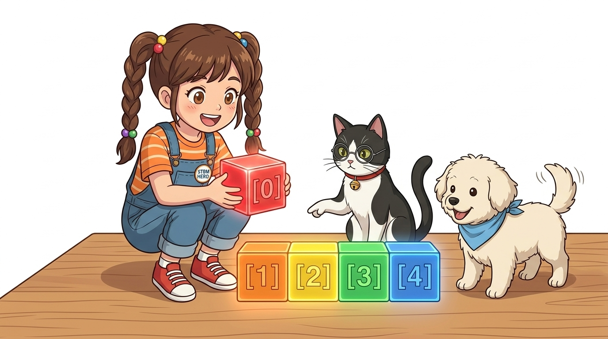
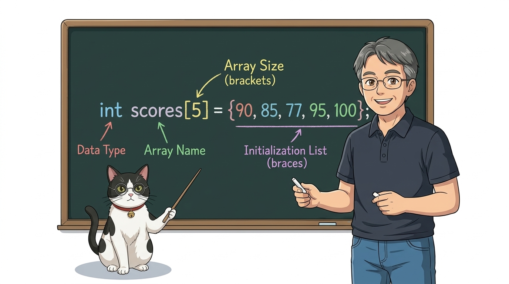
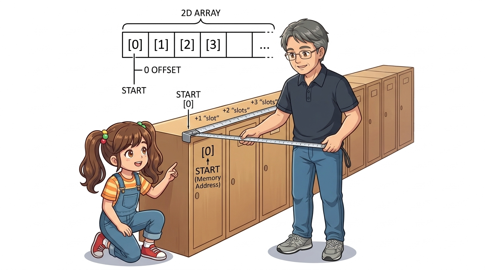
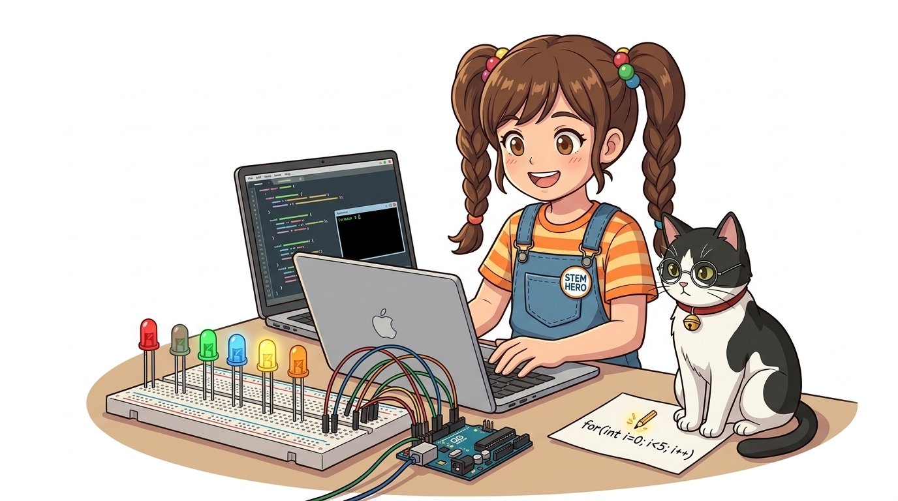

# 074_C언어배열_데이터줄줄이기차 🚂



* **반복과 확장의 핵심 자료구조! 수십 개의 동일 변수를 하나의 이름으로 묶어 일괄 제어하기**
* 배열의 메모리 연속성, 0-인덱싱 규칙, 버퍼 오버런(Buffer Overrun) 방지, `for` 루프와의 결합 패턴을 학습합니다.
* 📖 **상세 강의 교재**: [index.md](./index.md)


> 여러분 안녕하세요! 이번 시간에는 '074. C언어배열 데이터줄줄이기차 🚂'을 주제로 함께 흥미진진한 탐험을 떠나보겠습니다. 마법 멘토 지니와 호기심 많은 탐험가 도로시, 그리고 귀여운 토토와 함께 신나는 아두이노 모험을 힘차게 시작해 봅시다. 준비되셨나요?

---

## 1. 👧 도로시의 고민: "변수 이름 짓다가 밤새겠어요!"


* **👧 도로시**: "지니야! LED 8개를 켜려고 변수를 만들었더니 `int led1, led2, led3, led4, led5...` 이름 짓기도 너무 힘들고, 코드가 수십 줄로 길어져서 머리가 아파!"
* **🐱 지니**: "그럴 때 같은 방 번호를 매겨 한 줄로 묶어주는 **배열(Array)** 을 쓰면 변수 이름 딱 하나로 100개도 거뜬히 다룰 수 있단다!"
* **🐶 토토**: "멍멍! (기차 칸에 1호차, 2호차 번호표 붙이는 거랑 똑같네!)"
* [!NOTE]
* **배열(Array)이 주는 혁신**
* 일반 변수는 메모리 여기저기에 흩어져 있어 일괄 처리가 불가능합니다. 하지만 배열은 컴퓨터 메모리에 빈틈없이 연속된 방을 확보하므로, 반복문 카운터 `i`만 바꾸면 모든 변수를 1초 만에 순회할 수 있습니다.

LED 8개를 순서대로 켜고 끄는 제어 코드를 작성하던 도로시가 지쳐서 책상에 엎드렸습니다!

> 이번 슬라이드에서는 '1. 👧 도로시의 고민: "변수 이름 짓다가 밤새겠어요!"'에 대해 자세히 살펴보겠습니다. 화면의 다이어그램과 사진을 함께 참고해 주시기 바랍니다. 도로시와 지니의 대화처럼, 지니야! LED 8개를 켜려고 변수를 만들었더니 int led1, led2, led3, led4, led5... 이름 짓기도 너무 힘들고, 코드가 수십 줄로 길어져서 머리가 아파!라는 상황에 대해 그럴 때 같은 방 번호를 매겨 한 줄로 묶어주는 배열(Array) 을 쓰면 변수 이름 딱 하나로 100개도 거뜬히 다룰 수 있단다!라는 원리가 작동하는 것입니다. 이 원리는 아두이노 시스템 전체를 관통하는 핵심 논리이므로 머릿속에 꼭 정리해 두시기 바랍니다.

---

## 2. 🚂 배열(Array)이란 무엇일까요?


| 비교 항목 | 일반 개별 변수 | C/C++ 배열 (Array) |
| :--- | :--- | :--- |
| **메모리 배치** | 메모리 곳곳에 불규칙하게 흩어짐 | 빈틈없이 연속된 물리적 공간에 차례대로 배치 |
| **변수 식별** | 변수 이름을 각각 지어야 함 (`a, b, c, d...`) | 하나의 이름과 **인덱스 번호표(`arr[0]`, `arr[1]`...)** |
| **반복문 활용** | `for` 문으로 순회할 수 없음 | `for (int i = 0; i < N; i++)` 로 일괄 제어 |
| **코드 확장성** | 부품이 늘어날 때마다 코드 길이가 비례 증가 | 크기 숫자만 바꾸면 코드가 전혀 늘어나지 않음 |

배열은 **동일한 자료형(Data Type)** 의 데이터 여러 개를 메모리에 나란히 연속으로 배치한 컨테이너입니다.
### 📌 일반 변수 vs 배열 비교

> 자, 이번 슬라이드의 질문을 함께 보시겠습니다. 바로 '2. 🚂 배열(Array)이란 무엇일까요?'라는 아주 흥미로운 질문입니다. 이 질문 속에 숨겨진 전자 회로와 컴퓨팅의 핵심 원리를 지금부터 차근차근 하나씩 파헤쳐 보겠습니다.

---

## 3. 🏷️ 배열 선언 및 초기화 문법



* [!IMPORTANT]
* C/C++ 배열은 **정적 할당(Static Allocation)** 되므로, 한 번 선언된 배열의 크기는 프로그램 실행 도중에 마음대로 늘리거나 줄일 수 없습니다.

배열을 선언할 때는 **자료형, 배열 이름, 요소 개수(크기)** 를 정확히 명시합니다.

```cpp
// 방법 1: 크기만 먼저 선언하고 나중에 값 넣기 (5칸짜리 정수 방)
int scores[5];

// 방법 2: 선언과 동시에 중괄호 {} 로 초기값 채우기
int ledPins[4] = {2, 3, 4, 5};

// 방법 3: 초기값 개수에 따라 컴파일러가 자동으로 크기를 결정
int notes[] = {262, 294, 330, 349, 392}; // 도, 레, 미, 파, 솔 (크기 5 자동 지정)
```

> 이번 슬라이드에서는 '3. 🏷️ 배열 선언 및 초기화 문법'에 대한 실제 동작 코드를 분석해 보겠습니다. 화면의 코드를 살펴보시면, 컴퓨터가 아두이노 하드웨어에 단계별로 명령을 내리는 흐름을 명확하게 확인할 수 있습니다. 각 함수의 역할과 괄호 안의 매개변수가 하드웨어 핀과 어떤 관계를 맺고 동작하는지 주의 깊게 살펴보시기 바랍니다.

---

## 4. 0️⃣ 가장 중요한 황금 규칙: 첫 번째 칸은 0번!



* 크기가 4인 배열 `leds[4]`의 유효한 인덱스는 **`0`, `1`, `2`, `3`** 까지입니다.
* 만약 실수로 `leds[4] = 10;` 처럼 4번 방에 값을 쓰려고 하면, 배열 바깥의 엉뚱한 시스템 메모리를 덮어써서 **아두이노가 갑자기 재부팅되거나 멈추는 치명적인 버그**가 발생합니다!
* **공식**: *N*개짜리 배열의 마지막 방 번호는 항상 **`N - 1`** 입니다.

배열의 방 번호를 가리키는 숫자를 **인덱스(Index)** 또는 첨자라고 부릅니다. 컴퓨터 공학의 절대 원칙: **인덱스는 언제나 0부터 시작**합니다!
### 🚨 치명적 오류: 버퍼 오버런 (Buffer Overrun)

```cpp
int leds[4] = {2, 4, 6, 8};

leds[0] // ➡️ 1번째 칸의 값: 2
leds[1] // ➡️ 2번째 칸의 값: 4
leds[2] // ➡️ 3번째 칸의 값: 6
leds[3] // ➡️ 4번째 칸의 값: 8
```

> 이번 슬라이드에서는 '4. 0️⃣ 가장 중요한 황금 규칙: 첫 번째 칸은 0번!'에 대한 실제 동작 코드를 분석해 보겠습니다. 화면의 코드를 살펴보시면, 컴퓨터가 아두이노 하드웨어에 단계별로 명령을 내리는 흐름을 명확하게 확인할 수 있습니다. 여기서 핵심은 크기가 4인 배열 leds[4]의 유효한 인덱스는 0, 1, 2, 3 까지입니다.입니다. 각 함수의 역할과 괄호 안의 매개변수가 하드웨어 핀과 어떤 관계를 맺고 동작하는지 주의 깊게 살펴보시기 바랍니다.

---

## 5. ⚡ 최고의 짝꿍: 배열(Array) + 반복문(for)



배열의 인덱스 번호는 `for` 루프의 제어 변수 `i`와 완벽히 1:1 매칭됩니다.

```cpp
// 디지털 2번부터 6번까지 5개 LED 핀을 배열로 묶기
const int LED_COUNT = 5;
int ledPins[LED_COUNT] = {2, 3, 4, 5, 6};

void setup() {
  // 5줄 쓰던 pinMode 선언을 단 2줄로 종결!
  for (int i = 0; i < LED_COUNT; i++) {
    pinMode(ledPins[i], OUTPUT);
  }
}

void loop() {
  // 5개의 LED를 순서대로 하나씩 점등 이동
  for (int i = 0; i < LED_COUNT; i++) {
    digitalWrite(ledPins[i], HIGH);
    delay(150);
    digitalWrite(ledPins[i], LOW);
  }
}
```

> 이번 슬라이드에서는 '5. ⚡ 최고의 짝꿍: 배열(Array) + 반복문(for)'에 대한 실제 동작 코드를 분석해 보겠습니다. 화면의 코드를 살펴보시면, 컴퓨터가 아두이노 하드웨어에 단계별로 명령을 내리는 흐름을 명확하게 확인할 수 있습니다. 각 함수의 역할과 괄호 안의 매개변수가 하드웨어 핀과 어떤 관계를 맺고 동작하는지 주의 깊게 살펴보시기 바랍니다.

---

## 🌟 도로시와 지니의 배열 마법 요약! 🏆


* **👧 도로시**: "코드 길이가 5분의 1로 줄어들었어! 이제 LED가 100개 있어도 끄떡없겠어!"
* **🐱 지니**: "멋지다 도로시! 이제 64개의 LED 점으로 하트와 문자를 그리는 2차원 배열의 결정판, **'8x8 도트 매트릭스'**에 도전해보자!"

* [x] **연속 메모리 할당**: 데이터들이 물리적으로 인접하게 붙어 있어 초고속 순회가 가능합니다.
* [x] **0-Based Indexing**: 1번째 칸은 `[0]`, *N*번째 칸은 `[N-1]`임을 철저히 지킵니다.
* [x] **`for` 루프 연동**: `ledPins[i]` 패턴을 활용해 반복 코드를 80% 이상 줄였습니다.

축하합니다! C언어 프로그래밍의 정수이자 대규모 I/O 제어의 필수 도구인 배열을 완벽히 정복했습니다.
### 📋 핵심 요약 체크리스트

> 오늘 배운 '🌟 도로시와 지니의 배열 마법 요약! 🏆'의 핵심 내용을 모두 정리해 보았습니다. 오늘 다룬 내용 중에서도 [x] 연속 메모리 할당: 데이터들이 물리적으로 인접하게 붙어 있어 초고속 순회가 가능합니다. 부분은 앞으로의 아두이노 실습과 프로젝트에서 계속 사용되는 매우 중요한 기초 지식입니다. 오늘 배운 내용을 꼭 다시 한번 복습해 보시고, 다음 강의에서 더욱 신나고 유익한 모험으로 다시 만나겠습니다. 모두 수고 많으셨습니다!