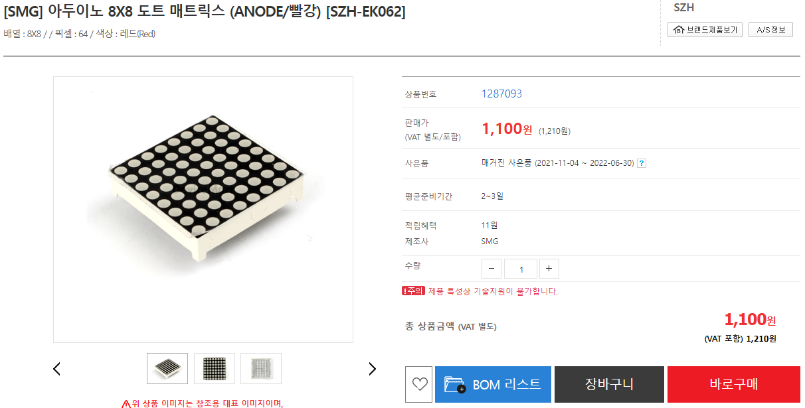
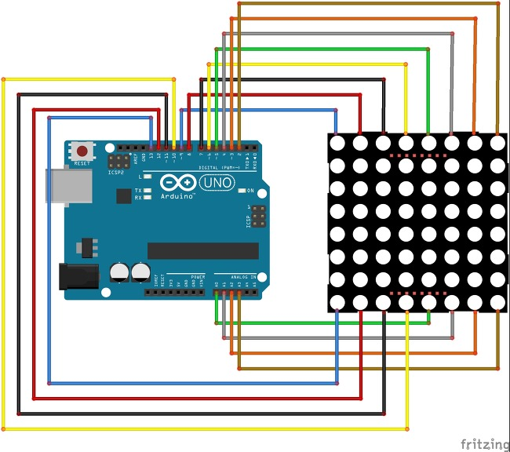
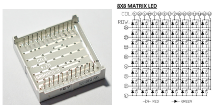
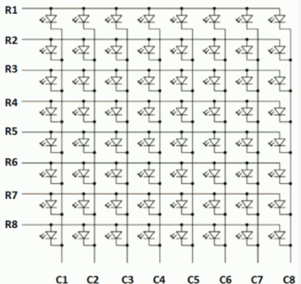
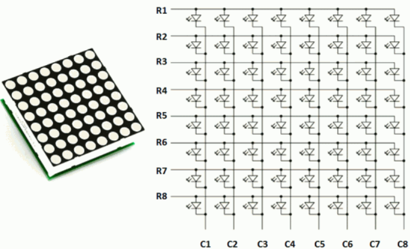

# 075_8x8도트매트릭스_픽셀아트 ✨

> **픽셀 그래픽의 시초! 8×8 바둑판 매트릭스 회로와 초고속 시분할 스캐닝 잔상(POV) 기술**  
> 행(Row)과 열(Column)의 교차점 구동 원리, 다이나믹 멀티플렉싱, 16개 핀 결선 구조를 학습합니다.

* 🖥️ **강의 슬라이드**: [slides.md](./slides.md)

---

## 1. 👧 도로시의 호기심: "빨간 점들이 모여 하트가 되었어요!"

버스 정류장의 도착 안내판과 지하철 스크린도어 전광판을 유심히 관찰하던 도로시가 신이 나서 외칩니다!

> **👧 도로시**: "지니야! 버스 정류장 안내판에 화살표랑 버스 번호가 빨간 점들로 콕콕 그려져 있어! 글씨가 지나가고 하트도 깜빡이는데 저건 어떻게 만드는 거야?"  
> **🐱 지니**: "그게 바로 **도트 매트릭스(Dot Matrix)** 란다! 바둑판처럼 LED를 가로세로로 촘촘히 엮어서 글자도 쓰고 귀여운 애니메이션 캐릭터도 그릴 수 있지!"  
> **🐶 토토**: "멍멍! (내 얼굴도 도트 그림으로 그려줘!)"

> [!NOTE]
> **픽셀(Pixel)과 비트맵(Bitmap)**  
> 컴퓨터 화면의 모든 그래픽은 아주 작은 색 점인 픽셀들의 모임입니다. 8×8 도트 매트릭스는 총 64개의 발광 픽셀을 통해 비트맵 이미지의 생성 원리를 가장 직관적으로 체감할 수 있는 훌륭한 교구입니다.

---

## 2. 🏙️ 실생활 속의 도트 매트릭스 디스플레이

도트 매트릭스는 강한 햇빛 아래에서도 시인성이 탁월하여 산업 전반의 공공 안내판에 널리 쓰입니다.

* **대중교통 안내 전광판**: 버스 노선 번호, 지하철 행선지 안내, 열차 도착 시간 표시
* **고속도로 교통 표지판**: 제한 속도 경고, 안개 주의, 공사 구간 화살표 안내
* **금융 및 상점 안내기**: 은행 환율 시세판, 전광판 광고 보드, 순번 대기 번호판

---

## 3. 🟥 8×8 도트 매트릭스의 물리적 구조

가로 8줄과 세로 8줄이 교차하여 총 64개의 LED 전구가 촘촘하게 박혀 있습니다.

### 📌 왜 행/열 매트릭스를 쓸까요?

* 만약 64개의 LED에 각각 1가닥씩 전선을 연결한다면? ➡️ **무려 64개의 핀이 필요합니다! (아두이노 UNO의 핀은 20개뿐!)**
* 하지만 가로줄(행, Row)과 세로줄(열, Column)을 서로 교차시켜 묶어주면? ➡️ **가로 8개 + 세로 8개 = 단 16개의 핀**만으로 64개 전체를 제어할 수 있습니다!

---

## 4. 📐 행(Row)과 열(Column)의 매트릭스 원리

도트 매트릭스 내부 회로는 직교하는 바둑판 그물망(Grid) 형태로 엮여 있습니다.

* **행 (Row 1 ~ Row 8)**: 가로줄에 위치한 8개 LED의 양극(Anode, `+`)을 한 줄로 묶어 연결
* **열 (Column 1 ~ Column 8)**: 세로줄에 위치한 8개 LED의 음극(Cathode, `-`)을 한 줄로 묶어 연결
* 각 LED는 고유한 **(Row, Column)** 교차 좌표를 가집니다.

---

## 5. 🎯 원하는 좌표의 점 1개 켜기

LED는 양극에 `+` 전압이 걸리고 음극에 `-` 접지가 될 때만 전류가 흘러 불이 켜지는 다이오드(Diode)입니다.

> **🐱 지니**: "예를 들어 (4번째 행, 3번째 열) 자리에 불을 켜려면 신호를 어떻게 줘야 할까?"  
> **👧 도로시**: "4번 행에 **`HIGH (+5V)`** 를 넣어주고, 3번 열에 **`LOW (0V, GND)`** 를 걸어주면 두 선이 만나는 교차점의 LED에만 전기가 흘러 켜지겠네!"

| 제어 신호 | 인가 전압 | 회로 상태 |
| :---: | :---: | :--- |
| **선택한 Row** | **`HIGH (5V)`** | LED의 양극(+)에 전류 공급 |
| **선택한 Column** | **`LOW (0V, GND)`** | LED의 음극(-)으로 전류 배출 ➡️ **점등 (ON)** |
| **선택되지 않은 핀들** | 반대 전압 또는 차단 | 역방향 전압이 걸려 점등되지 않음 |

---

## 6. 👀 눈의 착각! 잔상 효과(Persistence of Vision, POV)

여러 개의 점을 동시에 켜려고 할 때 발생하는 고스트 현상을 초고속 스캐닝으로 극복합니다.

### ⚠️ 매트릭스의 동시 점등 딜레마
* 만약 (1행, 1열)과 (2행, 2열)을 동시에 켜려고 1, 2행에 `HIGH`, 1, 2열에 `LOW`를 주면, 원치 않는 (1행 2열)과 (2행 1열)까지 총 4개의 점이 사각형으로 몽땅 켜져 버립니다!
* **해결책: 다이나믹 스캐닝(Dynamic Scanning)**:
  * 1번째 행만 켜고 1번째 열을 켬 (1ms)
  * 2번째 행만 켜고 2번째 열을 켬 (1ms)
  * 이를 1초에 100번 이상 초고속으로 번갈아 반복하면 사람의 뇌는 **망막의 잔상 효과(POV)** 로 인해 두 점이 동시에 켜져 있는 완벽한 그림으로 인식합니다!

---

## 🌟 도로시와 지니의 도트 매트릭스 원리 정리! 🏆

축하합니다! 디스플레이 기술의 핵심인 매트릭스 배선과 잔상 효과의 물리학을 마스터했습니다.

### 📋 핵심 요약 체크리스트

* [x] **격자 배선**: 행 8개와 열 8개로 64개의 핀을 16개로 대폭 압축했습니다.
* [x] **교차점 구동**: 선택된 Row에 `HIGH`, 선택된 Column에 `LOW`를 인가하여 좌표별 픽셀을 점등했습니다.
* [x] **초고속 시분할 스캐닝**: 잔상 효과(POV)를 이용하여 복잡한 비트맵 이미지를 깜빡임 없이 표시하는 메커니즘을 이해했습니다.

> **👧 도로시**: "하지만 선 16개도 빵판에 일일이 꽂으려니까 여전히 전선이 너무 많아!"  
> **🐱 지니**: "후후, 그래서 다음 시간에는 전선 단 3개로 64개 LED를 다루는 **MAX7219 전용 드라이버 모듈**을 실습해 볼 거야!"
