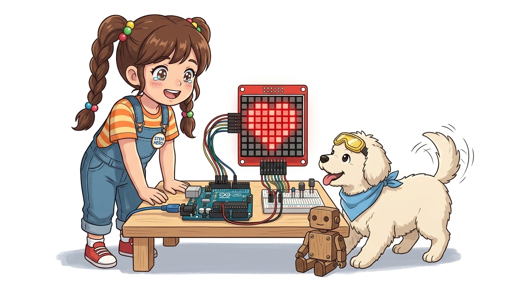
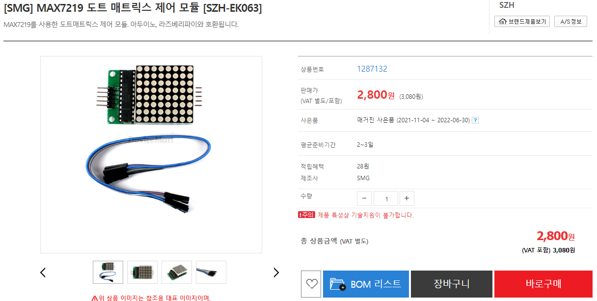
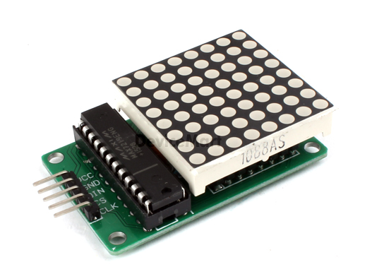
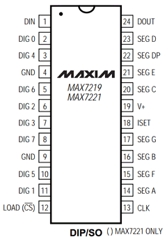
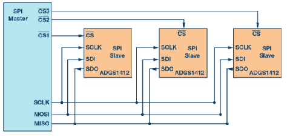
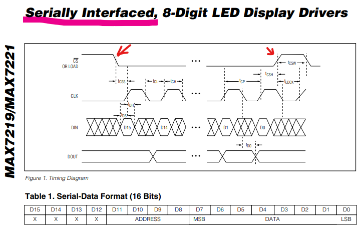
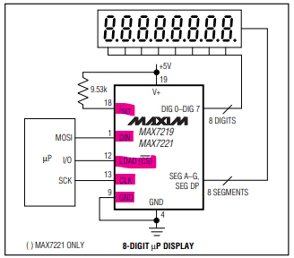

# 076_MAX7219_매트릭스모듈구동 💡



* **배선의 일대 혁신! 전용 시리얼 LED 드라이버 IC로 도트 매트릭스를 완벽히 정복하기**
* SPI 방식의 3선 통신(DIN, CS, CLK), 데이지 체인 확장, `LedControl` 라이브러리를 활용한 비트맵 하트 애니메이션을 실습합니다.
* 📖 **상세 강의 교재**: [index.md](./index.md)


> 여러분 안녕하세요! 이번 시간에는 '076. MAX7219 매트릭스모듈구동 💡'을 주제로 함께 흥미진진한 탐험을 떠나보겠습니다. 마법 멘토 지니와 호기심 많은 탐험가 도로시, 그리고 귀여운 토토와 함께 신나는 아두이노 모험을 힘차게 시작해 봅시다. 준비되셨나요?

---

## 1. 👧 도로시의 한숨: "전선 16개 꽂다가 다 엉켰어요!"


* **👧 도로시**: "지니야! 도트 매트릭스에 전선 16개를 아두이노에 하나하나 꽂으려니까 손가락도 아프고 선이 스파게티처럼 꼬여서 뭐가 뭔지 모르겠어!"
* **🐱 지니**: "후후, 걱정 마! **MAX7219**라는 슈퍼 드라이버 칩이 들어간 일체형 모듈을 쓰면 전원 2개와 신호선 **단 3개(총 5개)** 로 64개 점을 자유자재로 켤 수 있단다!"
* **🐶 토토**: "멍멍! (마법 칩 하나가 16가닥 선을 대신해 주는 거야? 대박!)"
* [!NOTE]
* **전용 디스플레이 드라이버의 이점**
* MAX7219는 내부 BCD 디코더, 다중화 스캔 회로, 8×8 정적 RAM(SRAM)을 내장하고 있어 아두이노 CPU의 점등 루프 연산 부담을 0%로 줄여줍니다.

브레드보드에 16가닥의 점퍼선을 꽂으며 회로를 맞추던 도로시가 지쳐서 한숨을 쉽니다!

> 이번 슬라이드에서는 '1. 👧 도로시의 한숨: "전선 16개 꽂다가 다 엉켰어요!"'에 대해 자세히 살펴보겠습니다. 화면의 다이어그램과 사진을 함께 참고해 주시기 바랍니다. 도로시와 지니의 대화처럼, 지니야! 도트 매트릭스에 전선 16개를 아두이노에 하나하나 꽂으려니까 손가락도 아프고 선이 스파게티처럼 꼬여서 뭐가 뭔지 모르겠어!라는 상황에 대해 후후, 걱정 마! MAX7219라는 슈퍼 드라이버 칩이 들어간 일체형 모듈을 쓰면 전원 2개와 신호선 단 3개(총 5개) 로 64개 점을 자유자재로 켤 수 있단다!라는 원리가 작동하는 것입니다. 이 원리는 아두이노 시스템 전체를 관통하는 핵심 논리이므로 머릿속에 꼭 정리해 두시기 바랍니다.

---

## 2. 🧩 MAX7219 도트 매트릭스 모듈 외형



* **입력 단자 (Input Header, 좌측)**: 아두이노 보드와 연결되는 5핀 (VCC, GND, DIN, CS, CLK)
* **출력 단자 (Output Header, 우측)**: 다음 매트릭스 모듈로 신호를 넘겨주는 5핀 (VCC, GND, DOUT, CS, CLK)
* **모듈 교체 가능**: 상단 LED 매트릭스는 소켓 방식으로 탈부착이 가능하여 고장 시 유지보수가 간편합니다.

8×8 LED 매트릭스와 MAX7219 칩이 컴팩트한 PCB 기판에 일체형으로 조립되어 있습니다.

> 이번 슬라이드에서는 '2. 🧩 MAX7219 도트 매트릭스 모듈 외형'에 대해 자세히 살펴보겠습니다. 화면의 다이어그램과 사진을 함께 참고해 주시기 바랍니다. 첫 번째 핵심은 입력 단자 (Input Header, 좌측): 아두이노 보드와 연결되는 5핀 (VCC, GND, DIN, CS, CLK)이며, 두 번째로는 출력 단자 (Output Header, 우측): 다음 매트릭스 모듈로 신호를 넘겨주는 5핀 (VCC, GND, DOUT, CS, CLK)입니다. 여기에 덧붙여 모듈 교체 가능: 상단 LED 매트릭스는 소켓 방식으로 탈부착이 가능하여 고장 시 유지보수가 간편합니다. 내용까지 함께 이해해 두시면 완벽합니다. 이 원리는 아두이노 시스템 전체를 관통하는 핵심 논리이므로 머릿속에 꼭 정리해 두시기 바랍니다.

---

## 3. 🦸‍♂️ 구원투수: MAX7219 드라이버 IC의 내부 아키텍처



* **하드웨어 다이나믹 스캐닝**: 1초에 800Hz 이상의 초고속으로 8줄을 자동 스캔하여 깜빡임(Flicker)을 원천 차단
* **16단계 디지털 밝기 조절**: 아날로그 저항 교체 없이 내부 PWM 전류 제어로 16단계 휘도 설정
* **저전력 셧다운(Shutdown) 모드**: 화면을 끄고 대기 전류를 $150\mu\text{A}$ 이하로 유지하는 절전 모드 지원

MAX7219는 마이크로프로세서와 7-세그먼트 또는 8×8 도트 매트릭스를 연결하기 위해 설계된 산업용 고집적 드라이버입니다.
### 📌 주요 핵심 기능

> 이번 슬라이드에서는 '3. 🦸‍♂️ 구원투수: MAX7219 드라이버 IC의 내부 아키텍처'에 대해 자세히 살펴보겠습니다. 화면의 다이어그램과 사진을 함께 참고해 주시기 바랍니다. 첫 번째 핵심은 하드웨어 다이나믹 스캐닝: 1초에 800Hz 이상의 초고속으로 8줄을 자동 스캔하여 깜빡임(Flicker)을 원천 차단이며, 두 번째로는 단계 디지털 밝기 조절: 아날로그 저항 교체 없이 내부 PWM 전류 제어로 16단계 휘도 설정입니다. 여기에 덧붙여 저전력 셧다운(Shutdown) 모드: 화면을 끄고 대기 전류를 $150\mu\text{A}$ 이하로 유지하는 절전 모드 지원 내용까지 함께 이해해 두시면 완벽합니다. 이 원리는 아두이노 시스템 전체를 관통하는 핵심 논리이므로 머릿속에 꼭 정리해 두시기 바랍니다.

---

## 4. 🔌 MAX7219 모듈의 5개 핀 상세 결선표



| 모듈 핀 | 아두이노 UNO 핀 | 신호 명칭 및 역할 |
| :---: | :---: | :--- |
| **`VCC`** | **5V** | 5V 전원 공급 |
| **`GND`** | **GND** | 공통 접지 (0V) |
| **`DIN`** | **디지털 12번** | 직렬 데이터 입력선 (Data In) |
| **`CS`** | **디지털 10번** | 칩 선택 래치 신호선 (Chip Select / Load) |
| **`CLK`** | **디지털 11번** | 비트 동기화 클록 신호선 (Serial Clock) |

아두이노 UNO와 고속 SPI 통신 핀으로 깔끔하게 결선합니다.

> 이번에 살펴볼 내용은 '4. 🔌 MAX7219 모듈의 5개 핀 상세 결선표'입니다. 슬라이드에 정리된 표를 통해 각 항목의 특징과 수치, 차이점을 한눈에 비교해 보실 수 있습니다. 이 기본 개념을 확실히 잡아두셔야 실제 부품을 브레드보드에 꽂고 코딩할 때 실수 없이 완성할 수 있습니다.

---

## 5. 🔄 데이지 체인(Daisy-Chain): 줄줄이 비엔나 확장!



* **DOUT (Data Out) ➡️ 다음 모듈의 DIN**: 데이터를 8바이트씩 밀어내어 다음 매트릭스로 전달 (시프트 레지스터 원리)
* **CS와 CLK**: 모든 모듈이 하나의 공통 선을 공유
* **확장성**: 아두이노 핀을 단 1개도 추가하지 않고 모듈 4개(8×32), 8개(8×64)를 연쇄 확장하여 초대형 전광판을 구축할 수 있습니다.

모듈 우측의 5개 핀을 다음 모듈의 좌측 핀에 그대로 연결하면 무한 확장이 가능합니다.

> 이번 슬라이드에서는 '5. 🔄 데이지 체인(Daisy-Chain): 줄줄이 비엔나 확장!'에 대해 자세히 살펴보겠습니다. 화면의 다이어그램과 사진을 함께 참고해 주시기 바랍니다. 첫 번째 핵심은 DOUT (Data Out) ➡️ 다음 모듈의 DIN: 데이터를 8바이트씩 밀어내어 다음 매트릭스로 전달 (시프트 레지스터 원리)이며, 두 번째로는 CS와 CLK: 모든 모듈이 하나의 공통 선을 공유입니다. 여기에 덧붙여 확장성: 아두이노 핀을 단 1개도 추가하지 않고 모듈 4개(8×32), 8개(8×64)를 연쇄 확장하여 초대형 전광판을 구축할 수 있습니다. 내용까지 함께 이해해 두시면 완벽합니다. 이 원리는 아두이노 시스템 전체를 관통하는 핵심 논리이므로 머릿속에 꼭 정리해 두시기 바랍니다.

---

## 6. 🛠️ LedControl 라이브러리로 쉽게 제어하기



복잡한 16비트 레지스터 통신 코드를 래핑해 주는 `LedControl` 오픈소스 라이브러리를 설치합니다.

```cpp
#include <LedControl.h>

// LedControl(DIN, CLK, CS, 모듈개수);
LedControl lc = LedControl(12, 11, 10, 1);

void setup() {
  lc.shutdown(0, false);  // 0번 모듈의 절전 모드 해제 (화면 켜기)
  lc.setIntensity(0, 8);   // 밝기 설정 (0: 최소 ~ 15: 최대)
  lc.clearDisplay(0);      // 화면 버퍼 비우기
}
```

> 이번 슬라이드에서는 '6. 🛠️ LedControl 라이브러리로 쉽게 제어하기'에 대한 실제 동작 코드를 분석해 보겠습니다. 화면의 코드를 살펴보시면, 컴퓨터가 아두이노 하드웨어에 단계별로 명령을 내리는 흐름을 명확하게 확인할 수 있습니다. 각 함수의 역할과 괄호 안의 매개변수가 하드웨어 핀과 어떤 관계를 맺고 동작하는지 주의 깊게 살펴보시기 바랍니다.

---

## 7. 💻 실습 코드: 깜빡이는 하트 비트맵 그리기



2진수(`B10101010`) 8바이트 배열로 하트 모양을 정의하고 화면에 점등하는 예제입니다.

```cpp
#include <LedControl.h>

LedControl lc = LedControl(12, 11, 10, 1);

// 8x8 하트 비트맵 데이터 (1: ON, 0: OFF)
byte heart[8] = {
  B00000000,
  B01100110, // **  **
  B11111111, // ********
  B11111111, // ********
  B11111111, // ********
  B01111110, //  ******
  B00111100, //   ****
  B00011000  //    **
};

void setup() {
  lc.shutdown(0, false);
  lc.setIntensity(0, 5); // 눈부심 방지 적정 밝기
  lc.clearDisplay(0);
}

void loop() {
  // 1. 하트 그리기: setRow(모듈번호, 행번호, 8비트값)
  for (int r = 0; r < 8; r++) {
    lc.setRow(0, r, heart[r]);
  }
  delay(1000);
  
  // 2. 화면 끄기 (깜빡임 효과)
  lc.clearDisplay(0);
  delay(500);
}
```

> 이번 슬라이드에서는 '7. 💻 실습 코드: 깜빡이는 하트 비트맵 그리기'에 대한 실제 동작 코드를 분석해 보겠습니다. 화면의 코드를 살펴보시면, 컴퓨터가 아두이노 하드웨어에 단계별로 명령을 내리는 흐름을 명확하게 확인할 수 있습니다. 각 함수의 역할과 괄호 안의 매개변수가 하드웨어 핀과 어떤 관계를 맺고 동작하는지 주의 깊게 살펴보시기 바랍니다.

---

## 🌟 도로시와 지니의 핵심 정리! 🏆


* **👧 도로시**: "우와! 빨간 하트가 선명하게 두근두근 깜빡여! 선 5개로 이게 된다니 마법 같아!"
* **🐱 지니**: "훌륭해! 다음 시간에는 모듈 4개를 옆으로 길게 이어 붙여 글자가 스르륵 지나가는 **'도트 매트릭스 다중 제어 전광판'** 을 완성해 보자!"

* [x] **배선 70% 절감**: 16가닥 핀을 3선 직렬 통신(DIN, CS, CLK)으로 압축했습니다.
* [x] **`LedControl` 라이브러리**: `setRow()` 메소드로 2진수 8자리 바이너리 비트맵을 직관적으로 화면에 투사했습니다.
* [x] **데이지 체인 아키텍처**: DOUT과 DIN 연결로 복수 모듈 확장의 기초를 확립했습니다.

축하합니다! MAX7219 드라이버를 활용하여 64개 픽셀을 단 3개의 신호선으로 능숙하게 다루게 되었습니다.
### 📋 핵심 요약 체크리스트

> 오늘 배운 '🌟 도로시와 지니의 핵심 정리! 🏆'의 핵심 내용을 모두 정리해 보았습니다. 오늘 다룬 내용 중에서도 [x] 배선 70% 절감: 16가닥 핀을 3선 직렬 통신(DIN, CS, CLK)으로 압축했습니다. 부분은 앞으로의 아두이노 실습과 프로젝트에서 계속 사용되는 매우 중요한 기초 지식입니다. 지니 멘토가 강조했듯이 훌륭해! 다음 시간에는 모듈 4개를 옆으로 길게 이어 붙여 글자가 스르륵 지나가는 라는 점을 꼭 마음에 새겨두시길 바랍니다. 오늘 배운 내용을 꼭 다시 한번 복습해 보시고, 다음 강의에서 더욱 신나고 유익한 모험으로 다시 만나겠습니다. 모두 수고 많으셨습니다!