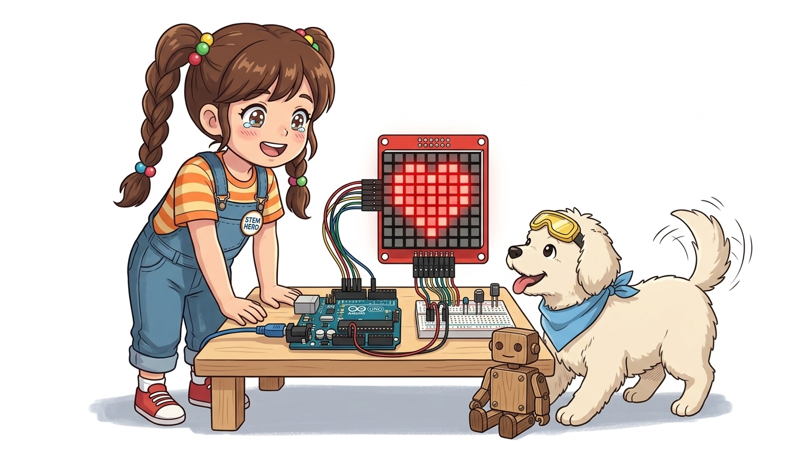
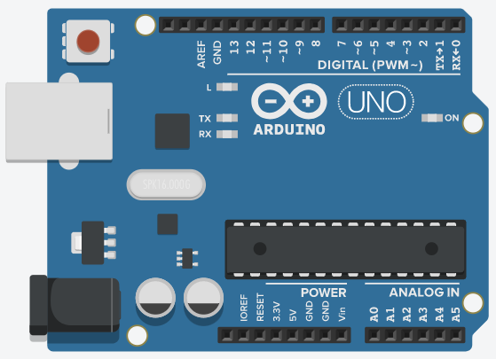
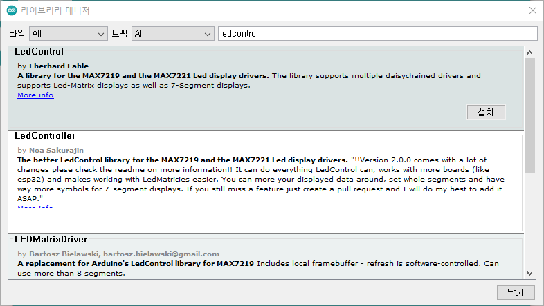
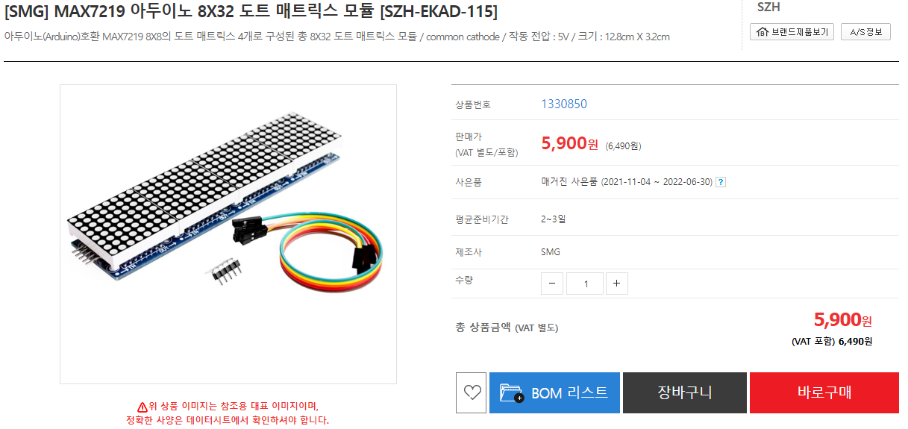
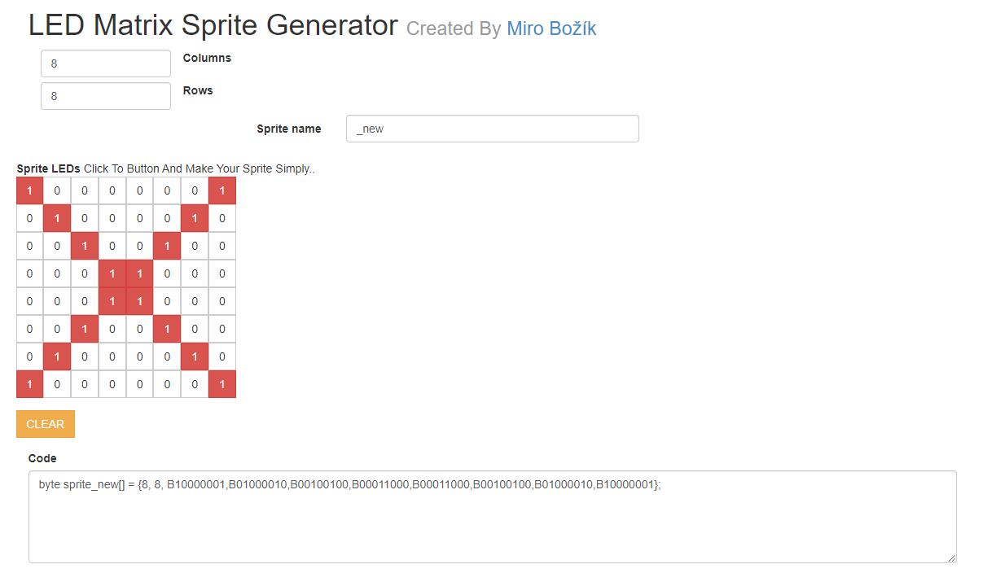
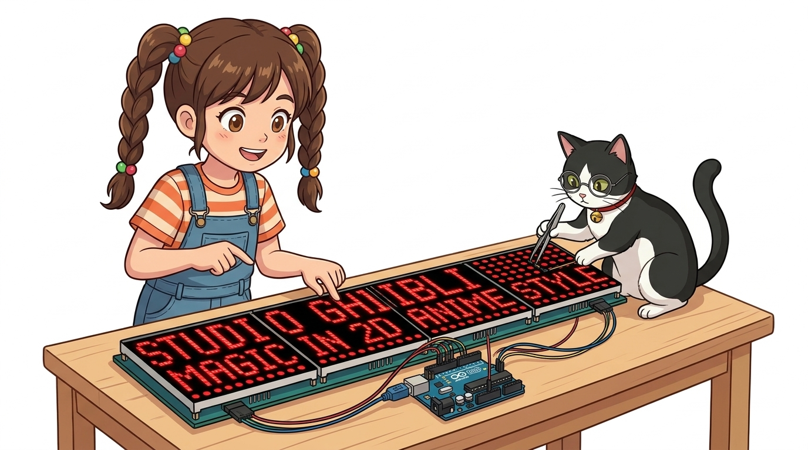

# 077_32x8와이드전광판_다중제어 🎬

> **32×8 총 256개 픽셀의 파노라마 전광판 구축하기!**  
> MAX7219 데이지 체인 직렬 프로토콜, 다중 모듈 인덱싱, 4글자 텍스트 동시 표출, 파도타기 웨이브 애니메이션을 완성합니다.



* 🖥️ **강의 슬라이드**: [slides.md](./slides.md)

---

## 1. 👧 도로시의 꿈: "진짜 전광판처럼 길게 만들래요!"

8×8 단일 매트릭스로 하트 그리기를 성공한 도로시가 더 큰 스케일의 전광판 프로젝트에 도전합니다!

> **👧 도로시**: "지니야! 8×8 하나는 글자 딱 한 글자밖에 안 들어가서 답답해! 4개를 옆으로 길게 붙여서 지하철 안내판처럼 멋진 전광판을 만들 수는 없을까?"  
> **🐱 지니**: "당연하지! MAX7219의 데이지 체인을 이용하면 **전선 수는 똑같이 5개**로 유지하면서 모듈 4개를 한 줄로 길게 묶을 수 있어!"  
> **🐶 토토**: "왈왈! (32개 가로 점으로 내 이름도 다 들어갈 수 있겠다!)"


> [!NOTE]
> **모듈러 디스플레이(Modular Display)**  
> 8×8 매트릭스 4개를 직렬로 이어 붙이면 **32열(Column) × 8행(Row) = 총 256개 LED**의 와이드 스크린이 구성됩니다. 동일한 SPI 버스로 신호를 순차 전달하므로 아두이노의 핀 소모는 전혀 증가하지 않습니다.

---

## 2. 🔗 모듈 4개 직렬 연결 (Daisy-Chain 구조)

아두이노는 오직 **맨 첫 번째 모듈(0번)** 에만 직접 연결하고, 나머지는 모듈 간 꼬리물기로 연결합니다.



### 📌 신호 흐름 및 배선 규칙

* **데이터 전송선 (Data Chain)**:
  * 아두이노 **디지털 7번 핀** ➡️ 0번 모듈의 **`DIN`**
  * 0번 모듈의 **`DOUT`** ➡️ 1번 모듈의 **`DIN`**
  * 1번 모듈의 **`DOUT`** ➡️ 2번 모듈의 **`DIN`**
  * 2번 모듈의 **`DOUT`** ➡️ 3번 모듈의 **`DIN`**
* **공통 버스선 (Shared Lines)**:
  * **`CS` (칩 선택)**: 아두이노 **8번 핀** ➡️ 모든 모듈의 CS 핀에 공통 병렬 연결
  * **`CLK` (클록)**: 아두이노 **9번 핀** ➡️ 모든 모듈의 CLK 핀에 공통 병렬 연결
  * **`VCC` / `GND`**: 5V 전원 레일 병렬 연결

---

## 3. 💻 객체 선언: "매트릭스는 총 4개야!"

`LedControl` 인스턴스를 생성할 때 마지막 매개변수로 연결된 총 모듈 개수를 지정합니다.



```cpp
#include <LedControl.h>

const int DIN_PIN = 7;
const int CS_PIN  = 8;
const int CLK_PIN = 9;
const int MATRIX_COUNT = 4; // 직렬 연결된 모듈 개수: 4개 (32x8 픽셀)

// LedControl(DIN, CLK, CS, numDevices);
LedControl dot_matrix = LedControl(DIN_PIN, CLK_PIN, CS_PIN, MATRIX_COUNT);
```

> [!TIP]
> 이제 각 모듈은 **`0번, 1번, 2번, 3번`** 의 디바이스 인덱스 번호로 개별 식별되어 독립적으로 픽셀을 켜거나 끌 수 있습니다.

---

## 4. ⚙️ 4개 화면 한 번에 일괄 초기화하기

`for` 반복문을 활용하여 0번부터 3번 모듈까지 순차적으로 절전 모드를 해제하고 밝기를 동기화합니다.



```cpp
void setup() {
  for (int i = 0; i < MATRIX_COUNT; i++) {
    dot_matrix.shutdown(i, false); // i번 모듈 절전 모드 해제 (화면 ON)
    dot_matrix.setIntensity(i, 6); // 적정 밝기 설정 (0~15)
    dot_matrix.clearDisplay(i);    // i번 화면 버퍼 깨끗이 소등
  }
}
```

---

## 5. 🎨 비트맵 패턴으로 4글자 단어 디자인하기

8×8 매트릭스 4개에 각각 한 글자씩 매핑하여 총 4글자의 영문 단어나 심볼을 동시에 띄웁니다.



```cpp
// 4개 화면에 각각 띄울 비트맵 폰트 데이터 정의 (예: J-I-N-Y)
byte char1[8] = {B00000000, B00011111, B00000100, B00000100, B00000100, B01000100, B00111000, B00000000};
byte char2[8] = {B00000000, B00001110, B00000100, B00000100, B00000100, B00000100, B00001110, B00000000};
byte char3[8] = {B00000000, B01000010, B01100010, B01010010, B01001010, B01000110, B01000010, B00000000};
byte char4[8] = {B00000000, B01000010, B00100100, B00011000, B00001000, B00001000, B00001000, B00000000};

void loop() {
  // 각 모듈(0, 1, 2, 3)의 가로 8줄을 동시에 업데이트
  for (int r = 0; r < 8; r++) {
    dot_matrix.setRow(0, r, char1[r]); // 0번 모듈
    dot_matrix.setRow(1, r, char2[r]); // 1번 모듈
    dot_matrix.setRow(2, r, char3[r]); // 2번 모듈
    dot_matrix.setRow(3, r, char4[r]); // 3번 모듈
  }
  delay(3000);
}
```

---

## 6. 🌊 파도타기 웨이브(Wave) 애니메이션 효과!

32개의 세로 줄(Column)을 왼쪽에서 오른쪽으로, 다시 오른쪽에서 왼쪽으로 훑고 지나가는 박진감 넘치는 빛의 파도입니다.



```cpp
void loop() {
  // 1. 왼쪽 0번 모듈부터 오른쪽 3번 모듈까지 빛의 파도 전진
  for (int k = 0; k < 4; k++) {
    for (int col = 0; col < 8; col++) {
      dot_matrix.setColumn(k, col, B11111111); // 세로 한 줄 전체 ON
      delay(30);
      dot_matrix.clearDisplay(k);              // 끄고 다음 열로 이동
    }
  }
  
  // 2. 오른쪽 3번 모듈부터 왼쪽 0번 모듈까지 반대 방향 복귀
  for (int k = 3; k >= 0; k--) {
    for (int col = 7; col >= 0; col--) {
      dot_matrix.setColumn(k, col, B11111111);
      delay(30);
      dot_matrix.clearDisplay(k);
    }
  }
}
```

---

## 🌟 03단원 디스플레이 마스터 총정리! 🏆

축하합니다! 숫자, 텍스트, 그래픽에 이르는 아두이노의 모든 주요 디스플레이를 완벽하게 정복했습니다.


### 📋 03단원 디스플레이 정복 체크리스트

* [x] **숫자 디스플레이 (FND)**: 7-세그먼트와 TM1637 4자리 모듈로 시계와 타이머를 제작했습니다.
* [x] **문자 디스플레이 (LCD)**: 1602 LCD와 PCF8574 I2C 어댑터 모듈로 전광판 스크롤 텍스트를 출력했습니다.
* [x] **그래픽 디스플레이 (Matrix)**: 8×8 도트 매트릭스와 MAX7219 데이지 체인으로 32×8 대형 애니메이션 스크린을 완성했습니다.

> **👧 도로시**: "우와! 이제 내 손으로 디지털 시계도 만들고 전광판 애니메이션도 띄울 수 있어!"  
> **🐱 지니**: "대단해 도로시! 이제 사람의 눈을 즐겁게 하는 출력을 배웠으니, 다음 02단원에서는 소리와 빛의 기초인 **'LED, RGB LED, 피에조 부저 출력 실습'** 을 하나씩 섭렵해 보자!"  
> **🐶 토토**: "왈왈! (지니야, 신나는 음악 만들러 가자!)"
