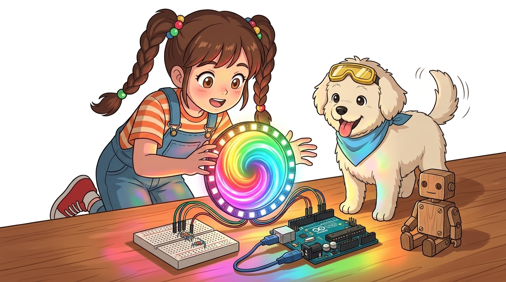
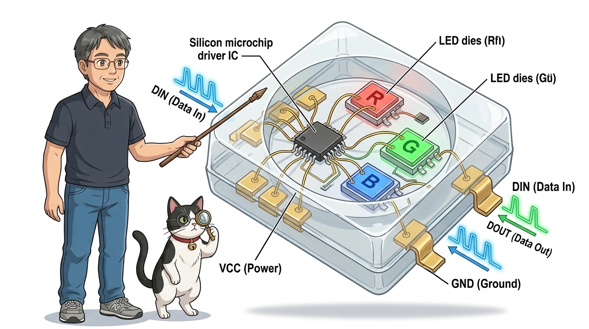
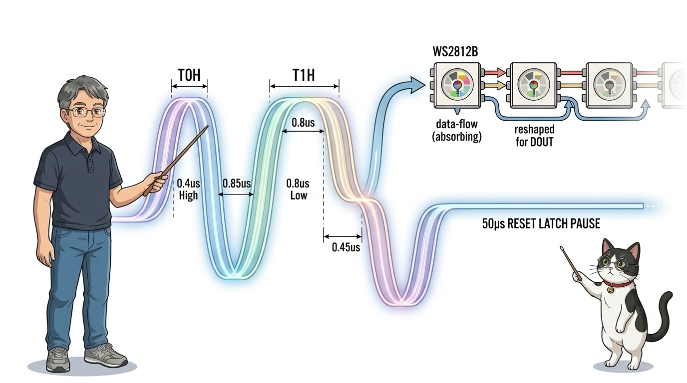
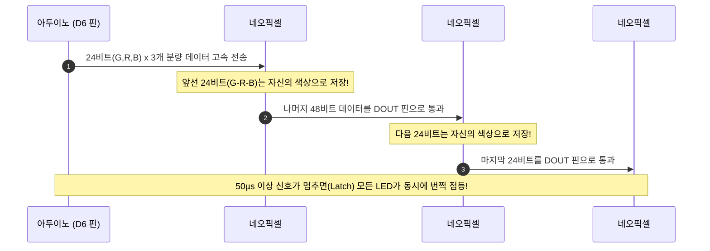
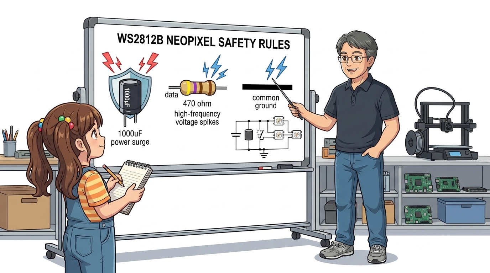
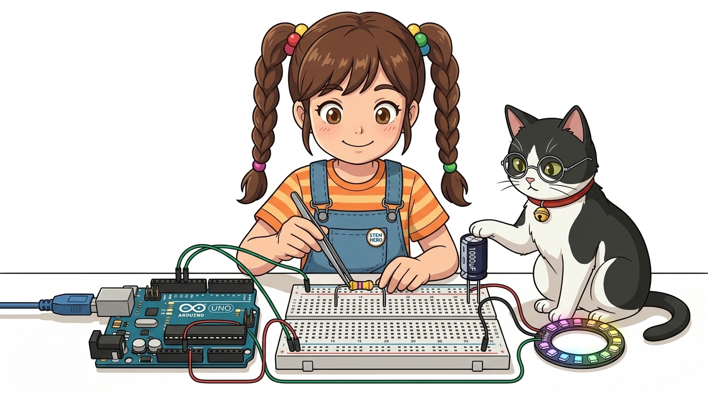

# 078_WS2812B_네오픽셀_화려한RGB무지개와_스마트무드등 🌈✨



**도로시와 지니가 함께하는 단 1개 핀으로 수백 개 풀컬러 LED를 제어하는 네오픽셀 마법과 무드등 제작**
* 👧 **도로시**: "지니야! 일반 RGB LED는 1개만 써도 아두이노 핀을 3개나 잡아먹잖아. LED 16개로 방을 무지개빛으로 꾸미고 싶은데, 그럼 핀이 48개나 필요한 거야?"
* 🐱 **지니**: "후후, 걱정 마 도로시! 전 세계 메이커들이 가장 사랑하는 환상의 광원, **WS2812B 네오픽셀(NeoPixel)** 이 있단다! 데이터 선 단 **1가닥**만 아두이노에 꽂으면 수백 개의 LED를 개별 색상과 밝기로 마음껏 지휘할 수 있지!"
* 🐶 **토토**: "바우! 빙글빙글 도는 무지개 빛깔이 영화처럼 예쁘다 멍!"
* 📖 **상세 강의 교재**: [index.md](./index.md)


> 여러분 안녕하세요! 이번 시간에는 '078. WS2812B 네오픽셀 화려한RGB무지개와 스마트무드등 🌈✨'을 주제로 함께 흥미진진한 탐험을 떠나보겠습니다. 오늘 강의에서는 특히 도로시와 지니가 함께하는 단 1개 핀으로 수백 개 풀컬러 LED를 제어하는 네오픽셀 마법과 무드등 제작, 👧 도로시: "지니야! 일반 RGB LED는 1개만 써도 아두이노 핀을 3개나 잡아먹잖아. LED 16개로 방을 무지개빛으로 꾸미고 싶은데, 그럼 핀이 48개나 필요한 거야?"를 중심으로 핵심 원리와 응용 방법을 차근차근 배워보겠습니다. 마법 멘토 지니와 호기심 많은 탐험가 도로시, 그리고 귀여운 토토와 함께 신나는 아두이노 모험을 힘차게 시작해 봅시다. 준비되셨나요?

---

## 1. 네오픽셀(WS2812B)이란 무엇인가?



네오픽셀은 5mm x 5mm 크기의 SMD 5050 초소형 패키지 안에 **고휘도 Red, Green, Blue LED 칩**과 함께 **지능형 디지털 드라이버 IC(WS2812B)** 가 하나로 압축 내장된 주소 지정형(Addressable) 스마트 LED입니다.

```
       [ 일반 RGB LED (핀 낭비 심함) ]              [ WS2812B 네오픽셀 (혁신적 1선 제어) ]
       아두이노 ─── D9  ──▶ Red                   아두이노 ─── D6 ──▶ [LED #0] ──▶ [LED #1] ──▶ [LED #2] ...
       아두이노 ─── D10 ──▶ Green                   (단 1개 핀으로 직렬 캐스케이드 무한 확장!)
       아두이노 ─── D11 ──▶ Blue
       * LED 1개당 핀 3개 필요!                     * LED가 100개여도 신호선은 단 1개!
```

> 자, 이번 슬라이드의 질문을 함께 보시겠습니다. 바로 '1. 네오픽셀(WS2812B)이란 무엇인가?'라는 아주 흥미로운 질문입니다. 이 질문 속에 숨겨진 전자 회로와 컴퓨팅의 핵심 원리를 지금부터 차근차근 하나씩 파헤쳐 보겠습니다.

---
## 2. 800kHz 고속 단선 통신과 데이터 캐스케이드(Cascade) 원리




* **24비트 트루컬러(True Color)**:
* Green(8비트: 0~255) + Red(8비트: 0~255) + Blue(8비트: 0~255) = 총 24비트.
* $256 	imes 256 	imes 256 = \mathbf{16,777,216	ext{가지}}$ (1,670만 가지 천연색 표현!)

네오픽셀은 아두이노에서 쏟아지는 초당 800,000번(800kHz)의 고속 디지털 펄스를 받아 앞쪽 LED가 자기 데이터를 꿀꺽 삼키고, 남은 데이터를 뒤쪽 LED로 릴레이 전달합니다.



> 이번 슬라이드에서는 '2. 800kHz 고속 단선 통신과 데이터 캐스케이드(Cascade) 원리'에 대한 실제 동작 코드를 분석해 보겠습니다. 화면의 코드를 살펴보시면, 컴퓨터가 아두이노 하드웨어에 단계별로 명령을 내리는 흐름을 명확하게 확인할 수 있습니다. 여기서 핵심은 비트 트루컬러(True Color)입니다. 각 함수의 역할과 괄호 안의 매개변수가 하드웨어 핀과 어떤 관계를 맺고 동작하는지 주의 깊게 살펴보시기 바랍니다.
---
## 3. 하드웨어 보호와 전원 연결의 황금률 ⚠️




* [!CAUTION]
* **네오픽셀 사용 시 반드시 지켜야 할 메이커 3대 수칙**:
* 1. **전류 폭식 주의**: 풀 화이트(White, R+G+B 모두 최대) 점등 시 LED 1개당 약 **60mA**를 소모합니다. 16구 링은 약 **1A**, 60구 스트립은 **3.6A**의 거대한 전류를 요구하므로, 8개 이상 사용 시 **5V 2A 독립 파워서플라이**를 연결해야 아두이노 보드가 타지 않습니다.
* 2. **신호선 보호 저항**: 아두이노 신호 핀과 네오픽셀 DIN 단자 사이에 **`330Ω ~ 470Ω` 저항**을 직렬로 연결하여 전압 스파이크 노이즈를 막아줍니다.
* 3. **대용량 전해 커패시터**: 전원(+)과 (-) 사이에 **`1000µF (6.3V 이상)` 전해 커패시터**를 병렬로 달아주면 전원 투입 순간의 서지 전압으로부터 민감한 WS2812B 칩을 완벽히 보호합니다.

> 이번 슬라이드에서는 '3. 하드웨어 보호와 전원 연결의 황금률 ⚠️'에 대해 자세히 살펴보겠습니다. 이 원리는 아두이노 시스템 전체를 관통하는 핵심 논리이므로 머릿속에 꼭 정리해 두시기 바랍니다.
---
## 4. 회로 배선도 (16구 네오픽셀 링 기준)




| 네오픽셀 링 핀 | 아두이노 우노 연결 | 연결 부품 및 주의사항 |
| :--- | :--- | :--- |
| **`VCC (또는 +5V)`** | **5V 핀** (소형 링) 또는 외부 전원(+) | 전원 단자 사이에 1000µF 커패시터 병렬 결선 권장 |
| **`GND`** | **GND 핀** | 외부 전원 사용 시 아두이노 GND와 반드시 공통 접지(Common GND) |
| **`DIN (Data In)`** | **디지털 6번 (D6)** | 330Ω 저항을 거쳐 직렬 연결 |
| `DOUT (Data Out)` | *비워둠* (다음 링 확장 시 연결) | 추가 네오픽셀의 DIN으로 연장 |

> 이번에 살펴볼 내용은 '4. 회로 배선도 (16구 네오픽셀 링 기준)'입니다. 슬라이드에 정리된 표를 통해 각 항목의 특징과 수치, 차이점을 한눈에 비교해 보실 수 있습니다. 이 기본 개념을 확실히 잡아두셔야 실제 부품을 브레드보드에 꽂고 코딩할 때 실수 없이 완성할 수 있습니다.
---
## 5. 실습 1: Adafruit_NeoPixel 무지개 사이클(Rainbow) 애니메이션


아두이노 IDE [라이브러리 관리자]에서 **`Adafruit NeoPixel`** 을 검색하여 설치합니다.

```cpp
#include <Adafruit_NeoPixel.h>

#define LED_PIN    6   // 네오픽셀 DIN 연결 핀
#define LED_COUNT 16   // 네오픽셀 LED 개수 (16구 링 기준)

// 네오픽셀 객체 생성 (개수, 핀 번호, 색상 순서 NEO_GRB + 주파수 800KHZ)
Adafruit_NeoPixel strip(LED_COUNT, LED_PIN, NEO_GRB + NEO_KHZ800);

void setup() {
  strip.begin();           // 네오픽셀 초기화
  strip.show();            // 모든 픽셀을 일단 OFF 상태로 반영
  strip.setBrightness(50); // 눈부심 방지 밝기 제한 (0~255, 50 정도면 충분히 밝음!)
}

void loop() {
  rainbowCycle(10); // 10ms 딜레이로 부드러운 무지개 회전
}

// 256단계 무지개 휠을 링 전체에 고르게 분산 회전시키는 마법 함수
void rainbowCycle(uint8_t wait) {
  uint16_t i, j;
  for(j = 0; j < 256 * 5; j++) { // 무지개 전체를 5바퀴 회전
    for(i = 0; i < strip.numPixels(); i++) {
      strip.setPixelColor(i, Wheel(((i * 256 / strip.numPixels()) + j) & 255));
    }
    strip.show(); // 16개 LED에 한 번에 적용!
    delay(wait);
  }
}

// 0~255 수치를 입력받아 R-G-B 색상 코드로 변환하는 휠 수학 함수
uint32_t Wheel(byte WheelPos) {
  WheelPos = 255 - WheelPos;
  if(WheelPos < 85) {
    return strip.Color(255 - WheelPos * 3, 0, WheelPos * 3);
  }
  if(WheelPos < 170) {
    WheelPos -= 85;
    return strip.Color(0, WheelPos * 3, 255 - WheelPos * 3);
  }
  WheelPos -= 170;
  return strip.Color(WheelPos * 3, 255 - WheelPos * 3, 0);
}
```

> 이번 슬라이드에서는 '5. 실습 1: Adafruit NeoPixel 무지개 사이클(Rainbow) 애니메이션'에 대한 실제 동작 코드를 분석해 보겠습니다. 화면의 코드를 살펴보시면, 컴퓨터가 아두이노 하드웨어에 단계별로 명령을 내리는 흐름을 명확하게 확인할 수 있습니다. 각 함수의 역할과 괄호 안의 매개변수가 하드웨어 핀과 어떤 관계를 맺고 동작하는지 주의 깊게 살펴보시기 바랍니다.
---
## 6. 실습 2: 가변저항으로 색상과 분위기를 바꾸는 스마트 무드등


A0 핀에 가변저항을 달아 다이얼을 돌릴 때마다 은은한 주황색 캔들 라이트부터 몽환적인 오로라 블루까지 색상을 실시간으로 변환합니다.

```cpp
#include <Adafruit_NeoPixel.h>

#define LED_PIN    6
#define LED_COUNT 16
#define POT_PIN   A0

Adafruit_NeoPixel strip(LED_COUNT, LED_PIN, NEO_GRB + NEO_KHZ800);

void setup() {
  strip.begin();
  strip.setBrightness(60);
  strip.show();
}

void loop() {
  int potValue = analogRead(POT_PIN); // 0 ~ 1023
  byte wheelPos = map(potValue, 0, 1023, 0, 255); // 0~255 매핑

  uint32_t color = Wheel(wheelPos);
  for(int i = 0; i < strip.numPixels(); i++) {
    strip.setPixelColor(i, color); // 링 전체를 일치된 감성 색상으로 설정
  }
  strip.show();
  delay(20);
}

uint32_t Wheel(byte WheelPos) {
  WheelPos = 255 - WheelPos;
  if(WheelPos < 85) return strip.Color(255 - WheelPos * 3, 0, WheelPos * 3);
  if(WheelPos < 170) { WheelPos -= 85; return strip.Color(0, WheelPos * 3, 255 - WheelPos * 3); }
  WheelPos -= 170;
  return strip.Color(WheelPos * 3, 255 - WheelPos * 3, 0);
}
```

> 이번 슬라이드에서는 '6. 실습 2: 가변저항으로 색상과 분위기를 바꾸는 스마트 무드등'에 대한 실제 동작 코드를 분석해 보겠습니다. 화면의 코드를 살펴보시면, 컴퓨터가 아두이노 하드웨어에 단계별로 명령을 내리는 흐름을 명확하게 확인할 수 있습니다. 각 함수의 역할과 괄호 안의 매개변수가 하드웨어 핀과 어떤 관계를 맺고 동작하는지 주의 깊게 살펴보시기 바랍니다.
---

## 🌟 도로시와 지니의 핵심 요약 노트!


* 👧 **도로시**: "신호선 단 1개로 16개 LED가 각자 다른 무지개빛으로 춤추는 게 너무 신기해! 방 전체를 감성 조명으로 꾸밀 수 있겠어!"
* 🐱 **지니**: "맞아! 네오픽셀은 24비트 데이터를 직렬 릴레이로 전달하는 스마트 IC 덕분에 무한 확장이 가능하단다. 단, LED가 많아지면 외부 전원과 330Ω 저항을 잊지 말렴!"
* 🐶 **토토**: "바우! 이제 글자와 그림을 선명하게 그려내는 **'079_SSD1306_OLED디스플레이'**의 세계로 넘어가보자 멍!"

> 오늘 배운 '🌟 도로시와 지니의 핵심 요약 노트!'의 핵심 내용을 모두 정리해 보았습니다. 오늘 다룬 내용 중에서도 👧 도로시: "신호선 단 1개로 16개 LED가 각자 다른 무지개빛으로 춤추는 게 너무 신기해! 방 전체를 감성 조명으로 꾸밀 수 있겠어!" 부분은 앞으로의 아두이노 실습과 프로젝트에서 계속 사용되는 매우 중요한 기초 지식입니다. 오늘 배운 내용을 꼭 다시 한번 복습해 보시고, 다음 강의에서 더욱 신나고 유익한 모험으로 다시 만나겠습니다. 모두 수고 많으셨습니다!