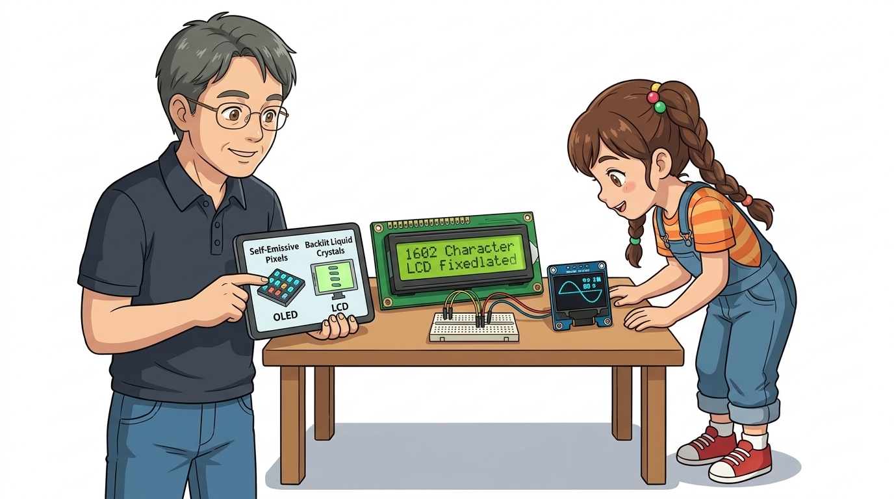
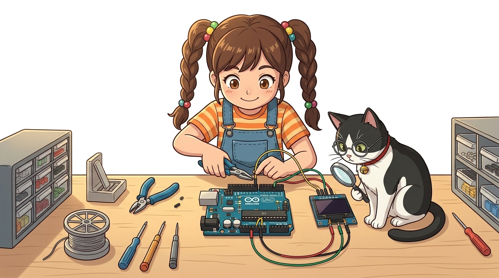
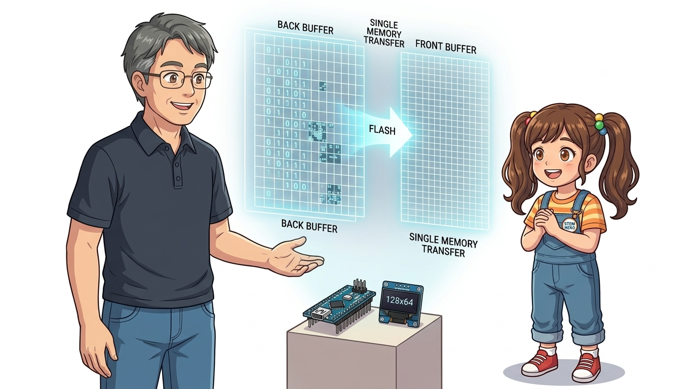
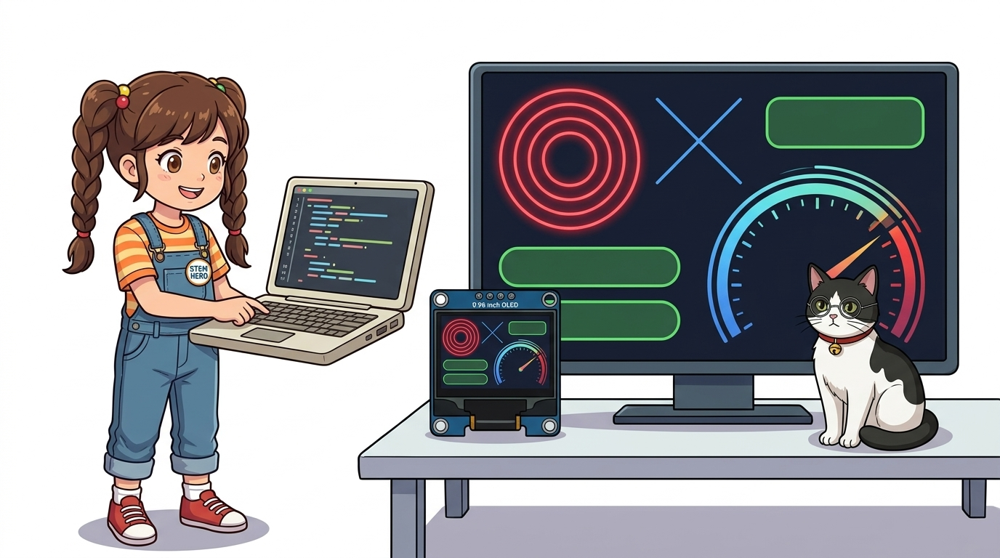
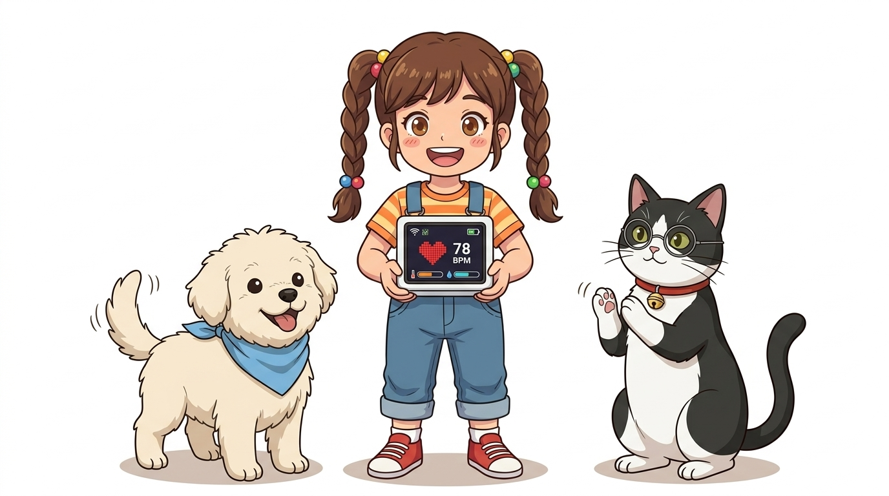

# 079_SSD1306_OLED디스플레이_128x64그래픽과_아이콘위젯 📺🖼️


**도로시와 지니가 함께하는 초고해상도 0.96인치 I2C OLED 그래픽 렌더링과 스마트 미니 대시보드 제작**
* 👧 **도로시**: "지니야! 1602 LCD는 둔탁하고 알파벳이랑 숫자만 겨우 나왔는데, 스마트 워치처럼 귀여운 캐릭터 얼굴도 띄우고 부드러운 게이지 바(Bar)도 그릴 수 있는 화면은 없을까?"
* 🐱 **지니**: "그게 바로 메이커들의 감성을 자극하는 **0.96인치 I2C OLED (SSD1306)** 란다! 백라이트 없이 스스로 빛을 내는 128x64개의 미세한 도트로 비트맵 그래픽, 차트, 아이콘을 선명하게 그려낼 수 있지!"
* 🐶 **토토**: "바우! 내 얼굴도 화면에 쏙 집어넣을 수 있다 멍!"
* 📖 **상세 강의 교재**: [index.md](./index.md)


> 여러분 안녕하세요! 이번 시간에는 '079. SSD1306 OLED디스플레이 128x64그래픽과 아이콘위젯 📺🖼️'을 주제로 함께 흥미진진한 탐험을 떠나보겠습니다. 오늘 강의에서는 특히 도로시와 지니가 함께하는 초고해상도 0.96인치 I2C OLED 그래픽 렌더링과 스마트 미니 대시보드 제작, 👧 도로시: "지니야! 1602 LCD는 둔탁하고 알파벳이랑 숫자만 겨우 나왔는데, 스마트 워치처럼 귀여운 캐릭터 얼굴도 띄우고 부드러운 게이지 바(Bar)도 그릴 수 있는 화면은 없을까?"를 중심으로 핵심 원리와 응용 방법을 차근차근 배워보겠습니다. 마법 멘토 지니와 호기심 많은 탐험가 도로시, 그리고 귀여운 토토와 함께 신나는 아두이노 모험을 힘차게 시작해 봅시다. 준비되셨나요?

---

## 1. 0.96인치 I2C OLED 디스플레이의 특징



| 구분 | 1602 문자 LCD | 0.96인치 그래픽 OLED (SSD1306) |
| :--- | :--- | :--- |
| **화면 방식** | 수동형 액정 + 백라이트 필수 | **유기 발광 다이오드 (자발광, Self-lit)** |
| **해상도** | 16글자 x 2줄 (고정 폰트 블록) | **가로 128픽셀 x 세로 64픽셀 (총 8,192 도트)** |
| **명암비 및 시야각** | 시야각 좁음, 콘트라스트 조정 필요 | **압도적인 칠흑 같은 블랙, 160도 광시야각** |
| **통신 방식** | 병렬(16핀) 또는 I2C 변환(4핀) | **I2C 단 4가닥 선 (VCC, GND, SCL, SDA)** |
| **소비 전력** | 백라이트로 인해 비교적 큼 | **픽셀이 켜진 부분만 전기를 먹어 초절전!** |

> 이번에 살펴볼 내용은 '1. 0.96인치 I2C OLED 디스플레이의 특징'입니다. 슬라이드에 정리된 표를 통해 각 항목의 특징과 수치, 차이점을 한눈에 비교해 보실 수 있습니다. 이 기본 개념을 확실히 잡아두셔야 실제 부품을 브레드보드에 꽂고 코딩할 때 실수 없이 완성할 수 있습니다.

---
## 2. 하드웨어 배선 가이드 (I2C 4핀 인터페이스)




* [!NOTE]
* SSD1306 모듈의 기본 I2C 주소는 대부분 **`0x3C`** 입니다. (일부 제품 뒷면 점퍼 저항 위치에 따라 `0x3D`일 수 있습니다.)

```
      [ 아두이노 우노 ]                 [ 0.96인치 OLED SSD1306 ]
      ──────────────────────────────────────────────────────────
      5V (또는 3.3V) ────────────────▶ VCC (전원 3.3V ~ 5V 호환)
      GND            ────────────────▶ GND (접지)
      A5 (SCL)       ────────────────▶ SCL (I2C 클록 라인)
      A4 (SDA)       ────────────────▶ SDA (I2C 데이터 라인)
```

> 이번 슬라이드에서는 '2. 하드웨어 배선 가이드 (I2C 4핀 인터페이스)'에 대한 실제 동작 코드를 분석해 보겠습니다. 화면의 코드를 살펴보시면, 컴퓨터가 아두이노 하드웨어에 단계별로 명령을 내리는 흐름을 명확하게 확인할 수 있습니다. 각 함수의 역할과 괄호 안의 매개변수가 하드웨어 핀과 어떤 관계를 맺고 동작하는지 주의 깊게 살펴보시기 바랍니다.
---
## 3. 라이브러리 설치와 디스플레이 버퍼(Frame Buffer)




* [!IMPORTANT]
* 화면에 그림을 그리는 함수(`drawPixel`, `print`, `drawRect`)를 호출한 뒤에는 반드시 **`display.display();`** 를 실행해야 내부 버퍼의 그림이 실제 OLED 화면으로 일괄 전송되어 눈에 보입니다!

1. **`Adafruit GFX Library`** (점, 선, 원, 글꼴 등 그래픽 코어 엔진)
2. **`Adafruit SSD1306`** (SSD1306 하드웨어 드라이버)

아두이노 IDE [라이브러리 관리자]에서 아래 2개의 핵심 라이브러리를 설치합니다:

```
 [ 아두이노 SRAM 메모리 ]                      [ 실제 OLED 화면 ]
 ┌───────────────────────────┐                 ┌───────────────────────────┐
 │ 128 x 64 비트 그래픽 버퍼 │  display.display()  │ 128 x 64 화소 픽셀 배열   │
 │ (메모리 1,024바이트 소모) │ ──────────────▶ │ 선명한 그래픽 실시간 표시 │
 └───────────────────────────┘ (I2C 일괄 전송) └───────────────────────────┘
```

> 이번 슬라이드에서는 '3. 라이브러리 설치와 디스플레이 버퍼(Frame Buffer)'에 대한 실제 동작 코드를 분석해 보겠습니다. 화면의 코드를 살펴보시면, 컴퓨터가 아두이노 하드웨어에 단계별로 명령을 내리는 흐름을 명확하게 확인할 수 있습니다. 여기서 핵심은 Adafruit GFX Library (점, 선, 원, 글꼴 등 그래픽 코어 엔진)입니다. 각 함수의 역할과 괄호 안의 매개변수가 하드웨어 핀과 어떤 관계를 맺고 동작하는지 주의 깊게 살펴보시기 바랍니다.
---
## 4. 실습 1: 텍스트 크기, 기하학 도형 및 게이지 바 그리기




```cpp
#include <Wire.h>
#include <Adafruit_GFX.h>
#include <Adafruit_SSD1306.h>

#define SCREEN_WIDTH 128
#define SCREEN_HEIGHT 64

// I2C 통신 기반 SSD1306 객체 선언 (-1은 리셋 핀 없음 의미)
Adafruit_SSD1306 display(SCREEN_WIDTH, SCREEN_HEIGHT, &Wire, -1);

void setup() {
  // 0x3C 주소로 초기화 실패 시 무한 루프
  if(!display.begin(SSD1306_SWITCHCAPVCC, 0x3C)) {
    while(true);
  }

  display.clearDisplay();      // 화면 깨끗이 지우기
  display.setTextColor(WHITE); // 흰색(점등) 텍스트

  // 1. 헤더 타이틀 출력
  display.setTextSize(1);
  display.setCursor(18, 5);
  display.println("SMART MAKER LAB");

  // 2. 가로 구분선 그리기
  display.drawFastHLine(0, 18, 128, WHITE);

  // 3. 둥근 모서리 박스와 프로그레스 바 외곽선
  display.drawRoundRect(10, 26, 108, 14, 3, WHITE);

  // 4. 게이지 바 70% 채우기 (가로 폭 70px)
  display.fillRoundRect(12, 28, 70, 10, 2, WHITE);

  // 5. 하단 수치 텍스트
  display.setTextSize(2);
  display.setCursor(35, 46);
  display.print("70 %");

  // 버퍼 내용을 화면에 렌더링!
  display.display();
}

void loop() {}
```

> 이번 슬라이드에서는 '4. 실습 1: 텍스트 크기, 기하학 도형 및 게이지 바 그리기'에 대한 실제 동작 코드를 분석해 보겠습니다. 화면의 코드를 살펴보시면, 컴퓨터가 아두이노 하드웨어에 단계별로 명령을 내리는 흐름을 명확하게 확인할 수 있습니다. 각 함수의 역할과 괄호 안의 매개변수가 하드웨어 핀과 어떤 관계를 맺고 동작하는지 주의 깊게 살펴보시기 바랍니다.
---
## 5. 실습 2: 실시간 온습도 계측 대시보드와 하트 비트맵 아이콘




16x16 픽셀 크기의 귀여운 비트맵 아이콘 데이터를 메모리에 저장하고 센서 값에 따라 게이지가 움직이는 완성형 대시보드를 만듭니다.

```cpp
#include <Wire.h>
#include <Adafruit_GFX.h>
#include <Adafruit_SSD1306.h>

Adafruit_SSD1306 display(128, 64, &Wire, -1);

// 16x16 픽셀 하트 비트맵 아이콘 데이터
const unsigned char PROGMEM heart_icon[] = {
  0x00, 0x00, 0x0e, 0x70, 0x1f, 0xf8, 0x3f, 0xfc,
  0x7f, 0xfe, 0x7f, 0xfe, 0x7f, 0xfe, 0x3f, 0xfc,
  0x1f, 0xf8, 0x0f, 0xf0, 0x07, 0xe0, 0x03, 0xc0,
  0x01, 0x80, 0x00, 0x00, 0x00, 0x00, 0x00, 0x00
};

void setup() {
  display.begin(SSD1306_SWITCHCAPVCC, 0x3C);
}

void loop() {
  // 가상의 온습도 데이터 (실제 실습 시 DHT11 또는 TMP36 연결)
  float temp = 24.5;
  int humidity = 58;

  display.clearDisplay();

  // 하트 아이콘 표시 (X=5, Y=4)
  display.drawBitmap(5, 4, heart_icon, 16, 16, WHITE);

  display.setTextSize(1);
  display.setCursor(26, 8);
  display.print("DOROTHY IOT");

  display.drawFastHLine(0, 22, 128, WHITE);

  // 온도 표시
  display.setCursor(5, 28);
  display.print("TEMP : ");
  display.setTextSize(2);
  display.setCursor(50, 25);
  display.print(temp, 1);
  display.setTextSize(1);
  display.print(" C");

  // 습도 표시 & 게이지 바
  display.setCursor(5, 48);
  display.print("HUMI : ");
  display.print(humidity);
  display.print("%");
  
  // 습도 게이지 바 (0~100% -> 가로 50픽셀)
  int barWidth = map(humidity, 0, 100, 0, 50);
  display.drawRect(70, 48, 52, 10, WHITE);
  display.fillRect(71, 49, barWidth, 8, WHITE);

  display.display();
  delay(1000);
}
```

> 이번 슬라이드에서는 '5. 실습 2: 실시간 온습도 계측 대시보드와 하트 비트맵 아이콘'에 대한 실제 동작 코드를 분석해 보겠습니다. 화면의 코드를 살펴보시면, 컴퓨터가 아두이노 하드웨어에 단계별로 명령을 내리는 흐름을 명확하게 확인할 수 있습니다. 각 함수의 역할과 괄호 안의 매개변수가 하드웨어 핀과 어떤 관계를 맺고 동작하는지 주의 깊게 살펴보시기 바랍니다.
---

## 🌟 도로시와 지니의 핵심 요약 노트!


* 👧 **도로시**: "비트맵 하트 아이콘이랑 게이지 바가 작고 선명한 검은 화면 위에 반짝이니까 진짜 스마트 워치 화면 같아!"
* 🐱 **지니**: "맞아! I2C 핀 단 2개만으로 128x64 도트를 마음껏 그릴 수 있어 IoT 디바이스의 얼굴로 가장 적합하단다. `display.display()` 호출을 잊지 않는 것이 포인트야!"
* 🐶 **토토**: "바우! 이제 모터 구동 파트의 안전 심장인 **'080_직류전원공급기_파워서플라이와_외부전원'**으로 달려가보자 멍!"

> 오늘 배운 '🌟 도로시와 지니의 핵심 요약 노트!'의 핵심 내용을 모두 정리해 보았습니다. 오늘 다룬 내용 중에서도 👧 도로시: "비트맵 하트 아이콘이랑 게이지 바가 작고 선명한 검은 화면 위에 반짝이니까 진짜 스마트 워치 화면 같아!" 부분은 앞으로의 아두이노 실습과 프로젝트에서 계속 사용되는 매우 중요한 기초 지식입니다. 오늘 배운 내용을 꼭 다시 한번 복습해 보시고, 다음 강의에서 더욱 신나고 유익한 모험으로 다시 만나겠습니다. 모두 수고 많으셨습니다!