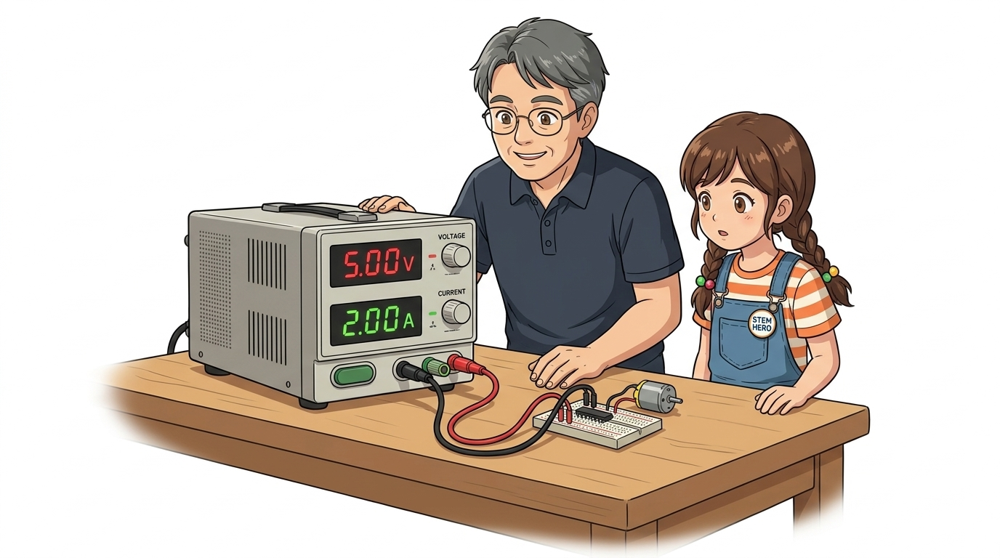
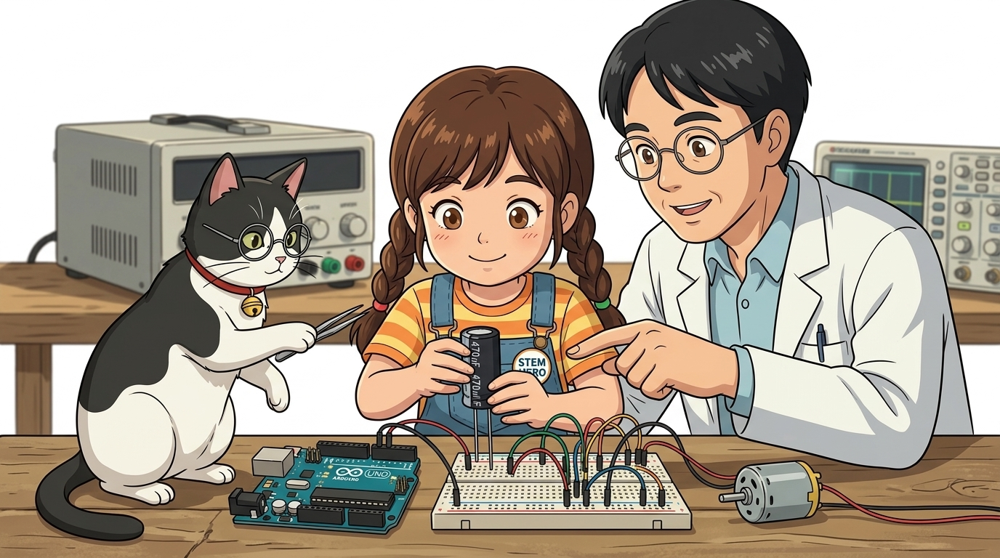
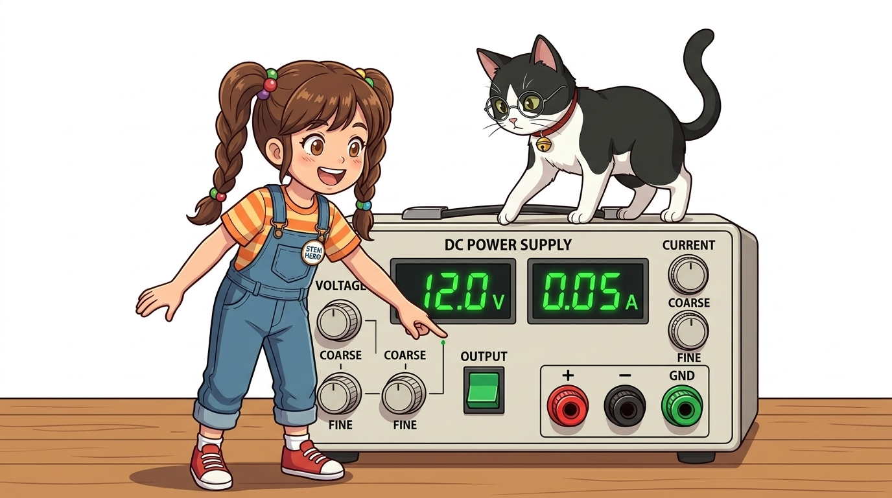
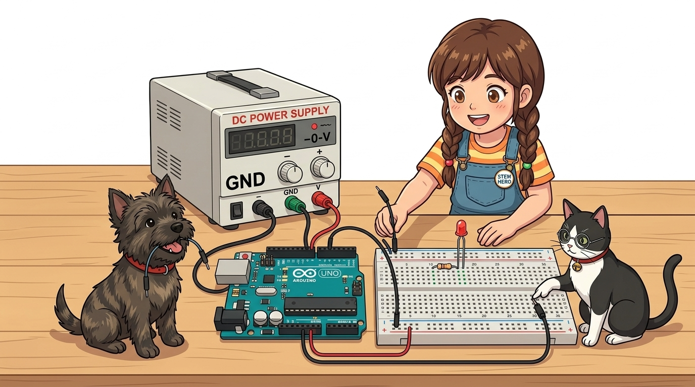

# 080_직류전원공급기_파워서플라이와_외부전원 ⚡🔋



**도로시와 지니가 함께하는 벤치탑 DC 파워서플라이 조작법과 브라운아웃 방지 외부 전원 설계**
* 👧 **도로시**: "지니야! 모터를 2개 연결했더니 아두이노가 갑자기 혼자서 자꾸 꺼졌다 켜져! 귀신이 곡할 노릇이야!"
* 🐱 **지니**: "그건 모터가 전기를 너무 많이 먹어서 아두이노가 기절하는 **브라운아웃(Brown-out)** 현상이란다! 이럴 땐 강력하고 안전한 외부 발전소, **DC 파워서플라이**를 투입해야 해!"
* 🐶 **토토**: "바우! 전압과 전류를 마음대로 뿜어내는 마법 상자다 멍!"
* 📖 **상세 강의 교재**: [index.md](./index.md)


> 여러분 안녕하세요! 이번 시간에는 '080. 직류전원공급기 파워서플라이와 외부전원 ⚡🔋'을 주제로 함께 흥미진진한 탐험을 떠나보겠습니다. 오늘 강의에서는 특히 도로시와 지니가 함께하는 벤치탑 DC 파워서플라이 조작법과 브라운아웃 방지 외부 전원 설계, 👧 도로시: "지니야! 모터를 2개 연결했더니 아두이노가 갑자기 혼자서 자꾸 꺼졌다 켜져! 귀신이 곡할 노릇이야!"를 중심으로 핵심 원리와 응용 방법을 차근차근 배워보겠습니다. 마법 멘토 지니와 호기심 많은 탐험가 도로시, 그리고 귀여운 토토와 함께 신나는 아두이노 모험을 힘차게 시작해 봅시다. 준비되셨나요?

---

## 1. 아두이노 보드 전원만으로 모터를 돌리면 안 되는 이유



1. **USB 포트의 한계**: 컴퓨터의 USB 2.0 포트는 최대 **500mA(0.5A)** 까지만 전기를 내어줍니다.
2. **모터의 돌입 전류(Inrush Current)**: 정지해 있던 DC 모터나 서보 모터가 회전을 시작하는 찰나의 순간, 평상시의 3~5배에 달하는 **1A~2A** 이상의 전류를 폭발적으로 빨아들입니다.
3. **전압 강하(Voltage Drop)**: 아두이노 5V 라인 전압이 3V 이하로 곤두박질치면서, 아두이노 내부의 저전압 감지 회로(BOD)가 작동하여 칩을 강제로 재부팅(Reset)시킵니다.
4. **결론**: **모터, 릴레이, 고휘도 LED 매트릭스 등 전기를 많이 먹는 액추에이터는 반드시 독립된 외부 전원(External Power)을 공급해야 합니다!**

초보 메이커들이 가장 흔하게 겪는 미스터리 고장이 바로 모터 동작 중 아두이노의 무한 재부팅입니다.
### ⚠️ 전류 부족과 브라운아웃(Brown-out Reset)

> 이번 슬라이드에서는 '1. 아두이노 보드 전원만으로 모터를 돌리면 안 되는 이유'에 대해 자세히 살펴보겠습니다. 화면의 다이어그램과 사진을 함께 참고해 주시기 바랍니다. 첫 번째 핵심은 USB 포트의 한계: 컴퓨터의 USB 2.0 포트는 최대 500mA(0.5A) 까지만 전기를 내어줍니다.이며, 두 번째로는 모터의 돌입 전류(Inrush Current): 정지해 있던 DC 모터나 서보 모터가 회전을 시작하는 찰나의 순간, 평상시의 3~5배에 달하는 1A~2A 이상의 전류를 폭발적으로 빨아들입니다.입니다. 여기에 덧붙여 전압 강하(Voltage Drop): 아두이노 5V 라인 전압이 3V 이하로 곤두박질치면서, 아두이노 내부의 저전압 감지 회로(BOD)가 작동하여 칩을 강제로 재부팅(Reset)시킵니다. 내용까지 함께 이해해 두시면 완벽합니다. 이 원리는 아두이노 시스템 전체를 관통하는 핵심 논리이므로 머릿속에 꼭 정리해 두시기 바랍니다.

---
## 2. 벤치탑 DC 파워서플라이 전면부 구조




```
 ┌────────────────────────────────────────────────────────┐
 │  [ 5.00 V ]          [ 1.50 A ]                        │ ➔ 전압(V) / 전류(A) 표시창
 │  (CV 녹색등)         (CC 적색등)                       │
 ├────────────────────────────────────────────────────────┤
 │  [ VOLTAGE 다이얼 ]  [ CURRENT 다이얼 ]   [ OUTPUT ]   │ ➔ 전압 / 전류 미세 조절 노브
 ├────────────────────────────────────────────────────────┤
 │      (+) 빨강              (-) 검정          (GND) 초록│ ➔ 출력 바나나 플러그 단자
 └────────────────────────────────────────────────────────┘
```

> 이번 슬라이드에서는 '2. 벤치탑 DC 파워서플라이 전면부 구조'에 대한 실제 동작 코드를 분석해 보겠습니다. 화면의 코드를 살펴보시면, 컴퓨터가 아두이노 하드웨어에 단계별로 명령을 내리는 흐름을 명확하게 확인할 수 있습니다. 각 함수의 역할과 괄호 안의 매개변수가 하드웨어 핀과 어떤 관계를 맺고 동작하는지 주의 깊게 살펴보시기 바랍니다.
---
## 3. 정전압(CV)과 정전류(CC) 모드의 마법


1. 전원 스위치를 켜고, 전압 노브를 `1V` 정도로 낮춥니다.
2. 출력 단자의 **빨간색(+)과 검정색(-) 단자를 집게 전선으로 쇼트(합선)** 시킵니다.
3. 파워서플라이가 `CC (적색등)` 모드로 전환되면, **CURRENT 다이얼을 돌려 안전 전류 한계(예: 0.50A)** 로 맞춥니다.
4. 집게 쇼트를 풀면 다시 `CV (녹색등)` 모드로 돌아옵니다. 이제 원하는 시험 전압(예: `5.00V`)을 맞추고 회로에 연결합니다!
*(이제 회로에 쇼트가 나도 전류가 0.5A에서 칼같이 제한되어 안전합니다!)*

| 동작 모드 | 표시등 | 핵심 원리 및 작동 방식 |
| :--- | :---: | :--- |
| **CV (정전압, Constant Voltage)** | **녹색등** | 사용자가 설정한 전압(예: 5.00V)을 고정 유지하고, 회로가 요구하는 만큼 전류를 공급 (일반적인 회로 시험 모드) |
| **CC (정전류, Constant Current)** | **적색등** | 회로가 설정한 전류 한계치(예: 1.00A)를 넘어서려 할 때, 전압을 스스로 낮추어 전류가 넘치지 않게 강제 억제 (합선 보호 모드) |

파워서플라이에는 부품이 타버리는 것을 막아주는 마법의 2대 동작 모드가 내장되어 있습니다.
### 🛡️ 부품을 살리는 '전류 제한(Current Limit)' 세팅 4단계!
새로운 회로를 테스트할 때 실수로 전선을 잘못 꽂아 합선(Short)되더라도 부품이 불타지 않게 보호하는 엔지니어들의 불문율입니다:

> 이번에 살펴볼 내용은 '3. 정전압(CV)과 정전류(CC) 모드의 마법'입니다. 슬라이드에 정리된 표를 통해 각 항목의 특징과 수치, 차이점을 한눈에 비교해 보실 수 있습니다. 첫째로 전원 스위치를 켜고, 전압 노브를 1V 정도로 낮춥니다.에 유의해야 하며, 둘째로 출력 단자의 빨간색(+)과 검정색(-) 단자를 집게 전선으로 쇼트(합선) 시킵니다.라는 점이 핵심입니다. 이 기본 개념을 확실히 잡아두셔야 실제 부품을 브레드보드에 꽂고 코딩할 때 실수 없이 완성할 수 있습니다.
---

## 4. 외부 전원 연결과 공통 접지(Common Ground)의 절대 원칙



* [!CAUTION]
* **왜 접지(GND)를 하나로 묶어야 할까?**:
* 아두이노가 D9번 핀으로 "모터 돌아라! (5V HIGH)" 신호를 보내도, 모터 드라이버 입장에서 "기준 0V(GND)"가 아두이노와 이어져 있지 않으면 그 신호가 몇 볼트인지 알 수 없습니다. 전원(+)은 분리하더라도, **GND(-)는 반드시 전선 하나로 단단히 연결**해야 오작동이 없습니다!

아두이노와 외부 파워서플라이를 연결할 때 전 세계 모든 메이커가 반드시 지켜야 하는 단 하나의 철칙입니다:

```
 [ 아두이노 보드 ]                             [ 외부 DC 파워서플라이 ]
 ────────────────────────────────────────────────────────────────────────────
 D9 (모터 신호선) ──────▶ [ L298N 모터 드라이버 IN1 ]
                        [ L298N VCC (+12V) ] ◀────── (+) 12V 전원 출력
                        [ L298N GND (-)    ] ◀────── (-) 0V 전원 접지
                              │                            │
                              └─────────────┬──────────────┘
                                            │
 GND 핀 ────────────────────────────────────┘ (★ 공통 접지 Common GND 연결 필수!)
```

> 이번 슬라이드에서는 '4. 외부 전원 연결과 공통 접지(Common Ground)의 절대 원칙'에 대한 실제 동작 코드를 분석해 보겠습니다. 화면의 코드를 살펴보시면, 컴퓨터가 아두이노 하드웨어에 단계별로 명령을 내리는 흐름을 명확하게 확인할 수 있습니다. 각 함수의 역할과 괄호 안의 매개변수가 하드웨어 핀과 어떤 관계를 맺고 동작하는지 주의 깊게 살펴보시기 바랍니다.

---

## 🌟 도로시와 지니의 핵심 요약 노트!


* 👧 **도로시**: "모터처럼 힘센 장치는 아두이노 전원을 쓰지 않고 독립된 파워서플라이로 전기를 주고, GND는 꼭 하나로 묶어야 하는구나!"
* 🐱 **지니**: "훌륭해! 그리고 전류 제한(Current Limit)을 미리 걸어두면 실수로 합선이 일어나도 연기 날 걱정 없이 안전하게 실험할 수 있단다."
* 🐶 **토토**: "바우! 이제 든든한 외부 전원을 준비했으니 강력한 힘으로 세상을 움직이는 **'079_모터란_전기운동변환'**으로 달려가보자 멍!"

> 오늘 배운 '🌟 도로시와 지니의 핵심 요약 노트!'의 핵심 내용을 모두 정리해 보았습니다. 오늘 다룬 내용 중에서도 👧 도로시: "모터처럼 힘센 장치는 아두이노 전원을 쓰지 않고 독립된 파워서플라이로 전기를 주고, GND는 꼭 하나로 묶어야 하는구나!" 부분은 앞으로의 아두이노 실습과 프로젝트에서 계속 사용되는 매우 중요한 기초 지식입니다. 오늘 배운 내용을 꼭 다시 한번 복습해 보시고, 다음 강의에서 더욱 신나고 유익한 모험으로 다시 만나겠습니다. 모두 수고 많으셨습니다!