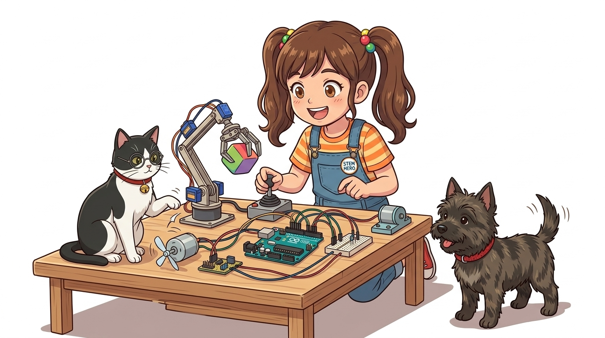
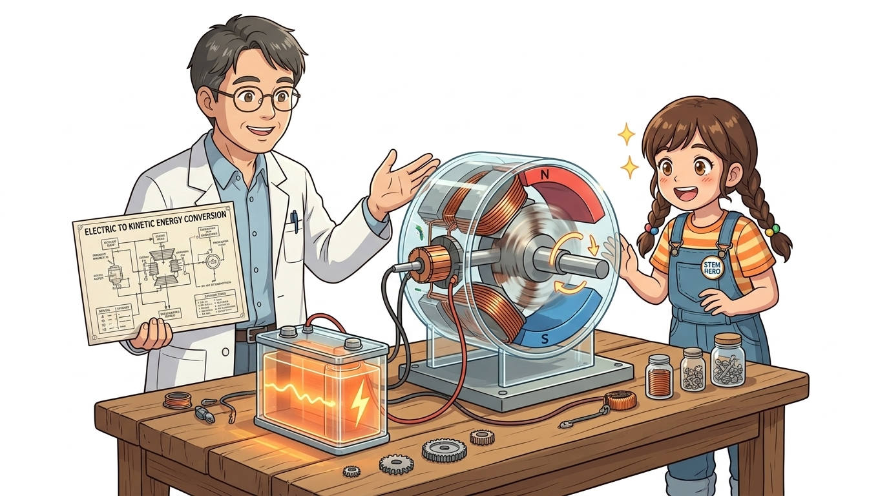
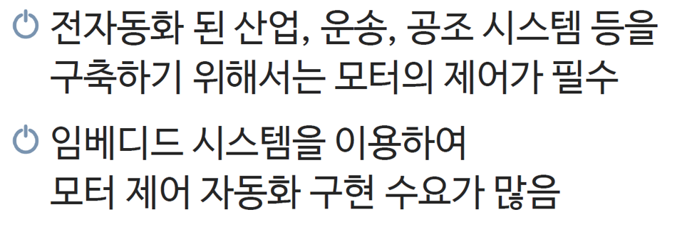
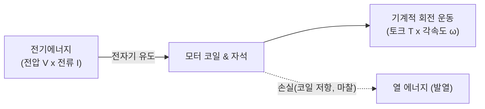
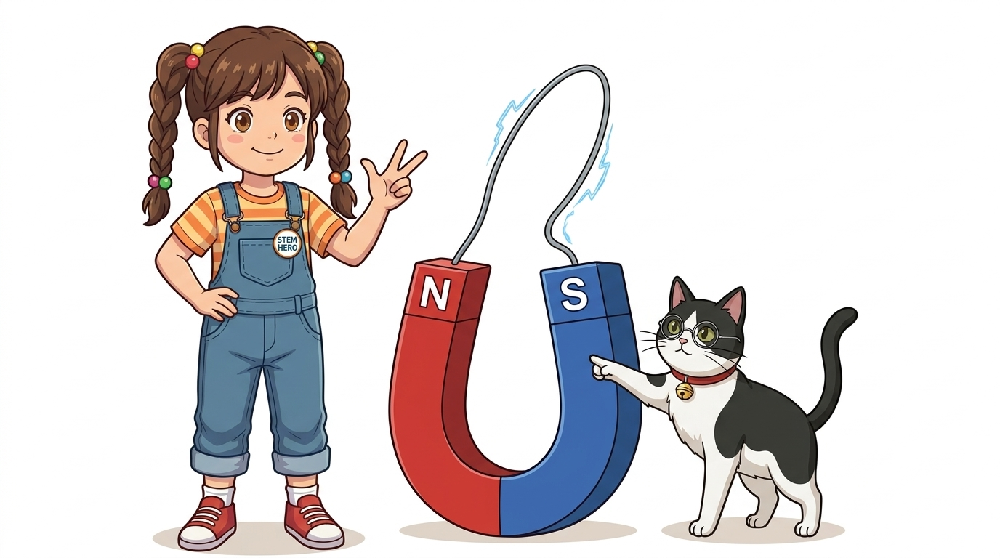
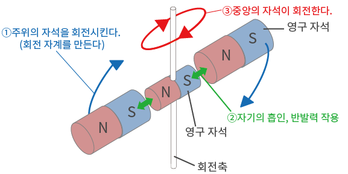
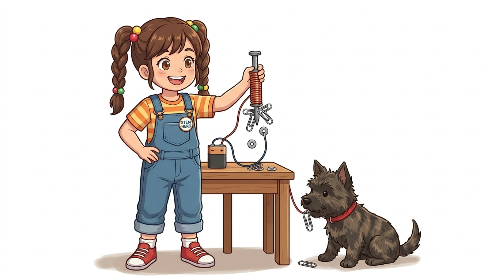
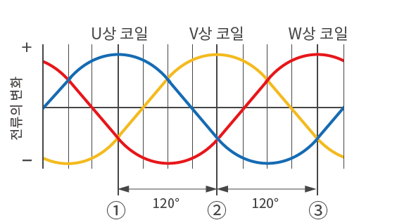
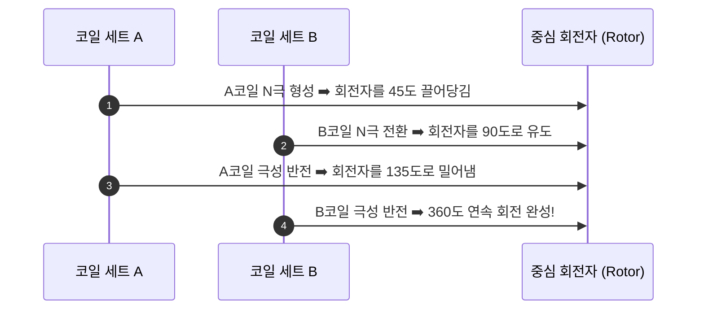
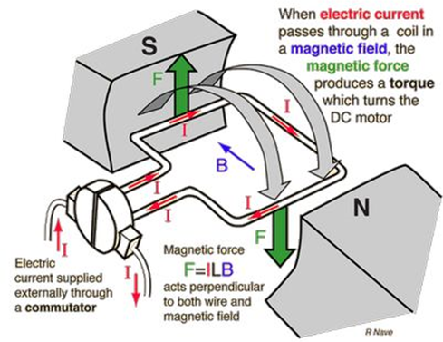

# 081_모터란_전기운동변환 ⚙️🔄



**도로시와 지니가 함께하는 아두이노 모터 기초 교실**

* 👧 **도로시**: "지니야! 지금까지는 LED를 켜고 부저 소리를 내는 것만 해봤는데, 이제 진짜 로봇처럼 팔을 흔들고 바퀴를 굴려 앞으로 달리게 만들고 싶어!"
* 🐱 **지니**: "그게 바로 로봇의 뼈와 근육을 움직이는 **모터(Motor, 전동기)** 야! 전기를 넣어주면 강력한 힘으로 축을 씽씽 돌리는 핵심 부품이란다!"
* 🐶 **토토**: "바우! 장난감 자동차 바퀴가 굴러가듯 회전의 세계로 떠나보자 멍!"

* 🖥️ **강의 슬라이드**: [slides.md](./slides.md)

---

## 1. 도로시의 로봇 제작 프로젝트 로드맵


### 🤖 전기 회로에서 물리적 움직임의 세계로!

지금까지 학습한 센서(Sensor)가 사람의 **감각 기관(눈, 귀, 피부)** 이었다면, 모터는 뇌(MCU)의 명령을 받아 실제 물리적 세상을 변화시키는 **액추에이터(Actuator, 근육과 팔다리)** 입니다.

| 로봇의 구성 요소 | 아두이노 시스템 대응 부품 | 인체 비유 | 역할과 기능 |
| :--- | :--- | :--- | :--- |
| **감각 기관** | 조도, 온도, 초음파, 적외선 센서 | 눈, 코, 귀, 피부 | 주변 환경의 물리량을 전기 신호로 감지 |
| **두뇌 (제어부)** | 아두이노 우노 (ATmega328P) | 뇌, 중추신경 | 센서 값을 연산하고 제어 알고리즘 실행 |
| **액추에이터** | **DC 모터, 서보모터, 스텝모터** | **팔, 다리, 근육** | **전기에너지를 물리적 기계 운동으로 변환** |

---

## 2. 모터(전동기, Electric Motor)의 정의



### ⚡ 전기에너지를 강력한 회전 기계에너지로 변환

모터는 전원(배터리나 전원 공급기)에서 공급되는 **전압과 전류를 기계적인 토크(Torque, 회전력)와 각속도로 바꾸어주는 에너지 변환 장치**입니다.

* **현대 문명의 원동력**:
  * 전 세계 발전소에서 생산되는 전체 전력의 **약 50% 이상**이 다양한 산업용/가정용 모터를 돌리는 데 소모되고 있습니다.
* **생활 속의 모터들**:
  * 선풍기, 드라이기, 세탁기 드럼, 청소기 흡입팬
  * 스마트폰의 햅틱 진동 모터
  * 전기차(EV) 구동 트랙션 모터, 드론의 고속 브러시리스 모터, 3D 프린터의 정밀 모터

---

## 3. 에너지 변환 메커니즘과 효율



### 🔋 전기 입력과 기계 출력 사이의 관계

모터가 회전할 때는 단순한 회전뿐만 아니라 다양한 물리 법칙이 작용합니다.



* **입력 전력**: $P_{in} = V \times I$ (단위: 와트, W)
* **출력 일률**: $P_{out} = T \times \omega$ (토크 $\times$ 각속도)
* **효율**: 입력된 전기가 회전력으로 바뀌며 일부는 코일 저항에 의해 열로 변환되므로, 과부하가 걸리지 않도록 적절한 구동 드라이버 회로가 필수적입니다.

---

## 4. 모터 회전의 물리 법칙: 플레밍의 왼손 법칙



### 🖐️ FBI 법칙으로 기억하는 전자기력의 방향

자석이 만드는 자기장(Magnetic Field) 속에 놓인 도선에 전기가 흐르면, 전선은 자기장의 힘을 받아 밀려납니다. 이 힘을 **로런츠 힘(Lorentz Force)** 또는 전자기력이라고 부릅니다.

* **엄지손가락 (F, Force - 힘)**:
  * 도선이 힘을 받아 밀려나는 **운동 방향**!
* **검지손가락 (B, Magnetic Field - 자기장)**:
  * 자석의 **N극에서 S극으로** 흐르는 보이지 않는 자기력선의 방향!
* **중지손가락 (I, Current - 전류)**:
  * 도선 속에서 **(+)극에서 (-)극으로** 흐르는 전류의 방향!

> [!NOTE]
> 엄지, 검지, 중지를 서로 직각(90도)으로 펼치고, 검지를 N $\to$ S 방향, 중지를 전류 방향에 맞추면 엄지가 가리키는 방향이 바로 모터가 힘차게 회전하는 방향입니다.

---

## 5. 자석의 인력(끌어당김)과 척력(밀어냄)



### 🧲 밀고 당기는 힘이 회전 토크를 만든다

자석은 같은 극끼리는 서로 밀어내고, 다른 극끼리는 서로 달라붙으려 합니다.

```mermaid
graph LR
    subgraph 척력 (Repulsion)
        N1["N극"] <-.->|"강하게 밀어냄"| N2["N극"]
    end
    subgraph 인력 (Attraction)
        N3["N극"] --->|"강하게 끌어당김"| S1["S극"]
    end
```

1. **고정자(Stator)**: 바깥쪽에 단단히 고정된 자석 틀
2. **회전자(Rotor)**: 가운데 축에 매달려 빙글빙글 돌 수 있는 자석/코일 축
3. 회전자가 180도 돌아 다른 극에 가까워졌을 때 전류 방향을 휙 반대로 바꾸어주면, 다시 척력이 발생하여 멈추지 않고 연속 회전하게 됩니다!

---

## 6. 전선 코일과 전자석의 원리



### 🌀 전기를 흘려주면 강력한 자석으로 변신!

진짜 모터 속에는 단순한 막대자석이 아니라, 원통 모양의 규소강판 철심에 구리선(에나멜선)을 수백 바퀴 감은 **코일(전자석)** 이 들어있습니다.

* **앙페르의 오른나사 법칙**:
  * 코일에 전류를 흘리면 주위에 강력한 자기장이 유도되어 한쪽 끝은 N극, 반대쪽 끝은 S극이 됩니다.
* **철심(Iron Core)의 마법**:
  * 공기 중에 전선을 감는 것보다 쇳덩이(철심) 둘레에 전선을 감으면 자력의 밀도가 수백~수천 배 집중되어 거대한 회전 토크를 발휘합니다.

---

## 7. 연속 회전을 만드는 회전 자기장



### 🔄 자석이 뱅글뱅글 춤추듯 도는 원리

모터의 축이 멈추지 않고 매끄럽게 회전하기 위해서는 코일에 들어가는 전류의 방향과 타이밍을 주기적으로 스위칭해주어야 합니다.



* 기계식 접점(브러시와 정류자)을 사용하는 모터를 **DC 모터**라 부르고, 전자식 마이크로컨트롤러 회로로 코일을 직접 스위칭하는 모터를 **스텝모터** 및 **BLDC 모터**라고 부릅니다.

---

## 🌟 도로시와 지니의 모터 기초 교실 정리!



* 👧 **도로시**: "전기에너지가 자석과 코일의 밀고 당기는 힘(플레밍의 왼손 법칙)을 만나 씽씽 도는 기계 회전력으로 변하는 거였구나!"
* 🐱 **지니**: "완벽해! 모터는 로봇이 세상과 상호작용하는 첫걸음이란다."
* 🐶 **토토**: "바우! 다음 시간에는 DC 모터, 서보모터, 스텝모터의 특징과 차이점을 비교해보자 멍!"
