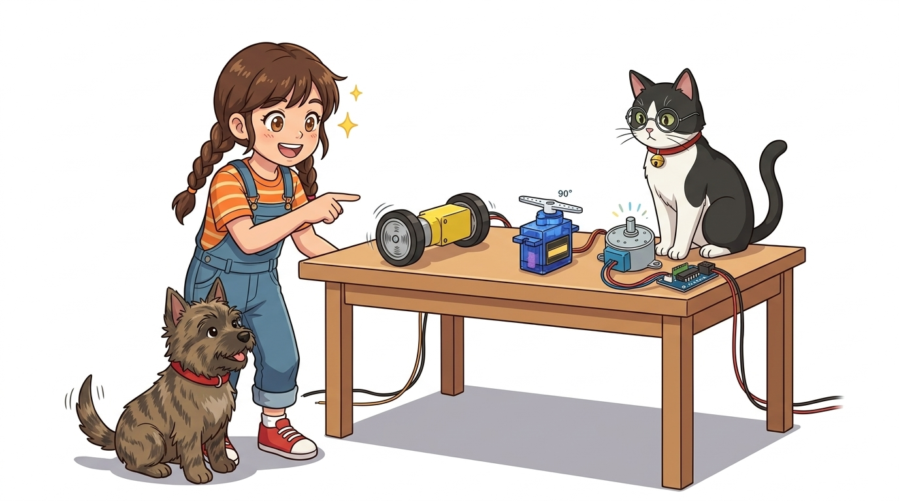
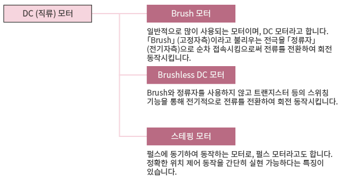
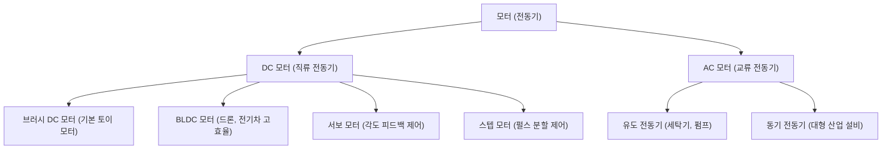
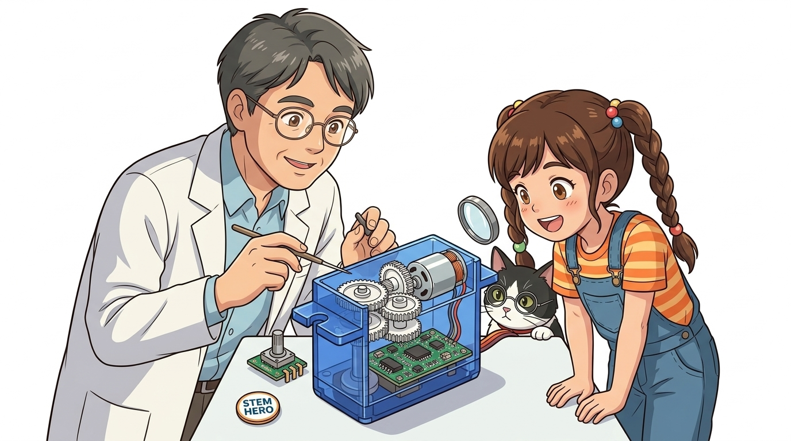
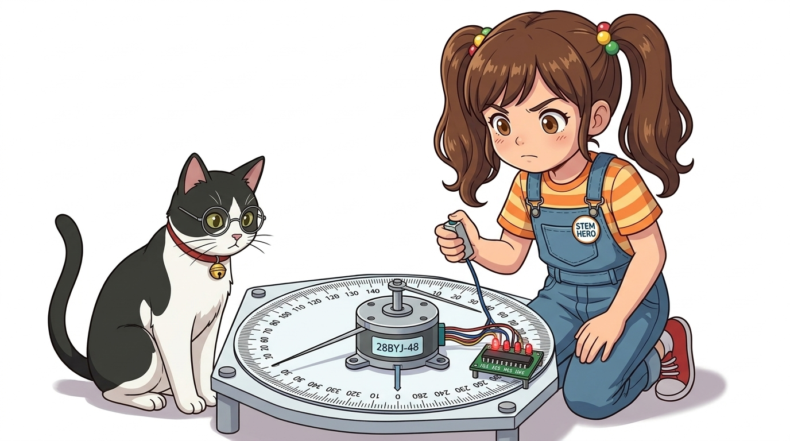

# 082_모터의종류와_특징 🦾🏎️

**도로시와 지니가 함께하는 용도별 모터 완벽 가이드**

* 👧 **도로시**: "지니야! RC 자동차 바퀴도 돌리고 싶고, 인형 머리도 까딱까딱하게 하고 싶은데, 모든 곳에 다 똑같은 모터를 쓰면 될까?"
* 🐱 **지니**: "아니란다! 모터마다 잘하는 특기가 완전히 달라! 쌩쌩 달리는 달리기 선수도 있고, 1도 오차도 없이 자리를 지키는 조각가 선수도 있지!"
* 🐶 **토토**: "바우! 강아지 꼬리처럼 흔들흔들 움직이는 모터도 있다 멍!"

* 🖥️ **강의 슬라이드**: [slides.md](./slides.md)

---

## 1. 도로시의 고민: 프로젝트에 맞는 최적의 모터는?

### 🎯 움직임의 목적에 따라 모터의 종류가 결정됩니다

우리가 만들려는 창작물의 움직임 특성에 맞추어 가장 적합한 모터를 선택해야 회로와 코딩이 단순해집니다.

| 만들고 싶은 동작 | 필요한 회전 특성 | 추천되는 모터 종류 |
| :--- | :--- | :--- |
| **자동차 바퀴, 드론 프로펠러, 선풍기** | 한 방향으로 빠르게 계속 쉼 없이 도는 회전 | **DC 모터 / BLDC 모터** |
| **로봇 팔 관절, 자동차 조향 핸들, 스마트 도어락** | 0° ~ 180° 사이에서 원하는 각도로 정확히 멈춤 | **서보모터 (Servo Motor)** |
| **3D 프린터 노즐 이동, 카메라 초점, 스캐너** | 미세한 단위(0.9°~1.8°)로 끊어서 정밀 위치 제어 | **스텝모터 (Stepper Motor)** |

---

## 2. 전원 공급 방식에 따른 대분류: DC 모터 vs AC 모터

### ⚡ 직류(DC) 전기를 쓰는가, 교류(AC) 전기를 쓰는가?

모터를 구동하는 전원의 성격에 따라 전자기적 구동 구조가 크게 달라집니다.

* **DC 모터 (Direct Current)**:
  * 배터리나 건전지, USB의 안정적인 직류(+/-) 전원으로 동작합니다. 아두이노 메이커 프로젝트의 99%는 DC 계열 모터를 사용합니다.
* **AC 모터 (Alternating Current)**:
  * 가정용 벽 콘센트(220V 60Hz)의 교류 전원을 사용하며 냉장고 컴프레서, 대형 세탁기, 엘리베이터 등에 사용됩니다.

---

## 3. 1. DC 모터: 쌩쌩 달리는 바퀴의 제왕!

### 🏎️ 전압만 넣어주면 쉬지 않고 도는 가장 대중적인 모터

DC 모터는 영구자석과 회전자 코일, 브러시로 구성되어 전원을 인가하면 즉시 최대 속도로 고속 회전합니다.

* **동작 원리**:
  * 모터 양단에 (+)와 (-) 전압을 가하면 시계 방향으로 회전하고, 극성을 반대로 뒤집으면 즉시 반시계 방향으로 역회전합니다.
* **장점**:
  * 구조가 간단하고 가격이 매우 저렴하며, 전압의 크기(PWM)로 회전 속도를 쉽게 조절할 수 있습니다.
* **단점**:
  * 내부 회전 관성 때문에 "정확히 90도 회전 후 정지"와 같은 위치 지정이 불가능합니다.

---

## 4. 2. 서보모터: 원하는 각도로 척척! 로봇의 관절

### 🦾 목표 각도를 스스로 측정하여 유지하는 똑똑한 모터

서보모터(Servo Motor)는 소형 DC 모터와 감속 기어박스, 가변저항(포텐쇼미터 위치 센서), 제어 PCB 회로가 하나의 케이스에 패키징된 통합 모듈입니다.

* **동작 범위**: 일반 RC용 소형 서보(SG90 등)는 주로 **0도에서 180도** 범위 내에서 움직입니다.
* **폐루프 제어 (Closed-Loop)**:
  * 외부에서 억지로 축을 비틀려고 해도 내부 센서가 각도 이탈을 감지하여 원래 각도를 고집스럽게 사수합니다.

---

## 5. 3. 스텝모터: 1도씩 딱딱 끊어 도는 시계침!

### 🖨️ 펄스 1개당 정해진 각도만큼 전진하는 초정밀 모터

스텝모터(Stepper Motor)는 회전자에 수많은 톱니 모양의 영구자석 극을 배치하고, 주변 전자석 코일에 펄스를 가해 1스텝씩 기계적으로 맞물리며 회전합니다.

* **스텝각 (Step Angle)**:
  * 펄스 신호 1번마다 정확히 정해진 각도(예: 5.625°/64 감속 시 약 0.088°)만큼 회전합니다.
* **오차 누적 없음 (No Cumulative Error)**:
  * 펄스를 준 횟수만큼 정확히 돌기 때문에 센서 없이도(개루프 제어) 정밀한 위치 제어가 가능합니다.
* **정지 토크 (Holding Torque)**:
  * 전원이 켜진 상태로 정지해 있을 때 코일이 자력을 꽉 쥐고 있어 외부 힘에 밀리지 않고 자리를 지킵니다.

---

## 6. 아두이노 3대 모터 완전 비교표

### 📊 엔지니어를 위한 모터 선택 기준표

| 항목 | DC 모터 | 서보모터 (SG90) | 스텝모터 (28BYJ-48) |
| :--- | :--- | :--- | :--- |
| **회전 형태** | 연속 무한 회전 | 제한 각도 회전 (0°~180°) | 스텝 단위 연속 회전 |
| **속도 제어** | PWM 듀티비로 전압 가변 | 내부 기어비에 의해 일정 | 펄스 공급 주파수로 제어 |
| **위치 제어** | 불가능 (엔코더 별도 필요) | 매우 뛰어남 (목표 각도 입력) | 극도로 정밀함 (펄스 카운팅) |
| **제어 핀 수** | 2개 (방향 및 속도) | **단 1개 (PWM 신호선)** | **4개 (IN1 ~ IN4)** |
| **구동 드라이버** | 모터 드라이버(L298N 등) 필수 | 아두이노 핀 직결 가능 | 드라이버 보드(ULN2003 등) 필수 |
| **대표적인 사용처** | RC카 구동 바퀴, 선풍기 | 로봇 관절, 조향 장치 | 3D 프린터, 정밀 스캐너 |

---

## 🌟 도로시와 지니의 핵심 요약 노트!

* 👧 **도로시**: "바퀴를 신나게 굴릴 땐 **DC 모터**, 로봇 팔을 원하는 각도로 굽힐 땐 **서보모터**, 3D 프린터 헤드를 정밀하게 옮길 땐 **스텝모터**를 고르면 되는구나!"
* 🐱 **지니**: "정답이야! 다음 시간에는 모터의 속도와 각도를 자유자재로 제어하는 핵심 디지털 신호인 **PWM**에 대해 알아보자!"
* 🐶 **토토**: "바우! PWM을 알면 모터뿐만 아니라 LED 밝기까지 마음대로 주무를 수 있다 멍!"
