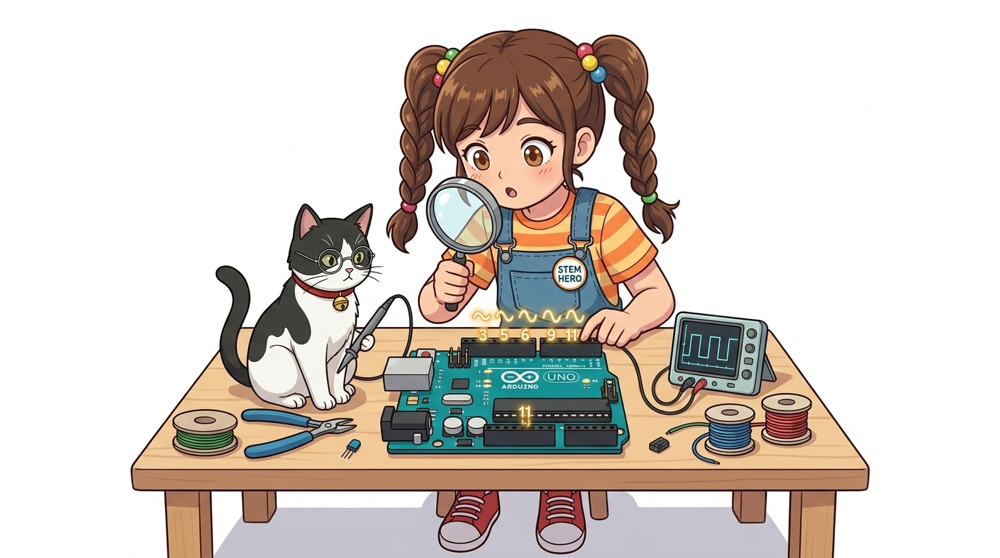
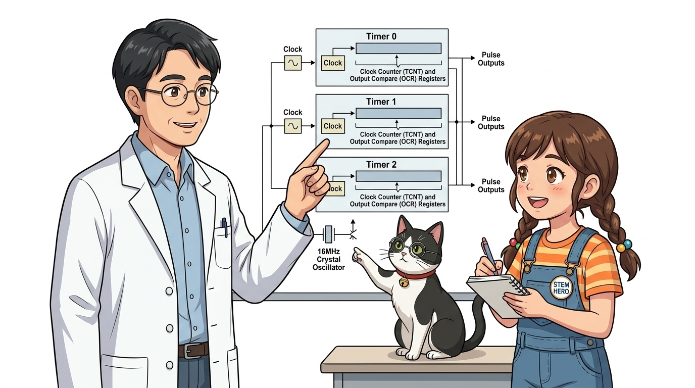
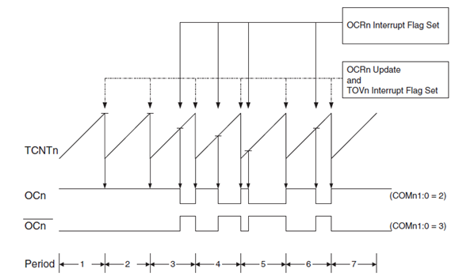
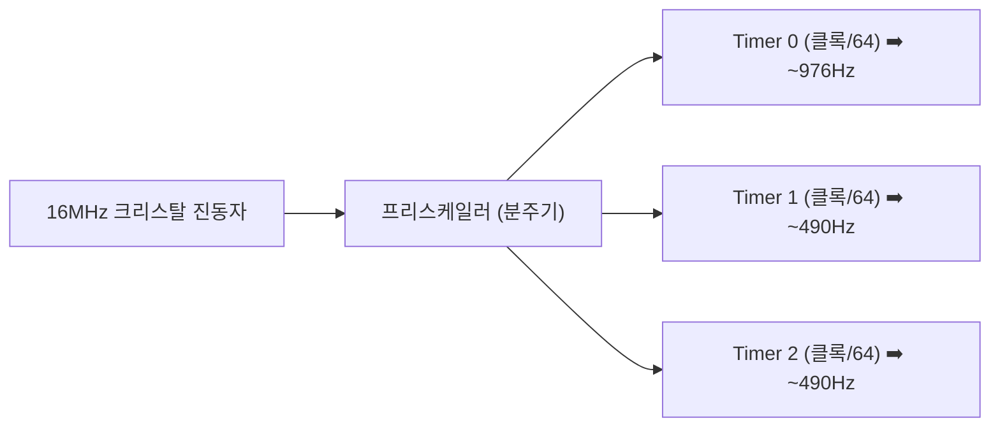
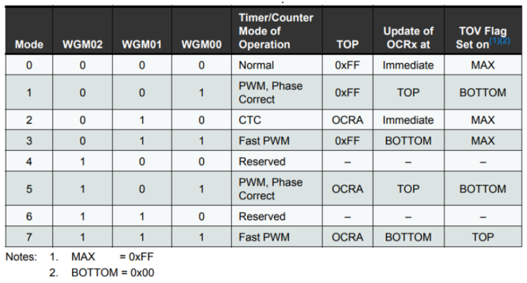
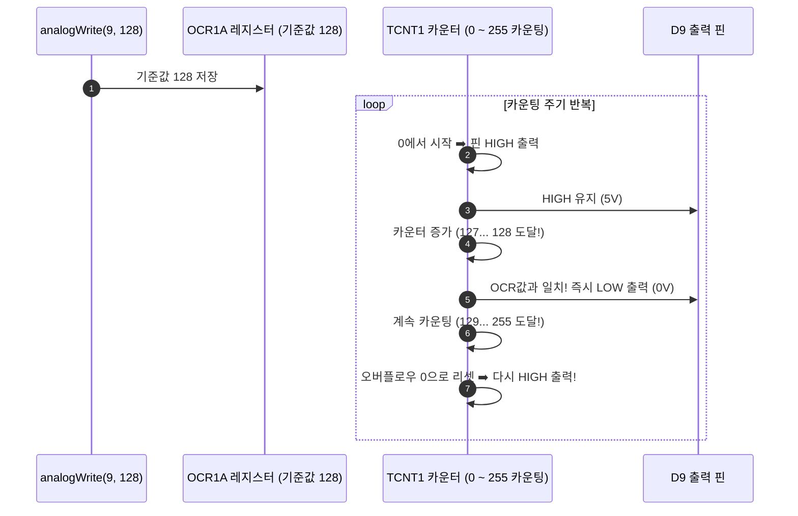
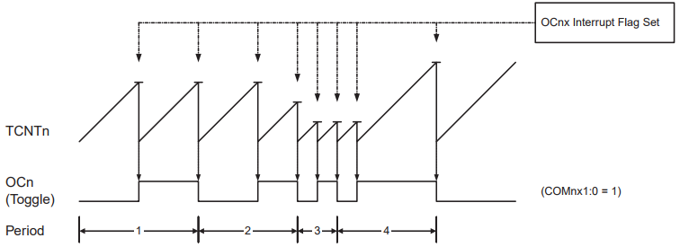

# 083_하드웨어PWM_타이머 ⏱️⚡

**도로시와 지니가 함께하는 물결표(~) 핀과 타이머 카운터 탐험**

* 👧 **도로시**: "지니야! 아두이노 우노의 디지털 핀 번호를 자세히 살펴보니 3, 5, 6, 9, 10, 11번 핀 옆에만 작은 물결표(`~`)가 새겨져 있어! 이건 무슨 뜻이야?"
* 🐱 **지니**: "아주 날카로운 관찰이야! 물결표(`~`)가 붙어 있는 핀은 CPU가 다른 코드를 실행하는 동안에도 독립적으로 초고속 펄스를 뿜어내는 **하드웨어 PWM(펄스 폭 변조) 전용 핀**이란다!"
* 🐶 **토토**: "바우! 아두이노 칩 속에 3개의 전용 시계가 숨어 있다 멍!"

* 🖥️ **강의 슬라이드**: [slides.md](./slides.md)

---

## 1. 물결표(~) 핀 6개의 비밀: 아날로그 흉내 내기

### 🌊 디지털 핀으로 아날로그 전압을 흉내 내는 비결

아두이노의 디지털 출력은 기본적으로 0V(LOW) 또는 5V(HIGH)의 두 가지 상태만 가질 수 있습니다. 하지만 모터 속도를 부드럽게 올리거나 LED 밝기를 은은하게 바꾸려면 1V, 2.5V, 3.8V와 같은 중간 전압이 필요합니다.

* **PWM(Pulse Width Modulation, 펄스 폭 변조)**:
  * 1초에 수백 번 이상 초고속으로 전원을 켰다 껐다(ON/OFF)를 반복하여, 부하(모터, LED)가 느끼는 **평균 유효 전압(Average Voltage)** 을 조절하는 기법입니다.
* **하드웨어 지원 핀 (6개)**:
  * 아두이노 우노 R3 기준: **D3, D5, D6, D9, D10, D11**

---

## 2. ATmega328P 칩의 3대 독립 하드웨어 타이머

### ⏱️ 백그라운드에서 지치지 않고 달리는 3개의 시계 엔진

아두이노의 주 마이크로컨트롤러인 ATmega328P 내부에는 CPU 연산과 완전히 독립되어 동작하는 3개의 하드웨어 타이머/카운터가 내장되어 있습니다.

| 하드웨어 타이머 | 담당 디지털 PWM 핀 | 레지스터 비트 수 | 기본 생성 주파수 | 주요 시스템 용도 |
| :---: | :---: | :---: | :---: | :--- |
| **Timer 0** | **D5, D6** | 8비트 (0 ~ 255) | **약 976 Hz** | `millis()`, `delay()` 시간 계산 전용 |
| **Timer 1** | **D9, D10** | **16비트 (0 ~ 65535)** | **약 490 Hz** | `Servo.h` 서보모터 정밀 제어에 활용 |
| **Timer 2** | **D3, D11** | 8비트 (0 ~ 255) | **약 490 Hz** | `tone()` 부저 주파수 발생에 활용 |

> [!WARNING]
> **타이머 충돌 주의**: `Servo.h` 라이브러리를 사용하면 Timer 1을 점유하므로 9번과 10번 핀의 일반 `analogWrite()` PWM 기능이 비활성화됩니다. 서보모터와 일반 PWM을 함께 쓸 때는 3, 5, 6, 11번 핀을 사용하세요!

---

## 3. 타이머 주파수와 프리스케일러(Prescaler)

### ⚡ 16MHz 메인 클록을 쪼개어 최적의 펄스 생성

아두이노는 16,000,000Hz(16MHz)의 크리스탈 클록을 프리스케일러 분주기를 통해 나누어 타이머에 공급합니다.

* **D5, D6 핀이 약 976Hz로 두 배 빠른 이유**:
  * Timer 0는 고속 PWM(Fast PWM) 모드로 동작하여 주기마다 카운터가 바닥(0)에서 천장(255)까지 한 방향으로만 달리기 때문입니다.
* **D3, D9, D10, D11 핀이 약 490Hz인 이유**:
  * Timer 1과 Timer 2는 위상 교정(Phase-Correct PWM) 모드로 동작하여 0부터 255까지 올라갔다가 다시 0으로 내려오며 펄스를 만듭니다.

---

## 4. TCNT 카운터와 OCR 비교 레지스터의 협업

### ⚙️ 하드웨어가 펄스를 빚어내는 정밀한 4단계 과정

우리가 C++ 코드에서 `analogWrite(pin, 128);`을 실행하면 내부에서는 다음과 같은 기계적 비교가 실시간으로 일어납니다.

1. **`TCNT` (Timer/Counter Register)**: 시계추처럼 0에서 255까지 쉬지 않고 숫자를 셉니다.
2. **`OCR` (Output Compare Register)**: `analogWrite()`로 지정한 0~255의 목표 듀티비가 저장됩니다.
3. 카운터가 OCR보다 작을 때는 핀이 **HIGH(5V)** 를 유지하다가, OCR 값과 일치하는 순간 하드웨어 비교기가 스위치를 내려 **LOW(0V)** 로 만듭니다.

---

## 🌟 도로시와 지니의 핵심 요약 노트!

* 👧 **도로시**: "물결표(`~`)가 있는 핀은 CPU가 신경 쓰지 않아도 내부 타이머가 알아서 1초에 수백 번 펄스를 뿜어주는 특별한 핀이구나!"
* 🐱 **지니**: "맞아! 이 하드웨어 PWM 덕분에 아두이노는 다른 복잡한 센서 계산을 하면서도 모터 속도와 서보 각도를 완벽하게 유지할 수 있단다."
* 🐶 **토토**: "바우! 다음 장에서는 이 펄스의 폭(Duty Cycle)을 조절하는 구체적인 원리와 코드를 정복해보자 멍!"
