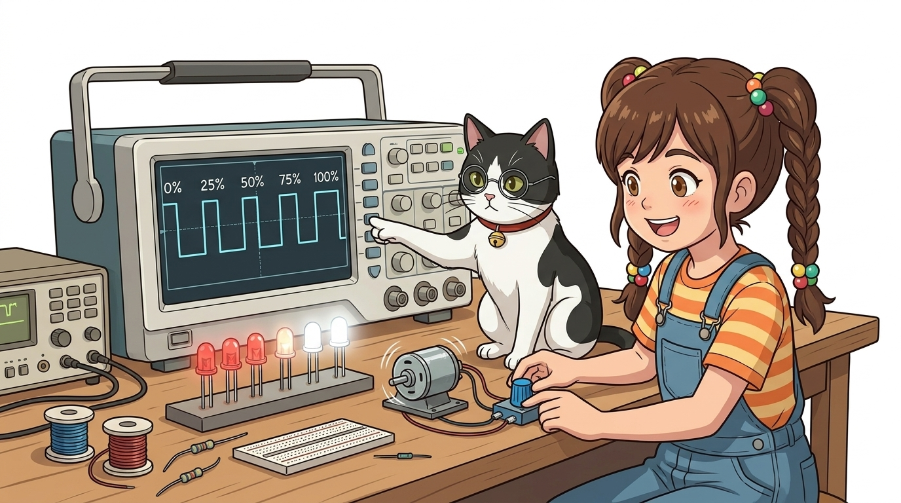
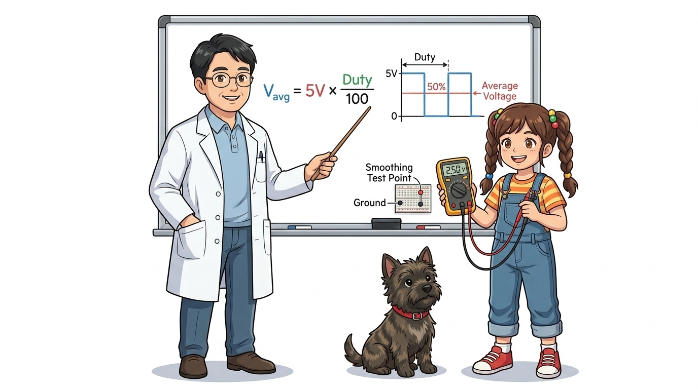
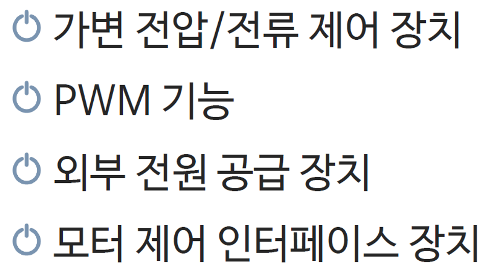

# 084_PWM펄스폭조절_원리 🌊⚡



**도로시와 지니가 함께하는 펄스 폭 변조(PWM)와 듀티 사이클 완벽 해설**
* 👧 **도로시**: "지니야! 아두이노는 0V(꺼짐) 아니면 5V(켜짐)만 내보낼 수 있는데, 어떻게 2.5V나 1.25V처럼 중간 세기로 모터를 살살 돌릴 수 있는 거야?"
* 🐱 **지니**: "그게 바로 **PWM(Pulse Width Modulation, 펄스 폭 변조)** 의 원리란다! 전등 스위치를 1초에 수백 번 껐다 켰다 하면서 '켜져 있는 시간의 비율'을 조절하는 놀라운 기술이지!"
* 🐶 **토토**: "바우! 눈 깜빡할 새보다 훨씬 빠르게 스위치를 찰칵거리는 마법이다 멍!"
* 📖 **상세 강의 교재**: [index.md](./index.md)


> 여러분 안녕하세요! 이번 시간에는 '084. PWM펄스폭조절 원리 🌊⚡'을 주제로 함께 흥미진진한 탐험을 떠나보겠습니다. 오늘 강의에서는 특히 도로시와 지니가 함께하는 펄스 폭 변조(PWM)와 듀티 사이클 완벽 해설, 👧 도로시: "지니야! 아두이노는 0V(꺼짐) 아니면 5V(켜짐)만 내보낼 수 있는데, 어떻게 2.5V나 1.25V처럼 중간 세기로 모터를 살살 돌릴 수 있는 거야?"를 중심으로 핵심 원리와 응용 방법을 차근차근 배워보겠습니다. 마법 멘토 지니와 호기심 많은 탐험가 도로시, 그리고 귀여운 토토와 함께 신나는 아두이노 모험을 힘차게 시작해 봅시다. 준비되셨나요?

---

## 1. 도로시의 질문: 디지털인데 어떻게 전압을 낮출까?


* **LED의 경우**:
* 1초에 500번 깜빡이면 우리 눈의 망막 잔상 효과 때문에 깜빡임이 사라지고 단순히 '밝기가 어두워졌다'고 인식합니다.
* **모터의 경우**:
* 회전자의 관성(Inertia)과 내부 코일의 인덕턴스(Inductance)가 고주파 스위칭 신호를 부드럽게 필터링하여 일정한 속도로 회전합니다.

### 💡 스위칭 속도와 잔상 효과가 만드는 아날로그 착시
디지털 회로는 켜짐(ON, 5V)과 꺼짐(OFF, 0V)의 두 가지 상태만 존재합니다. 하지만 이 전환을 인간의 눈이나 기계 부품이 반응할 수 없을 만큼 빠른 속도로 반복하면, 부하는 중간 세기의 연속 전압이 공급되는 것처럼 느끼게 됩니다.

> 자, 이번 슬라이드의 질문을 함께 보시겠습니다. 바로 '1. 도로시의 질문: 디지털인데 어떻게 전압을 낮출까?'라는 아주 흥미로운 질문입니다. 우리가 일상에서 흔히 접하는 LED의 경우 현상을 떠올려보면 왜 이런 의문이 생기는지 쉽게 공감할 수 있습니다. 이 질문 속에 숨겨진 전자 회로와 컴퓨팅의 핵심 원리를 지금부터 차근차근 하나씩 파헤쳐 보겠습니다.

---

## 2. 펄스(Pulse)의 기본 구성 요소

1. **주기 (Period, $T$)**:
* 신호가 한 번 HIGH가 되었다가 LOW를 거쳐 다시 HIGH로 돌아오기까지 걸리는 총 시간 (초, s)
2. **주파수 (Frequency, $f$)**:
* 1초 동안 이러한 주기가 몇 번 반복되는가를 나타내는 수치 ($f = 1/T$, 단위: 헤르츠, Hz)
3. **상승 에지 (Rising Edge)**:
* 전압이 0V(LOW)에서 5V(HIGH)로 급격히 치솟는 순간
4. **하강 에지 (Falling Edge)**:
* 전압이 5V(HIGH)에서 0V(LOW)로 뚝 떨어지는 순간

### 〰️ 파형을 이해하기 위한 4대 기본 개념
사각형 모양으로 솟구쳤다 떨어지는 구형파(Square Wave) 펄스는 다음과 같은 파라미터로 정의됩니다.

```mermaid
graph LR
    subgraph 1 주기 (T)
        R["상승 에지 (Rising)"] --> H["HIGH (+5V 유지 시간: t_on)"]
        H --> F["하강 에지 (Falling)"]
        F --> L["LOW (0V 유지 시간: t_off)"]
    end
```

> 이번 슬라이드에서는 '2. 펄스(Pulse)의 기본 구성 요소'에 대한 실제 동작 코드를 분석해 보겠습니다. 화면의 코드를 살펴보시면, 컴퓨터가 아두이노 하드웨어에 단계별로 명령을 내리는 흐름을 명확하게 확인할 수 있습니다. 여기서 핵심은 주기 (Period, $T$)입니다. 각 함수의 역할과 괄호 안의 매개변수가 하드웨어 핀과 어떤 관계를 맺고 동작하는지 주의 깊게 살펴보시기 바랍니다.

---

## 3. 듀티 사이클 (Duty Cycle, 듀티 비)


| analogWrite(pin, 값) | 8비트 레지스터 값 | 듀티 사이클 (%) | 평균 출력 전압 ($V_{avg}$) | 모터 동작 상태 |
| :---: | :---: | :---: | :---: | :--- |
| `analogWrite(pin, 0)` | 0 / 255 | **0%** | **0.0 V** | 완전 정지 (OFF) |
| `analogWrite(pin, 64)` | 64 / 255 | **약 25%** | **1.25 V** | 저속 회전 (미세 제어) |
| `analogWrite(pin, 127)` | 127 / 255 | **약 50%** | **2.50 V** | 중간 속도 회전 |
| `analogWrite(pin, 191)` | 191 / 255 | **약 75%** | **3.75 V** | 고속 회전 |
| `analogWrite(pin, 255)` | 255 / 255 | **100%** | **5.00 V** | 최대 속도 (풀 가동) |

### 📊 1주기 동안 HIGH가 켜져 있는 시간의 비율(%)
듀티 사이클은 펄스 신호에서 에너지가 공급되는 비율을 결정하는 가장 핵심적인 척도입니다.
$$\text{Duty Cycle (\%)} = \frac{t_{\text{ON}}}{T} \times 100$$

> 이번에 살펴볼 내용은 '3. 듀티 사이클 (Duty Cycle, 듀티 비)'입니다. 슬라이드에 정리된 표를 통해 각 항목의 특징과 수치, 차이점을 한눈에 비교해 보실 수 있습니다. 이 기본 개념을 확실히 잡아두셔야 실제 부품을 브레드보드에 꽂고 코딩할 때 실수 없이 완성할 수 있습니다.

---

## 4. 평균 전압(Average Voltage)의 수학적 계산



* **실제 계산 예시**:
* 아두이노에서 `analogWrite(9, 204);`를 실행한 경우
* $\text{Duty Ratio} = \frac{204}{255} = 0.80$ (80%)
* $V_{avg} = 5\text{V} \times 0.80 = 4.0\text{V}$
* 즉, 4V짜리 직류 전원 공급기를 연결한 것과 동일한 일률을 부하에 전달합니다!

### 📈 시간 적분으로 구하는 유효 공급 에너지
PWM 신호가 부하에 전달하는 실질적인 에너지의 크기는 펄스의 면적을 주기로 나눈 평균 전압 공식으로 계산할 수 있습니다.
$$V_{avg} = \frac{1}{T} \int_{0}^{T} V(t) dt = 5\text{V} \times \frac{\text{Duty Cycle}}{100}$$

> 이번 슬라이드에서는 '4. 평균 전압(Average Voltage)의 수학적 계산'에 대해 자세히 살펴보겠습니다. 화면의 다이어그램과 사진을 함께 참고해 주시기 바랍니다. 첫 번째 핵심은 실제 계산 예시이며, 두 번째로는 아두이노에서 analogWrite(9, 204);를 실행한 경우입니다. 여기에 덧붙여 $\text{Duty Ratio} = \frac{204}{255} = 0.80$ (80%) 내용까지 함께 이해해 두시면 완벽합니다. 이 원리는 아두이노 시스템 전체를 관통하는 핵심 논리이므로 머릿속에 꼭 정리해 두시기 바랍니다.

---

## 5. 아두이노 C++ PWM 제어 코드 패턴



### 💻 서서히 밝아지고 서서히 어두워지는 호흡 LED 실습
PWM의 듀티 사이클을 0부터 255까지 점진적으로 증감시켜 부드러운 밝기 변화를 연출하는 표준 코드입니다.

```cpp
// 9번 PWM 핀을 제어 핀으로 지정 (물결표 ~9 핀)
const int ledPin = 9;

void setup() {
  // PWM 핀은 pinMode를 생략해도 analogWrite 호출 시 자동 설정되지만, 명시하는 것이 좋습니다.
  pinMode(ledPin, OUTPUT);
}

void loop() {
  // 1. 서서히 밝아지기 (듀티 사이클 0% -> 100%)
  for (int brightness = 0; brightness <= 255; brightness += 5) {
    analogWrite(ledPin, brightness); // 듀티비 갱신
    delay(30);                      // 밝기 변화 체감을 위한 지연
  }

  // 2. 서서히 어두워지기 (듀티 사이클 100% -> 0%)
  for (int brightness = 255; brightness >= 0; brightness -= 5) {
    analogWrite(ledPin, brightness);
    delay(30);
  }
}
```

> 이번 슬라이드에서는 '5. 아두이노 C++ PWM 제어 코드 패턴'에 대한 실제 동작 코드를 분석해 보겠습니다. 화면의 코드를 살펴보시면, 컴퓨터가 아두이노 하드웨어에 단계별로 명령을 내리는 흐름을 명확하게 확인할 수 있습니다. 각 함수의 역할과 괄호 안의 매개변수가 하드웨어 핀과 어떤 관계를 맺고 동작하는지 주의 깊게 살펴보시기 바랍니다.

---

## 6. 아두이노 분야별 PWM의 핵심 활용처


1. **LED 조명 제어**:
* RGB LED의 빨강, 초록, 파랑 핀에 각각 PWM 값을 주어 1,600만 가지의 풀컬러 색상을 합성합니다.
2. **DC 모터 속도 조절**:
* 모터 드라이버(L298N, 모스펫)의 인에이블(EN) 핀에 PWM을 가해 자동차 바퀴의 가속과 감속을 정밀하게 제어합니다.
3. **서보모터 각도 제어 (PWM 서보 신호)**:
* 50Hz(주기 20ms) 주파수에서 HIGH 펄스 폭을 **1.0ms(0도) ~ 1.5ms(90도) ~ 2.0ms(180도)** 로 조절하여 모터 암의 각도를 정확히 고정합니다.

### 🚀 전자와 기계 제어의 만능 열쇠

> 이번 슬라이드에서는 '6. 아두이노 분야별 PWM의 핵심 활용처'에 대해 자세히 살펴보겠습니다. 화면의 다이어그램과 사진을 함께 참고해 주시기 바랍니다. 첫 번째 핵심은 LED 조명 제어이며, 두 번째로는 RGB LED의 빨강, 초록, 파랑 핀에 각각 PWM 값을 주어 1,600만 가지의 풀컬러 색상을 합성합니다.입니다. 여기에 덧붙여 DC 모터 속도 조절 내용까지 함께 이해해 두시면 완벽합니다. 이 원리는 아두이노 시스템 전체를 관통하는 핵심 논리이므로 머릿속에 꼭 정리해 두시기 바랍니다.

---

## 🌟 도로시와 지니의 핵심 요약 노트!


* 👧 **도로시**: "초당 수백 번씩 ON/OFF 스위치를 켜고 끄는 시간의 비율(Duty Cycle)을 바꿔서 0V부터 5V까지 원하는 평균 전압을 만들어내는 거였구나!"
* 🐱 **지니**: "정답이야! `analogWrite()`는 진짜 아날로그 전압을 만드는 게 아니라, 하드웨어 타이머가 만든 똑똑한 PWM 신호라는 점을 꼭 기억하렴."
* 🐶 **토토**: "바우! 이제 이 멋진 PWM 신호를 이용해 원하는 각도로 척척 움직이는 **서보모터(Servo)** 를 직접 조종해보자 멍!"

> 오늘 배운 '🌟 도로시와 지니의 핵심 요약 노트!'의 핵심 내용을 모두 정리해 보았습니다. 오늘 다룬 내용 중에서도 👧 도로시: "초당 수백 번씩 ON/OFF 스위치를 켜고 끄는 시간의 비율(Duty Cycle)을 바꿔서 0V부터 5V까지 원하는 평균 전압을 만들어내는 거였구나!" 부분은 앞으로의 아두이노 실습과 프로젝트에서 계속 사용되는 매우 중요한 기초 지식입니다. 오늘 배운 내용을 꼭 다시 한번 복습해 보시고, 다음 강의에서 더욱 신나고 유익한 모험으로 다시 만나겠습니다. 모두 수고 많으셨습니다!