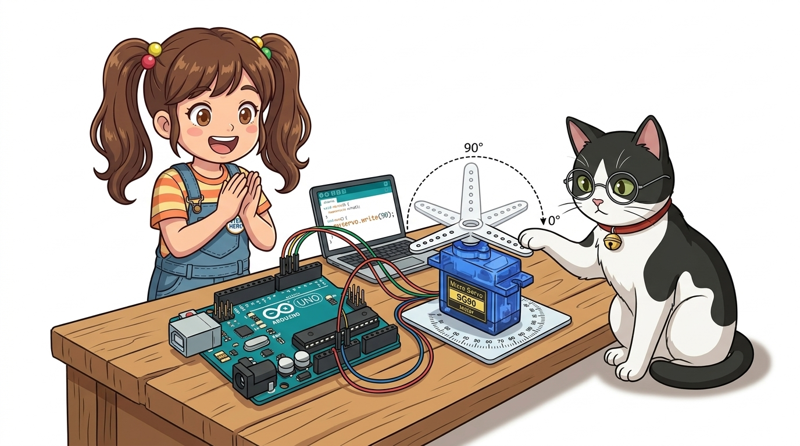
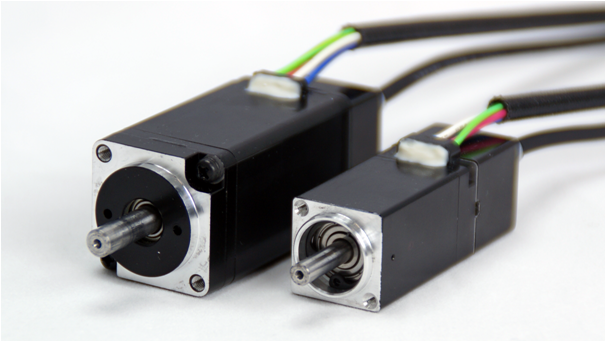
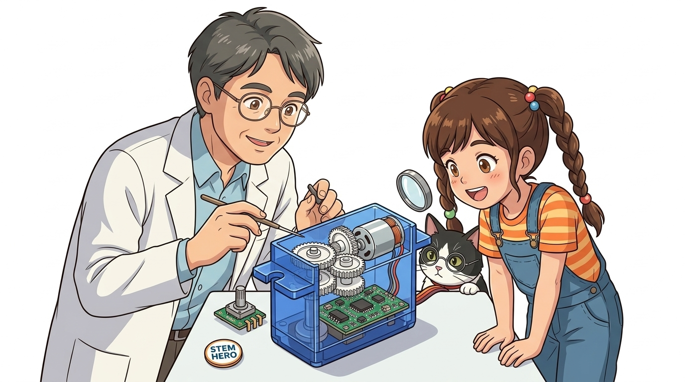
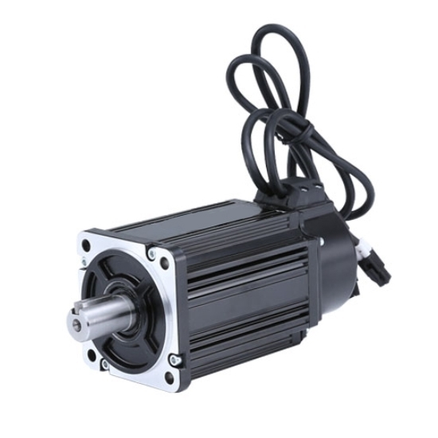
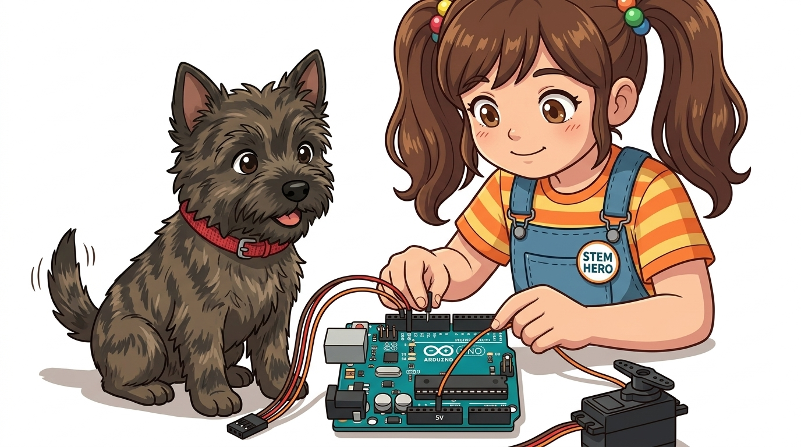
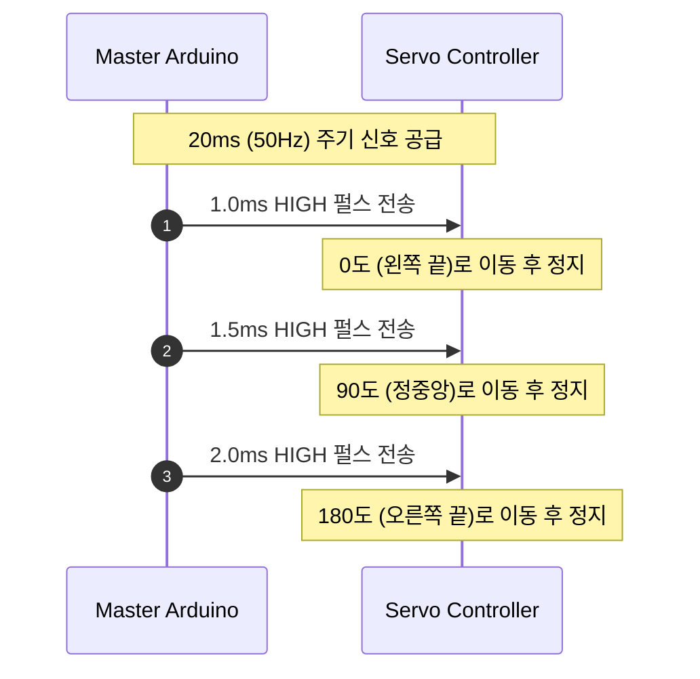
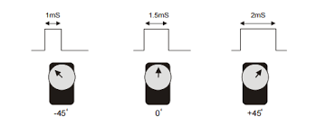

# 085_서보모터_각도제어 📐🤖

**도로시와 지니가 함께하는 충직한 관절 모터, 서보모터 완벽 가이드**

* 👧 **도로시**: "지니야! 왜 이 모터 이름은 그냥 모터가 아니라 '서보(Servo)' 모터야? 이름이 아주 특별하고 멋져 보여!"
* 🐱 **지니**: "서보(Servo)는 라틴어 '서버스(Servus)', 즉 **'주인의 명령에 절대 복종하는 충직한 하인'** 에서 유래했단다! 주인이 '정확히 90도로 돌아!' 하고 명령하면 단 1도의 오차도 없이 명령을 수행하고 그 자리를 지키는 똑똑한 관절 모터란다!"
* 🐶 **토토**: "바우! 주인님 말에 즉각 귀를 쫑긋 세우는 나랑 꼭 닮았다 멍!"

* 🖥️ **강의 슬라이드**: [slides.md](./slides.md)

---

## 1. 도로시의 호기심: 일반 모터와 서보모터는 무엇이 다를까?

### 🤖 단순 회전(DC 모터) vs 각도 유지(서보모터)

일반 DC 모터는 전기를 공급하면 최고 속도로 쉼 없이 돌다가 전원을 끄면 관성으로 미끄러져 멈춥니다. 반면 서보모터는 목표 각도라는 개념을 이해하는 지능형 모터입니다.

| 구분 항목 | 일반 DC 모터 | 서보모터 (Servo Motor) |
| :--- | :--- | :--- |
| **회전 방식** | 360도 연속 무한 회전 | 주로 **0도 ~ 180도** 정해진 각도 회전 |
| **제어 목표** | 회전 속도 (RPM), 회전 방향 | **출력축의 정확한 물리적 각도(위치)** |
| **제어 루프** | 개루프 (Open-Loop, 피드백 없음) | **폐루프 (Closed-Loop, 내부 위치 피드백)** |
| **외부 힘 저항** | 손으로 돌리면 쉽게 돌아감 | **설정 각도를 지키기 위해 강한 반발 토크 발휘** |
| **주요 적용처** | 바퀴, 프로펠러, 선풍기 | 로봇 관절, 스마트 도어락, RC 조향 링키지 |

---

## 2. 서보모터의 폐루프 제어(Closed-Loop) 원리

### 🔄 스스로 위치를 확인하고 오차를 수정하는 피드백 루프

서보모터가 정확한 각도를 유지할 수 있는 비결은 모터 내부에 제어 컴퓨터(IC)와 각도 센서가 항상 대화하고 있기 때문입니다.

* **오차(Error) = 목표 각도 - 현재 각도**:
  * 오차가 0이면 모터는 전원을 차단하고 멈춥니다.
  * 손으로 축을 비틀어 오차가 생기면 모터가 즉시 반대 방향으로 힘을 주어 원래 각도로 복귀합니다.

---

## 3. 서보모터 속을 들여다봐요! 4대 핵심 구성 부품

### 🔍 작은 파란 케이스 속에 숨겨진 정밀 공학의 정수

손가락 두 마디 크기의 서보모터(SG90 기준 약 9g) 안에는 다음과 같은 4대 부품이 오밀조밀 배치되어 있습니다.

1. **초소형 고속 DC 모터 (DC Core Motor)**:
   * 1분에 수천 번 회전하며 강력한 기본 구동력을 만듭니다.
2. **정밀 감속 기어박스 (Reduction Gear Train)**:
   * 4~5단의 기어가 맞물려 고속 회전을 느리게 낮추는 대신, **회전력(토크)을 50배 이상 뻥튀기**합니다.
3. **위치 검출용 가변저항 (Potentiometer)**:
   * 출력축과 직접 결합되어 있어, 축이 도는 각도에 따라 저항 전압이 0V~5V로 변하며 현재 각도를 감지합니다.
4. **내부 제어 기판 (Control PCB & Comparator)**:
   * 아두이노의 PWM 신호 폭을 측정하여 내부 센서 값과 비교한 후 모터를 정/역회전시킵니다.

---

## 4. 감속 기어의 마법: 속도를 줄여 힘(토크)을 키운다!

### ⚙️ 기어비(Gear Ratio)가 만드는 강력한 파워

작은 DC 모터의 축을 손가락으로 잡으면 쉽게 멈추지만, 감속 기어를 통과한 서보모터의 암(Arm)은 어른 손으로도 쉽게 꺾기 힘듭니다.

* **물리 법칙**: $P = T \times \omega$ (일률 = 토크 $\times$ 각속도)
* 회전 속도($\omega$)가 1/50로 줄어들면, 반대로 회전 토크($T$)는 50배로 커집니다!
* 덕분에 9g짜리 초소형 서보모터도 약 **1.8 kg·cm**의 강력한 힘으로 로봇의 팔다리를 들어 올릴 수 있습니다.

---

## 5. RC 서보모터의 3가닥 전선 핀아웃

### 🔌 전원 2선과 신호 1선으로 끝나는 간결한 연결

서보모터는 3핀 커넥터로 되어 있어 브레드보드나 아두이노에 매우 직관적으로 연결할 수 있습니다.

| 전선 색상 (표준) | 전선 색상 (대체) | 핀 기능 명칭 | 연결 위치 |
| :--- | :--- | :--- | :--- |
| **갈색 (Brown)** | 검정색 (Black) | **GND** | 아두이노 **GND (0V)** 공통 접지 |
| **빨간색 (Red)** | 빨간색 (Red) | **VCC** | 아두이노 **5V** (모터 다수 구동 시 외장 5V 필수) |
| **주황색 (Orange)** | 노란색 (Yellow) | **Signal** | 아두이노 **PWM 지원 디지털 핀 (예: D9)** |

> [!IMPORTANT]
> **전원 부족 주의 (브라운아웃 현상)**:
> 서보모터가 움직이는 순간 최대 수백 mA의 순간 전류를 소모합니다. 2개 이상의 서보를 아두이노 5V 핀에 직접 연결하면 아두이노 전압이 강하되어 리셋될 수 있으므로, 외장 배터리나 전원 어댑터(5V)를 사용하는 것이 안전합니다.

---

## 6. 펄스 폭(Pulse Width)으로 각도를 명령하는 원리

### ⏱️ 50Hz (주기 20ms) PWM 신호의 시간 약속

서보모터는 일반 `analogWrite()`의 0~255 듀티비가 아니라, **HIGH 상태가 유지되는 절대적인 시간(ms)** 을 기준으로 각도를 해석합니다.

* **1.0 ms HIGH**: 서보모터 **0°** 위치
* **1.5 ms HIGH**: 서보모터 **90°** 정중앙 위치
* **2.0 ms HIGH**: 서보모터 **180°** 끝 위치
* 아두이노의 `<Servo.h>` 표준 라이브러리를 쓰면 이 복잡한 타이밍을 신경 쓸 필요 없이 `myservo.write(90);`처럼 각도 숫자만 던져주면 됩니다!

---

## 🌟 도로시와 지니의 핵심 요약 노트!

* 👧 **도로시**: "서보모터 속에는 초소형 모터와 감속 기어, 가변저항 센서, 제어 보드가 한 세트로 들어있어서 주인이 지정한 각도를 스스로 지키는 거였구나!"
* 🐱 **지니**: "완벽해! 전선도 전원 2개와 신호선 1개뿐이라 다루기 정말 쉽단다."
* 🐶 **토토**: "바우! 다음 시간에는 전 세계 메이커들이 가장 사랑하는 꼬마 서보모터 **SG90**을 아두이노에 직접 연결해 춤추게 해보자 멍!"
