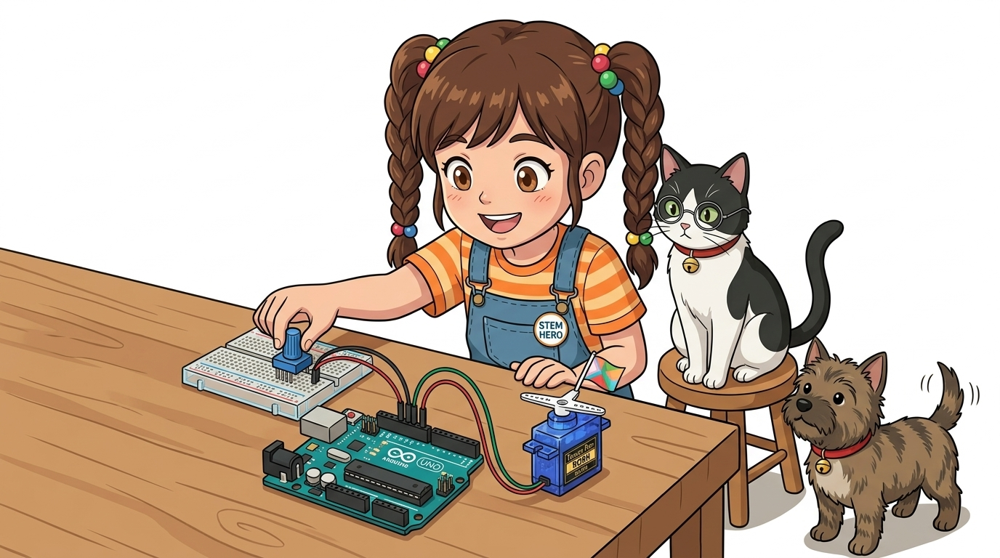
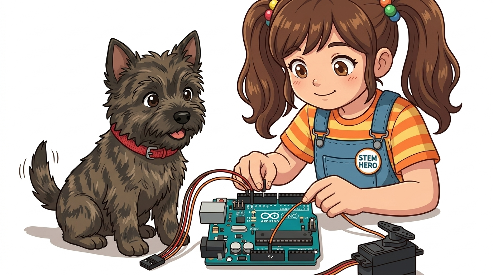
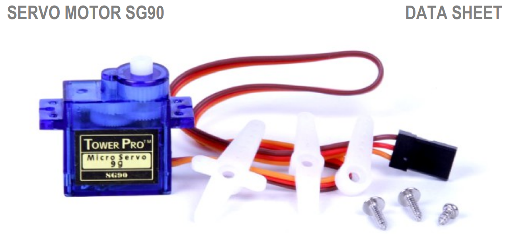
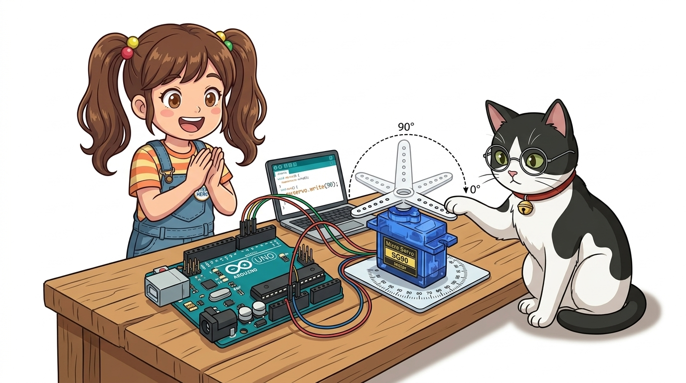

# 086_SG90서보모터_로봇관절 🦾🤖



**도로시와 지니가 함께하는 마이크로 서보 SG90과 `<Servo.h>` 완벽 정복**

* 👧 **도로시**: "지니야! 이 파란색 꼬마 모터는 손가락 두 마디만 한데, 하얀 날개(혼, Horn)를 끼우고 코드를 넣으니까 진짜 로봇 관절처럼 힘차게 윙윙 움직여!"
* 🐱 **지니**: "이 모터가 바로 전 세계 아두이노 메이커들이 가장 사랑하는 국민 서보모터 **Tower Pro SG90**이야! 무게는 겨우 9g에 불과하지만 자기 몸무게의 수백 배를 거뜬히 들어 올리는 놀라운 친구란다!"
* 🐶 **토토**: "바우! 하얀 혼 위에 깃발을 꽂아서 반갑게 흔들어보자 멍!"

* 🖥️ **강의 슬라이드**: [slides.md](./slides.md)

---

## 1. 도로시의 감탄: 손바닥만 한 파란색 모터와 부속품



### 📦 패키지 구성품과 기계적 체결법

SG90 서보모터 세트를 개봉하면 파란색 모터 본체와 함께 다양한 형태의 흰색 플라스틱 회전 날개(Horn) 및 고정용 미세 나사들이 동봉되어 있습니다.

* **서보 혼(Servo Horn)**:
  * **일자형 혼 (Arm Horn)**: 로봇 팔 관절, 자동차 조향 링키지 연결용
  * **십자형/사거리 혼 (Cross Horn)**: 4방향 와이어 당김 장치용
  * **원형 혼 (Round Horn)**: 회전 원판, 초음파 센서 레이더 스캐너 거치용
* **조립 꿀팁**:
  * 코드를 업로드하기 전에 나사로 혼을 꽉 조이지 마세요! 코드로 서보모터를 90도(중립) 위치로 초기화한 다음, 반듯한 각도로 혼을 끼우고 나사를 체결해야 원하는 각도 범위가 정확히 맞습니다.

---

## 2. SG90 서보모터 하드웨어 스펙 한눈에 보기



### 🔍 정밀 제어를 위한 핵심 전기적/기계적 특성

SG90은 가볍고 저렴하면서도 준수한 토크를 발휘하여 교육용 로봇 제작에 최적화되어 있습니다.

| 기술 사양 항목 | 상세 규격 및 수치 | 특징 설명 |
| :--- | :--- | :--- |
| **동작 전압 (Voltage)** | **DC 4.8V ~ 5.0V** | 아두이노 우노의 5V 핀으로 직접 구동 가능 |
| **스톨 토크 (Stall Torque)** | **약 1.8 kg·cm (at 4.8V)** | 1cm 거리에서 1.8kg의 무게를 지탱하는 회전력 |
| **동작 속도 (Speed)** | **0.1초 / 60도 (at 4.8V)** | 60도를 회전하는 데 불과 100ms 소요 |
| **회전 동작 각도** | **0° ~ 180° (물리적 한계각 약 200°)** | 반원(180도) 왕복 운동 전용 |
| **내부 기어 재질** | 고강도 나일론 수지 플라스틱 | 부드럽고 조용하나 무리한 외력 시 기어 마모 주의 |
| **제품 중량** | 약 9.0 g (초경량) | 소형 드론이나 보행 로봇에 무게 부담 없음 |

---

## 3. 3색 케이블 결선과 회로도


### 🔌 단 3개의 점퍼선으로 완성하는 아두이노 직결 회로

SG90 케이블은 표준 3핀 헤더(2.54mm 피치)로 마감되어 있어 아두이노 핀에 바로 꽂을 수 있습니다.

| 케이블 색상 | 아두이노 우노 연결 핀 | 기능 역할 | 주의 사항 |
| :--- | :--- | :--- | :--- |
| **갈색 (Brown)** | **GND** | 0V 공통 접지 | 기준 전위선 |
| **빨간색 (Red)** | **5V** | 모터 구동 전원 공급 | 모터 2개 이상 시 외장 전원 사용 |
| **주황색 (Orange)** | **디지털 9번 (PWM ~9)** | 각도 지시 펄스 신호선 | `<Servo.h>`에 지정된 핀 |

> [!CAUTION]
> **극성 역결선 주의**: 빨간색(5V)과 갈색(GND)을 반대로 꽂으면 서보모터 내부의 제어 IC가 타버려 영구 고장 납니다. 반드시 전원 색상을 재확인하세요!

---

## 4. 아두이노의 보물창고: `<Servo.h>` 표준 라이브러리


### 📚 타이머 인터럽트를 기반으로 한 초정밀 각도 엔진

아두이노 IDE에 기본 내장된 `<Servo.h>` 라이브러리는 백그라운드 하드웨어 타이머(Timer 1)를 사용하여 CPU의 간섭 없이 안정적인 50Hz PWM 서보 신호를 생성합니다.

* **핵심 함수 정리**:
  * `myservo.attach(pin)`: 서보모터가 연결된 디지털 핀을 지정하고 펄스 생성을 개시합니다.
  * `myservo.write(angle)`: 서보모터를 목표 각도(**0 ~ 180**)로 회전시킵니다.
  * `myservo.read()`: 현재 서보모터에 지시된 각도 값을 읽어옵니다.
  * `myservo.detach()`: 서보모터 신호 출력을 중단하여 모터 전력 소모와 떨림을 방지합니다.

> [!IMPORTANT]
> **우노 핀 사용 제약**: `<Servo.h>` 라이브러리는 우노의 16비트 타이머 1을 독점 사용하므로, 서보 라이브러리를 포함하는 순간 **9번과 10번 핀에서는 `analogWrite()` PWM 기능이 작동하지 않습니다.**

---

## 5. 실습 1: 부드러운 왕복 스윕(Sweep) 운동 스케치



### 🧹 와이퍼처럼 0도부터 180도까지 부드럽게 오가기

급격한 각도 변화는 모터 기어에 충격을 줍니다. `for` 반복문을 사용하여 1도씩 점진적으로 전진시킵니다.

```cpp
#include <Servo.h> // 아두이노 서보모터 공식 라이브러리 포함

Servo myservo; // 서보모터를 제어할 객체 생성 (이름: myservo)

void setup() {
  myservo.attach(9); // 9번 디지털 핀에 서보모터 신호선 할당
}

void loop() {
  // 1. 0도에서 180도까지 1도씩 전진
  for (int pos = 0; pos <= 180; pos++) {
    myservo.write(pos); // 현재 각도로 서보모터 이동 지시
    delay(15);          // 서보모터 기어가 물리적으로 도달할 시간(15ms) 제공
  }

  // 2. 180도에서 0도까지 1도씩 후진
  for (int pos = 180; pos >= 0; pos--) {
    myservo.write(pos);
    delay(15);          // 급회전 방지 딜레이
  }
}
```

---

## 6. 실습 2: 가변저항으로 실시간 각도 조종하기 (Potentiometer Control)


### 🎛️ 손잡이를 돌리는 만큼 서보모터가 실시간으로 따라 도는 로봇 조종기

아날로그 입력 핀(A0)에 가변저항을 달아 0~1023 신호를 서보의 0~180도로 변환합니다.

```cpp
#include <Servo.h>

Servo myservo; // 서보모터 객체

const int potPin = A0; // 가변저항 중앙 신호 핀

void setup() {
  myservo.attach(9); // 9번 핀에 서보모터 연결
}

void loop() {
  int potVal = analogRead(potPin); // 가변저항 아날로그 값 읽기 (0 ~ 1023)
  
  // map(입력값, 입력최소, 입력최대, 출력최소, 출력최대)
  // 0~1023 범위의 센서 값을 서보 각도 범위인 0~180으로 비율 변환!
  int angle = map(potVal, 0, 1023, 0, 180);
  
  myservo.write(angle); // 계산된 각도로 서보모터 회전
  delay(15);            // 부드러운 위치 추종을 위한 최소 지연 시간
}
```

---

## 7. 실습 중 흔히 겪는 문제와 해결법 (Troubleshooting)

```cpp
#include <Servo.h>

Servo myServo;
const int servoPin = 10;
const int yellowPin = 5;
const int redPin    = 6;
const int greenPin  = 7;

void setup() {
  myServo.attach(servoPin);
  pinMode(yellowPin, INPUT);
  pinMode(redPin, INPUT);
  pinMode(greenPin, INPUT);
}
```

### ⚠️ 모터가 덜덜 떨리거나 아두이노가 자꾸 꺼질 때

1. **서보모터 헌팅(Jittering / 떨림 현상)**:
   * 원인: 저가형 서보모터의 내부 기어 유격이나 가변저항 아날로그 노이즈.
   * 해결: `map()`으로 계산한 각도 값의 변화량이 2~3도 이상일 때만 `write()`를 호출하도록 소프트웨어 필터를 적용합니다.
2. **아두이노 무한 재부팅 (Brownout Reset)**:
   * 원인: 모터가 급격히 방향을 틀 때 순간적으로 500mA 이상의 피크 전류를 당겨와 아두이노 5V 전압이 순간 4V 밑으로 강하됨.
   * 해결: 아두이노 5V와 GND 핀 사이에 **100µF ~ 470µF 전해 콘덴서**를 병렬로 달아주거나, 5V 외장 배터리 팩을 독립 전원으로 공급합니다.

---

## 🌟 도로시와 지니의 핵심 요약 노트!

```cpp
void loop() {
  if (digitalRead(yellowPin) == HIGH) {
    myServo.write(0);   // 노란 버튼: 0도 회전
  } else if (digitalRead(redPin) == HIGH) {
    myServo.write(90);  // 빨간 버튼: 90도 회전
  } else if (digitalRead(greenPin) == HIGH) {
    myServo.write(180); // 초록 버튼: 180도 회전
  }
}
```

* 👧 **도로시**: "갈색(GND), 빨강(5V), 주황(신호) 3가닥만 꽂고 `#include <Servo.h>`를 불러오면 `myservo.write(각도)` 한 줄로 로봇 관절을 마음껏 움직일 수 있구나!"
* 🐱 **지니**: "맞아! 여기에 가변저항이나 조이스틱을 붙이면 나만의 원격 조종 로봇 팔과 스마트 크레인을 만들 수 있단다."
* 🐶 **토토**: "바우! 다음 시간에는 3D 프린터처럼 1스텝씩 초정밀 각도로 끊어 도는 **스텝모터(Stepper Motor)** 를 정복하러 가자 멍!"
