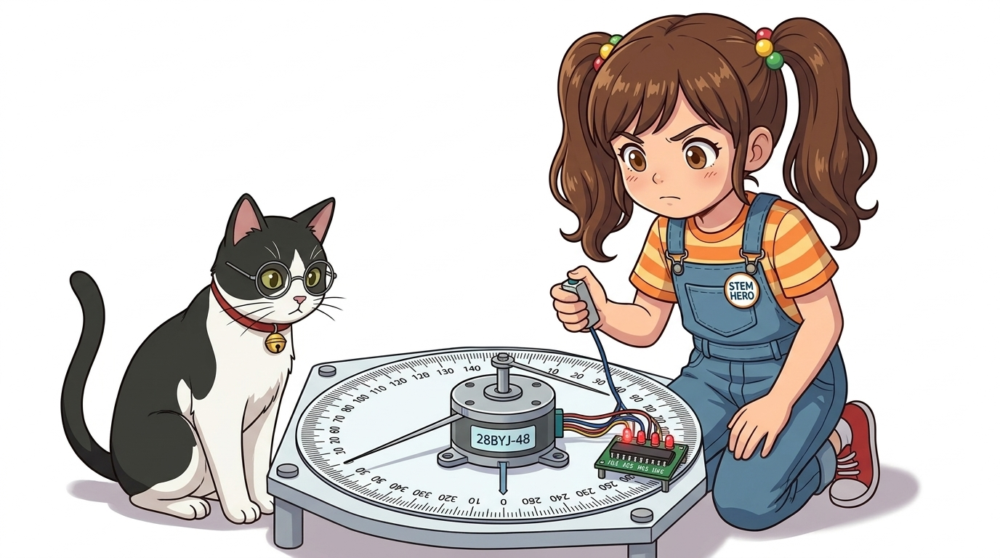
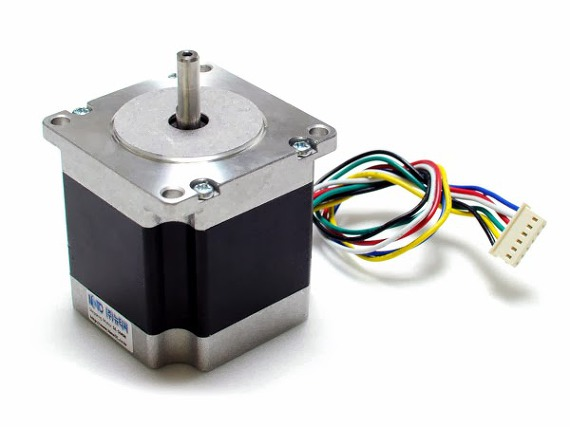
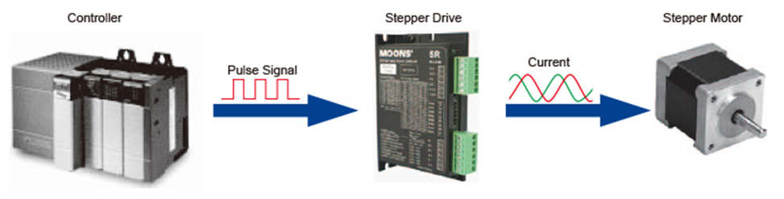
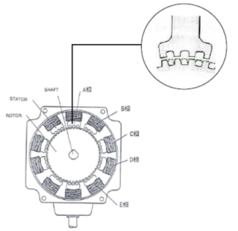
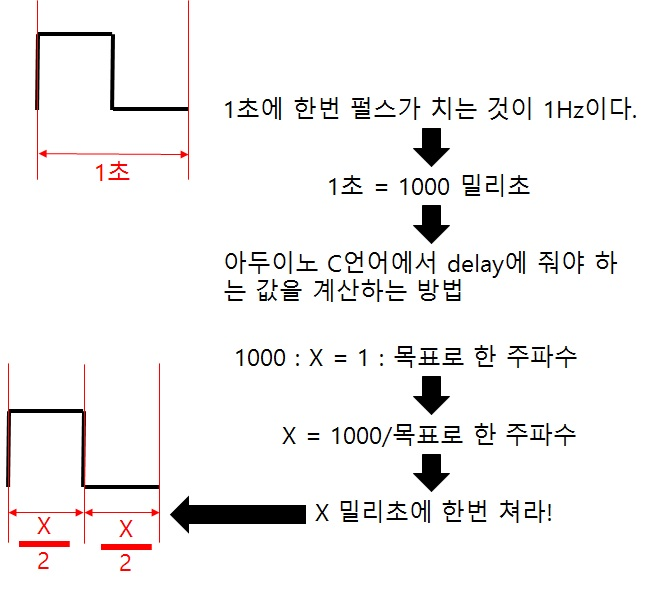
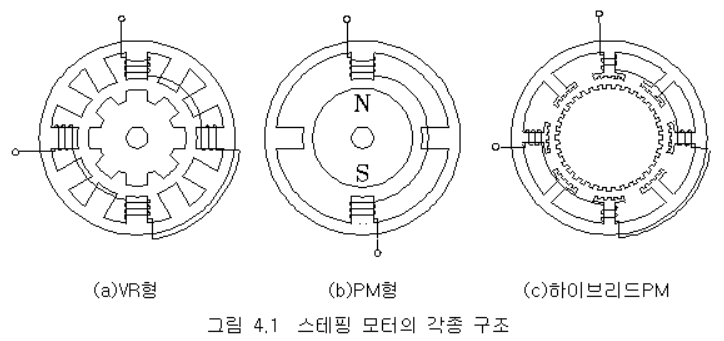
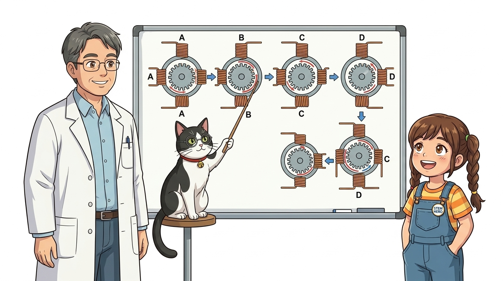
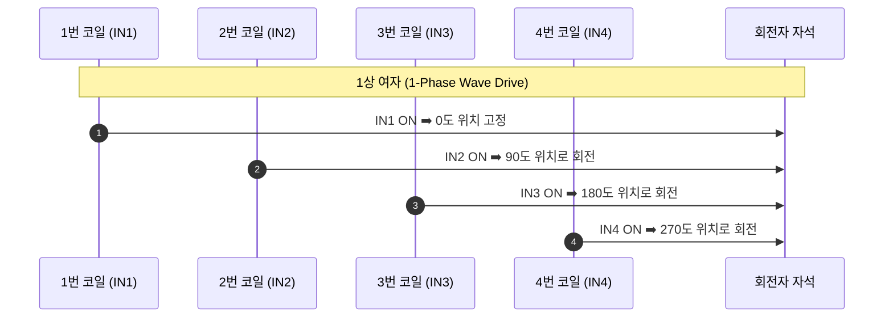
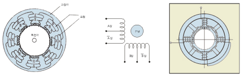

# 087_스텝모터란_한걸음씩회전 🪜🔄

**도로시와 지니가 함께하는 초정밀 위치 제어의 심장, 스텝모터 기초 탐험**

* 👧 **도로시**: "지니야! 3D 프린터를 보면 뜨거운 노즐이 허공에서 0.1mm도 틀리지 않고 정확한 위치에 플라스틱을 쌓아가잖아! 도대체 어떤 모터를 쓰길래 그렇게 놀랍도록 정밀해?"
* 🐱 **지니**: "그게 바로 **스텝모터(Stepper Motor, 보진 전동기)** 란다! 아두이노가 전기 펄스를 1개 줄 때마다 정해진 각도(예: 1.8도 또는 0.088도)씩 '찰칵!' 하고 한 걸음씩 발을 맞추어 걷는 초정밀 모터지!"
* 🐶 **토토**: "바우! 지휘자의 구령 하나, 둘, 셋에 맞춰 착착 행진하는 모터다 멍!"

* 🖥️ **강의 슬라이드**: [slides.md](./slides.md)

---

## 1. 도로시의 호기심: 시계침처럼 뚝뚝 끊겨 도는 모터의 비밀

### 👣 연속 회전이 아닌 '이산적(Discrete) 발걸음' 운동

일반 모터는 전기를 공급하는 시간 동안 부드럽게 미끄러지듯 연속 회전합니다. 반면 스텝모터는 마치 시계의 초침이 1초마다 딱딱 끊어져 이동하듯, 디지털 펄스 1개당 1스텝씩 고정된 각도를 전진합니다.

| 모터 종류 | 회전 형태 | 멈출 때의 특성 | 위치 확인 방식 |
| :--- | :--- | :--- | :--- |
| **DC 모터** | 연속 고속 회전 | 관성으로 인해 조금 더 밀려남 | 별도의 외부 엔코더 센서 필수 |
| **서보모터 (SG90)** | 0° ~ 180° 제한 회전 | 내부 가변저항 센서로 위치 사수 | 내부 폐루프 아날로그 피드백 |
| **스텝모터 (28BYJ)** | **스텝 단위 무한 회전** | **코일 자력으로 찰칵 멈춰 고정 (홀딩)** | **펄스 개수를 카운팅하여 개루프 계산** |

---

## 2. 스텝모터란 무엇일까요?

### ⚡ 전기 펄스를 기계적 각도 변위로 직접 변환

스텝모터는 마이크로컨트롤러의 디지털 펄스 열(Pulse Train)을 회전축의 각변위로 직접 변환하는 특수 디지털 액추에이터입니다.

* **스텝 각 (Step Angle, $\theta_s$)**:
  * 펄스 신호 1번 입력 시 모터 축이 회전하는 고유한 기계적 각도입니다.
  * 산업용 바이폴라 모터: 통상 **$1.8^\circ$ (1회전에 200스텝)** 또는 **$0.9^\circ$ (1회전에 400스텝)**
  * 소형 기어드 모터 (28BYJ-48): 64:1 감속 기어를 거쳐 스텝당 약 **$0.088^\circ$ (1회전에 4096스텝)**

---

## 3. 펄스 수와 회전 각도의 정밀 수학 관계

### 📐 펄스 개수로 각도를 정하고, 펄스 주파수로 속도를 정한다!

스텝모터는 복잡한 센서 계산 없이도 단순한 비례 계산식으로 움직임을 완벽히 통제할 수 있습니다.

1. **회전 각도 공식**:
   $$\text{회전 각도}(\theta) = \text{펄스 수} \times \text{스텝 각}(\theta_s)$$
   * $1.8^\circ$ 모터에 펄스 100개를 입력하면: $1.8^\circ \times 100 = 180^\circ$ (정확히 반 바퀴)
   * 펄스 200개를 입력하면: $1.8^\circ \times 200 = 360^\circ$ (정확히 딱 한 바퀴 회전)
2. **회전 속도 공식**:
   * 1초에 200개의 펄스를 쏘면($f=200\text{Hz}$) 1초에 1바퀴, 즉 **60 RPM**으로 회전합니다.

---

## 4. 스텝모터만의 4가지 슈퍼 장점!

### 🏆 정밀 기계와 로보틱스에서 독보적인 위치를 차지하는 이유

1. **오차 누적 없음 (No Cumulative Error)**:
   * 1스텝 전진할 때 기계적인 미세 오차가 있더라도, 다음 스텝에 그 오차가 누적되지 않고 항상 자기 극(Pole)의 중심선에 정렬됩니다.
2. **센서 없는 정밀 위치 제어 (Open-Loop Control)**:
   * 고가의 위치 센서(엔코더)나 피드백 연산 회로 없이도, 아두이노가 보낸 펄스 수만 카운트하면 현재 모터가 어디를 가리키고 있는지 정확히 알 수 있습니다.
3. **강력한 정지 유지력 (Holding Torque)**:
   * 회전이 멈춘 상태에서도 코일에 전기가 흐르고 있으면 자석을 꽉 물고 있어, 외부에서 손으로 비틀어도 쉽게 돌아가지 않는 강력한 브레이크 효과를 냅니다.
4. **극저속 고토크 구동**:
   * 1시간에 단 1바퀴만 돌게 만드는 것과 같은 극단적인 초저속 회전도 흔들림 없이 안정적으로 수행합니다.

---

## 5. 엔지니어가 가장 경계해야 할 '탈조(Step-Out)' 현상

### ⚠️ 박자를 놓치면 멈추어 버리는 스텝모터의 유일한 약점

스텝모터는 센서 없이 펄스를 믿고 달리는 '개루프' 시스템이므로, 모터가 펄스를 제때 따라오지 못하면 치명적인 위치 오차가 발생합니다.

* **탈조(脫調, Step-Out / Stall)**:
  * 모터 축에 허용 토크를 넘어서는 과부하가 걸리거나,
  * 정지 상태에서 갑자기 너무 빠른 고주파 펄스를 쏘아버리면,
  * 회전자가 코일의 자기장을 놓쳐 제자리에서 **덜덜덜 진동만 하며 멈춰버리는 현상**입니다.
* **탈조 방지 대책**:
  * 출발할 때는 낮은 속도에서 시작하여 부드럽게 가속(Ramp-up)하고, 멈출 때도 부드럽게 감속(Ramp-down)하는 사다리꼴 속도 제어 알고리즘을 사용합니다.

---

## 6. 스텝모터의 내부 구조에 따른 3대 분류

### ⚙️ 로터와 고정자의 전자기적 설계 방식

| 종류 | 영문 명칭 | 회전자(Rotor) 구조 | 특징 및 주 활용처 |
| :--- | :--- | :--- | :--- |
| **PM형** | Permanent Magnet | 원통형 영구자석 (N/S극) | 저렴하고 구조가 단순함. 교육용 키트(**28BYJ-48**) |
| **VR형** | Variable Reluctance | 톱니 모양 연철(자석 없음) | 회전 관성이 작아 고속 회전에 유리함 |
| **HB형** | Hybrid | 영구자석 + 톱니형 철심 | 고토크, 고분해능(1.8°). **3D 프린터, CNC 머신** |

---

## 7. 고정자 코일 시퀀스와 여자 방식

### 🔄 코일 4개에 순서대로 불을 붙여 회전을 유도

스텝모터 내부에는 A, B, C, D(또는 1, 2, 3, 4) 4개의 코일 상이 원형으로 배치되어 있습니다.

* **1상 여자**: 코일을 1개씩 켜며 전력 소모가 적음
* **2상 여자**: 코일을 2개씩 동시에 켜며 최대 토크 발휘
* **1-2상 여자 (하프 스텝)**: 1개와 2개를 번갈아 켜며 스텝 각을 절반으로 쪼개어(0.9° $\to$ 0.45°) 극도로 부드러운 회전 달성!

---

## 🌟 도로시와 지니의 핵심 요약 노트!

* 👧 **도로시**: "펄스 1개당 1스텝씩 걸어가니까 펄스 수만 세면 센서가 없어도 현재 각도를 1도 오차 없이 완벽하게 알 수 있구나!"
* 🐱 **지니**: "맞아! 멈춰 서 있을 때 강력한 홀딩 토크를 발휘하기 때문에 3D 프린터처럼 정밀하게 위치를 고정해야 하는 모든 기계의 심장이란다."
* 🐶 **토토**: "바우! 다음 시간에는 아두이노 키트에 들어있는 국민 스텝모터 **28BYJ-48**의 핀과 기어비를 파헤쳐 보자 멍!"
