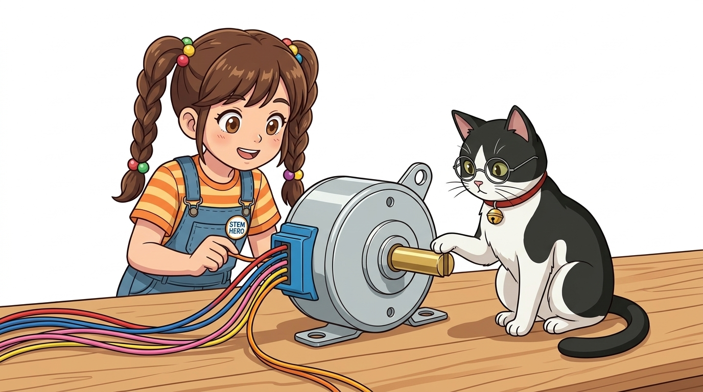
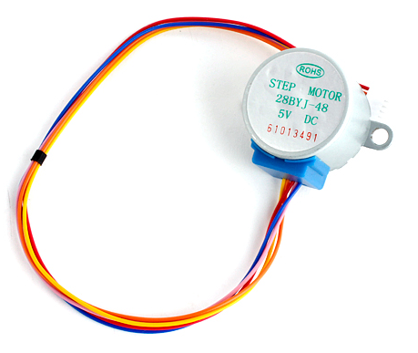
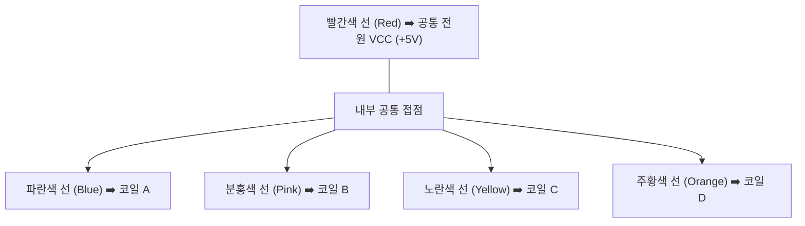
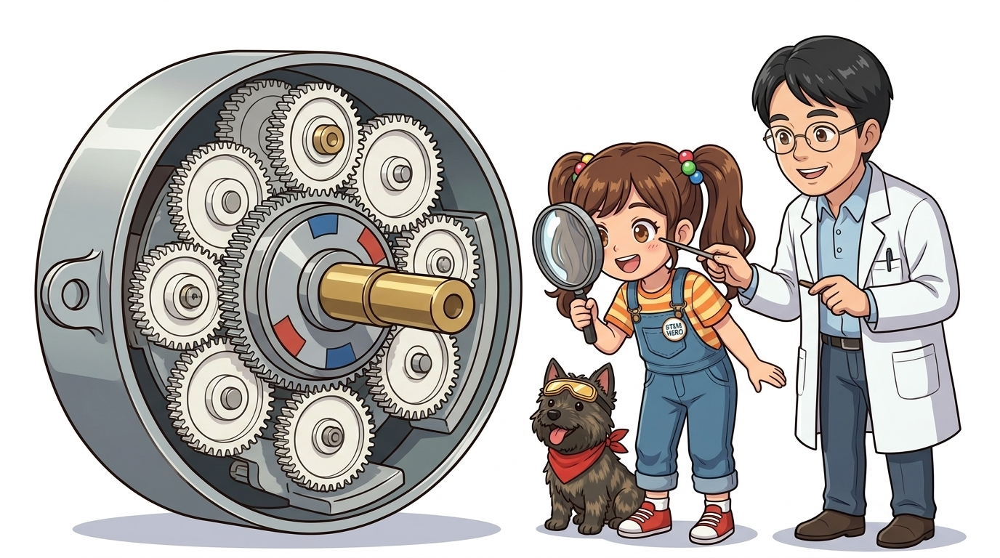
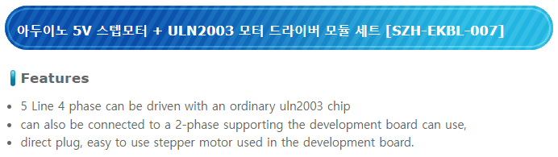
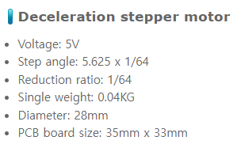

# 088_28BYJ48_감속스텝모터 🥫⚙️

**도로시와 지니가 함께하는 5선식 유니폴라 스텝모터와 1:64 감속 기어의 비밀**

* 👧 **도로시**: "지니야! 이 모터는 은색 참치 캔처럼 납작하게 생겼는데, 전선이 무려 5가닥이나 무지개처럼 튀어나와 있어! SG90 서보모터보다 전선이 더 많은데 어떻게 연결해?"
* 🐱 **지니**: "이 모터가 바로 전 세계 아두이노 키트에 빠짐없이 들어있는 국민 스텝모터 **28BYJ-48 5V 유니폴라 모터**야! 에어컨 실내기에서 찬바람 방향 날개를 조용하고 정밀하게 오르내릴 때 실제로 쓰이는 모터란다!"
* 🐶 **토토**: "바우! 5개 전선이 어떤 비밀을 품고 있는지 파헤쳐 보자 멍!"

* 🖥️ **강의 슬라이드**: [slides.md](./slides.md)

---

## 1. 도로시의 관찰: 은색 틴 캔(Tin-Can) 구조와 황동 샤프트

### 🥫 튼튼하고 경제적인 스탬핑 캔 하우징

28BYJ-48 모터는 프레스로 찍어낸 두 개의 금속 컵을 맞물려 조립하는 **틴 캔(Tin-can / Claw-pole) 구조**로 대량 생산되어 매우 저렴하면서도 내구성이 우수합니다.

* **D-컷 황동 출력축 (D-cut Brass Shaft)**:
  * 모터 축의 한쪽 면이 알파벳 'D' 모양으로 평평하게 깎여 있어, 바퀴나 기어, 링크를 꽂았을 때 헛돌지 않고 단단하게 동력을 전달합니다.
* **장착용 플랜지 귀 (Mounting Flange)**:
  * 양옆에 볼트 구멍 2개가 뚫려 있어 아크릴 판이나 3D 출력 프레임에 견고하게 고정할 수 있습니다.

---

## 2. 28BYJ-48 모델명에 숨겨진 암호 해독

### 🔍 영문과 숫자로 읽어내는 모터 엔지니어링 규격

중국 표준 모터 명명법에 따라 지어진 이름 속에는 모터의 모든 하드웨어 특성이 녹아 있습니다.

| 기호 | 한자 / 영문 원어 | 의미 및 규격 | 설명 |
| :---: | :--- | :--- | :--- |
| **28** | 外径 28mm | **모터 외경 지름 28mm** | 소형 캔 타입 표준 직경 |
| **B** | 步进 (Bùjìn) | **스텝모터 (Stepping Motor)** | 펄스로 회전하는 모터 |
| **Y** | 永磁 (Yǒngcí) | **영구자석형 (Permanent Magnet)** | 내부에 영구자석 로터 내장 (PM형) |
| **J** | 减速 (Jiǎnsù) | **감속 기어 내장 (Geared)** | 내부에 다단 유성 감속 기어박스 포함 |
| **48** | 4相 8拍 | **4상 8스텝 구동 방식** | 4개의 여자 코일로 구동 |

---

## 3. 5가닥 무지개 전선의 정체: 5선식 유니폴라(Unipolar)

### 🌈 1개의 공통 전원선과 4개의 코일 제어선

28BYJ-48은 코일 중심 탭(Center Tap)을 하나로 묶어낸 **유니폴라(Unipolar)** 방식입니다.

* **빨간색 선 (Common VCC)**:
  * 4개의 전자석 코일에 공통으로 +5V 전원을 공급하는 전선입니다.
* **코일 제어선 (Blue, Pink, Yellow, Orange)**:
  * 각 코일의 반대쪽 끝선으로, 아두이노 드라이버가 이 선들을 순서대로 **접지(GND)로 당겨줄 때마다(LOW 스위칭)** 해당 코일에 전류가 흐르며 자석이 켜집니다!

---

## 4. 내부에 숨겨진 마법: 1:64 정밀 감속 기어박스

### ⚙️ 속도를 1/64로 줄여 강력한 토크와 초정밀 해상도 달성

모터 캔 내부를 열어보면 초소형 나일론 톱니바퀴들이 여러 단으로 맞물려 있습니다.

* **기어 감속비 (Gear Ratio)**: **약 64 : 1** (정확히는 63.68395 : 1)
  * 내부 모터 로터가 **64바퀴** 돌아야 바깥 황동 축이 **정확히 딱 1바퀴** 돕니다.
* **1회전당 필요 스텝 수 계산**:
  * 내부 순수 스텝각: $5.625^\circ / 64$ (1스텝당 약 $0.08789^\circ$)
  * **풀 스텝 (Full-step, 4단계 여자)**: $360^\circ / (5.625^\circ / 32) \approx$ **2048 스텝 / 1회전**
  * **하프 스텝 (Half-step, 8단계 여자)**: 1회전당 **4096 스텝**의 초정밀 해상도!

---

## 5. 28BYJ-48의 전기적 규격 및 저항 특성

### 📊 안정적인 구동을 위한 엔지니어링 체크리스트

| 특성 항목 | 표준 규격값 | 엔지니어링 팁 |
| :--- | :--- | :--- |
| **정격 정전압** | **DC 5V** (12V 모델도 별도 존재) | 아두이노 키트 모델은 5V 전용 |
| **코일 직류 저항** | **약 50 Ω $\pm 7\%$** | 옴의 법칙: $I = 5\text{V} / 50\Omega = 100\text{mA}$ |
| **최대 인출 토크** | **> 34.3 mN·m (약 350 g·cm)** | 감속 기어 덕분에 크기 대비 강력함 |
| **절연 저항** | > 10 MΩ (500V) | 누전 및 쇼트 방지 설계 |
| **작동 소음** | < 35 dB (속삭이는 소리 수준) | 매우 정숙하여 실내 가전용으로 최적 |

---

## 6. 아두이노 핀으로 직접 돌릴 수 없는 이유: 드라이버의 필요성

### 🛡️ 아두이노 MCU를 태우지 않기 위한 든든한 보디가드

* 아두이노 우노의 디지털 GPIO 핀 1개가 안전하게 흘려줄 수 있는 최대 전류는 **약 20mA**입니다.
* 하지만 28BYJ-48의 코일 1개를 켜려면 최소 **100mA**, 2개를 동시에 켜면 **200mA** 이상의 전류가 필요합니다.
* 만약 아두이노 핀에 28BYJ-48 전선을 직접 꽂고 코드를 돌리면, 아두이노 메인 칩(ATmega328P) 내부 회로가 과전류로 즉시 타버립니다!
* 따라서 아두이노의 미세한 신호를 받아 고전류 전원을 스위칭해주는 **ULN2003 트랜지스터 어레이 드라이버 보드**가 반드시 함께 사용되어야 합니다.

---

## 🌟 도로시와 지니의 핵심 요약 노트!

* 👧 **도로시**: "빨간 선(VCC)과 4개의 코일 선(파랑, 분홍, 노랑, 주황)으로 되어 있고, 64:1 감속 기어가 들어있어서 2048 스텝을 주면 정확히 한 바퀴를 도는구나!"
* 🐱 **지니**: "정답이야! 코일 전류가 크기 때문에 아두이노 보드를 보호하기 위해 **ULN2003 드라이버 모듈**을 중간에 꼭 거쳐야 한단다."
* 🐶 **토토**: "바우! 그럼 다음 장에서 모터의 든든한 보디가드 **ULN2003 모터 드라이버**를 만나보자 멍!"
