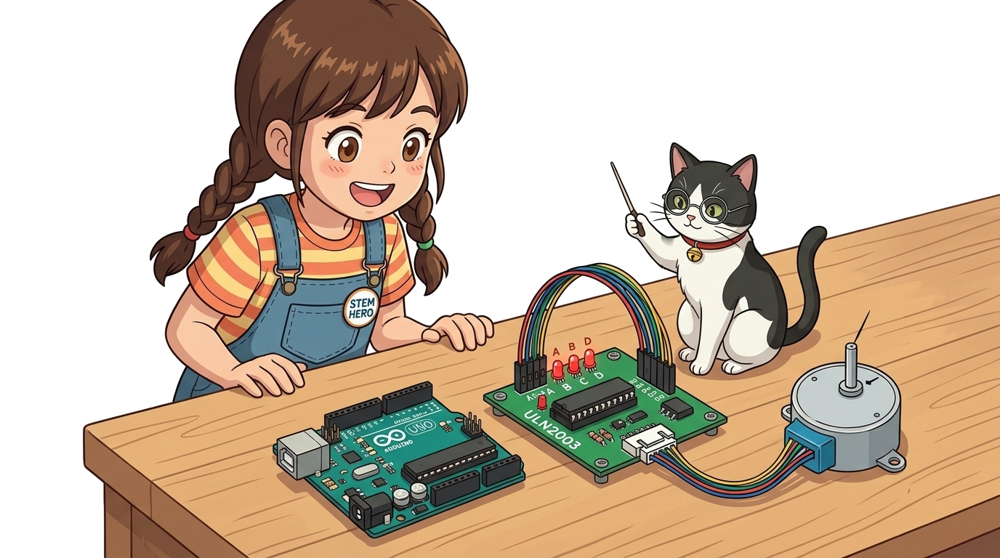
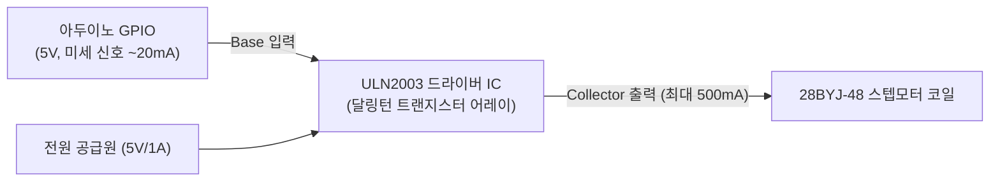
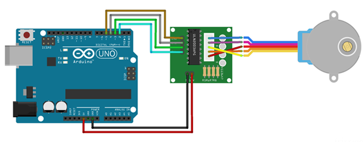
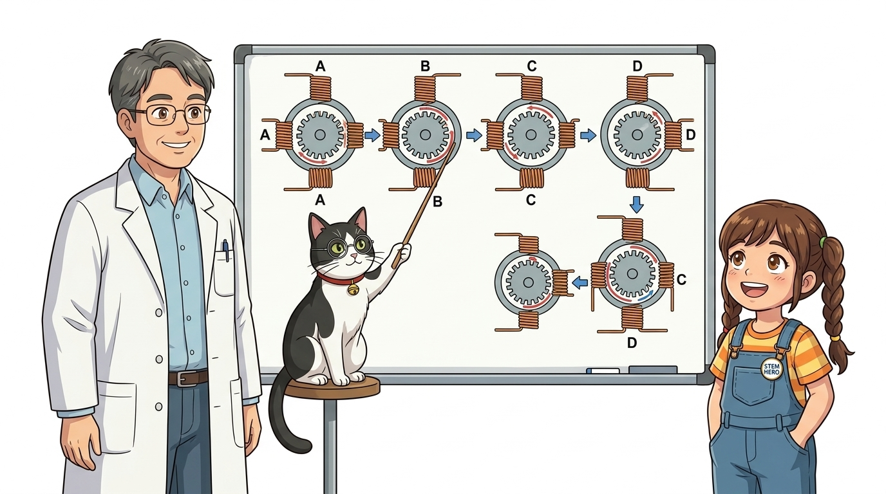
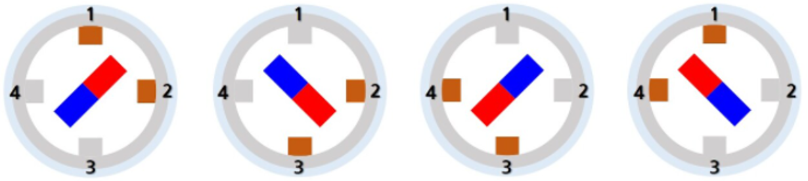
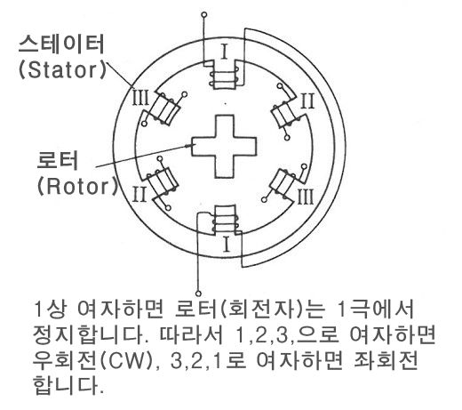
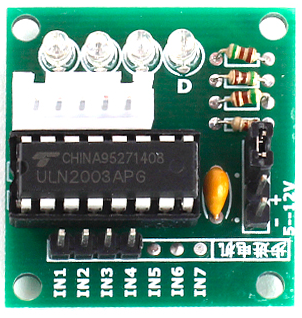

# 089_ULN2003_스텝드라이버 🛡️⚡



**도로시와 지니가 함께하는 달링턴 트랜지스터 어레이와 3대 코일 여자(Excitation) 기법**

* 👧 **도로시**: "지니야! LED처럼 스텝모터 전선 4개도 아두이노 디지털 핀에 바로 꽂아서 코딩하면 안 돼? 왜 중간에 네모난 칩이 박힌 초록색 드라이버 기판을 꼭 거쳐야 해?"
* 🐱 **지니**: "아두이노 우노의 디지털 핀은 안전 한계 전류가 20mA에 불과하거든! 하지만 스텝모터는 코일을 켤 때마다 **200mA가 넘는 큰 전류**를 벌컥벌컥 마신단다! 아두이노 핀이 과전류로 타버리지 않도록 중간에서 전기를 시원하게 퍼 올려주는 **보디가드(ULN2003)** 가 반드시 필요하단다!"
* 🐶 **토토**: "바우! 작은 신호로 거대한 전류 스위치를 찰칵 열어주는 마법의 증폭기다 멍!"

* 🖥️ **강의 슬라이드**: [slides.md](./slides.md)

---

## 1. 도로시의 걱정: 아두이노 MCU 보호와 전류 증폭의 필요성


### 🛡️ 제어 신호(Logic)와 전력 공급(Power)의 분리

마이크로컨트롤러(ATmega328P)는 계산과 판단을 내리는 '두뇌'일 뿐, 물리적인 모터를 힘차게 돌리는 발전기가 아닙니다.



* **역할**: 아두이노가 5V HIGH 신호를 주면, ULN2003 내부 트랜지스터가 닫히면서 모터 코일 전류를 시원하게 접지(GND)로 싱크(Sink)해 줍니다.
* **역기전력(Flyback EMF) 방어**: 모터 코일이 꺼질 때 튀어나오는 수십 볼트의 역전압 스파크를 흡수하는 플라이백 다이오드가 칩 내부에 내장되어 있어 아두이노를 완벽히 보호합니다.

---

## 2. ULN2003A 드라이버 모듈의 구조와 부품


### 🔍 7채널 NPN 달링턴 트랜지스터 어레이와 상태 표시 LED

우리가 사용하는 모듈 보드는 초보자도 쉽게 다룰 수 있도록 다양한 편의 기능이 갖추어져 있습니다.

* **ULN2003A IC 칩**:
  * 2개의 트랜지스터를 묶어 증폭률을 극대화한 '달링턴 페어' 회로가 7개 들어있는 산업 표준 고전압/대전류 드라이버 칩입니다.
* **4개의 상태 표시 LED (A, B, C, D)**:
  * 코일 1, 2, 3, 4번에 전류가 통과할 때마다 빨간색 LED가 켜져, 모터가 도는 순서와 박자를 눈으로 실시간 확인할 수 있습니다.
* **화이트 5핀 JST 커넥터**:
  * 28BYJ-48 모터의 5가닥 케이블을 뒤집히지 않게 홈에 맞춰 원터치로 결합합니다.
* **점퍼 핀 (ON/OFF)**:
  * 모터 전원 라인을 수동으로 차단할 수 있는 전원 차단 스위치 역할을 합니다.

---

## 3. 아두이노와 ULN2003 드라이버 배선도



### 🔌 6가닥 점퍼선으로 완성하는 하드웨어 회로

아두이노의 디지털 핀 4개를 드라이버 입력 핀(IN1 ~ IN4)에 순서대로 연결합니다.

| 드라이버 보드 핀 | 아두이노 우노 연결 핀 | 기능 역할 |
| :--- | :--- | :--- |
| **IN1** | **디지털 2번 핀 (D2)** | A상 코일 구동 제어 |
| **IN2** | **디지털 3번 핀 (D3)** | B상 코일 구동 제어 |
| **IN3** | **디지털 4번 핀 (D4)** | C상 코일 구동 제어 |
| **IN4** | **디지털 5번 핀 (D5)** | D상 코일 구동 제어 |
| **+ (VCC)** | **5V 핀** (외장 배터리 +) | 코일 공통 전원 공급 (빨간 선으로 전달) |
| **- (GND)** | **GND 핀** (외장 배터리 -) | 공통 접지선 |

---

## 4. 스텝모터의 3대 코일 여자(Excitation) 방식 완전 비교



### 🌀 코일을 켜는 순서에 따라 힘과 부드러움이 달라진다!

스텝모터는 코일을 어떤 조합으로 켜느냐에 따라 토크(힘), 소모 전력, 회전 해상도가 달라집니다.

| 여자 방식 | 영문 명칭 | 한 주기 스텝 | 1회전 필요 스텝 수 | 장점 및 특징 |
| :--- | :--- | :---: | :---: | :--- |
| **1상 여자** | Wave Drive (1-Phase) | 4단계 | **2048 스텝** | 전력 소모가 가장 적음. (토크가 약함) |
| **2상 여자** | Full-Step (2-Phase) | 4단계 | **2048 스텝** | **항상 코일 2개 활성화 ➡️ 최대 토크 발휘!** |
| **1-2상 여자** | **Half-Step** | **8단계** | **4096 스텝** | **1회전에 4096스텝! 진동 없이 극도로 부드러움** |

---

## 5. 실습 1: 강력한 토크의 2상 여자(2-Phase Full-Step) 스케치



### 💻 비트마스크(Bitmask)와 4단계 순환 패턴으로 1바퀴 회전

코일을 2개씩 짝지어 켜는 4단계 이진수 비트 패턴(1100 $\to$ 0110 $\to$ 0011 $\to$ 1001)을 배열로 정의하여 순차 구동합니다.

```cpp
// 2상 여자 시계방향(CW) 4단계 비트 패턴
// IN1, IN2, IN3, IN4 순서 (1 = 켜짐, 0 = 꺼짐)
const int stepCW[4] = {
  0b1100, // 1단계: 코일 A + B 켜짐
  0b0110, // 2단계: 코일 B + C 켜짐
  0b0011, // 3단계: 코일 C + D 켜짐
  0b1001  // 4단계: 코일 D + A 켜짐
};

const int motorPins[4] = {2, 3, 4, 5}; // IN1, IN2, IN3, IN4 핀 배열

void setup() {
  for (int i = 0; i < 4; i++) {
    pinMode(motorPins[i], OUTPUT); // 모든 모터 핀을 출력으로 초기화
  }
}

void loop() {
  // 1회전 = 2048 스텝 회전
  for (int step = 0; step < 2048; step++) {
    int patternIndex = step % 4; // 0, 1, 2, 3 순환 인덱스
    
    for (int p = 0; p < 4; p++) {
      // bitRead() 함수로 패턴의 각 비트(0 또는 1)를 읽어 핀에 출력
      digitalWrite(motorPins[p], bitRead(stepCW[patternIndex], p));
    }
    delay(2); // 스텝 간 지연 시간 (2ms가 가장 안정적)
  }
  
  delay(1000); // 1회전 후 1초 정지
}
```

---

## 6. 실습 2: 진동 없는 초정밀 1-2상 하프스텝(Half-Step) 스케치


### 🔬 4096스텝으로 쪼개어 부드럽게 미끄러지듯 회전

1개 켜기와 2개 켜기를 번갈아 수행하는 8단계 패턴을 적용하면 스텝 각이 절반으로 줄어들어 소음과 떨림이 사라집니다.

```cpp
// 1-2상 하프스텝 8단계 비트 패턴
const int halfCW[8] = {
  0b1000, // A
  0b1100, // A + B
  0b0100, // B
  0b0110, // B + C
  0b0010, // C
  0b0011, // C + D
  0b0001, // D
  0b1001  // D + A
};

const int motorPins[4] = {2, 3, 4, 5};

void setup() {
  for (int i = 0; i < 4; i++) pinMode(motorPins[i], OUTPUT);
}

void loop() {
  // 1회전 = 4096 스텝 (초정밀 회전)
  for (int step = 0; step < 4096; step++) {
    int patternIndex = step % 8; // 0~7 순환
    for (int p = 0; p < 4; p++) {
      digitalWrite(motorPins[p], bitRead(halfCW[patternIndex], p));
    }
    delay(1); // 하프스텝은 진동이 적어 1ms 고속 펄스도 소화 가능!
  }
  delay(1000);
}
```

---

## 7. 내부 플라이백 다이오드와 발열 관리 팁



### ⚡ 인덕턴스 코일 구동 시 반드시 알아야 할 주의점

* **코일 발열은 정상 현상**:
  * 스텝모터는 정지해 있을 때도 위치를 유지하기 위해 전기를 계속 먹기 때문에 모터 캔 표면이 따끈따끈해집니다(섭씨 40~50도).
* **장시간 대기 시 전원 끄기**:
  * 모터가 회전할 필요가 없을 때는 4개의 핀을 모두 `LOW`로 내려주면 코일 전류가 완전히 차단되어 발열과 배터리 낭비를 막을 수 있습니다.
  * `for(int p=0; p<4; p++) digitalWrite(motorPins[p], LOW);`

---

## 🌟 도로시와 지니의 핵심 요약 노트!



* 👧 **도로시**: "ULN2003 드라이버가 아두이노 대신 200mA의 큰 전류를 공급해주고, 보드 위의 빨간 LED 4개가 깜빡거리면서 코일 순서를 보여주니까 정말 신기해!"
* 🐱 **지니**: "힘이 필요할 땐 2상 여자(2048스텝), 부드러운 정밀도가 필요할 땐 1-2상 하프스텝(4096스텝)을 선택하면 된단다."
* 🐶 **토토**: "바우! 이제 아두이노 전용 라이브러리로 스텝모터의 회전 속도와 정밀 각도를 척척 제어해보자 멍!"
