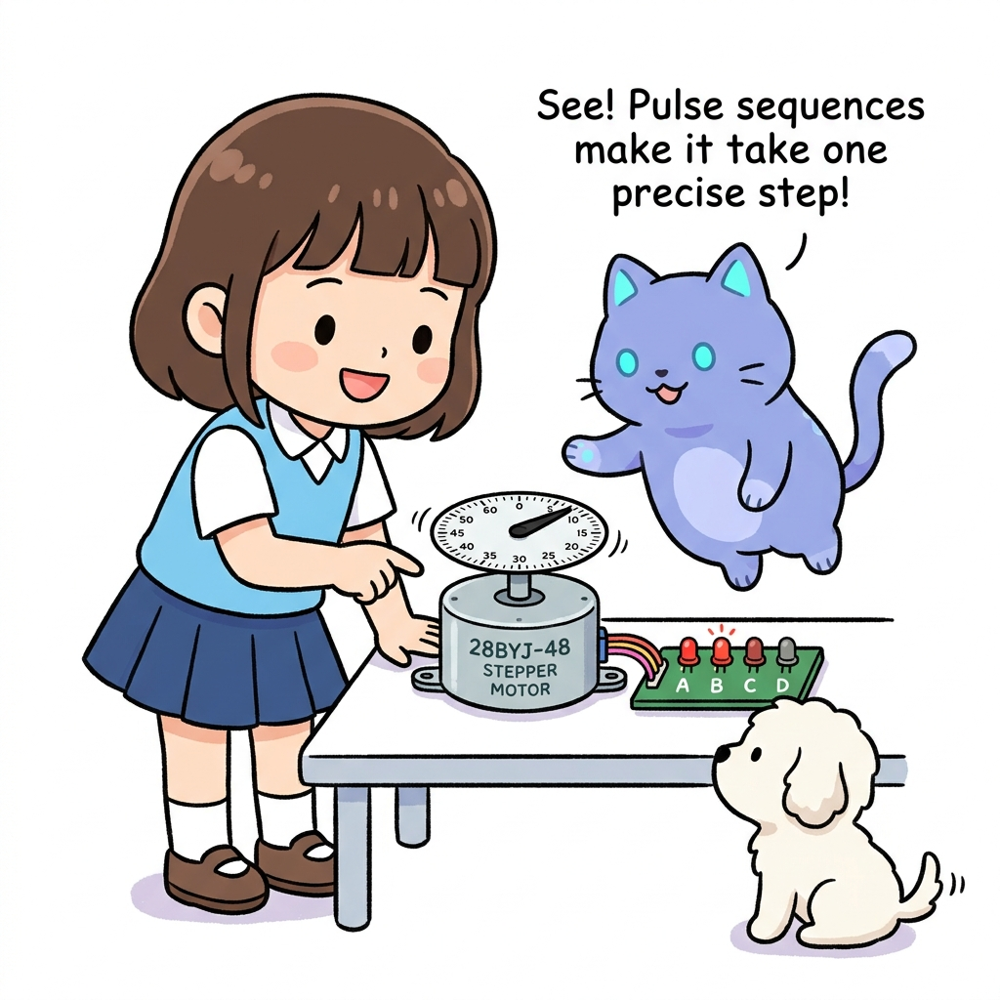
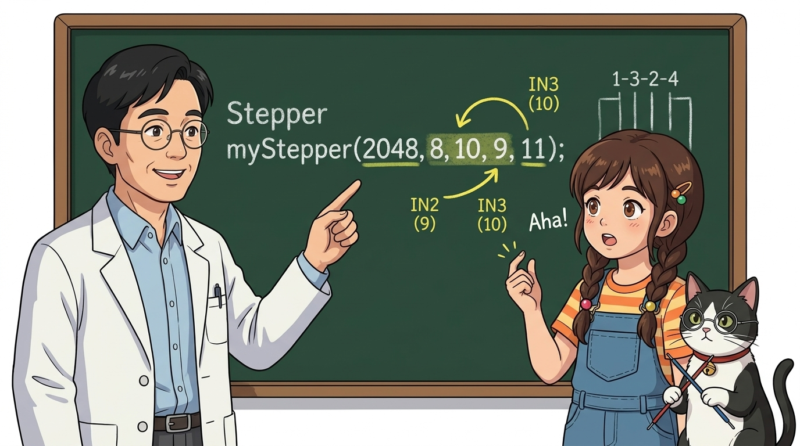
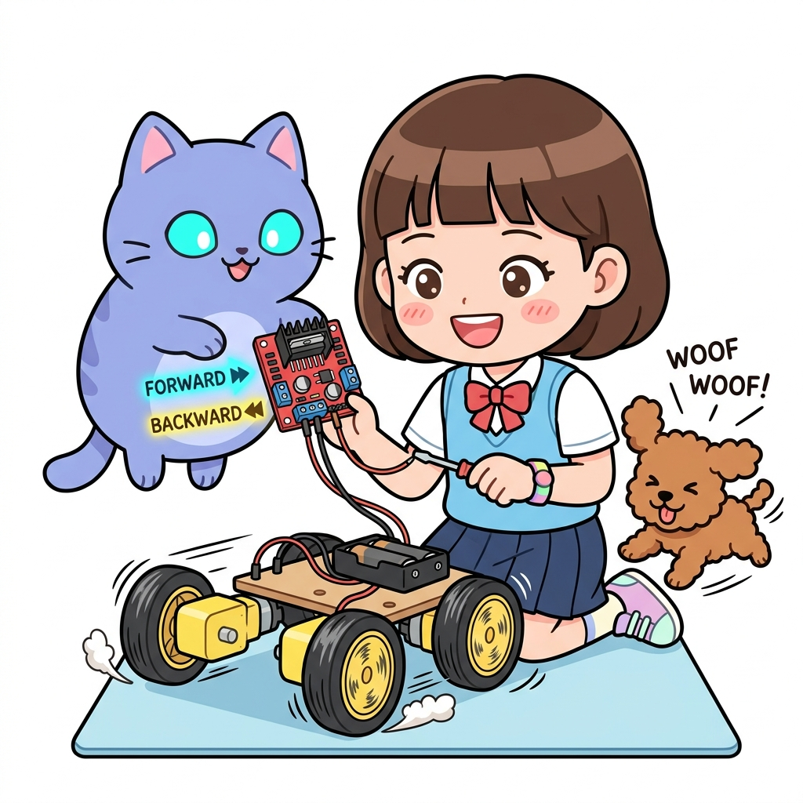

# 090_스텝모터_구동제어실습 💻🔄



**도로시와 지니가 함께하는 `<Stepper.h>` 라이브러리와 28BYJ-48 정·역회전 실습**

* 👧 **도로시**: "지니야! 지난 시간에 `0b1100, 0b0110...` 2진수 비트 배열을 적느라 눈이 너무 아팠어! 서보모터처럼 라이브러리 함수 한 줄로 훨씬 편하게 돌릴 수는 없을까?"
* 🐱 **지니**: "하하! 물론 아두이노 표준 내장 라이브러리인 **`<Stepper.h>`** 가 완벽하게 준비되어 있단다! 4개 코일의 점등 순서를 라이브러리가 알아서 계산해주니 코드 몇 줄이면 1바퀴를 뚝딱 돌릴 수 있지!"
* 🐶 **토토**: "바우! 라이브러리 덕분에 코딩이 백 배는 쉬워졌다 멍!"

* 🖥️ **강의 슬라이드**: [slides.md](./slides.md)

---

## 1. 도로시의 고민: 비트마스크를 매번 직접 작성해야 할까?


### 📜 저수준 제어 vs 고수준 라이브러리 추상화

직접 비트를 조작하는 방식은 모터의 물리적 원리를 깊이 이해하는 데 필수적이지만, 복잡한 프로젝트를 만들 때는 코드가 길어지고 유지보수가 어렵습니다.

| 비교 항목 | 직접 비트 패턴 제어 (Bitmask) | `<Stepper.h>` 표준 라이브러리 |
| :--- | :--- | :--- |
| **코드 복잡도** | 2진수 배열, `for` 루프, `bitRead()` 등 필요 | `myStepper.step(2048);` 단 한 줄 |
| **속도 설정** | `delay(ms)` 값으로 수동 계산 | `myStepper.setSpeed(15);` RPM 단위 지정 |
| **방향 전환** | 정회전용/역회전용 배열을 따로 만들어야 함 | **양수(+)는 정회전, 음수(-)는 역회전** |
| **초보자 편의성** | 복잡하고 오타 발생 위험 높음 | **매우 직관적이고 표준화됨** |

---

## 2. `<Stepper.h>` 객체 선언과 28BYJ-48 전용 핀 매핑의 비밀



### 🚨 왜 `8, 9, 10, 11`이 아니라 `8, 10, 9, 11` (1-3-2-4) 순서일까?

28BYJ-48 모터를 `<Stepper.h>`로 돌릴 때 가장 많이 범하는 실수가 핀 번호를 8, 9, 10, 11 순서대로 적는 것입니다.

```cpp
#include <Stepper.h> // 표준 라이브러리 포함

const int STEPS_PER_REV = 2048; // 1:64 감속 기어가 적용된 1바퀴 스텝 수

// [중요!] 생성자 매개변수: Stepper 객체명(1회전스텝수, IN1, IN3, IN2, IN4)
Stepper myStepper(STEPS_PER_REV, 8, 10, 9, 11);
```

> [!IMPORTANT]
> **1-3-2-4 핀 배치의 기계적 이유**:
> `<Stepper.h>`는 일반적인 2상 바이폴라 모터(A $\to$ A-bar $\to$ B $\to$ B-bar) 기준으로 설계되어 있습니다. 하지만 28BYJ-48 유니폴라 모터는 코일의 물리적 회전 순서가 1번 $\to$ 2번 $\to$ 3번 $\to$ 4번 순서이므로, 라이브러리의 교차 시퀀스와 모터의 물리적 코일 위상을 일치시키기 위해 **IN2와 IN3의 핀 순서를 서로 맞바꾸어(1, 3, 2, 4)** 선언해야 탈조 없이 부드럽게 돌아갑니다!

---

## 3. 핵심 멤버 함수 2가지 완전 정복



### 🏎️ `setSpeed()`와 `step()`으로 끝내는 완벽 제어

1. **`myStepper.setSpeed(long whatSpeed);`**:
   * 모터의 회전 속도를 **RPM(Revolutions Per Minute, 분당 회전수)** 단위로 설정합니다.
   * 28BYJ-48 모터에 권장되는 안정적인 속도는 **10 ~ 15 RPM**입니다.
   * 너무 빠른 속도(예: 30 RPM 이상)를 지정하면 내부 기어의 관성과 코일 충전 시간 부족으로 모터가 덜덜 떨며 멈춰버리는 **탈조(Step-out)** 가 발생합니다.
2. **`myStepper.step(int numberOfSteps);`**:
   * 지정한 스텝 수만큼 모터를 회전시킵니다.
   * **양수 (+)**: 시계 방향(Clockwise, CW) 회전
   * **음수 (-)**: 반시계 방향(Counter-Clockwise, CCW) 회전
   * 이 함수는 목표 스텝만큼 다 돌 때까지 코드 실행을 멈추고 기다리는 **블로킹(Blocking) 함수**입니다.

---

## 4. 실습 코드: 정회전 1바퀴 ➡️ 역회전 1바퀴 반복


### 💻 2048스텝으로 정방향과 역방향을 오가는 표준 스케치

```cpp
#include <Stepper.h> // 아두이노 표준 스텝모터 라이브러리

// 28BYJ-48 모터의 1회전 스텝 수 (2-Phase 기준 2048 스텝)
const int stepsPerRevolution = 2048;

// 아두이노 핀: D8(IN1), D10(IN3), D9(IN2), D11(IN4) - 순서 주의!
Stepper myStepper(stepsPerRevolution, 8, 10, 9, 11);

void setup() {
  // 모터 속도를 분당 12회전(12 RPM)으로 설정 (가장 힘 있고 안정적인 속도)
  myStepper.setSpeed(12);
  Serial.begin(9600);
  Serial.println("스텝모터 1바퀴 왕복 실습 시작!");
}

void loop() {
  Serial.println("시계 방향(CW) 1바퀴 회전 중...");
  // 1. 시계 방향으로 정확히 2048스텝(360도) 전진
  myStepper.step(stepsPerRevolution);
  delay(1000); // 회전 완료 후 1초 휴식

  Serial.println("반시계 방향(CCW) 1바퀴 역회전 중...");
  // 2. 음수 부호를 붙여 반시계 방향으로 2048스텝(-360도) 후진
  myStepper.step(-stepsPerRevolution);
  delay(1000); // 1초 휴식
}
```

---

## 5. 실습 시 자주 발생하는 실수 체크리스트

| 증상 | 유력한 원인 | 해결 방법 |
| :--- | :--- | :--- |
| **모터가 돌지 않고 징~ 소리 내며 떨린다** | 객체 생성 시 핀 순서를 `8, 9, 10, 11`로 적음 | `8, 10, 9, 11` (1-3-2-4 순서)로 수정 |
| **모터가 덜덜거리다 멈춰버린다** | `setSpeed()`의 RPM 값이 너무 높음 (20 초과) | 속도를 `10 ~ 14 RPM` 범위로 낮춤 |
| **드라이버 LED는 깜빡이는데 축이 안 돈다** | 전원 전류 부족 (아두이노 5V 전압 강하) | ULN2003 보드에 5V 외장 배터리/어댑터 연결 |

---

## 🌟 도로시와 지니의 핵심 요약 노트!


* 👧 **도로시**: "`#include <Stepper.h>`를 쓰고 핀을 `(8, 10, 9, 11)` 순서로 꽂은 뒤 `myStepper.step(2048)` 딱 한 줄만 실행하면 정확히 1바퀴를 돈다는 걸 배웠어!"
* 🐱 **지니**: "맞아! 양수는 시계방향, 음수는 반시계방향으로 움직이니 정말 쉽지?"
* 🐶 **토토**: "바우! 이제 스텝 수를 수학 공식으로 변환해서 45도, 90도, 180도 등 원하는 각도로 척척 움직이는 **각도 제어**를 정복해보자 멍!"
