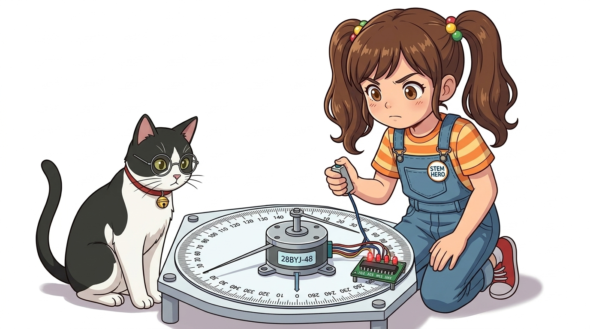
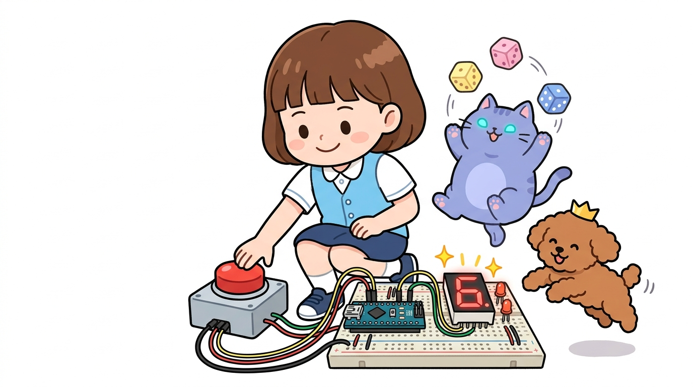
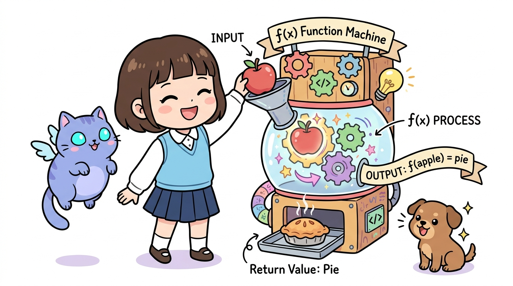

# 091_스텝모터_정밀각도제어 🎯📐



**도로시와 지니가 함께하는 수학 비례식을 이용한 임의 각도 제어와 아날로그시계 프로젝트**

* 👧 **도로시**: "지니야! 1바퀴가 2048스텝이라는 건 알겠는데, 정확하게 90도(직각)나 45도, 혹은 6도씩만 돌리려면 코드를 어떻게 짜야 해?"
* 🐱 **지니**: "간단한 수학 비례식만 세우면 된단다! 전체 360도 중에서 내가 원하는 각도가 차지하는 비율만큼 2048을 곱해주면 정확한 스텝 수가 나오지!"
* 🐶 **토토**: "바우! 초침처럼 째깍째깍 흐르는 진짜 아날로그시계도 만들 수 있다 멍!"

* 🖥️ **강의 슬라이드**: [slides.md](./slides.md)

---

## 1. 도로시의 물음: 90도만 돌리려면 몇 걸음을 걸어야 할까?


### 📐 원(Circle)의 360도와 스텝모터 분해능의 관계

스텝모터는 아날로그 각도를 직접 입력받지 않고 정수 단위의 스텝 수만 이해합니다. 따라서 원하는 각도($\theta$)를 모터가 알아들을 수 있는 발걸음(Step) 수로 변환하는 공식이 필요합니다.

* **28BYJ-48 모터 기준 (2-Phase Full-step)**:
  * 1회전 = **$360^\circ$ = 2048 스텝**
  * 1스텝당 회전 각도 = $360^\circ / 2048 \approx \mathbf{0.17578^\circ}$
  * $1^\circ$ 회전에 필요한 스텝 수 = $2048 / 360 \approx \mathbf{5.6888}$ 스텝

---

## 2. 각도를 스텝 수로 변환하는 황금 공식!


### 🔢 수학 비례식과 각도별 스텝 수 조견표

전체 360도에 대한 목표 각도의 비율에 1회전 전체 스텝 수(2048)를 곱해줍니다.

$$\text{필요한 스텝 수} = 2048 \times \frac{\text{목표 각도}(\theta)}{360^\circ}$$

| 원하는 회전 각도 ($\theta$) | 수학 계산식 | 반올림 정수 스텝 수 | 실제 물리적 용도 |
| :---: | :---: | :---: | :--- |
| **$360^\circ$ (1회전)** | $2048 \times (360 / 360)$ | **2048** 스텝 | 전체 제자리 회전 |
| **$180^\circ$ (반바퀴)** | $2048 \times (180 / 360)$ | **1024** 스텝 | 반대 방향 전환 |
| **$90^\circ$ (직각)** | $2048 \times (90 / 360)$ | **512** 스텝 | 사거리 방향 전환, 로봇 팔 꺾기 |
| **$45^\circ$** | $2048 \times (45 / 360)$ | **256** 스텝 | 8방위 정밀 조향 |
| **$30^\circ$ (시계 1시간)** | $2048 \times (30 / 360)$ | **약 171** 스텝 | 시계 시침(Hour Hand) 1시간 이동 |
| **$6^\circ$ (시계 1초/1분)** | $2048 \times (6 / 360)$ | **약 34** 스텝 | 시계 초침/분침 1초 단위 전진 |

---

## 3. 실습 1: 90도씩 4번 돌아 제자리로 돌아오기



### 🧭 동서남북 4방향을 순서대로 가리키는 정밀 인덱싱

512스텝씩 4번을 회전하여 정확히 사각형 궤적을 그리며 원점으로 복귀하는 예제입니다.

```cpp
#include <Stepper.h>

const int STEPS_PER_REV = 2048; // 1회전 2048스텝
// 핀 순서: 8(IN1), 10(IN3), 9(IN2), 11(IN4)
Stepper myStepper(STEPS_PER_REV, 8, 10, 9, 11);

void setup() {
  myStepper.setSpeed(12); // 12 RPM의 부드러운 속도
  Serial.begin(9600);
  Serial.println("90도 4회전 인덱싱 시작!");
}

void loop() {
  // 90도(512스텝)씩 4번 회전하면 정확히 360도 제자리!
  for (int i = 1; i <= 4; i++) {
    Serial.print(i * 90);
    Serial.println("도 방향으로 회전 중...");
    
    myStepper.step(512); // 정확히 90도 회전
    delay(1000);         // 각 방향에서 1초간 정지하여 대기
  }

  delay(2000); // 1주기 완료 후 2초 대기
}
```

---

## 4. 실습 2: 째깍째깍 아날로그 초시계 만들기!



### 🕰️ 1초마다 6도(34스텝)씩 60번 움직이는 기계식 시계 완성

시계의 1분은 60초이며, 원통($360^\circ$)을 60등분하면 1초당 정확히 **$6^\circ$** 입니다.

```cpp
#include <Stepper.h>

const int STEPS_PER_REV = 2048;
Stepper myStepper(STEPS_PER_REV, 8, 10, 9, 11);

// 6도 회전에 필요한 스텝 수: 2048 * (6 / 360) = 34.133... -> 약 34스텝
const int STEPS_PER_SECOND = 34;

void setup() {
  myStepper.setSpeed(14); // 째깍거림을 빠르게 마치기 위해 14 RPM 설정
}

void loop() {
  // 1분(60초) 동안 매초 6도씩 째깍째깍 전진!
  for (int sec = 1; sec <= 60; sec++) {
    myStepper.step(STEPS_PER_SECOND); // 6도 전진
    delay(1000); // 1초 간격 유지 (실제 타이머와 동기화)
  }
}
```

> [!TIP]
> 28BYJ-48 출력 샤프트에 긴 빨간색 종이 바늘을 테이프로 붙여놓으면, 벽걸이 시계처럼 1초마다 째깍거리며 원을 도는 감성 아날로그시계가 완성됩니다!

---

## 🌟 05단원 모터 구동 대단원 완전 정복!


* 👧 **도로시**: "모터 3총사(DC 모터, 서보모터, 스텝모터)의 차이점을 배우고, PWM과 드라이버 회로를 거쳐 90도 회전과 아날로그시계까지 내 손으로 직접 만들었어!"
* 🐱 **지니**: "대단해 도로시! 전기에너지를 기계적인 힘으로 바꾸는 액추에이터의 핵심을 완벽하게 마스터했단다."
* 🐶 **토토**: "바우! 이제 자동차 바퀴를 쌩쌩 달리게 만드는 **06단원 DC 모터와 H-브리지 드라이버**의 세계로 씽씽 달려가보자 멍!"
