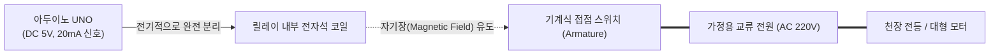
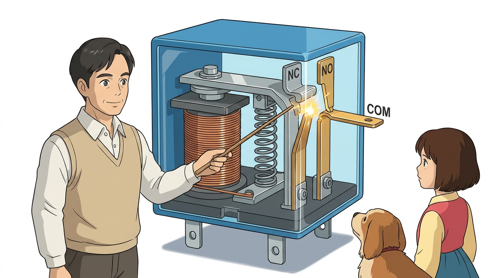

# 092_릴레이_전자석스위치 🧲⚡


**도로시와 지니가 함께하는 5V 저전압으로 고전력 가전을 안전하게 움직이는 절연 스위칭 기술**
* 👧 **도로시**: "지니야! 아두이노로 내 방 천장 형광등(220V)이나 대형 선풍기를 켜고 싶은데, 아두이노 핀에 220V 전선을 바로 꽂으면 펑! 하고 폭발하잖아!"
* 🐱 **지니**: "절대 바로 연결하면 안 돼! 그럴 때 사용하는 최고의 안전 마법 부품이 바로 **릴레이(Relay)** 야! 두 회로가 전선으로 직접 닿지 않고 **전자석의 보이지 않는 자력**으로만 기계식 접점을 밀고 당겨주기 때문에 아두이노가 100% 안전하단다!"
* 🐶 **토토**: "바우! 귀를 기울이면 '찰칵!' 소리를 내며 켜지는 파란 네모 상자다 멍!"
* 📖 **상세 강의 교재**: [index.md](./index.md)


> 여러분 안녕하세요! 이번 시간에는 '092. 릴레이 전자석스위치 🧲⚡'을 주제로 함께 흥미진진한 탐험을 떠나보겠습니다. 오늘 강의에서는 특히 도로시와 지니가 함께하는 5V 저전압으로 고전력 가전을 안전하게 움직이는 절연 스위칭 기술, 👧 도로시: "지니야! 아두이노로 내 방 천장 형광등(220V)이나 대형 선풍기를 켜고 싶은데, 아두이노 핀에 220V 전선을 바로 꽂으면 펑! 하고 폭발하잖아!"를 중심으로 핵심 원리와 응용 방법을 차근차근 배워보겠습니다. 마법 멘토 지니와 호기심 많은 탐험가 도로시, 그리고 귀여운 토토와 함께 신나는 아두이노 모험을 힘차게 시작해 봅시다. 준비되셨나요?

---

## 1. 도로시의 걱정: 저전압 제어부와 고전압 부하의 충돌


* **갈바닉 절연 (Galvanic Isolation)**:
* 제어 회로(아두이노)와 부하 회로(220V) 사이에 물리적인 구리 도선 연결이 전혀 없으므로, 고전압 스파크나 누전이 발생해도 아두이노 쪽으로 절대 넘어오지 않습니다.

### ⚡ 5V 디지털 세계와 220V 고전력 세계의 완벽한 분리
마이크로컨트롤러는 5V 직류 전압과 수십 mA의 미세 전류로만 작동하는 섬세한 전자 부품입니다. 반면 가정용 전등, 전기 온열기, 대형 펌프 등은 100~240V의 고전압 교류 전원과 수 암페어(A)의 거대한 전류를 사용합니다.



> 이번 슬라이드에서는 '1. 도로시의 걱정: 저전압 제어부와 고전압 부하의 충돌'에 대한 실제 동작 코드를 분석해 보겠습니다. 화면의 코드를 살펴보시면, 컴퓨터가 아두이노 하드웨어에 단계별로 명령을 내리는 흐름을 명확하게 확인할 수 있습니다. 여기서 핵심은 갈바닉 절연 (Galvanic Isolation)입니다. 각 함수의 역할과 괄호 안의 매개변수가 하드웨어 핀과 어떤 관계를 맺고 동작하는지 주의 깊게 살펴보시기 바랍니다.

---

## 2. 릴레이(Relay)의 내부 기계 구조와 작동 원리



1. **전자석 코일 (Electromagnet Coil)**:
* 아두이노가 `HIGH` 신호를 주면 코일에 전류가 흐르며 순간적으로 강력한 전자석이 됩니다.
2. **가동 철편 (Armature)**:
* 전자석의 자력에 이끌려 쇠붙이 날개가 **"찰칵!(Click)"** 소리를 내며 끌려옵니다.
3. **접점 전환 (Contacts Switching)**:
* 철편 끝에 달린 은 합금 접점이 반대편 단자에 딱 달라붙으며 고전압 회로를 통전시킵니다.
4. **복귀 스프링 (Return Spring)**:
* 아두이노가 신호를 꺼 `LOW`가 되면 자력이 사라지고, 스프링이 철편을 원래 자리로 밀어내어 스위치를 즉시 끕니다.

### 🧲 전자석(코일)과 가동 철편(Armature)의 상호작용
릴레이의 파란 플라스틱 껍질 속에는 정밀한 전자기 기계 장치가 들어있습니다.

> 이번 슬라이드에서는 '2. 릴레이(Relay)의 내부 기계 구조와 작동 원리'에 대해 자세히 살펴보겠습니다. 화면의 다이어그램과 사진을 함께 참고해 주시기 바랍니다. 첫 번째 핵심은 전자석 코일 (Electromagnet Coil)이며, 두 번째로는 아두이노가 HIGH 신호를 주면 코일에 전류가 흐르며 순간적으로 강력한 전자석이 됩니다.입니다. 여기에 덧붙여 가동 철편 (Armature) 내용까지 함께 이해해 두시면 완벽합니다. 이 원리는 아두이노 시스템 전체를 관통하는 핵심 논리이므로 머릿속에 꼭 정리해 두시기 바랍니다.

---

## 3. 릴레이 모듈의 3대 출력 단자대: COM, NO, NC


* [!NOTE]
* 일반적인 스마트 조명이나 모터를 만들 때는 전원선 한 가닥을 **COM**에 넣고, 부하로 나가는 선을 **NO**에 연결합니다. 이렇게 하면 아두이노가 켜라고 명령할 때만 전기가 통합니다.

| 단자 명칭 | 정식 영문 명칭 | 기본 상태 (신호 OFF 시) | 동작 상태 (신호 ON 시) | 주요 활용 목적 |
| :---: | :--- | :--- | :--- | :--- |
| **COM** | **Common** | 모든 회로의 공통 기준선 | 공통 기준선 | 전원 선 한 가닥을 고정 연결 |
| **NO** | **Normally Open** | **열림 (OFF, 전류 차단)** | **닫힘 (ON, 통전!)** | **평소엔 꺼져 있다가 명령 시 켤 때 (99% 사용)** |
| **NC** | **Normally Closed** | **닫힘 (ON, 항상 켜짐)** | **열림 (OFF, 차단!)** | 화재 경보기, 비상 정지 회로 |

### 🔌 목적에 따라 골라 쓰는 나사 단자대 결선법
릴레이 모듈의 출력 측 파란 나사 터미널 블록에는 영문 약자 3개가 각인되어 있습니다.

> 이번에 살펴볼 내용은 '3. 릴레이 모듈의 3대 출력 단자대: COM, NO, NC'입니다. 슬라이드에 정리된 표를 통해 각 항목의 특징과 수치, 차이점을 한눈에 비교해 보실 수 있습니다. 이 기본 개념을 확실히 잡아두셔야 실제 부품을 브레드보드에 꽂고 코딩할 때 실수 없이 완성할 수 있습니다.

---

## 4. 포토커플러(Optocoupler) 이중 보호 회로


* **빛을 통한 통신 (Optical Isolation)**:
* 아두이노 신호가 들어오면 칩 내부의 적외선 LED가 켜지고, 반대편 포토트랜지스터가 그 빛을 감지하여 릴레이 코일을 작동시킵니다.
* **완벽한 노이즈 차단**:
* 릴레이 코일이 꺼질 때 발생하는 역기전력(Flyback) 노이즈조차 아두이노로 역류하지 못하도록 완벽하게 봉쇄합니다.

### 🛡️ 빛으로 신호를 넘겨주는 궁극의 안전 방패
우리가 사용하는 아두이노용 1채널 릴레이 모듈에는 작은 4핀 검정 칩(PC817 포토커플러)이 장착되어 있습니다.

> 이번에 살펴볼 내용은 '4. 포토커플러(Optocoupler) 이중 보호 회로'입니다. 화면의 회로도와 부품 사진을 보면서 각 핀과 배선이 어떻게 구성되어 있는지 눈으로 직접 따라와 주시기 바랍니다. 첫째로 빛을 통한 통신 (Optical Isolation)에 유의해야 하며, 둘째로 아두이노 신호가 들어오면 칩 내부의 적외선 LED가 켜지고, 반대편 포토트랜지스터가 그 빛을 감지하여 릴레이 코일을 작동시킵니다.라는 점이 핵심입니다. 이 기본 개념을 확실히 잡아두셔야 실제 부품을 브레드보드에 꽂고 코딩할 때 실수 없이 완성할 수 있습니다.

---

## 5. 실습 코드: 1초마다 찰칵찰칵 스위칭 테스트


### 💻 기계식 접점의 경쾌한 소리를 확인하는 스케치

```cpp
// 릴레이 제어 핀을 디지털 10번으로 정의
const int relayPin = 10;

void setup() {
  pinMode(relayPin, OUTPUT); // 릴레이 제어 핀을 출력으로 설정
  Serial.begin(9600);
  Serial.println("전자석 릴레이 스위칭 실습 시작!");
}

void loop() {
  Serial.println("릴레이 켜짐 (접점 닫힘 - 찰칵!)");
  // 신호 HIGH -> 전자석 가동 -> NO 단자 연결 (전등 ON)
  digitalWrite(relayPin, HIGH);
  delay(1000); // 1초간 켜짐 상태 유지

  Serial.println("릴레이 꺼짐 (접점 열림 - 착!)");
  // 신호 LOW -> 전자석 해제 -> NO 단자 차단 (전등 OFF)
  digitalWrite(relayPin, LOW);
  delay(1000); // 1초간 꺼짐 상태 유지
}
```

> 이번 슬라이드에서는 '5. 실습 코드: 1초마다 찰칵찰칵 스위칭 테스트'에 대한 실제 동작 코드를 분석해 보겠습니다. 화면의 코드를 살펴보시면, 컴퓨터가 아두이노 하드웨어에 단계별로 명령을 내리는 흐름을 명확하게 확인할 수 있습니다. 각 함수의 역할과 괄호 안의 매개변수가 하드웨어 핀과 어떤 관계를 맺고 동작하는지 주의 깊게 살펴보시기 바랍니다.

---

## 6. 고전압/대용량 교류 부하 연결 시 안전 수칙


1. **전원 분리 작업**:
* 전선 결선 작업을 할 때는 반드시 벽면 콘센트 플러그를 뽑은 상태에서 나사를 조여야 합니다.
2. **접촉부 절연 처리**:
* 나사 단자대에 물리는 구리선 피복이 바깥으로 삐져나오지 않도록 수축 튜브나 절연 테이프로 감싸줍니다.
3. **릴레이 허용 용량 준수**:
* 릴레이 상단에 인쇄된 규격(예: **10A 250VAC**, **10A 30VDC**)을 초과하는 초대형 전기난로 등에는 사용하지 마세요.

### ⚠️ 감전 사고를 방지하기 위한 엔지니어 필수 안전 규칙

> 이번 슬라이드에서는 '6. 고전압/대용량 교류 부하 연결 시 안전 수칙'에 대해 자세히 살펴보겠습니다. 화면의 다이어그램과 사진을 함께 참고해 주시기 바랍니다. 첫 번째 핵심은 전원 분리 작업이며, 두 번째로는 전선 결선 작업을 할 때는 반드시 벽면 콘센트 플러그를 뽑은 상태에서 나사를 조여야 합니다.입니다. 여기에 덧붙여 접촉부 절연 처리 내용까지 함께 이해해 두시면 완벽합니다. 이 원리는 아두이노 시스템 전체를 관통하는 핵심 논리이므로 머릿속에 꼭 정리해 두시기 바랍니다.

---

## 🌟 도로시와 지니의 핵심 요약 노트!


* 👧 **도로시**: "릴레이는 5V 아두이노의 작은 신호로 전자석을 켜서 기계식 스위치를 물리적으로 찰칵 붙여주는 안전 스위치였구나!"
* 🐱 **지니**: "맞아! COM과 NO 단자를 활용하면 감전 위험 없이 220V 가전제품이나 대용량 모터를 안전하게 원격 조종할 수 있단다."
* 🐶 **토토**: "바우! 이제 릴레이로 전원을 켜고 끄며 회전하는 **DC 모터**의 세계로 떠나보자 멍!"

> 오늘 배운 '🌟 도로시와 지니의 핵심 요약 노트!'의 핵심 내용을 모두 정리해 보았습니다. 오늘 다룬 내용 중에서도 👧 도로시: "릴레이는 5V 아두이노의 작은 신호로 전자석을 켜서 기계식 스위치를 물리적으로 찰칵 붙여주는 안전 스위치였구나!" 부분은 앞으로의 아두이노 실습과 프로젝트에서 계속 사용되는 매우 중요한 기초 지식입니다. 오늘 배운 내용을 꼭 다시 한번 복습해 보시고, 다음 강의에서 더욱 신나고 유익한 모험으로 다시 만나겠습니다. 모두 수고 많으셨습니다!