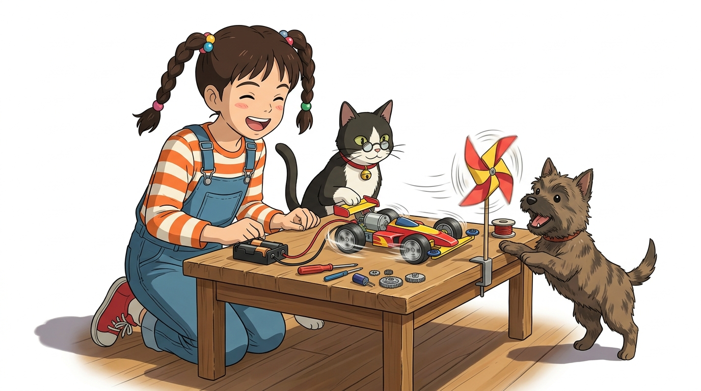
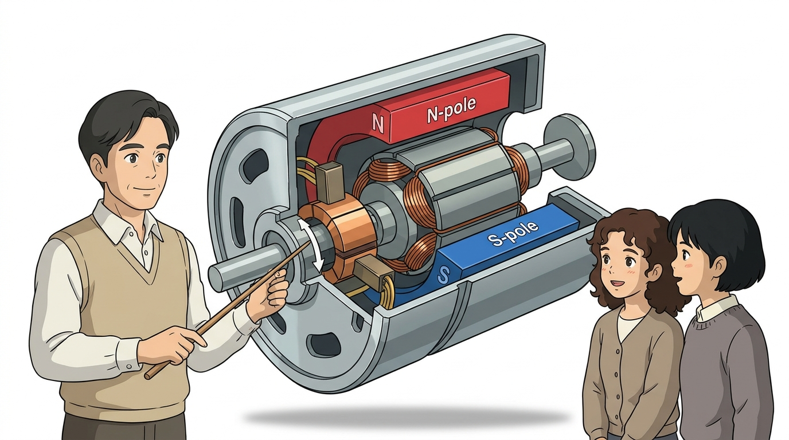
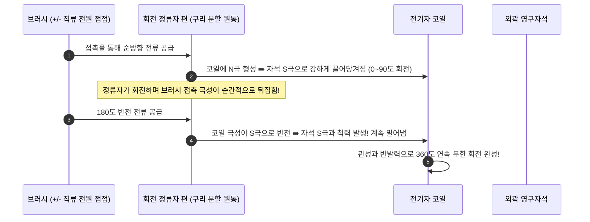
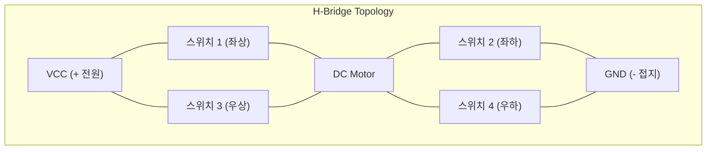

# 093_DC모터_연속회전원리 🏎️⚡

**도로시와 지니가 함께하는 영구자석과 정류자가 만드는 연속 회전과 H-브리지의 비밀**

* 👧 **도로시**: "지니야! 미니카 장난감에 들어있는 작은 모터는 전선이 딱 2개뿐인데 건전지만 대면 미친 듯이 쌩쌩 돌아가! 어떻게 이렇게 빠른 속도로 쉬지 않고 달릴 수 있어?"
* 🐱 **지니**: "그게 바로 기계 산업과 장난감, 전기차의 심장인 **DC 모터 (직류 전동기)** 란다! 전선 2가닥에 플러스(+)와 마이너스(-) 전압만 걸어주면 전자기력에 의해 쉬지 않고 강력한 연속 회전 운동을 만들어내지!"
* 🐶 **토토**: "바우! 선을 반대로 꽂으면 꼬리를 흔들며 뒤로 후진도 한다 멍!"

* 🖥️ **강의 슬라이드**: [slides.md](./slides.md)

---

## 1. 도로시의 궁금증: 미니카 모터는 왜 전선이 2개뿐일까?

### 🏎️ 가장 단순하면서도 가장 강력한 2선식 구동

서보모터(3선식)나 스텝모터(4~5선식)와 달리, 기본 브러시 DC 모터는 단 2가닥의 전선만으로 동작합니다.

* **간결한 인터페이스**:
  * 복잡한 디지털 통신 프로토콜이나 펄스 시퀀스 없이, 직류 전원만 연결하면 곧바로 최대 속도로 회전합니다.
* **극성에 따른 방향 반전**:
  * 빨간 선에 (+), 검은 선에 (-)를 연결하면 시계 방향(정회전)
  * 극성을 거꾸로 바꾸어 빨간 선에 (-), 검은 선에 (+)를 연결하면 즉시 반시계 방향(역회전)으로 전환됩니다.

---

## 2. DC 모터 내부의 3대 핵심 기계 구조

### 🔬 껍질 속에서 쉼 없이 돌아가는 전자기 부품들

브러시 DC 모터의 철 캔 하우징 내부에는 3가지 핵심 부품이 유기적으로 맞물려 있습니다.

1. **고정자 (Stator, 외곽 자석)**:
   * 캔 껍질 안쪽 벽면에 붙어 있는 영구자석(N극과 S극)으로, 흔들리지 않는 기준 자기장을 형성합니다.
2. **회전자 (Rotor / 전기자, 회전축)**:
   * 중심 회전축에 규소 강판을 겹치고 구리 에나멜선을 칭칭 감은 3극(또는 5극) 전자석 코일 뭉치입니다.
3. **정류자(Commutator) & 브러시(Brush)**:
   * 회전자가 180도 돌 때마다 코일에 들어가는 전류 방향을 물리적으로 자동 전환해주는 회전식 기계 스위치입니다.

---

## 3. 회전 원리와 정류자(Commutator)의 기계식 스위칭

### 🔄 멈춤 없는 연속 회전을 가능하게 하는 역전의 비밀

만약 코일에 항상 한 방향으로만 전류가 흐른다면, 회전자는 영구자석의 반대 극에 이끌려 90도만 돌고 그 자리에 달라붙어 멈춰버릴 것입니다.

---

## 4. DC 모터의 물리적 특성: 전압-속도 & 전류-토크

### 📈 전기 엔지니어가 암기해야 할 2대 비례 법칙

DC 모터의 기계적 출력은 입력되는 전기적 상태와 정비례 관계를 형성합니다.

$$\text{회전 속도 (RPM)} \propto \text{인가 전압}(V)$$
$$\text{회전 토크 (Torque, 힘)} \propto \text{흐르는 전류}(I)$$

* **속도를 올리고 싶다면**:
  * 3V 대신 5V, 9V, 12V로 모터 양단의 평균 전압을 높여줍니다 (아두이노 PWM으로 제어).
* **무거운 바퀴를 밀어붙이는 힘이 필요하다면**:
  * 전원 공급기의 전류 용량(A)이 넉넉해야 하며, 모터 코일에 충분한 암페어가 흘러야 스톨(Stall)되지 않습니다.

---

## 5. 브러시 모터의 복병: 마찰 스파크와 전기적 노이즈

### ⚡ 불꽃 노이즈로부터 아두이노를 지키는 스너버(Snubber) 기법

브러시와 정류자가 초당 수천 번 고속으로 비벼지면서 미세한 단락(쇼트)과 접촉 불량이 반복되어 **전기적 불꽃(스파크)** 과 광대역 고주파 전자기 노이즈(EMI)가 발생합니다.

* **아두이노 오작동 유발**:
  * 이 노이즈가 전원선을 타고 들어가면 아두이노가 갑자기 멈추거나 리셋되는 기현상이 발생합니다.
* **해결책 (0.1µF 세라믹 콘덴서 장착)**:
  * 모터의 두 전원 단자 사이에 **0.1µF (코드명 104) 세라믹 콘덴서**를 납땜하면 고주파 스파크를 콘덴서가 흡수하여 아두이노 회로가 안전해집니다.

---

## 6. 전·후진 제어의 핵심 아키텍처: H-브리지 (H-Bridge)

### 🔄 스위치 4개로 전선의 극성을 자유자재로 반전

로봇 자동차가 전진하다가 후진하기 위해 사람이 손으로 전선을 뽑아 반대로 꽂을 수는 없습니다. 트랜지스터 4개를 알파벳 **'H'** 자 형태로 배치하여 전자식으로 극성을 바꿉니다.

---

## 7. H-브리지의 4가지 동작 상태 진리표

### 📊 대각선 스위칭과 급제동(Brake) 원리

| 동작 모드 | S1 (좌상) | S2 (좌하) | S3 (우상) | S4 (우하) | 모터 양단 전압 | 모터 동작 상태 |
| :--- | :---: | :---: | :---: | :---: | :---: | :--- |
| **정회전 (Forward)** | **ON** | OFF | OFF | **ON** | **+ VCC** | **시계 방향 전진 회전** |
| **역회전 (Reverse)** | OFF | **ON** | **ON** | OFF | **- VCC** | **반시계 방향 후진 회전** |
| **급제동 (Brake)** | **ON** | OFF | **ON** | OFF | 0V (단락) | 발전 제동 효과로 즉시 급정지 |
| **자유 회전 (Coast)**| OFF | OFF | OFF | OFF | 개방 (Hi-Z) | 관성으로 스르륵 미끄러지며 정지 |

> [!CAUTION]
> **직통 단락(Shoot-Through) 위험**:
> 만약 실수로 같은 쪽 라인의 **S1과 S2를 동시에 ON** 시키면 전원(VCC)과 접지(GND)가 직결되어 배터리가 폭발하거나 트랜지스터가 불타버립니다.

---

## 🌟 도로시와 지니의 핵심 요약 노트!

* 👧 **도로시**: "DC 모터는 전압으로 속도를 올리고 전류로 힘을 내며, 브러시와 정류자가 회전하면서 자동으로 전류 방향을 뒤집어 멈추지 않고 도는 거였구나!"
* 🐱 **지니**: "맞아! 그리고 자동차의 전진과 후진은 스위치 4개로 극성을 반전시키는 **H-브리지 회로**로 완성한단다."
* 🐶 **토토**: "바우! 다음 시간에 트랜지스터와 릴레이를 이용해 DC 모터를 직접 돌려보자 멍!"
