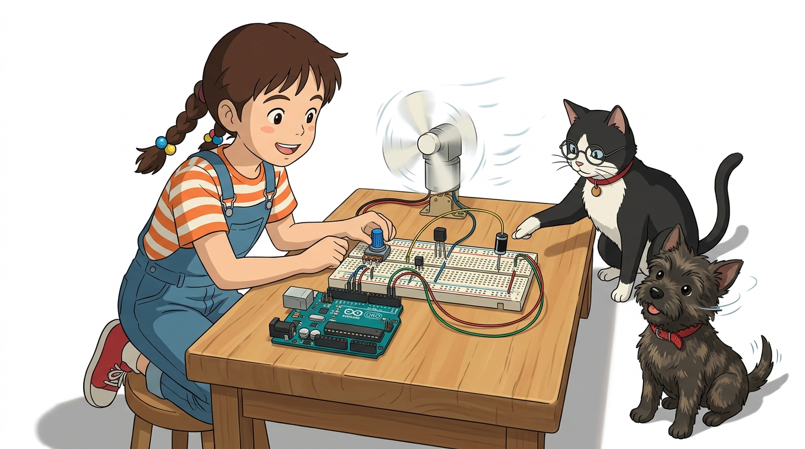
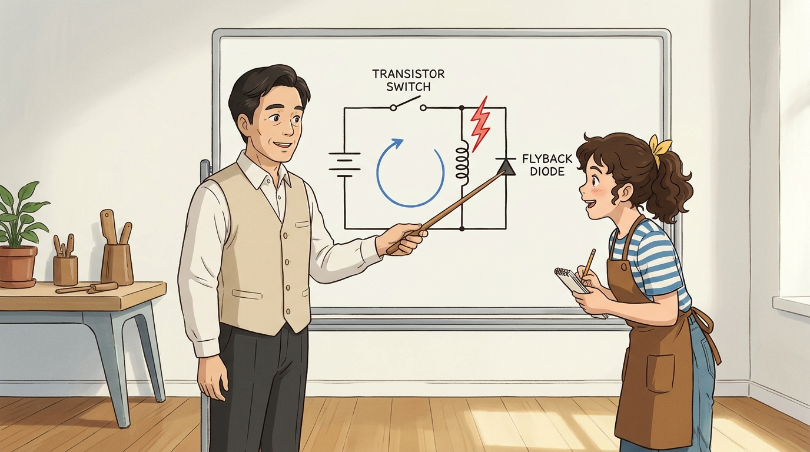
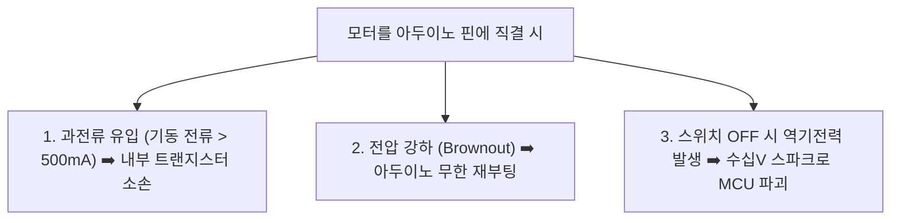
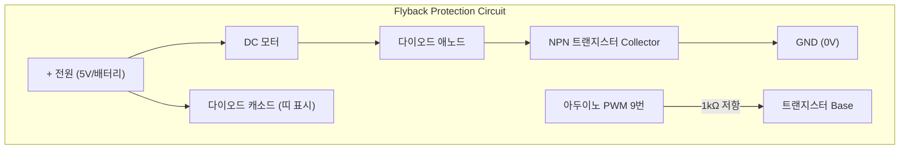

# 094_트랜지스터_다이오드구동 🛡️🔌



**도로시와 지니가 함께하는 전자식 고속 스위칭과 역기전력(Back-EMF) 보호 회로 완벽 정복**
* 👧 **도로시**: "지니야! 아두이노 디지털 9번 핀에 꼬마 DC 모터 전선을 바로 꽂았더니 아두이노가 먹통이 되거나 USB 연결이 끊겨버려! 왜 그러는 거야?"
* 🐱 **지니**: "절대 모터를 핀에 직접 꽂으면 안 돼! 모터가 돌기 시작할 때 순간적으로 500mA 이상의 거대한 전류를 끌어당겨 아두이노 전압이 뚝 떨어지기 때문이야! 게다가 모터가 멈출 때 아두이노를 파괴하는 무서운 **고전압 스파이크(역기전력)** 를 뿜어낸단다!"
* 🐶 **토토**: "바우! 아두이노가 타버리지 않게 지켜주는 든든한 방패 부품들이 필요하다 멍!"
* 📖 **상세 강의 교재**: [index.md](./index.md)


> 여러분 안녕하세요! 이번 시간에는 '094. 트랜지스터 다이오드구동 🛡️🔌'을 주제로 함께 흥미진진한 탐험을 떠나보겠습니다. 오늘 강의에서는 특히 도로시와 지니가 함께하는 전자식 고속 스위칭과 역기전력(Back-EMF) 보호 회로 완벽 정복, 👧 도로시: "지니야! 아두이노 디지털 9번 핀에 꼬마 DC 모터 전선을 바로 꽂았더니 아두이노가 먹통이 되거나 USB 연결이 끊겨버려! 왜 그러는 거야?"를 중심으로 핵심 원리와 응용 방법을 차근차근 배워보겠습니다. 마법 멘토 지니와 호기심 많은 탐험가 도로시, 그리고 귀여운 토토와 함께 신나는 아두이노 모험을 힘차게 시작해 봅시다. 준비되셨나요?

---

## 1. 도로시의 위험한 실험: 모터를 GPIO 핀에 직결하면 생기는 일



* **해결 원칙**:
* 아두이노 핀은 오직 제어 신호(베이스/게이트 트리거)만 공급하고,
* 모터의 실제 구동 전류는 **스위칭 트랜지스터(NPN BJT 또는 N-ch MOSFET)** 를 통해 외부 전원으로부터 공급받아야 합니다.

### ⚠️ 아두이노의 한계와 유도성 부하(Inductive Load)의 특성
아두이노의 디지털 출력 핀(GPIO)은 센서 신호를 읽거나 LED 하나를 켤 정도의 미세 전력(최대 20mA)만 공급할 수 있도록 설계되어 있습니다.



> 이번 슬라이드에서는 '1. 도로시의 위험한 실험: 모터를 GPIO 핀에 직결하면 생기는 일'에 대한 실제 동작 코드를 분석해 보겠습니다. 화면의 코드를 살펴보시면, 컴퓨터가 아두이노 하드웨어에 단계별로 명령을 내리는 흐름을 명확하게 확인할 수 있습니다. 여기서 핵심은 해결 원칙입니다. 각 함수의 역할과 괄호 안의 매개변수가 하드웨어 핀과 어떤 관계를 맺고 동작하는지 주의 깊게 살펴보시기 바랍니다.

---

## 2. 전자식 수도꼭지: 트랜지스터 (BJT / MOSFET) 스위치


* 아두이노가 `analogWrite(9, 0~255)`로 베이스 핀에 펄스를 주면, 듀티비에 비례하여 트랜지스터가 열리면서 모터 회전 속도가 부드럽게 가변됩니다!

| 트랜지스터 핀 | 아두이노 및 회로 연결 위치 | 내부 역할 비유 |
| :--- | :--- | :--- |
| **베이스 (Base, B)** | 아두이노 **PWM 9번 핀** (1kΩ 보호 저항 경유) | 수도꼭지의 손잡이 (미세 제어 신호) |
| **컬렉터 (Collector, C)** | **모터의 (-) 단자** | 물이 들어오는 파이프 (모터 통과 전류 흡수) |
| **에미터 (Emitter, E)** | **GND (공통 접지 0V)** | 물이 빠져나가는 하수구 |

### ⚡ 작은 베이스 전류로 거대한 컬렉터 전류를 제어
NPN 바이폴라 트랜지스터(예: 2N2222, TIP120)는 작은 신호로 거대한 밸브를 여는 기계식 스위치와 같습니다.

> 이번에 살펴볼 내용은 '2. 전자식 수도꼭지: 트랜지스터 (BJT / MOSFET) 스위치'입니다. 슬라이드에 정리된 표를 통해 각 항목의 특징과 수치, 차이점을 한눈에 비교해 보실 수 있습니다. 특히 아두이노가 analogWrite(9, 0~255)로 베이스 핀에 펄스를 주면, 듀티비에 비례하여 트랜지스터가 열리면서 모터 회전 속도가 부드럽게 가변됩니다! 항목은 실제 실습 시 오작동이나 쇼트를 방지하기 위해 꼭 기억해 두셔야 합니다. 이 기본 개념을 확실히 잡아두셔야 실제 부품을 브레드보드에 꽂고 코딩할 때 실수 없이 완성할 수 있습니다.

---

## 3. 무서운 도깨비 전압: 역기전력(Back-EMF)과 렌츠의 법칙


* 스위치가 열리는 순간 전류 변화율($\frac{di}{dt}$)이 무한대에 가까워지며, 코일 양단에 **순간적으로 50V ~ 100V 이상의 역방향 고전압 펄스**가 유도됩니다.
* 이 고전압 스파이크가 트랜지스터와 아두이노를 강타하여 부품을 즉시 태워버립니다.

### 🪓 렌츠의 법칙(Lenz's Law)과 스파크의 정체
모터 속 코일(인덕터, $L$)은 전류가 흐르다가 갑자기 차단되면, 전류의 흐름을 원래대로 유지하려는 강력한 반발 전압을 형성합니다.
$$V = -L \frac{di}{dt}$$

> 이번 슬라이드에서는 '3. 무서운 도깨비 전압: 역기전력(Back-EMF)과 렌츠의 법칙'에 대해 자세히 살펴보겠습니다. 화면의 다이어그램과 사진을 함께 참고해 주시기 바랍니다. 첫 번째 핵심은 스위치가 열리는 순간 전류 변화율($\frac{di}{dt}$)이 무한대에 가까워지며, 코일 양단에 순간적으로 50V ~ 100V 이상의 역방향 고전압 펄스가 유도됩니다.이며, 두 번째로는 이 고전압 스파이크가 트랜지스터와 아두이노를 강타하여 부품을 즉시 태워버립니다.입니다. 이 원리는 아두이노 시스템 전체를 관통하는 핵심 논리이므로 머릿속에 꼭 정리해 두시기 바랍니다.

---

## 4. 완벽한 안전 방패: 플라이백 다이오드 (Flyback Diode)


* **정상 회전 시**: 다이오드에 역방향 전압이 걸려 있으므로 전류가 전혀 흐르지 않습니다 (회로에 무간섭).
* **스위치 OFF 시**: 코일에서 뿜어져 나오는 역방향 고전압 스파크가 다이오드를 통해 다시 모터 내부로 순환하며 열로 안전하게 소멸됩니다!

### 🛡️ 역전압 에너지를 원형 루프로 회수하는 마법
모터 양단에 정류용 다이오드(예: **1N4001 ~ 1N4007**)를 **전원과 반대 방향(역방향)** 으로 병렬 연결합니다.



> 이번 슬라이드에서는 '4. 완벽한 안전 방패: 플라이백 다이오드 (Flyback Diode)'에 대한 실제 동작 코드를 분석해 보겠습니다. 화면의 코드를 살펴보시면, 컴퓨터가 아두이노 하드웨어에 단계별로 명령을 내리는 흐름을 명확하게 확인할 수 있습니다. 여기서 핵심은 정상 회전 시: 다이오드에 역방향 전압이 걸려 있으므로 전류가 전혀 흐르지 않습니다 (회로에 무간섭).입니다. 각 함수의 역할과 괄호 안의 매개변수가 하드웨어 핀과 어떤 관계를 맺고 동작하는지 주의 깊게 살펴보시기 바랍니다.

---

## 5. 실습 코드: 안전한 DC 모터 부드러운 가속·감속 스케치


### 💻 PWM 신호로 모터 속도를 0%에서 100%까지 점진 제어

```cpp
const int motorPin = 9; // 트랜지스터 베이스에 연결된 PWM 핀 (~9)

void setup() {
  pinMode(motorPin, OUTPUT);
  Serial.begin(9600);
  Serial.println("트랜지스터 DC 모터 안전 구동 시작!");
}

void loop() {
  Serial.println("모터 부드럽게 가속 중 (0% -> 100%)...");
  // 1. 서서히 가속 (0 ~ 255)
  for (int speed = 0; speed <= 255; speed += 5) {
    analogWrite(motorPin, speed);
    delay(30); // 기계적 가속 시간
  }
  
  delay(1000); // 최고 속도로 1초간 주행

  Serial.println("모터 부드럽게 감속 중 (100% -> 0%)...");
  // 2. 서서히 감속 (255 ~ 0)
  for (int speed = 255; speed >= 0; speed -= 5) {
    analogWrite(motorPin, speed);
    delay(30);
  }
  
  delay(2000); // 2초간 완전 정지 후 반복
}
```

> 이번 슬라이드에서는 '5. 실습 코드: 안전한 DC 모터 부드러운 가속·감속 스케치'에 대한 실제 동작 코드를 분석해 보겠습니다. 화면의 코드를 살펴보시면, 컴퓨터가 아두이노 하드웨어에 단계별로 명령을 내리는 흐름을 명확하게 확인할 수 있습니다. 각 함수의 역할과 괄호 안의 매개변수가 하드웨어 핀과 어떤 관계를 맺고 동작하는지 주의 깊게 살펴보시기 바랍니다.

---
## 🌟 도로시와 지니의 핵심 요약 노트!


* 👧 **도로시**: "모터는 아두이노 핀에 절대 직결하지 말고, 트랜지스터(스위치)와 플라이백 다이오드(역기전력 흡수)를 반드시 달아주어야 아두이노가 안전하구나!"
* 🐱 **지니**: "완벽해! 코일이 들어있는 모든 전자기 부품(모터, 솔레노이드, 릴레이)에는 항상 다이오드가 단짝처럼 따라다닌다는 것을 잊지 말렴."
* 🐶 **토토**: "바우! 다음 시간에는 릴레이 모듈을 사용해 DC 모터를 스위칭하는 실습을 해보자 멍!"

> 오늘 배운 '🌟 도로시와 지니의 핵심 요약 노트!'의 핵심 내용을 모두 정리해 보았습니다. 오늘 다룬 내용 중에서도 👧 도로시: "모터는 아두이노 핀에 절대 직결하지 말고, 트랜지스터(스위치)와 플라이백 다이오드(역기전력 흡수)를 반드시 달아주어야 아두이노가 안전하구나!" 부분은 앞으로의 아두이노 실습과 프로젝트에서 계속 사용되는 매우 중요한 기초 지식입니다. 오늘 배운 내용을 꼭 다시 한번 복습해 보시고, 다음 강의에서 더욱 신나고 유익한 모험으로 다시 만나겠습니다. 모두 수고 많으셨습니다!