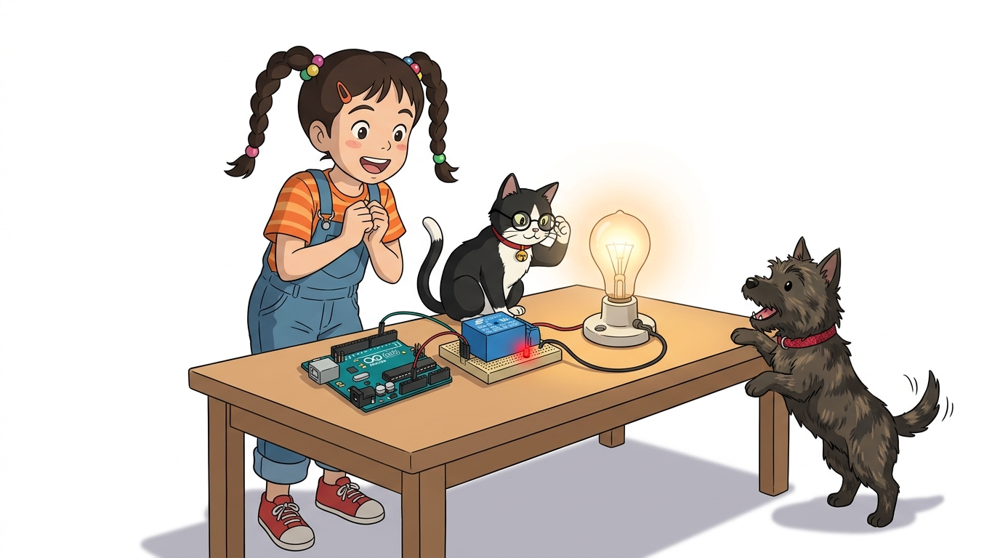
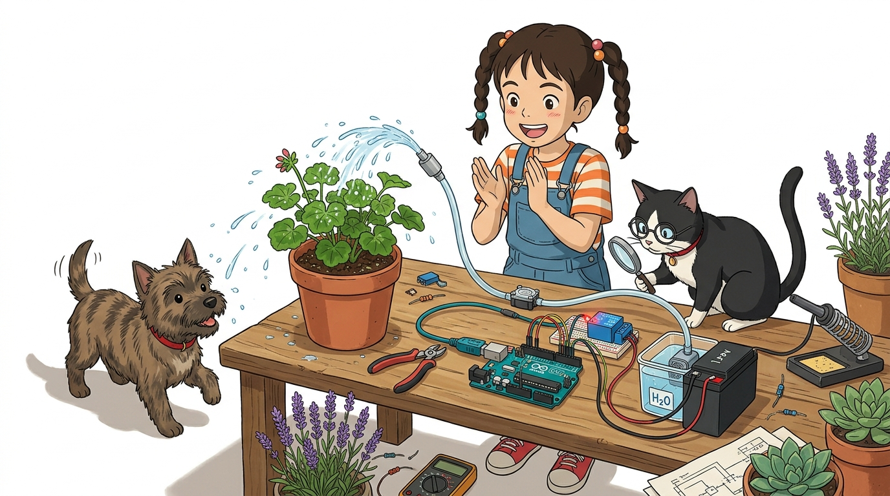
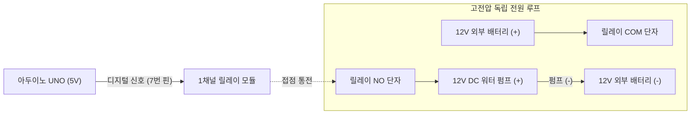

# 095_릴레이_DC모터제어 🧲🏎️



**도로시와 지니가 함께하는 12V 대형 DC 모터와 워터 펌프의 안전한 절연 스위칭 실습**

* 👧 **도로시**: "지니야! 화분에 자동으로 물을 주는 스마트 화분을 만들고 싶어! 그런데 수중 모터 펌프는 12V 대용량 배터리를 써야 한대! 아두이노로 어떻게 안전하게 켜고 끌 수 있어?"
* 🐱 **지니**: "그럴 때 바로 기계식 절연 스위치인 **릴레이(Relay)** 가 출동하는 거야! 12V 배터리 전원선의 중간을 릴레이 스위치에 연결해두면, 아두이노가 5V 신호 하나로 콸콸 쏟아지는 물 펌프를 완벽하게 원격 통제할 수 있단다!"
* 🐶 **토토**: "바우! 토토 목욕물도 콸콸 틀어줄 수 있는 강력한 파워다 멍!"

* 🖥️ **강의 슬라이드**: [slides.md](./slides.md)

---

## 1. 도로시의 프로젝트: 12V 수중 펌프와 스마트 화분 시스템



### 🚰 저전압 제어부(5V)와 고전력 부하(12V)의 완벽한 공존

대용량 DC 모터나 고압 워터 펌프는 기동 시 수 암페어(A)의 피크 전류를 소모합니다. 릴레이를 이용하면 아두이노의 5V 회로와 모터의 12V 회로가 물리적으로 완벽히 격리되므로 안심하고 구동할 수 있습니다.



---

## 2. 완벽 분리! 릴레이와 12V 외장 배터리 하드웨어 결선도


### 🔌 입력 제어 3선과 출력 부하 2선의 명확한 분리

| 회로 영역 | 핀 / 단자 명칭 | 연결 대상 | 기능 설명 |
| :--- | :--- | :--- | :--- |
| **제어 측 (아두이노)** | **VCC** | 아두이노 **5V** | 릴레이 전자석 구동 전원 |
| **제어 측 (아두이노)** | **GND** | 아두이노 **GND** | 신호 기준 접지 |
| **제어 측 (아두이노)** | **IN** | 아두이노 **디지털 7번** | 모터 ON/OFF 제어 디지털 출력 신호 |
| **부하 측 (12V 전원)** | **COM (공통)** | **12V 배터리 (+) 극** | 스위치로 들어가는 주 전력선 |
| **부하 측 (12V 모터)** | **NO (상시 개방)**| **DC 모터 / 펌프 (+) 단자**| 신호가 켜졌을 때만 12V 통전 |
| **부하 측 (접지 루프)**| 모터 (-) 단자 | 12V 배터리 (-) 극 | 모터 전용 귀환 폐루프 완성 |

> [!IMPORTANT]
> **공통 접지(GND) 연결 여부**:
> 릴레이는 완전한 물리적 기계 접점이므로, 12V 배터리의 (-)선과 아두이노의 GND선을 서로 연결하지 않아도 안전하게 동작합니다 (완전 절연 분리).

---

## 3. 실습 코드: 3초간 물 펌프를 켜고 10초간 대기하는 스케치


### 💻 타이머 루프를 활용한 주기적 관수 시스템 구현

```cpp
// 릴레이 제어 핀을 7번으로 지정
const int pumpRelayPin = 7;

void setup() {
  pinMode(pumpRelayPin, OUTPUT);
  digitalWrite(pumpRelayPin, LOW); // 아두이노 부팅 시 펌프는 반드시 꺼진 상태 유지
  
  Serial.begin(9600);
  Serial.println("스마트 화분 릴레이 자동 펌프 시스템 가동!");
}

void loop() {
  Serial.println(">>> 화분에 물 주기 시작! (릴레이 찰칵! ON)");
  digitalWrite(pumpRelayPin, HIGH); // 릴레이 닫힘 -> 12V 펌프 가동
  delay(3000);                      // 3초 동안 충분한 수분 공급

  Serial.println("<<< 물 주기 완료! (릴레이 착! OFF)");
  digitalWrite(pumpRelayPin, LOW);  // 릴레이 열림 -> 12V 전원 차단
  
  // 실제 스마트 화분에서는 토양 수분 센서 값을 읽어 동작하지만,
  // 실습에서는 10초 대기 후 다음 주기로 넘어갑니다.
  delay(10000); // 10초간 휴식 대기
}
```

---

## 4. 트랜지스터 구동 vs 릴레이 구동 심층 비교

| 비교 항목 | 트랜지스터 (BJT / MOSFET) | 기계식 릴레이 (Relay) |
| :--- | :--- | :--- |
| **스위칭 속도** | 초당 수십만 번 이상 (초고속) | 초당 수 번 이내 (물리적 한계) |
| **PWM 속도 제어** | **가능 (부드러운 속도 가감속)** | **불가능 (소음, 아크 방전, 접점 파괴)** |
| **스위칭 소음** | 완전 무음 (반도체) | "찰칵! 착!" 경쾌한 기계음 |
| **전기적 절연** | 소스-드레인 간 절연 없음 | **공기 틈새로 완벽한 갈바닉 절연** |
| **교류(AC) 제어** | 직류(DC) 전용 | **AC 220V / DC 모두 자유롭게 제어 가능** |

---

## 🌟 도로시와 지니의 핵심 요약 노트!


* 👧 **도로시**: "릴레이를 쓰니까 12V 배터리의 강한 전기가 아두이노에 전혀 닿지 않고도 펌프 모터를 찰칵 켤 수 있었어!"
* 🐱 **지니**: "맞아! 릴레이는 전원 ON/OFF 스위칭에는 최고지만, 속도를 조절하는 PWM은 할 수 없단다."
* 🐶 **토토**: "바우! 이제 모터의 속도도 조절하고 방향도 앞으로 뒤로 바꾸는 **DC 모터 드라이버(L298N)** 를 배우러 가보자 멍!"
